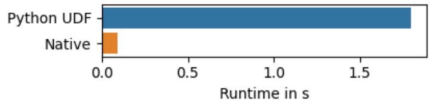
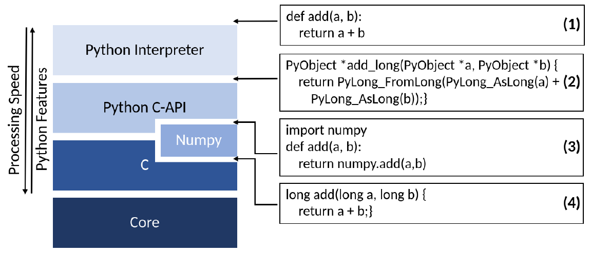
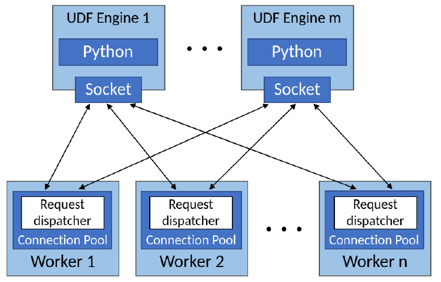
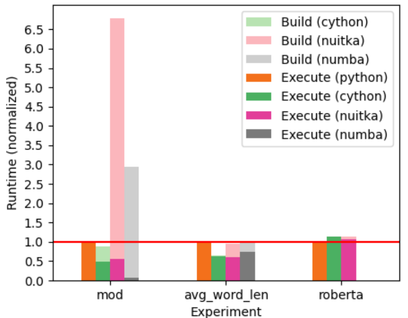
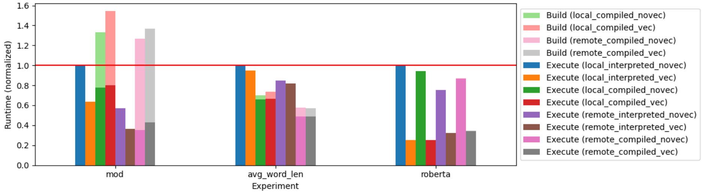

# Accelerating Python UDFs in Vectorized Query Execution（中文译文）

## 译者说明

本文依据同目录的 `source.pdf` 翻译。章节、图表、公式、算法、代码与参考文献按原文结构保留。

**Steffen Kläbe**\*，Actian，德国伊尔梅瑙，<steffen.klaebe@actian.com><br>
**Bobby DeSantis**，Actian，美国帕洛阿尔托，<robert.desantis@actian.com><br>
**Stefan Hagedorn**，伊尔梅瑙工业大学，德国伊尔梅瑙，<stefan.hagedorn@tu-ilmenau.de><br>
**Kai-Uwe Sattler**，伊尔梅瑙工业大学，德国伊尔梅瑙，<kus@tu-ilmenau.de>

\* 工作在伊尔梅瑙工业大学期间完成。

[原作](https://www.cidrdb.org/cidr2022/papers/p33-klaebe.pdf)发表于第 12 届创新数据系统研究年会（CIDR 2022），2022 年 1 月 9–12 日，美国 Chaminade，采用 [CC BY 4.0](https://creativecommons.org/licenses/by/4.0/) 许可。作者保留在个人和企业网站传播原作的权利，须注明原作作者和 CIDR 2022。

## 摘要

现代分析型数据库系统支持用户自定义函数，作为对 SQL 的一种灵活扩展。Python 是最受欢迎的 UDF 语言之一，易于使用，并为数据密集型任务提供了丰富的功能，但其性能和可扩展性较差。本文介绍了利用向量化、并行化和编译来加速嵌入式 Python UDF 执行的办法。我们比较了不同的编译框架，并展示如何在数据库运行期间透明地编译和动态加载 Python 代码，以及如何在查询中调用这些代码。我们的评估表明，编译和并行化结合使用能让多种用例显著加速。

**关键词**　Python 用户自定义函数、Python 编译、Python 并行化、向量化查询执行

## 1. 引言

用户自定义函数（UDF）在现代数据分析中发挥着重要作用。它以灵活、模块化、可复用的方式，帮助用户获得符合自身需求的业务洞察。许多常用的数据仓库系统集成了不同形式的 UDF，以扩展 SQL 前端的功能。视具体系统而定，用户可以用 C/C++、Java、Python、Scala 或 JavaScript 代码定义 UDF，并在 SQL 查询中使用它们。UDF 又可分为两类。标量 UDF 对每个输入元组产生一个结果；表 UDF 针对给定的输入表产生一个结果行数任意的新表，结果也可以为空。近年来，Python 成为数据分析领域最受欢迎、最重要的语言之一。这背后有几个原因。首先，Python 易于编写，便于快速构建原型；比如，类型处理等许多难题由解释器解决，用户无须处理。其次，面向数据清洗、数据分析，特别是机器学习等数据密集型任务，人们已开发出大量框架。这样一来，要从小数据集快速获取洞察，就无须搭建和维护数据库系统、建表及加载数据。因此，Python 的用户面很广，进行数据分析对 SQL 专业知识的要求也随之降低。



**图 1：对 800 万个元组执行基本取模运算时，UDF 与原生实现的性能对比**

提供 Python UDF 提高了数据库系统对各类用户的易用性。不过，UDF 的主要瓶颈是可扩展性。文献 [5] 的分析表明，UDF 占据了查询运行时间的大部分。由于几个原因，这在 Python UDF 上尤为明显。首先，输入数据要从数据库内部表示转换为 Python 格式，UDF 结果则要反向转换。其次，数据要传给数据库引擎外部的 Python 解释器，再将结果发回引擎。第三，Python 解释器解释执行代码通常比数据库引擎执行经过编译和优化的代码慢。对于既可用 UDF 表达、也可用数据库原生算子实现的操作，UDF 与该操作的原生实现之间有很大的性能差距，见图 1。

由于功能丰富，Python UDF 被 Grizzly [6] 等前端框架用来提供高级分析能力。在这种场景下，典型的 UDF 可能很复杂，也可能包含外部模块。为了加速这类分析，本文的主要目标是研究图 1 所示的性能差距，力争尽可能接近原生性能。图 2 展示了从数据库引擎执行 Python 代码的不同层级。使用 Python 解释器 (1) 是最通用的办法，性能也是最差的，所以我们将其作为耗时的上限基线。另一方面，使用纯 C 代码 (4) 的性能最佳，但对 Python 模块的支持有限，因此将其作为耗时的下限基线。通过 Python C API (2)，可以预先编译 Python 代码，限制解释开销，同时仍完整支持 Python 功能。使用 NumPy (3) 是这里的一个特例。虽然 NumPy 代码以 Python 编写，但文献 [13] 表明，得益于类似 C 的内存布局，其速度可接近原生代码。不过，这时的 UDF 仅限 NumPy 操作，碰到非 NumPy 构造时会回退到 (2)。



**图 2：Python 代码的执行层级**

(1) Python 解释器

```python
def add(a, b):
    return a + b
```

(2) Python C API

```c
PyObject *add_long(PyObject *a, PyObject *b) {
    return PyLong_FromLong(PyLong_AsLong(a) + PyLong_AsLong(b));
}
```

(3) NumPy

```python
import numpy
def add(a, b):
    return numpy.add(a,b)
```

(4) C

```c
long add(long a, long b) {
    return a + b;
}
```

本文探讨如何让标量 Python UDF 沿图 2 的执行栈向下移，同时评估以下相互独立的性能改进手段：

- **编译。** 我们评估不同的编译框架，透明地将 Python 代码转换成更低层的代码。此外，我们展示数据库在运行期间如何动态使用编译后的代码。这在解释型查询引擎中颇具挑战，我们为评估提供了开源的原型引擎。
- **向量化。** 我们具体讨论 Python 代码向量化对减少调用开销的影响。
- **并行化。** 我们研究如何在并行查询引擎中并行执行 Python 代码，这需要缓解全局解释器锁（GIL）带来的问题。

## 2. 相关工作

Cython [1] 和 Nuitka[^nuitka] 等 Python 转译器能处理任意 Python 语言构造，尤其也能处理外部模块，但由于仍依赖 Python C API，性能比原生代码差。Numba [7] 等 Python 编译器将 Python 代码转换为原生 C 代码，执行效率较高，但只能使用其支持的语言构造。Numba 支持一组基本 Python 语言构造以及 NumPy 代码，并提供一种可以回退到的“对象模式”，用来处理诸如字符串等对象，此时仍会调用 Python 运行环境。不过，Numba 不允许导入外部库。Tuplex [15] 专注于将以 Python 编写的数据分析流水线编译为原生二进制文件。本文撰写时，该框架尚未公开发布。这些框架都着眼于把 Python 代码编译为二进制文件，并作为独立进程运行。我们的工作研究如何在运行期间将这些框架集成到解释型查询引擎中，从而按需创建和使用编译后的 Python UDF。除这些框架外，GraalVM[^graalvm] 也支持将代码编译为原生镜像，但主要面向 Java 代码，只支持将 Python 作为嵌入 Java 代码的“客体语言”进行编译。该功能仍处于实验阶段，只支持少数 Python 模块。也有几种方法编译以其他语言编写的 UDF。文献 [3] 专注于将解释执行的 PL/SQL UDF 编译为递归 SQL 函数，避免 PL/SQL 和 SQL 之间的上下文切换；文献 [14] 则着眼于即时编译 SQL lambda 函数。

向量化的列式数据库系统 MonetDB 也支持 Python UDF [13]。它通常解释执行 Python 代码，同时针对 NumPy UDF 进行了优化，因为 NumPy 和列存储有相似的存储布局。这样，NumPy UDF 的执行速度接近原生代码。文献 [13] 还指出，编译 Python UDF 会要求将数据库引擎与编译后的 UDF 一起编译、链接，这在数据库运行期间无法做到。我们的方法面向任意 Python 构造，利用动态加载使查询引擎能够在运行期间使用编译后的 UDF。

Python 设计采用了全局解释器锁[^gil]（GIL），以简化并发线程的同步、内存管理等底层细节。这实现了较高的单线程性能，但限制了 Python 代码的并行或多线程执行 [10]。人们已针对动态语言中的 GIL 问题提出了若干解决方案，例如硬件事务内存 [12]、软件事务内存 [10] 或使用虚拟机 [11]。我们采用与虚拟机类似的方式，在并行查询引擎中创建单独的 UDF 引擎进程，实现并行。因为各进程处理独立的数据分区，我们无须进行任何形式的同步。这简化了 GIL 问题，使采用独立的 Python 进程成为合理的方案。

[^nuitka]: <http://nuitka.net/>
[^graalvm]: <https://www.graalvm.org/>
[^gil]: <https://wiki.python.org/moin/GlobalInterpreterLock>

## 3. 编译

如第 2 节所示，有多个框架旨在通过即时编译或预先编译来提升 Python 代码性能。与 Python 代码的解释执行和编译执行类似，过去几十年里，数据库也主要有两种设计方式，即解释型（向量化）查询引擎和编译型查询引擎。解释型查询引擎用一组预定义算子构建查询执行计划，遵循迭代器模型，例如 Volcano 迭代器模型 [4]。编译型查询引擎则为每条具体查询生成代码，再将其编译为可执行程序。与解释型引擎相比，这里需要权衡为每条查询生成及编译代码所付出的额外开销，以及执行经优化和编译的代码时获得的速度提升。在编译型查询引擎的查询中采用即时编译的 UDF 代码，需要链接查询的二进制文件，因而较为直接；在解释型查询引擎中于运行期间使用编译后的代码，则更有挑战性。

本节通过介绍一个支持编译型 UDF 算子的原型引擎，研究如何编译并集成 Python 代码。这些算子负责完成编译、动态加载和 UDF 执行。设计这些算子时考虑了以下挑战：

- **C1 透明性。** 从用户角度看，利用编译后的 UDF 无须额外操作。
- **C2 外部代码。** 为了利用广泛的 Python 框架，UDF 必须能够导入外部库。
- **C3 类型。** 算子需要弥合类型约束严格的数据库系统与弱类型 Python 代码之间的差异。
- **C4 安全性。** 必须保护系统，防止通过 Python UDF 进行未经授权的访问。

### 3.1 引擎设计

我们的原型引擎[^prototype] 遵循现代分析型数据库系统的常见设计，以 C 编写。它是一个内存引擎，按列组织数据。列值以数组形式在内存中紧密排列，从而在遍历数据时实现高效访问。字符串等变长类型存储为指向数据所在内存区域的指针。引擎还遵循 Volcano 迭代器模型 [4]，因此每个算子实现由 `open()`、`next()` 和 `close()` 函数组成的统一接口。`next()` 函数按向量逐批处理。由于构建该原型的目的是探索 UDF 的设计空间，引擎只包含一个基本的文件扫描算子、若干不同的 UDF 算子、在查询结束时“消费”查询结果的逻辑，以及细粒度的性能分析机制。

我们将最常用的编译和转译框架 Numba、Nuitka 和 Cython 集成进原型引擎，每个框架都封装在一个独立的算子中。在调用 `open()` 期间，相应框架编译 UDF 代码，将其动态加载进运行中的引擎并完成初始化。作为基线，我们还设计了一个基于 Python C API[^capi] 的原生 Python UDF 算子。为了达到 C1 的透明性目标，如果编译或加载出错，可以回退到原生 Python 算子。

[^prototype]: <https://github.com/dbis-ilm/Compiled_UDF_engine>
[^capi]: <https://docs.python.org/3.6/c-api/>

### 3.2 UDF 编译

所用的各个框架在 UDF 编译步骤上相似，只有一些细节随框架而异。不过，这些框架都面临同一个挑战，与 Python 处理导入模块的方式有关。所有框架原本都旨在生成编译好的模块，再交给 Python 解释器使用。遇到 `import` 语句时，Python 解释器会调用模块的初始化方法，初始化模块，并提供访问模块内函数的入口。后续的函数调用通过这个入口解析。因此，模块中的函数对模块外的代码不可见，对我们这个运行在 Python 上下文之外的查询引擎尤其如此。

要让 UDF 代码可见，可以手动改写生成的代码。不过，不同框架的改写方式在根本上不同，这会让编译过程高度依赖框架的版本，因为代码生成中的每一次变化都要求调整手动改写的方式。编译步骤的设计目标是尽可能摆脱对所用框架的依赖。因此，我们用一个偏底层的技巧来解决这个问题。编译时，将框架配置为保留编译代码的中间产物。这样，在目标文件被链接成共享库之前，就能访问这些采用可执行与可链接格式（ELF）的目标文件。ELF 是共享库、目标文件和可执行文件的一种标准格式，文件头和各数据段有固定的结构，能以灵活的方式表示代码和数据。ELF 使用符号表维护符号引用，如函数符号，以及它们在代码段中的对应位置。当函数符号属于动态符号表且具有全局可见性和默认绑定属性时，它们在库或可执行文件之外可见。我们借助 LIEF[^lief] 等 ELF 操作工具，对 UDF 对应的函数符号的可见性和绑定进行相应调整，再重复执行最后一个编译步骤，生成共享库。因此，我们为了屏蔽框架差异而接受这部分重复工作。我们无须更改框架的编译行为来修改生成的中间文件，只需重复最后的链接步骤。

在编译步骤中，我们也迈出了解决挑战 C3 的第一步。创建 UDF 时，用户需要指定函数的输入和输出数据类型。这不构成限制，因为将来集成到完整数据库系统时也能取得这些元数据，届时用户需要在 `CREATE FUNCTION` 查询中指定这些类型。必要时，我们会使用这些元数据给 UDF 代码加注，例如在使用 Numba 时。此外，挑战 C2 所指的外部模块支持由编译框架本身决定，因此由框架自动提供。Numba 框架是个例外，它只支持导入 NumPy 库。为了满足挑战 C4 的安全性目标，我们维护一份模块禁用清单，在编译前扫描 UDF 代码是否包含清单中的项目。这样可避免用户执行可能危及系统或底层环境的语句，例如使用 `os` 或 `sys` 模块的语句。

编译过程由一个 Python 脚本执行，其中包含调用框架、调整符号可见性和重新执行最后一个编译步骤。由于此脚本由 Python 编写，且在数据库运行期间不会改变，可以用这个编译脚本编译它自身，生成包含编译逻辑的共享库，再将该库动态链接到数据库引擎。因此，调用库中的函数比从数据库引擎发起调用来运行 Python 脚本更快。

[^lief]: <https://github.com/lief-project/LIEF>

### 3.3 动态加载和初始化

编译完成后，包含 UDF 的库必须存放在一个明确且系统可以访问的位置。在单服务器数据库系统中，这很容易做到。我们认为，即便在分布式数据库系统中，这也不构成限制，因为云环境有云存储，本地部署的集群方案则有 HDFS 等共享存储。接下来，通过 `dlopen` 和 `dlsym`[^dlsym] 将库动态加载到正在运行的数据库应用程序中。加载步骤的目标是尽可能减少后续执行所需的工作，尤其是代价较高的分支判断。

Cython、Nuitka 和 Numba 的对象模式基于 Python 的 `PyObject`。它是 Python C API 的类型抽象，可以容纳任意类型。对这些框架，我们按 UDF 的签名初始化输入和输出转换函数，并将它们存为函数指针，以免在执行期间进行分支判断。不过，实际 UDF 的签名可以包含任意组合的参数类型。编译数据库引擎时无法知道具体签名，所以我们定义了一个占位函数类型，并为每种可能的 UDF 签名生成一个包装函数和一个函数定义。在实践中，UDF 可能的参数个数必须控制在合理范围内。加载时根据 UDF 签名选定相应的包装函数，因此只需进行一次分支判断。清单 1 以一个接受 `long` 和 `double` 参数并返回 `double` 的 UDF 为例。包装函数转换通用输入参数以及实际 UDF 的类型，再调用 UDF。结果随后存放在指定的缓冲区位置，该位置属于结果向量。将包装代码存为函数指针，可以避免 UDF 执行期间的分支判断，同时解决挑战 C3 的类型处理问题。

**清单 1：包装代码示例**

```c
typedef void (*fplaceholder)(void);
typedef void (*WrapperFunc)(fplaceholder, char **, char **);
// For every parameter combination
typedef double (*dld)(long, double);
void func_38(fplaceholder f, char **params, char **out) {
    long *p0 = (long *) &params[0];
    double *p1 = (double *) &params[1];
    *((double *)out) = ((dld)f)(*p0, *p1);
}
```

除了加载 UDF，如果编译框架需要，我们还会加载库初始化函数的符号。对于 Cython、Nuitka 和 Numba 对象模式，我们随后在 Python 运行环境中初始化模块，也可能使用 Python 的多阶段初始化[^init]。注意，这一步可能发生在引擎启动时初始化 Python 解释器之后，具体取决于系统如何使用 Python 解释器，即长期运行同一个解释器，还是每条查询启动一个解释器或子解释器。模块初始化使我们能够访问模块内部的数据结构和辅助函数，效果相当于 Python 的 `import` 语句。

[^dlsym]: <https://linux.die.net/man/3/dlsym>
[^init]: <https://www.python.org/dev/peps/pep-0489/>

### 3.4 UDF 执行

如第 3.1 节所述，我们的原型引擎使用列式存储布局，按向量逐批处理，并遵循 Volcano 迭代器模型。因此，每个 UDF 算子从查询树中的子算子接收一组向量，每列一个。算子保持这些向量原样，并把承载 UDF 输出的结果向量加入中间结果。如果所用的编译框架有要求，就通过相应的输入转换函数将 UDF 输入值转换成 `Py_Object` 元素。然后经包装函数调用编译后的 UDF，必要时通过输出转换函数将结果转换回来。这三个步骤以向量化方式完成。请注意，由于函数指针已在动态加载和初始化阶段设好（见第 3.3 节），这里没有分支判断。

执行引擎的另一个重要方面是 NULL 处理。我们的方法基本上有两个选择，即在数据库引擎中处理，或在 UDF 代码中处理。如果在引擎内部处理，就需要只对非 NULL 值执行 UDF。在向量化版本中，还需要跟踪向量内部的偏移量，才能在 UDF 执行后把结果放回正确位置。若在 UDF 中处理 NULL，输入转换只需生成 `Py_None`，作为 Python 中表示 NULL 的值。我们的引擎原型选择第二种方案，在 UDF 中处理 NULL，使用户可以更灵活地应对 NULL。可以设想一些用例，其中 UDF 需要显式处理部分参数为 NULL 的情况。如果引擎在内部处理 NULL 时跳过 UDF 调用，就无法支持这些用例。

译注：本节中的 `Py_Object` 和 `Py_None` 按原文字形保留。

## 4. 向量化

UDF 的执行性能在很大程度上取决于代码的写法。在商业系统中，用户编写的 UDF 代码很可能会被封装进一个代码模板。这样可以实现定制的错误检查、复杂类型的转换与解释，以及向量迭代机制。可以设想一个由主函数以不同方式调用的用户函数。如果用户代码按元组逐个处理，向量每个元素都会触发一次用户函数调用，产生显著的调用开销。如果用户代码按向量逐批处理，就只调用一次用户函数，速度显著提高。在设计过程中，我们发现 Python 代码内部的调用开销是最限制性能的因素之一。预分配结果向量并使用列表推导式的向量化 UDF 性能最好；使用多个输入向量时，可以先将它们按对应位置配对。

在项目目前的阶段，UDF 向量化由用户手动启用。用户需要 (1) 把 UDF 代码改成向量化版本，以及 (2) 在 UDF 名称中用前缀标明采用向量化。为进一步改善易用性并达到 C1 的透明性目标，我们计划日后开发自动改写 UDF 的机制，把 UDF 代码嵌入向量化模板。

## 5. 并行化

按第 3 节所述编译 UDF，是为了提高向量化解释型查询引擎执行 UDF 的单核性能。不过，如今的分析型数据库系统通常采用大规模并行处理（MPP），以利用每个插槽上不断增多的核心，并能在集群环境中扩展系统。本节介绍如何扩展 UDF 执行。这与前述编译方法相互独立。



**图 3：UDF 引擎池概览**

我们假定 MPP 系统运行多个工作单元（worker），以在独立的数据分区上并行执行查询计划或子计划。将我们的编译型 UDF 方案集成进这样的系统时，仍需使用 Python 运行环境的框架（Cython、Nuitka、Numba 对象模式）会共享 Python 解释器。如第 2 节所述，GIL 在这种情况下会造成严重争用。因此，让 Python 并行执行可以缓解 GIL 问题。我们没有使用专门的事务内存，而是设计了与实际数据库工作单元分开运行的 UDF 引擎进程，如图 3 所示。注意，数据库工作单元可以是进程或线程，但 UDF 引擎是独立进程。这些 UDF 引擎各自启动自己的 Python 运行环境，由进程语义相互隔离。数据库工作单元和 UDF 引擎可以独立扩展，通过点对点套接字连接通信。在数据库引擎侧，这些连接由连接池维护，请求即 UDF 执行请求，按调度策略分发。目前，我们用简单的轮询策略把请求分配到各 UDF 引擎。由于向量大小固定，这个简单的策略就能让各 UDF 引擎的利用率较为均衡。即便数据存在倾斜，数据库工作单元之间不均衡的负载也可以在 UDF 引擎之间均摊。执行后，结果通过套接字连接发回数据库工作单元。这种“远程 UDF”方案同样涉及权衡。它引入了进程间通信和数据传输，同时实现了 Python 运行环境中的并行执行。将 Python 执行迁到独立进程还有一个附带效果，即提供了提高 Python 运行安全性的途径，例如在容器中运行 UDF 引擎。把 Python 执行限制在沙箱内是个复杂问题，因而 Python UDF 有时只作为测试版功能提供，或者需要管理员权限，例如 Postgres[^plpython]。因此，本文不讨论 Python 执行的沙箱化。

[^plpython]: <https://www.postgresql.org/docs/13/plpython.html>

## 6. 评估

评估中，我们比较了集成框架所生成的代码，以及编译、向量化与并行化各自的影响。评估机器配有 Intel(R) Core(TM) i7-8565U CPU @ 1.80GHz 和 24 GB 内存。我们设计了一组实验，代表不同的用例：

- **Mod。** 简单的取模 UDF，代表数学运算。
- **Avg_word_len。** 拆分字符串并计算平均词长，代表需要读取整个字符串的字符串分析函数。
- **Roberta。** 使用 Roberta ONNX 模型 [8] 分析文本的情感倾向。

实验使用 TPC-H [2] 在 SF10 下的 `partsupp` 表，以及 IMDB 影评数据集 [9]。第一个实验在原型查询引擎上比较集成的编译框架的表现。在该实验中，我们按第 4 节所述手动编写封装后的 UDF 代码，以模拟集成进数据库系统后的行为。



**图 4：在原型引擎中比较编译框架**

图 4 展示了上述实验的结果。运行时间以原生 Python 算子的运行时间为基准进行归一化。计入编译的构建耗时在各实验中处于相近的数量级，但它占总耗时的比例随执行耗时而变化。取模实验中，所有编译框架都带来了性能收益，其中 Numba 表现最好，因为在该示例中，它产生了与下限基线等价的原生 C 代码。它达到了图 2 执行栈的 (4) 层，运行速度约为基准的 20 倍。在 `avg_word_len` 示例的字符串分析中，所有框架同样都带来了性能收益。不过，Numba 比 Nuitka 和 Cython 慢，因为它回退到 Python 对象模式来处理字符串。Roberta 示例使用了导入的模块，因此无法使用 Numba。编译框架显然无法改变模块代码，也无法影响占该示例大部分运行时间的 ONNX 运行环境，所以在这里编译没有带来显著收益。由于我们的目标是提供对所有用例都透明适用的方案，不能选用 Numba。Nuitka 和 Cython 都达到了图 2 执行栈的 (2) 层，并在所有用例中表现出相近的性能，数学运算和字符串分析的速度约提高到 2 倍。Cython 的编译开销则明显更低。

根据第一个实验，我们以 Cython 为编译框架，将 UDF 方案集成进 6.1 版 Actian Vector 数据库系统。因此，第二个实验运行在图 2 执行栈的 (2) 层，并使用编译、向量化和并行化的不同组合来评估端到端查询性能。查询包含扫描、UDF 以及对结果的聚合，以便减小结果规模。



**图 5：Actian Vector 实验结果**

运行时间结果见图 5，同样以基准运行时间归一化，此处的基准是解释执行、未向量化且未并行化的版本。与对应的解释执行版本相比，编译带来显著收益。符合预期的是，Roberta 示例中编译只比解释执行略好，因为大部分时间花在 ONNX 运行环境中。向量化也几乎在每种情况下都带来性能收益，编译后的版本除外，因为 Cython 框架似乎难以为列表推导式生成高效的代码。Cython 提供一种扩展的 Python 方言，可对带有特定标注的代码构造进行更高效的编译。将来可以利用这一点，自动把用户定义的 Python 代码改写为 Cython 方言，以生成运行更快的编译代码。不过，Roberta 尤其受益于向量化，因为按向量处理时，ONNX 模型每个向量只需加载一次，逐元组处理时则要对每个元组加载一次。把并行度设为 4，用 4 个远程 UDF 引擎进程来并行执行，可进一步提升我们各项实验的性能，Roberta 示例除外，因为这项实验依赖 ONNX 运行时的可扩展性。综合评估，我们得出以下主要发现：

- 要以透明方式支持任意 Python 代码，只能达到图 2 执行栈的 (2) 层。
- 编译和并行化结合，在多数实验中取得最佳性能，速度是 Python 执行方式的 2–3 倍。
- 编译对依赖外部模块的函数没有影响。
- 通过外部 UDF 进程实现并行化会引入进程间数据交换开销，但可缓解 GIL 问题，从而加快执行。
- 向量化减少了 Python 调用开销，因而能提高性能。

因此，这些手段适用于多种用例，包括用户特定的计算、评分函数、分析，以及机器学习的预处理或后处理步骤。

## 7. 结论

用户自定义的 Python 函数是数据库引擎易于使用的扩展，可为现代分析任务提供支持。鉴于 Python 代码执行性能较差且难于扩展，我们探索了在向量化查询引擎中加速 Python UDF 的设计空间。我们评估了向量化、并行化和编译的影响，其中编译通过多种已有的编译框架实现。我们展示了如何在数据库运行期间即时编译 UDF、动态加载并在查询执行中使用它们，还将这项功能实现为开源原型引擎。此外，我们提出了采用独立的 UDF 引擎进程的方案，以缓解 Python 的 GIL 问题，支持并行执行 UDF。在评估中，我们将 Cython 编译框架集成进 Actian Vector 数据库系统，测试了有代表性的用例的端到端查询性能。结合使用编译与并行化后，我们在不同用例上取得了显著加速。我们把透明性作为主要设计目标，因此所介绍的方法易于使用，并且可以处理任意 Python 代码构造。未来，我们计划评估自动代码改写，以利用特定编译框架的特性和标注。机器学习工作负载仍依赖外部运行环境的性能，更原生地集成机器学习模型或许可以减轻这种依赖。

## 参考文献

1. S. Behnel et al. Cython: The Best of Both Worlds. *Computing in Science & Engineering*, 13, 2011.
2. P. A. Boncz, T. Neumann, and O. Erling. TPC-H Analyzed: Hidden Messages and Lessons Learned from an Influential Benchmark. In *TPCTC*, volume 8391, pages 61–76. 2014.
3. C. Duta, D. Hirn, and T. Grust. Compiling PL/SQL away. In *CIDR*, 2020.
4. G. Graefe. Volcano— An Extensible and Parallel Query Evaluation System. *IEEE Trans. on Knowl. and Data Eng.*, 6(1):120–135, 1994.
5. S. Gupta and K. Ramachandra. Procedural Extensions of SQL: Understanding their usage in the wild. *PVLDB*, 14(8):14, 2021.
6. S. Kläbe and S. Hagedorn. Applying machine learning models to scalable dataframes with grizzly. In *BTW*, pages 195–214, 2021.
7. S. K. Lam, A. Pitrou, and S. Seibert. Numba: A LLVM-Based Python JIT Compiler. In *LLVM*, 2015.
8. Y. Liu et al. RoBERTa: A Robustly Optimized BERT Pretraining Approach, 2019. _eprint: 1907.11692.
9. A. L. Maas and others. Learning Word Vectors for Sentiment Analysis. In *ACL-HLT*, pages 142–150, 2011.
10. R. Meier and A. Rigo. A way forward in parallelising dynamic languages. In *ICOOOLPS*, pages 1–4, Uppsala, Sweden, 2014.
11. R. Meier, A. Rigo, and T. R. Gross. Virtual machine design for parallel dynamic programming languages. *PACMPL*, 2:1–25, 2018.
12. R. Odaira, J. G. Castanos, and H. Tomari. Eliminating global interpreter locks in ruby through hardware transactional memory. In *PPoPP*, pages 131–142, Orlando, Florida, USA, 2014.
13. M. Raasveldt and H. Mühleisen. Vectorized UDFs in Column-Stores. In *SSDBM*, pages 1–12, 2016.
14. M. E. Schüle et al. Freedom for the SQL-Lambda: Just-in-Time-Compiling User-Injected Functions in PostgreSQL. In *SSDBM*, 2020.
15. L. Spiegelberg et al. Tuplex: Data Science in Python at Native Code Speed. In *SIGMOD*, pages 1718–1731, 2021.
