# Adaptive Factorization Using Linear-Chained Hash Tables（中文译文）

## 译者说明

本文依据同目录的 `source.pdf` 翻译。章节、图表、公式、算法、代码与参考文献按原文结构保留。

Paul Groß*、Daniel ten Wolde*、Peter Boncz

Centrum Wiskunde & Informatica，荷兰阿姆斯特丹。联系方式分别为：gross@cwi.nl、dljtw@cwi.nl、boncz@cwi.nl。

*前两位作者对本研究贡献相同。

本文以 Creative Commons Attribution 4.0 International（CC-BY 4.0）许可发布。第 15 届创新数据系统研究会议（CIDR ’25），2025 年 1 月 19–22 日，荷兰阿姆斯特丹。

## 摘要

我们在 DuckDB 中引入了因子化聚合和最坏情况最优连接，并采用自适应机制，仅在它们能够改善查询性能时使用。这项工作以一种新的等值连接哈希表设计——“线性探测链式”（Linear-Chained）哈希表——的采用为基础。我们的第一个认识是，这种新设计中不含冲突的链，能够支持高效的因子化处理和最坏情况最优处理。我们进一步把是否使用因子化和最坏情况最优连接的决策，从优化阶段推迟到运行时。第二个认识是，即使连接输入缺少统计信息，例如输入是子查询或 Parquet 文件，我们仍可在哈希连接构建期间，利用运行时启发式信息并高效地即时构造统计草图，获得准确的统计信息。最后，我们表明，使用这些指标的机器学习模型能够以很高的准确率实现接近最优的性能。此外，我们提出了基于启发式的方法，它们能获得与这些模型相当的性能，同时依赖的运行时统计信息获取成本更低，也更容易解释。

## 1 引言

围绕最坏情况最优连接（worst-case-optimal join，WCOJ）[19] 和因子化 [20] 的大量研究，已经找到了相较于传统方法能降低某些查询复杂度类别的算法。然而，因子化技术迄今尚未进入主流系统；即便在已经部署 WCOJ 的系统中，它们也仍然面临查询优化方面的挑战。通常，这些技术需要至少与查询输入规模成正比的前期投入，例如排序或创建 trie 等专门的数据结构，随后还涉及更复杂的逻辑。因此，通常只有当查询的中间结果显著大于输入和输出时，才能获得更快的结果：此时，避免生成这些中间结果所节省的代价，足以抵偿上述前期投入和复杂逻辑 [5]。因此，新算法不能替代传统算法，而是成为优化器在适当时机选择的新选项。遗憾的是，这类查询的代价难以估计，需要图数据库系统率先探索的专门统计信息 [7]；但在实践中，基表上并没有建立和维护这些统计信息，事先也很难证明这样做值得。

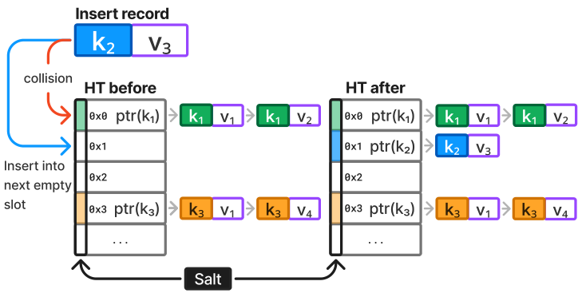

图 1：线性探测链式哈希表结合了线性探测与链式组织。插入 $k_2$ 时会与 $k_1$ 发生哈希冲突，因此将 $k_2$ 插入下一个可用桶。链由具有相同键的记录组成。

本文通过让因子化和 WCOJ 具备自适应能力来打破这一困境，贡献如下：

- “线性探测链式”哈希表设计：用线性探测处理键冲突，用链组织重复键。
- 在 DuckDB [21] 中利用这种哈希表实现因子化聚合与 WCOJ，并对其进行评估。
- 将算法选择从查询优化阶段推迟到运行时的机制：把哈希连接构建期间生成的草图统计信息输入一个准确率较高的简单模型。

**背景。** DuckDB [21] 是最初由 CWI 开发的可嵌入分析型数据库系统。它具有推送式向量化执行引擎 [6]，采用 morsel 驱动的多核并行机制 [15]。DuckDB 使用压缩列式存储和基于 MinMax 的谓词下推 [1]，并在所有列上保留 HyperLogLog（HLL）统计信息，用于连接基数估计 [10]。许多算子支持超出内存容量的数据处理 [14]。此外，它具有功能丰富的扩展框架，可以添加解析器规则、优化器规则，以及引入新的算子或 UDF [24]。DuckPGQ [24] 就是这样的一个扩展，它增加了 SQL:2023 中 SQL/PGQ 的支持。DuckPGQ 将图模式匹配查询转换为包含多个 n:m 连接的关系查询计划。这些计划可以触发本文介绍的 WCOJ 和因子化聚合。不过，我们的工作面向 DuckDB 中的所有 SQL 查询，而不仅仅是以 SQL/PGQ 表达的查询。

传统系统按照某种表连接顺序，一次连接一张表。相比之下，Leapfrog Triejoin [25] 等 WCOJ 算法会一次性处理整个连接图。它们对连接属性排序，并为每个属性值找出一个元组绑定列表。随后，按照选定的顺序对所有属性的这些列表求交，利用数据结构保证求交运行时间与最短列表的长度处于同一数量级；这通常涉及 trie [9, 19, 25]。注意，WCOJ 仍会产生冗余。仅就生成查询结果而言，它按定义是最坏情况最优的，但结果本身仍可能冗余。例如，在社交网络的多步好友查询中，对于拥有同一好友的所有人，从这个好友继续向后的连接绑定都是相同的。因子化查询处理 [3] 旨在用紧凑表示来表示查询结果，从而避免这类冗余。这些结构利用代数方法压缩结果 [11, 17, 20]。例如，如果存在从用户 $A$ 到用户 $B$、 $C$、 $D$ 的好友关系，可以用扁平元组表示为 $\langle A\rangle\times\langle B\rangle\lor\langle A\rangle\times\langle C\rangle\lor\langle A\rangle\times\langle D\rangle$ 。相应的因子化表示 $\langle A\rangle\times(\langle B\rangle\lor\langle C\rangle\lor\langle D\rangle)$ 更加稀疏。

我们的因子化处理建立在 3D Hash Join [8] 的思想之上，后者使用分层链式组织。对于每个桶，首先有一条包含冲突键的链；对每个键，再有另一条包含指向该键各条记录的指针的链。这种数据结构只对重复值频繁出现的连接高效。这里，我们提出的线性探测链式哈希表对所有等值连接都有效，并支持因子化处理。

我们的工作与 Umbra 中正在进行的研究 [5] 很接近：与 3D Hash Join [8] 类似，该研究也把连接拆分成产生链指针的查找阶段和后续展开阶段。在 [5] 中，作者关注独立重排连接查找算子与展开算子带来的查询优化机会，也研究了将 WCOJ 集成到其因子化框架中。我们的不同之处在于，还研究因子化聚合，以及如何通过即时计算的启发式信息和草图，把因子化查询的优化移到运行时，从而避免要求基表具备详细统计信息。

Kùzu 图数据库系统包含因子化处理和 WCOJ [13]，但查询优化仍然是一个挑战——我们发现，即使对于三角形查询，它也需要优化器提示才能生成 WCOJ。涉及多个 n:m 连接的图查询优化是一个活跃的研究课题，例如 [7] 在基数估计上取得了进展。但在一般情况下，估计误差仍然很大 [17]。通过直接在连接输入上即时计算统计信息，我们绕过了其中许多问题。

**文章结构。** 第 2 节介绍 DuckDB 中因子化查询处理的实现，以及它在聚合与连接查询中的应用。第 3 节介绍如何即时计算和利用草图，使因子化在运行时自适应。最后，第 4 节进行性能评估，第 5 节总结并提出未来工作方向。

## 2 线性探测链式哈希表

线性哈希表直接把记录存储在哈希桶中，因此一次查找通常只产生一次 CPU 缓存未命中。虽然很多系统对聚合算子（`GROUP BY`）使用线性探测，但哈希连接通常采用桶链式组织。桶链式哈希表将记录与哈希桶分开存储，因此查找通常产生两次缓存未命中：一次访问桶，另一次访问记录。与聚合不同，连接哈希表可能包含大量重复键；在这种情况下，线性哈希表的表现比链式哈希表差 [4]。链式组织的第二个优势在于构建阶段，其第一步是物化记录：对链式组织而言，这一步不需要并行同步，而线性探测需要。第三个优势是能够高效处理具有过滤效果的连接：在存放 64 位记录指针的桶的最高 16 位中，保留一个小型 Bloom 过滤器（“salt”），就能在不访问记录的情况下识别找不到匹配的查询 [15]。因此，具有过滤效果的负载不需要把记录保留在 CPU 缓存中；桶又比记录小得多，因而比线性哈希表更容易装入缓存。

此外，我们使用 salt 的最高位标记：在构建过程中，该桶是否曾发生哈希冲突。探测该桶时，就可以检查这个冲突位，判断在 salt 不匹配的情况下是否必须继续线性探测。

作为这项工作的一部分，DuckDB v1.1.0 采用了本文提出的线性探测链式哈希表。它是一种桶链式哈希表，但当新插入的键与已经插入的不同键发生冲突时，会通过线性探测解决，如图 1 所示。为利用缓存局部性，我们的实现在发生冲突时尝试下一个桶；不过，也可以使用平方探测等其他冲突处理策略。

这样，只有多条记录具有相同键时才使用链。由于每个桶只保存一个键的记录，salt 不再是每个键设置若干位的小型 Bloom 过滤器，而变成了一个 15 位哈希值，能够以较低计算成本获得较低的假阳性率。

与 DuckDB 原先的哈希表相比，这种方法既有利于处理具有过滤效果的连接——得益于准确的 salt——也有利于处理包含大量重复值的连接：第一次探测命中后，对同一键的所有后续命中都能直接从纯粹由同键记录组成的链中生成，无需比较键。缺点是：如果桶非空，插入时需要额外进行键相等性检查。如果非空是由重复键造成的，那么探测阶段的优势足以抵偿这个缺点；因此，只有真正的哈希冲突才会产生负面影响，而 DuckDB 为桶分配了较充裕的空间（桶数约为记录数的 2 倍），所以这种冲突很少。

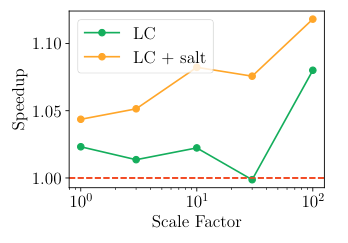

图 2：带 salt 的线性链式组织（LC）改善了 TPC-H 性能。

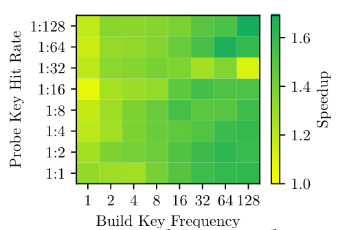

图 3：LC 的效果随过滤能力（冲突位与 salt）和构建键频率而改善。

图 2 展示了线性探测链式哈希表相较于 DuckDB 先前哈希连接实现，在所有 TPC-H 查询总运行时间上的加速比。不采用 salt 优化时，加速比通常接近基线，但随着规模因子增大而提高。采用 salt 优化后，新连接实现对每个规模因子都更快，且规模因子越大，性能改善越明显。这表明 salt 能减少缓存未命中次数，而哈希表越大，这一点越重要。图 3 的矩阵对构建侧不同的重复键频率（X 轴）和探测命中率（Y 轴）进行了全面测试。实验选择的探测侧基数为 $2^{28}$ ，构建侧基数为 $2^{24}$ 。矩阵表明没有出现性能回退，加速比随构建键的出现频率提高而增大，因为同键链减少了比较次数。此外，过滤能力较强的连接也获得了加速，因为它们同时受益于 salt 比较和冲突位。不过，过滤能力较强的查询的加速比较低，因为许多同键链不会被探测，使得为保证链中键相同而付出的工作变得多余。对本文而言，关键在于线性探测链式哈希表为因子化处理提供了基础。

**利用线性探测链式哈希表。** 现在，我们可以把 3D Hash Join [8] 的思想应用到 DuckDB：让连接探测输出指向哈希表中某条链的链指针，而不是为同一键的每次命中都生成一个结果元组，将结果展开。在因子化理论中，这种实用思想被称为 *d-representation*（d 表示）[17, 20]，即通过指向结果的定义来实现因子化。与 *f-representation*（f 表示）相比，这种方法可以通过重复输出同一链指针，多次复用同一个定义。两种表示都避免了连接展开，但在 d 表示中，用于扩展输入的值列表只计算并存储一次；相反，在 f 表示中，它可能会被计算和存储多次。3D Hash Join 论文仅使用因子化来推迟连接展开，以便同一流水线中更上层的过滤器或具有过滤效果的连接，在展开前消除元组（“延迟去嵌套”）。我们进一步在 n:m 连接上的（分组）聚合和环形哈希连接中探索这一思想，也就是在能够避免连接展开、因子化收益较高的情况下使用它。

**可因子化聚合**包括 `MIN(expr)`、`MAX(expr)`、`SUM(expr)` 和 `COUNT(expr)` 这样的可组合函数，其 `GROUP BY`（如果存在）不依赖于查询流水线下方某个尚未展开的连接的构建侧。如果聚合输入 `expr` 也不依赖构建侧，那么根本无需展开这些连接即可计算结果；对 `SUM` 和 `COUNT` 而言，只需将结果乘以链长。此外，如果某个可组合聚合的输入 `expr` 来自因子化连接的构建侧，就可以在计算后（部分地）缓存它。这些缓存的部分聚合的优势在于只计算一次，而同一个键可能被探测多次，因此可以减少内存访问和计算。哈希表构建完成后，不同链的数量就已知了。我们使用一个大小等于该数量的数组，其中保存链指针，并留出存储部分聚合结果的空间，如图 4 所示。连接探测随后输出指向该数组的指针，而不是直接输出链指针。

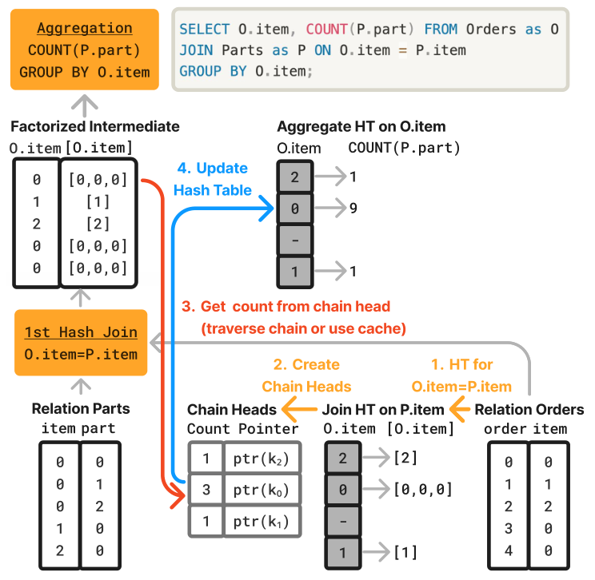

图 4：缓存的 `COUNT(expr)` 聚合计算：共享同一指针的探测元组可以使用链头的聚合值，避免为计数而重复遍历。

图 4 中的查询如下：

```sql
SELECT O.item, COUNT(P.part) FROM Orders as O
JOIN Parts as P ON O.item = P.item
GROUP BY O.item;
```

我们设计了一个微基准，评估聚合中使用缓存和不使用缓存时的因子化性能。该基准涉及两张表：`Orders` 有 500,000 行，包含 10,000 个不同的 item ID；`Parts` 有 1,000,000 行，包含 50,000 个不同的 part ID 和 10,000 个不同的 item ID。

该基准使用的查询位于图 4 右上角。我们使用 DuckDB 的非因子化查询计划作为基线。由于构建侧有重复值，该计划会展开探测元组，从而产生庞大的中间结果。由于连接和聚合在同一个键 `o.item` 上执行，可以选择因子化计划。利用前述缓存优化，我们对每个键只计算一次聚合，然后缓存结果供后续访问，如图 4 所示。

`Orders` 较小，因此作为构建侧。以 item 为键，500,000 条记录和 10,000 个不同值使哈希表的平均链长为 50。这将因子化中间结果的大小降至扁平结果的 2%。在聚合时，每个 item 键平均出现 100 次。第一次访问某条链时，我们遍历它获得链长，然后缓存该值。因此，仅有 1% 的访问需要完整遍历。图 5 表明，即便不使用缓存，因子化也能改善性能，获得 1.25 倍加速。启用缓存后，运行时间显著改善，获得 17.58 倍加速。

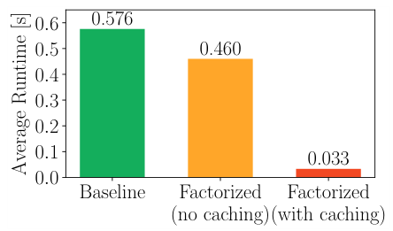

图 5：使用缓存与不使用缓存时的因子化收益。

**最坏情况最优连接**对 n:m 连接上的环形模式可能尤其高效，例如图 1 所示的模式。〔译注：原文此处引用“图 1”，但图 1 展示的是哈希表；环形连接计划和连接结构分别见图 6、图 7。〕在图中查找环是一项常见任务 [22]，但从系统角度看很有挑战，因为中间结果规模显著大于最终结果。在 DuckDB 的标准连接查询计划中，示例三角形查询通过两个（哈希）等值连接执行：第一个连接匹配关系 `R.dst=S.src`，第二个通过 `S.dst=T.src` 和 `T.dst=R.src` 闭合环。具体而言，第一个哈希表在表 `S` 上以 `S.src` 为键构建，第二个哈希表在表 `T` 上以 `T.src` 和 `T.dst` 的组合为键构建。

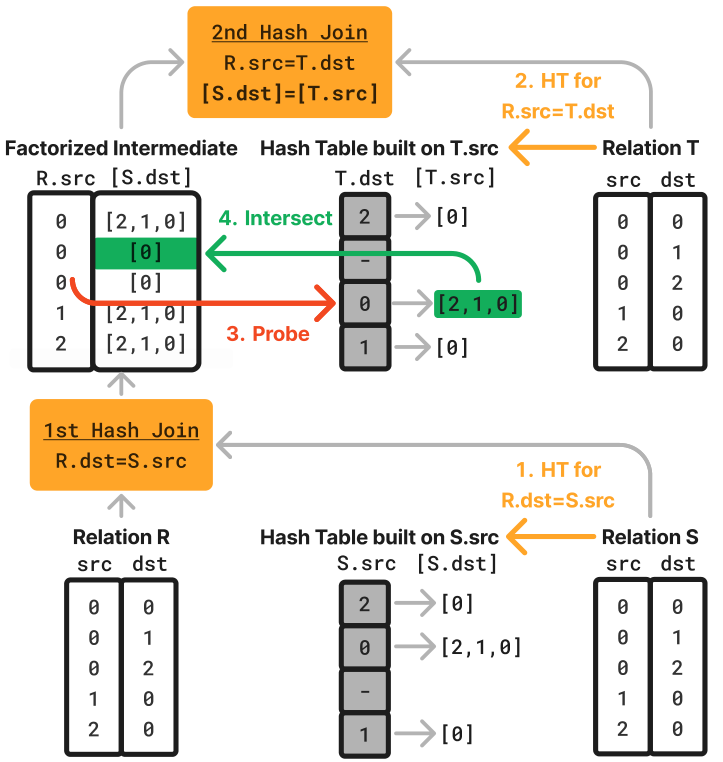

图 6：DuckDB 中的 WCOJ 计划。第一个连接探测找到一个列表（链指针），第二个连接也是如此。随后，对这两个列表求交以生成结果。

〔译注：图 6 右侧哈希表上方写有 “Hash Table built on T.src”，但该图列标题为 `T.dst [T.src]`，构建箭头及正文说明的查找键为 `T.dst`；此处保留原图。〕

```sql
# "follows" has edges
# (a "connecting table")
SELECT *
FROM follows R,
     follows S,
     follows T
WHERE R.dst = S.src
AND S.dst = T.src
AND T.dst = R.src
```

清单 1：SQL 三角形连接。

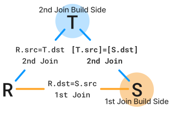

图 7：连接结构。

相比之下，利用线性探测链式哈希表，第一个连接不会展开结果，而会生成代表 `S.dst` 列表的链指针。第二个哈希表只应在 `T.dst` 上构建。因此，用 `R.src` 在第二个哈希表中查找，就会找到匹配的 `T.dst`，并再次返回一个代表 `T.src` 列表的链指针。随后，对第一个连接得到的 `S.dst` 列表和第二个连接得到的 `T.src` 列表求交，即可计算连接结果。只要求交的复杂度与两个列表中较短者的长度成线性关系，这就是一个 WCOJ。

这个 WCOJ 查询计划如图 6 所示。注意，在第二个连接中，我们把 `T.src` 列表直接画在左侧连接输入中；实际上，在 DuckDB 中，这些是指向第一个哈希表的链指针。〔译注：原文此句写作 `T.src`；图 6 的左侧因子化中间结果标为 `R.src [S.dst]`，并且下句也说明第一个连接输出 `S.dst` 列表的指针。〕这些链指针是一种因子化 d 表示，因为在第一个连接中，对于值相同的任意 `R.dst`，都会生成指向同一个 `S.dst` 列表的指针。

在 DuckDB 的求交连接实现中，我们使用基于哈希的方法，使两个列表的求交时间与较短列表长度成线性关系。为此，我们分配大缓冲区，在其中连续存放许多个小型线性哈希表，每个列表对应一个；每个表的大小取严格大于列表长度的最小 2 的幂。这些小型哈希表的桶是带 salt 的指针，指向原先已分配哈希表中已有的记录。求交时，用最小列表作为探测输入，在较大列表的小型哈希表中执行查找。

## 3 自适应因子化

WCOJ 面临的一项长期挑战，是决定何时用它来代替二元连接（binary join，BJ），因为它也可能使查询变慢 [17]。这同样适用于我们的因子化聚合技术：它利用 n:m 连接上的延迟展开，对连接匹配列表仅计算一次（子）聚合并重复使用。然而，如果连接实际上不是 n:m 而是 n:1，这些列表的长度就为 1，该技术只会增加开销。我们的 WCOJ 算法也是如此。

先前的工作，例如 [9]，着重于让优化器创建因子化查询计划。为此，优化器应估计连接中间结果的大小及其代价，或者采用更偏启发式的方法，检测连接图中的环等模式。这里优化器面临的一个重大问题，是缺少可靠的统计信息，甚至完全没有统计信息来预测连接大小。对于多个连接，以及由子查询计算得到的输入，这尤其困难。估计误差会累积，使估计变得不可靠 [12]。这一问题在 DuckDB 经常被部署的现代数据流水线中尤其明显。直接查询 Parquet 文件是一种常见做法，因而连主键、外键信息都不存在，甚至一开始就很难识别 n:m 连接。

我们提出一种自适应方法，利用运行时统计信息决定是否采用因子化查询计划。查询优化器检测因子化执行机会，但不立即承诺使用因子化，而是将计划标记为“可能可因子化”，使哈希连接在哈希构建阶段收集统计信息。目前，优化器以环形连接为目标，只改变两个连接的行为：（i）闭合环的连接，即含有双键条件的连接——图 6 中的第二个连接；（ii）其构建侧提供参与该次查找的键的连接，即图 6 中的第一个连接。我们将这个键（图 6 中标为 `S.dst`）称为“嵌入键”（embedded key）。这一变化使连接在物化阶段，基于嵌入键快速构造草图。我们选择闭合环形 n:m 连接作为起点，是因为它通常能减少中间结果。将自适应因子化处理推广到其他连接形状，留作未来工作。

对于图 6 的三角形查询，二元连接计划与因子化计划的开端类似，都在同一个键（图 6 中的 `S.src = R.dst`）上构建第一个哈希表；只有探测阶段不同，分别输出链指针或展开结果。第一个连接的哈希表构建完成后，链的数量和长度的精确信息，以及嵌入键 `S.dst` 的草图信息都已经可用。接着，构建第二个哈希表，并对其相应的嵌入键 `T.src` 创建草图。在完成记录物化之后、填充哈希桶之前，就可以根据运行时统计信息，决定继续执行 BJ 计划还是 WCOJ 计划。

具体来说，可以把两个普通哈希连接改造成如下计划：第一个连接执行因子化查找，输出链指针；原先通过组合键闭合环的第二个哈希连接，则改成另一个仅使用单键的因子化连接，并通过列表求交比较第二个键。如果做出这一选择，就在第二个哈希连接构建阶段的最后，为两个哈希表中的全部链创建小型哈希表。随后启动探测流水线：对每个元组在第一个哈希表中查找，产生含链指针的因子化结果；再在第二个哈希表中查找，得到另一个链指针；最后对两条链求交，输出扁平结果。

**AMS 草图。** 我们需要收集统计信息，了解可能在 WCOJ 计划中通过列表求交来处理的连接模式会产生多大程度的结果膨胀。为此，我们使用 AMS 草图；它是一种适合估计关系间连接大小的线性草图 [2]。

AMS 草图由矩阵 $M\in\mathbb{Z}^{d\times w}$ 构成，其中行数 $d$ 决定使用的哈希函数数量，列数 $w$ 是每个哈希函数对应的桶数。在我们的实现中，对于每个元素 $i$，使用哈希连接物化阶段生成的 64 位哈希值。二元连接计划和因子化连接计划都必须计算这个哈希值，因此为了草图而对键进行哈希不会增加额外开销。我们将这个 64 位哈希值拆成各个字节。对于每一行 $j$，考察哈希值的第 $j$ 个字节，并从中导出两个函数：（1）函数 $h_j(i)$ 根据第 $j$ 个字节的低 7 位，决定元素 $i$ 映射到第 $j$ 行的哪个桶 $b$；（2）函数 $g_j(i)$ 根据该字节的最高位，将元素 $i$ 映射到 $+1$ 或 $-1$。然后给桶 $b$ 加上 $g_j(i)$。

要估计两个草图 $M_1,M_2\in\mathbb{Z}^{d\times w}$ 的连接大小，我们通过点积计算每行 $j$ 的估计值 $e_j=\sum _ {k=1}^{w}M _ {1,j,k}\cdot M _ {2,j,k}$，再取各行估计值的均值。

在哈希连接物化期间，我们对两个连接侧前述的嵌入键分别构建 AMS 草图。对图 6 而言，得到的是第一个连接的草图 $M _ {\mathrm{S.dst}}$ 和第二个连接的草图 $M _ {\mathrm{T.src}}$。两个哈希表的草图可以用于估计列表求交的结果大小。再将它除以两个构建侧的平均基数，即得到“链求交膨胀因子”（Chain Intersection Explosion Factor）特征，使其对基数的依赖较弱。

我们还将每个连接构建侧的 AMS 草图与其自身组合，估计链键的自连接大小。将其除以构建侧基数，就得到“第一个连接链键倾斜度”（1st Join Chain Keys Skew）特征。

**HLL 草图。** 这一广为人知的草图用于估计不同值的数量。构建线性探测链式哈希表时，在第一步物化所有记录的过程中，DuckDB 已经计算了键的哈希值，因此计算 HLL 草图的成本很低。不同值的数量可用于确定桶数组大小，并提供平均链长。

除了 HLL 和 AMS 草图提供的统计信息，我们还将第一个哈希表的平均链长等简单度量作为模型特征，由模型决定选择 WCOJ 计划还是 BJ 计划。

**特征概览。** 除 HLL 和 AMS 草图的统计信息外，我们还使用第一个哈希表平均链长等启发式信息作为特征，预测应选择 WCOJ 还是 BJ 计划。完整特征列表见表 1。该表还列出了每个特征的 Pearson 相关系数（PCC），展示其与“更快的类别”和 WCOJ 相对 BJ 加速比的关系。正 PCC 表示随着特征值增大，WCOJ 更快的可能性增大；负相关则表示相反的关系。实验表明，计算这些草图并收集启发式信息，平均只增加 0.35% 的运行时间开销。

表 1：各特征与更快类别 $C_f$ 及加速比 $C_s$ 的相关性。

| 特征名称 | 说明 | $C_f$ | $C_s$ |
| --- | --- | ---: | ---: |
| 第一个连接构建侧基数（1st Join Build Side Cardinality） | 第一个连接构建侧的大小。 | -0.29 | -0.04 |
| 第一个连接不同链的数量（1st Join Number of Unique Chains） | 第一个连接中不同链的数量。 | -0.31 | -0.04 |
| 第一个连接平均链长（1st Join Average Chain Length） | 第一个连接的平均链长。 | 0.58 | 0.05 |
| 第一个连接链键倾斜度（1st Join Chain Keys Skew） | 列表求交处理的链键的倾斜度，根据第一个 AMS 草图的自连接大小估计。 | -0.02 | 0.03 |
| 第二个连接构建侧基数（2nd Join Build Side Cardinality） | 第二个连接构建侧的大小。 | -0.24 | -0.03 |
| 第二个连接不同链的数量（2nd Join Number of Unique Chains） | 第二个连接中不同链的数量。 | -0.22 | -0.02 |
| 第二个连接平均链长（2nd Join Average Chain Length） | 第二个连接的平均链长。 | -0.08 | -0.01 |
| 第二个连接链键倾斜度（2nd Join Chain Keys Skew） | 列表求交处理的链键的倾斜度，根据第二个 AMS 草图的自连接大小估计。 | -0.09 | -0.01 |
| 两个连接的平均链长（Both Joins Average Chain Length） | 两个连接的平均链长。 | 0.43 | -0.01 |
| 两个连接的平均构建侧基数（Both Joins Average Build Side Cardinality） | 两个连接的平均构建侧基数。 | -0.29 | -0.04 |
| 较大连接的平均链长（Larger Join Average Chain Length） | 构建侧基数较大的那个连接的平均链长。 | -0.08 | -0.01 |
| 两个连接平均链长的最大值（Both Joins Max Average Chain Length） | 两个连接各自平均链长的最大值。 | -0.08 | -0.01 |
| 两个连接平均链长的最小值（Both Joins Min Average Chain Length） | 两个连接各自平均链长的最小值；第一个连接使用准确值，第二个使用基于 HLL 的估计。 | 0.64 | 0.01 |
| 两个连接链键倾斜度的最小值（Both Joins Min Chain Keys Skew） | 两个连接中较小的链键倾斜度。 | 0.11 | 0.17 |
| 不同关系的数量（Number of Unique Relations） | 三角形查询涉及的不同关系的数量。 | -0.34 | -0.09 |
| 链求交连接大小（Chain Intersection Join Size） | 列表求交所处理连接结果的预测大小，根据两个 AMS 草图的乘积估计。 | -0.07 | -0.01 |
| 链求交膨胀因子（Chain Intersection Explosion Factor） | 链求交连接大小除以两个连接的平均构建侧基数。 | 0.12 | 0.17 |
| 第一与第二个连接的构建侧大小比（1st to 2nd Join Build Size Ratio） | 第一个连接构建侧基数与第二个连接构建侧基数之比。 | 0.08 | 0.09 |

图 8 展示了不同关系上的三角形查询的加速比，与“两个连接平均链长的最小值”和“第一与第二个连接的构建侧大小比”的关系。图中表明，因子化 WCOJ 方法并不总是优于基线，加速比从 0.23 倍到 14.91 倍不等。图中还表明，运行时参数与加速比相关。这符合直觉：较长的链会产生大型中间结果，而 WCOJ 可以避免它们。此外，观察“第一与第二个连接的构建侧大小比”可以发现，某些特征仅在特定情况下能够作为预测指标。例如，当这一特征值小于约 0.05 时，它能可靠地预测不应使用 WCOJ。其直觉是，第一个连接的探测侧是 WCOJ 缓解中间结果膨胀的地方。如果第一个连接的探测侧规模相较于第二个连接的规模过小，WCOJ 的收益就会减少。〔译注：本段先定义的是构建侧大小比，后两句原文却写作第一个连接的“探测侧”；表 1 也将该特征定义为两个构建侧的基数比，此处保留原文的区分。〕这也展示了在模型中组合多个特征的潜力。

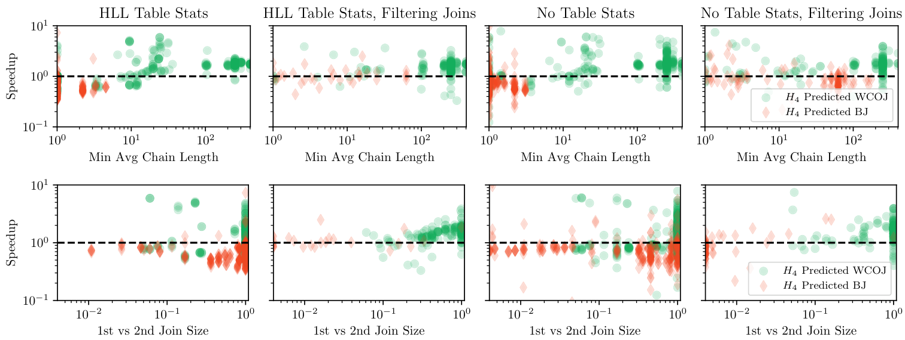

图 8：对于来自 DuckDB 表或 Parquet 的关系上的三角形查询，比较 WCOJ 相对 BJ 的加速比与“两个连接平均链长的最小值”（上）以及“第一与第二个连接的构建侧大小比”（下）的关系。由于表具有更好的连接排序统计信息，可以观察到较高相关性；但使用 Parquet 文件或过滤时，相关性下降。最小链长与加速比大致相关，而较低的“第一与第二个连接的构建侧大小比”预示 WCOJ 表现较差。此外，图中展示了表 2 的 $H_4$ 何时选择 WCOJ、何时选择 BJ，说明可以从这些特征构建良好的模型。

## 4 评估

本节评估我们针对环形连接的 WCOJ 实现的性能，以及自适应使用它的收益。环形连接实验运行在一台云实例上，操作系统为 Fedora 40，处理器为 Intel Xeon Gold 5115，具有 40 个线程和 248 GB 内存。自适应实验则运行在另一台 Fedora 40 机器上，使用具有 96 个线程的 AMD EPYC CPU 和 128 GB 内存。

**环形连接。** 我们通过沿 WebStan 数据集中的链接执行三角形连接，评估 DuckDB 中因子化环形连接的性能。该数据集有 685,231 个节点和 7,600,595 条边。[脚注 1] 我们将结果与 DuckDB v1.0.0、可嵌入图数据库 KùzuDB [13] 的 0.4.2.12 版本（提交 `89d47d152`），以及先进关系数据库 Umbra [18] 的 `v0.2-400-g806f09709` 版本比较。后两个系统都实现了 WCOJ。结果如图 9 所示。在 KùzuDB 和 DuckDB 中，二元连接都慢于 WCOJ。如前所述，KùzuDB 需要提示才能识别更快的 WCOJ 计划。DuckDB 使用列表求交的因子化 WCOJ，在单线程和多线程版本中都略快于 KùzuDB 的 WCOJ 实现。DuckDB 的 WCOJ 从单线程到多线程的加速比小于普通 BJ，说明还存在进一步优化的空间，因为算法中的某些部分没有并行执行。

脚注 1：[web-BerkStan 数据集](https://snap.stanford.edu/data/web-BerkStan.html)。

Umbra 的 WCOJ 在 8 个线程时表现最好，而二元连接在所有情况下都是最好的，甚至优于 Umbra 的 WCOJ。

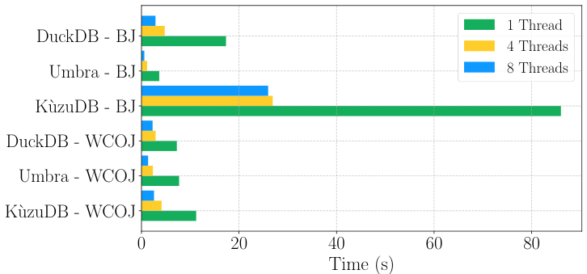

图 9：在 web-BerkStan 上执行三角形计数查询的性能。DuckDB 和 KùzuDB 受益于 WCOJ，Umbra 则没有。DuckDB WCOJ 中小型哈希表的分配（目前仍然）是串行的，影响其并行扩展性。

在默认设置 `set debug.multiway='c'`（`c` 表示 cautious，即谨慎）下运行 Umbra 时，它会对这个查询选择 WCOJ 计划。然而，对 Umbra 而言，WCOJ 是错误的选择：禁用多路连接（设为 `'d'`）后，二元连接计划似乎更快，这突出了 WCOJ 带来的优化器挑战。

**自适应因子化。** 为评估动态选择 WCOJ 或 BJ 计划的性能，我们比较了多种启发式方法和机器学习模型，看它们能否根据运行时收集的统计信息，预测应该使用哪个计划。

本次评估组合了三类不同数据集：（1）一个由 305 个图组成的合成数据集，每个图有 100 到 100,000 个节点、100 到 1,000 万条边，并覆盖广泛的入度和出度；（2）边数超过 100 万的 SNAP 数据集 [16]；（3）规模因子为 1、3、10 的 LDBC SNB BI [23] 数据集。SNB 测试数据集包含 352 个不同查询，代表所有可能的三关系环。每个关系都分别保存为一张 DuckDB 表和一个 Parquet 文件。[脚注 2]

脚注 2：完整基准见 [CyclicJoinBench](https://github.com/cwida/CyclicJoinBench)。

为在不同难度下测试我们的方法，我们建立了四种负载，它们所查询的数据集可用的（有效）静态统计信息逐渐减少。负载 $W_1$（ $n=900$）包含 SNB 数据集中主外键关系上的三角形查询，数据存放为 DuckDB 基表；这些表包含 HLL 表统计信息，优化器用它们进行连接排序。 $W_2$（ $n=1200$）在 $W_1$ 的基础上，增加跨合成数据集与 SNAP 数据集中的表进行图连接的查询，这些表各自是单个边表。当使用稠密整数顶点 ID 连接来自不同数据集的边时，连接仍可能发生结果膨胀，但许多连接键不会命中任何内容。我们把这一负载称为“过滤连接”（Filtering Joins），指的是连接中有时会出现的强过滤效果。这种现象难以用静态代价模型预先预测，通常会导致基数估计错误、连接顺序错误，并使得根据查询优化期间可用统计信息来决定使用 WCOJ 还是 BJ 变得困难。 $W_3$（ $n=1800$）仅包含 $W_1$ 中的 SNB 主外键查询，但现在有两种变体：在 DuckDB 基表上执行（有 HLL），以及在 Parquet 文件上执行（无 HLL）。因此，在 Parquet 表上连接时，由于没有关于不同键数量的表统计信息，DuckDB 查询优化器生成的连接顺序会比基表情况下更差。 $W_4$（ $n=2400$）建立在 $W_3$ 之上，再次加入过滤连接查询，并同时包含 DuckDB 基表及其对应 Parquet 文件两种形式。

对于每个查询，我们分别测量 BJ 和 WCOJ 计划的运行时间，以计算 WCOJ 的加速比，并识别它优于 BJ 的查询，作为模型的目标标签。我们按 70%/30% 划分训练集和测试集，训练多种机器学习模型，并使用运行时数据与草图统计信息构造表 1 中的特征。

由于数据中包含每个查询的 WCOJ 和 BJ 运行时间，我们还可以模拟其他情形，例如总是使用 WCOJ 计划或从不使用它时能够获得的加速比；这些情形展示在表 2 的前四行。

可达到的最佳加速比高于始终选择 WCOJ。例如，在 $W_1$ 上，最佳加速比为 1.3 倍，而始终使用 WCOJ 为 1.15 倍，凸显了自适应因子化的潜力。我们可以使用机器学习模型在运行时决定执行策略来利用这种潜力，如表 2 所示。随机森林模型取得最高的 1.29 倍加速。其最重要的特征为“最小链长”和“第一个连接的链长”，如图 10 所示。不过，这个模型有 98 个节点，已经相当复杂、不直观，并有过拟合的风险（尽管我们采用了 70/30 的训练/测试划分），这会阻碍系统采用。相比之下，图 11 中的决策树也许是更好的选择，因为它只有 9 个节点，却能提供相近性能。与随机森林类似，其关键特征之一也是“最小链长”：当链长大于 5 时选择 WCOJ。

较简单的启发式方法，例如当某个特征超过阈值时使用 WCOJ，也能取得良好的加速效果。例如， $H_1$ 仅使用第一个连接的平均链长，在 DuckDB 表（ $W_1$）上就能达到 1.27 倍加速。不过，它在 Parquet 文件（ $W_3$）上的表现较差。在表上运行查询时，优化器可以利用 HLL 表统计信息，把会导致结果膨胀的连接推迟。因此，如果第一个连接的链比较长，后续连接的链很可能也比较长，使第一个连接的链长成为较强的预测指标。在连接顺序较差时，这一启发式不再有效。进一步地，可以像 $H_4$ 那样组合多个特征以改善决策，从而在所有数据集上获得良好性能，图 8 中的颜色展示了这一点。关键是，“MinChainLength”特征需要第二个连接链长的估计值，这可以通过在哈希构建期间于运行时计算 HLL 来提供。类似地，“MinKeySkew”需要在两个连接输入上计算 AMS 草图。

表 2：不同自适应决策模型在负载 $W_1$ 到 $W_4$ 上的 WCOJ 相对 BJ 加速比；这些负载用于连接排序的静态统计信息逐渐减少。当连接顺序良好时， $H_1$ 等简单启发式表现很好；连接顺序较差时则需要更复杂的模型。

| 选择方法 | $W_1$ | $W_2$ | $W_3$ | $W_4$ |
| --- | ---: | ---: | ---: | ---: |
| **静态模型加速比** | | | | |
| 总是使用较慢的算法 | 0.84 | 0.86 | 0.83 | 0.87 |
| 总是使用较快的算法 | 1.30 | 1.42 | 1.39 | 1.47 |
| 总是使用 WCOJ | 1.15 | 1.28 | 1.23 | 1.34 |
| 总是使用 BJ | 1.00 | 1.00 | 1.00 | 1.00 |
| **启发式加速比，条件为真时使用 WCOJ** | | | | |
| $H_1=\mathrm{1stJoinChainLength}\gt 10$ | 1.27 | 1.36 | 1.29 | 1.37 |
| $H_2=\mathrm{MinChainLength}\gt 5.5$ | 1.27 | 1.37 | 1.29 | 1.37 |
| $H_3=H_2\lor\mathrm{MinKeySkew}\gt 5$ | 1.26 | 1.36 | 1.32 | 1.40 |
| $H_4=H_3\land\mathrm{JoinSizeRatio}\gt 0.05$ | **1.27** | **1.37** | **1.35** | **1.42** |
| **机器学习模型加速比** | | | | |
| 决策树 | 1.26 | 1.38 | **1.34** | **1.41** |
| 逻辑回归 | 1.22 | 1.30 | 1.27 | 1.31 |
| 随机森林 | **1.29** | **1.39** | 1.30 | 1.37 |
| 梯度提升 | **1.29** | **1.39** | 1.29 | 1.38 |

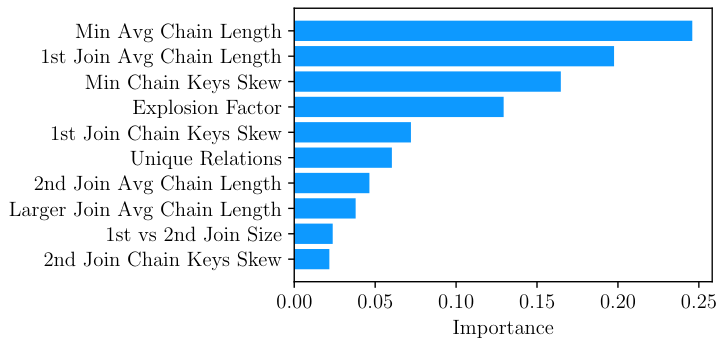

图 10：随机森林的特征重要性表明，“最小平均链长”和“第一个连接的平均链长”最为相关。

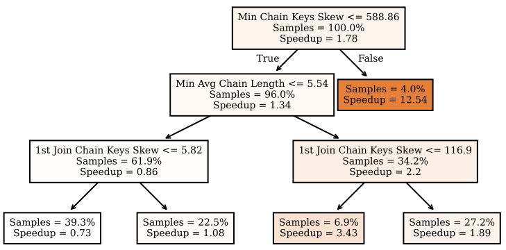

图 11：决策树将“最小平均链长”和“链键倾斜度”识别为决策的重要特征。

我们认为，在真实系统中，启发式方法（或简单模型）比学习模型更可取，因为开发者能够理解它们。从这个角度看， $H_4$ 恰好优于我们的机器学习模型是一件幸事。对于 $H_4$ 性能的普适性，我们仍呼吁谨慎：它还需要在真实部署中接受实战检验，但我们认为它提供了一个良好的起点。

## 5 结论

我们提出了线性探测链式哈希表设计，它已经合入 DuckDB v1.1.0，相较于先前的桶链式设计没有产生性能回退。其不含冲突的链，是因子化查询处理中所谓 d 表示的一种实用形式。我们用它实现了概念验证性质的 WCOJ 和因子化聚合，与 DuckDB 现有二元哈希连接紧密集成，对源代码的影响很小。

识别 WCOJ 和因子化能够有效加速查询的机会，仍是尚未解决的优化器挑战。本文表明，运行时自适应能够有所帮助：在构建阶段，可以检查所有构建侧元组，并构造 AMS 和 HLL 草图。这些统计信息在真实连接输入上产生；相反，基表统计信息往往一开始就不可用，即使存在，也会受到扫描与连接之间算子的影响，造成估计误差。利用草图中的统计信息，我们得以创建一个简单、稳健的模型，预测环形连接上的 WCOJ 是否能改善 DuckDB 性能。

**未来工作。** 我们仍在实现层面改进线性探测链式哈希表，并计划测试一种“非链式”（unchained）变体 [4]：将同一个重复键的所有记录聚集在一起，以改善内存局部性。不过，与 [4] 不同，为避免性能回退，我们认为只应自适应地执行这一操作，例如 HLL 草图显示存在长链的迹象时。相比 Umbra 这样的编译型引擎，这更容易集成到 DuckDB 这样的向量化引擎中：为了利用运行时自适应，编译型引擎必须在作出运行时决策后进行 JIT 重编译，或者包含两个分支的代码，导致代码量随决策数量指数增长。两种问题都可能增加编译延迟。

下一步，我们将把因子化技术集成到 DuckDB 或 DuckPGQ，使因子化聚合能够根据运行时统计信息动态调整，并与非因子化组件组合使用。我们还将通过增强基于哈希表的 d 表示，探索对更复杂连接形状的支持。

## 参考文献

[1] Daniel Abadi et al. 2013. The Design and Implementation of Modern Column-Oriented Database Systems. *Found. Trends Databases* (2013), 197–280.

[2] Noga Alon, Yossi Matias, and Mario Szegedy. 1996. The Space Complexity of Approximating the Frequency Moments. In *STOC*. ACM, 20–29.

[3] Nurzhan Bakibayev et al. 2012. FDB: A Query Engine for Factorised Relational Databases. *Proc. VLDB Endow.* (2012).

[4] Altan Birler et al. 2024. Simple, Efficient, and Robust Hash Tables for Join Processing. In *DaMoN*. ACM, 4:1–4:9.

[5] Altan Birler, Alfons Kemper, and Thomas Neumann. 2024. Robust Join Processing with Diamond Hardened Joins. *Proceedings of the VLDB Endowment* 17, 1 (2024).

[6] Peter A. Boncz, Marcin Zukowski, and Niels Nes. 2005. MonetDB/X100: Hyper-Pipelining Query Execution. In *CIDR*. 225–237.

[7] Jemery Chen et al. 2023. Accurate Summary-based Cardinality Estimation Through the Lens of Cardinality Estimation Graphs. *SIGMOD Rec.* (2023), 94–102.

[8] Daniel Flachs, Magnus Müller, and Guido Moerkotte. 2022. The 3D Hash Join: Building On Non-Unique Join Attributes. In *CIDR*.

[9] Michael J. Freitag et al. 2020. Adopting Worst-Case Optimal Joins in Relational Database Systems. *Proc. VLDB Endow.* (2020), 1891–1904.

[10] Michael J. Freitag and Thomas Neumann. 2019. Every Row Counts: Combining Sketches and Sampling for Accurate Group-By Result Estimates. In *CIDR*.

[11] Pranjal Gupta et al. 2021. Columnar Storage and List-based Processing for Graph Database Management Systems. *Proc. VLDB Endow.* 14, 11 (2021), 2491–2504. https://doi.org/10.14778/3476249.3476297

[12] Yannis E. Ioannidis and Stavros Christodoulakis. 1991. On the Propagation of Errors in the Size of Join Results. In *SIGMOD*. ACM Press, 268–277.

[13] Guodong Jin et al. 2023. KÙZU Graph Database Management System. In *CIDR*.

[14] Laurens Kuiper, Peter Boncz, and Hannes Mühleisen. 2024. Robust External Hash Aggregation in the Solid State Age. In *ICDE*. IEEE.

[15] Viktor Leis, Peter A. Boncz, Alfons Kemper, and Thomas Neumann. 2014. Morsel-driven parallelism: A NUMA-aware query evaluation framework for the many-core age. In *SIGMOD*.

[16] Jure Leskovec and Andrej Krevl. 2014. SNAP Datasets: Stanford Large Network Dataset Collection. http://snap.stanford.edu/data.

[17] Amine Mhedhbi. 2023. GraphflowDB: Scalable Query Processing on Graph-Structured Relations. Ph. D. Dissertation. University of Waterloo.

[18] Thomas Neumann and Michael J. Freitag. 2020. Umbra: A Disk-Based System with In-Memory Performance. In *CIDR*.

[19] Hung Q. Ngo, Ely Porat, Christopher Ré, and Atri Rudra. 2018. Worst-case Optimal Join Algorithms. *J. ACM* (2018), 16:1–16:40.

[20] Dan Olteanu and Maximilian Schleich. 2016. Factorized Databases. *SIGMOD Rec.* (2016), 5–16.

[21] Mark Raasveldt and Hannes Mühleisen. 2019. DuckDB: An Embeddable Analytical Database. In *SIGMOD*.

[22] Siddhartha Sahu. 2020. The ubiquity of large graphs and surprising challenges of graph processing: extended survey. *VLDB J.* (2020), 595–618.

[23] Gábor Szárnyas et al. 2022. The LDBC Social Network Benchmark: Business Intelligence Workload. *Proc. VLDB Endow.* (2022), 877–890.

[24] Daniel ten Wolde, Gábor Szárnyas, and Peter A. Boncz. 2023. DuckPGQ: Bringing SQL/PGQ to DuckDB. *Proc. VLDB Endow.* (2023), 4034–4037.

[25] Todd L. Veldhuizen. 2014. Triejoin: A Simple, Worst-Case Optimal Join Algorithm. In *ICDT*. 96–106.
