# Efficient Computation of Multiple Group By Queries（中文译文）

## 译者说明

本文依据同目录的 `source.pdf` 翻译。章节、图表、公式、算法、代码与参考文献按原文结构保留。

Zhimin Chen、Vivek Narasayya<br>
Microsoft Research<br>
{zmchen, viveknar}@microsoft.com

SIGMOD 2005，2005 年 6 月 14–16 日，美国马里兰州巴尔的摩。

## 摘要

数据分析人员需要了解数据仓库中的数据质量。这通常通过对感兴趣的若干列集合发出许多 Group By 查询来完成。由于这些仓库中的数据量可能很大，而且数据仓库的表往往包含许多列，这种分析通常需要执行大量 Group By 查询，代价可能很高。我们表明，现有数据库系统在此类数据分析上的性能不足。我们还证明这个问题在计算上是困难的，并提出了高效的求解技术。在现有商业数据库系统上，我们的方法相较已有方法获得了显著加速。

## 1. 引言

数据仓库上的决策支持分析会影响重要的业务决策，因此分析的准确性至关重要。了解数据质量是数据分析人员的一项重要需求 [18]。例如，如果一个描述美国客户的关系中，State 列的不同值数超过 50，就可能表明存在数据质量问题。其他例子包括某列中缺失值（NULL）的百分比、最大值和最小值等。这些聚合有助于分析人员判断数据是否符合预期规范。这类数据分析可以看作获取关系的某个列集合上的频率分布，即形如以下语句的 Group By 查询，其中 X 是关系 R 的列集合：

```sql
SELECT X, COUNT(*) FROM R GROUP BY X
```

注意，X 有时也可能包含派生列，例如用 `LEN(c)` 计算列 c 的长度分布。考虑关系 `Customer(Lastname, FirstName, M.I., Gender, Address, City, State, Zip, Country)`。一个典型场景是了解每一列的值分布，这需要对每列分别发出一个 Group By 查询。此外，有时还需要了解若干列集合的联合频率分布，例如，分析人员可能预期 `(LastName, FirstName, M.I., Zip)` 是该关系的键，或近似于键。一些数据挖掘应用 [15] 也有类似需求，需要计算同一关系上许多列集合的频率分布。

这种数据分析可能耗时且消耗大量资源，原因有二。首先，关系中的行数可能很大。其次，需要执行 Group By 查询的列集合数也可能很大。一种朴素方法是为每个列集合执行一个独立的 Group By 查询。

一些商业数据库系统提供了名为 GROUPING SETS 的 GROUP BY 扩展，允许使用一条 SQL 语句计算多个 Group By 查询。这些查询通过一组列集合来指定。例如，指定 `GROUP BY GROUPING SETS ((A), (B), (C), (A,C))`，会在结果集中返回这四个 Group By 查询的 Union All。查询优化器可以利用这些查询之间的共性，优化整组查询的执行。然而，下面在一个商业数据库系统上的实验表明，GROUPING SETS 功能并未针对上述数据分析场景进行优化。

**例 1。** 考虑分析人员希望获得关系中每个字符列或分类列的单列值分布的场景。例如，TPC-H 数据库（1GB）[24] 的 lineitem 表中有 12 个这样的列。我们在一个商业数据库系统上使用单条 GROUPING SETS 查询来计算这 12 个 Group By 查询的结果，并将其耗时与本文方法的耗时比较。我们的方法约快 4.5 倍。

原因在于，GROUPING SETS 没有针对所请求的许多列集合彼此几乎不重叠的场景进行优化，而这是常见的数据分析场景。在例 1 中，我们只请求 12 个单列集合，查询优化器选出的计划却先计算全部 12 列上的 Group By，将结果物化，再从该物化结果计算各个单列 Group By。容易看出，这种策略几乎等同于直接从 lineitem 表分别计算这 12 个 Group By 查询的朴素方法。相比之下，我们的方案将以下 Group By 查询的结果物化到临时表中：(1) `(l_receipdate, l_commitdate)`；(2) `(l_tax, l_discount, l_quantity, l_returnflag, l_linestatus)`；再从各自的临时表计算这些列的单列 Group By。其余各列的 Group By 查询则直接从 lineitem 表计算。

译注：此处的 `l_receipdate` 按原文拼写保留；论文后文使用 `l_receiptdate`。

上例说明了一个重要观察：物化某些查询的结果，包括原本并未要求的查询，可以加快所需查询的整体执行。容易看出，这一搜索空间非常大：其中的查询本身并非所需查询，但若将其结果物化，就可能加快所需查询的执行。例如，对于一个有 30 列的关系，如果要计算所有单列 Group By 查询，那么需要考虑物化的相关 Group By 查询的完整空间为 $2^{30}$ 。

先前针对这一问题的解决方案，包括 GROUPING SETS，都是为高效处理（部分）数据立方体而设计的，例如 [2,14,16,21]，可视为 CUBE 和 ROLLUP 查询的推广。与前述数据分析场景不同，这些方案面向的是类似 OLAP 的场景，通常只有少量 Group By 查询，且列集合之间存在大量重叠。因此，以往大多数方案都假设，可以在优化的第一步完整枚举查询搜索空间。这些方案因而无法很好地扩展到前述数据分析场景。

我们的主要思想和贡献概括如下。首先，即使只需计算关系的 n 个单列 Group By 查询，这个问题在计算上仍然是困难的。其次，与以前的方案不同，我们的算法采用爬山方法，自底向上探索搜索空间。因此，在大多数情况下，优化所需查询并不要求枚举整个搜索空间。这使我们能够很好地扩展到上述数据分析场景。第三，我们的算法基于代价，并展示了如何将该技术纳入现有商业数据库系统，以优化 GROUPING SETS 查询。作为另一种选择，我们还展示了现有客户端数据分析工具或应用如何利用这些技术，在 GROUPING SETS 尚未针对这类场景得到更好优化时改善性能。最后，我们使用真实世界数据集，对照商业数据库系统进行了实验评估。实验表明，使用我们的技术可以获得非常显著的加速。

本文其余部分的结构如下：第 2 节讨论相关工作。第 3 节形式化定义问题并证明其困难性。第 4 节提出求解算法并分析关键性质。第 5 节讨论如何在服务器内部实现该方案来优化 GROUPING SETS 查询，以及如何在客户端仅使用 SQL 查询实现它。第 6 节给出实验评估结果。第 7 节讨论对基本方案的扩展，以处理更广泛的场景。第 8 节总结全文。

## 2. 相关工作

我们的问题可以视为 Group By 查询的多查询优化问题。第一类相关工作提出了高效计算（部分）数据立方体的技术。IBM DB2、Oracle 等商业数据库系统中的 GROUPING SETS 支持，恰好提供了所需功能，即计算一组 Group By 查询的结果。然而，如引言所述，当输入包含大量列集合不重叠的 Group By 查询时，GROUPING SETS 的性能扩展性不佳；这正是我们前面描述的数据分析场景。与我们最接近的是部分 CUBE 计算方面的工作 [14,16]。这类工作提出物化新节点（Group By 查询）以降低其他查询的计算代价。一个关键区别是，它们的方案是最小 Steiner 树问题的近似算法，假设搜索格已经构造完成。然而，容易看出，如果需要计算一个多列表的所有单列 Group By 查询，该方案无法扩展，因为构造搜索格这一步本身就不可行。相比之下，我们的方法以自底向上的方式，只构造格的一小部分，并将构造过程与搜索算法交错进行（第 4 节），从而能够扩展到大得多的输入。

一旦确定了需要物化的查询集合，就可以使用多种物理算子，例如 PipeHash、PipeSort [14,16]、Partitioned-cube、Memory-Cube [16] 等，高效执行给定查询集合，而不引入任何新查询。这个问题与我们的问题是正交的，因此我们的方案也可以利用这些技术。基本思想是通过共享扫描、共享排序和共享分区等方式，利用 Group By 查询之间的共性 [2,8,15,16,21]。高效计算 CUBE（或 ROLLUP）查询的工作，是上述部分立方体计算的特例：它需要计算整个格（或一个层次结构）中的查询。相比之下，我们的工作可以看作以基于代价的方式，引入 GROUPING SETS 查询的逻辑等价改写。

第二类相关工作是创建物化视图以回答查询。文献 [17] 研究通过创建额外物化视图，加速物化视图 V 的更新或创建。他们通过考虑 V 的各种等价表达式，例如查询优化器产生的表达式，在逻辑算子上创建 DAG，再确定应物化的额外视图，即 DAG 的子树。类似地，文献 [10,11] 探索在数据仓库中应物化哪些视图，以优化查询回答代价与视图自身物化代价的加权和。但是，其方案假设包含所有候选物化视图的图 G（一个 DAG）已作为输入给定。上述两类研究都要求在优化之前构造 DAG。由于 DAG 的规模随输入查询数呈指数增长，这种方法同样无法扩展到我们的场景。

引入新查询或视图来回答给定查询集合的想法，并非本文首创；它此前已出现在多个背景中 [2,10,17]，包括 [3,25] 中的视图合并，以及 [9] 中构造公共包容表达式的思想。不过，在 [3,14,25] 中，目标是选择一组物化视图来优化给定查询集合的执行代价，所选视图自身的物化代价并不属于目标函数。因此，无法直接将其朴素地改用于我们的问题。[9] 则没有定义针对给定 Group By 查询集合所考虑的公共包容视图的确切空间。

文献 [15] 提出修改 GROUPING SETS 语法，称为 Combi 算子，以便轻松指定大量 Group By 查询作为输入，例如所有大小不超过 k 的列子集。这种语法扩展对本文的数据分析场景也有用，例如需要关系上的所有单列和双列 Group By 查询时。最后，多查询优化领域还有针对连接查询的工作，例如 [19]。这些论文关注复用连接表达式的结果；而我们关注的是共享不同 Group By 查询所做的工作，这些查询都引用同一个表或视图。

## 3. 问题陈述与困难性

### 3.1 定义

假设关系 $R(c _ 1,\ldots,c _ m)$ 有 m 列。令 C 为 R 的列集合，即 $C=\lbrace c _ 1,\ldots,c _ m\rbrace$ 。令 $S=\lbrace s _ 1,s _ 2,\ldots,s _ n\rbrace$ 表示 R 上的一组 Group By 查询，其中每个 $s _ i$ 都是 R 的一个列子集。因此，每个 $s _ i$ 都对应一个 Group By 查询：

```sql
SELECT si COUNT(*) FROM R GROUP BY si
```

在本文余下部分，我们假设所有查询都只需要 COUNT(*) 聚合。第 7 节讨论不同查询需要不同聚合时的扩展。

**搜索 DAG。** 给定关系 R，以及 R 上的一组 Group By 查询 $S=\lbrace s _ 1,s _ 2,\ldots,s _ n\rbrace$ 。定义有向无环图（DAG） $G=(V,E)$ 如下。图中一个节点对应一个 Group By 查询。节点集 V 包含 $s _ 1\cup s _ 2\cup\cdots\cup s _ n$ 的幂集中的所有元素。注意， $s _ 1,s _ 2,\ldots,s _ n$ 本身也是图中的节点。我们将 S 中的节点称为必需节点，因为必须产生这些节点的结果。边集 E 中包含从节点 u 到 v 的有向边，当且仅当 $v\subset u$ 。我们称 u 为 v 的祖先，v 为 u 的后代。此外，还有一个特殊的根节点，表示关系 R 本身。根节点有一条指向 V 中每个其他节点的出边，因为它是所有其他节点的祖先。我们将 G 称为搜索 DAG。

**例 2。** 假设 `R(A,B,C,D)`，且 $S=\lbrace (A),(B),(C),(A,C)\rbrace$ 。图 1 展示了这个例子的搜索 DAG。

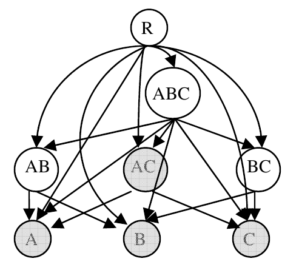

图 1. 输入 {(A), (B), (C), (AC)} 的搜索 DAG。

**计算一组 Group By 查询的逻辑计划。** 令 P 为计算 S 的逻辑计划，即计算所有查询 $s _ 1,\ldots,s _ n$ 的计划。P 是搜索 DAG 上一棵以 R 为根、包含全部必需节点的有向树。这棵树也可视为 SQL 查询的一个偏序。树中从节点 u 到 v 的边，表示在表 u 上执行 Group By 查询来计算 v。注意，如果 $u\ne R$ ，即 u 是树中的中间节点，那么在从 u 计算 v 之前，需要先将 u 物化为临时表。我们这里的逻辑计划不同于查询优化器使用的物理执行计划，因为计划中的“算子”是 SQL Group By 查询，而非物理算子。

图 2 展示了输入 $S=\lbrace (A),(B),(C),(AC)\rbrace$ 的两个不同逻辑计划。必需节点以阴影表示。在逻辑计划 P1 中，全部必需节点都从根节点，即基表 R 计算。在计划 P2 中，先从 R 计算 (A,B)，物化其结果，再从它计算 (A) 和 (B)。类似地，直接从 R 计算 (A,C)，物化结果，再从该结果计算 (C)。

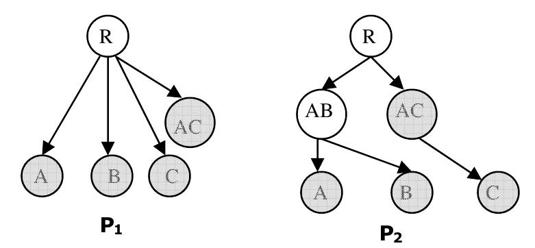

图 2. 输入 S = {(A),(B),(C),(AC)} 的两个逻辑计划 P1 和 P2。

子计划是逻辑计划的一棵子树，其根节点由 R 直接指向。例如，图 2 的 P2 中，以 (AB) 和 (AC) 为根的子树都是子计划；但以 (A) 为根的子树不是子计划，因为其父节点不是 R。

最后，给定逻辑计划，即一棵树，还需要考虑物化树中中间节点会消耗多少额外存储，即磁盘空间。注意，按不同次序，例如深度优先或广度优先，执行逻辑计划中的查询，计划消耗的最大存储空间可能不同。第 4.4 节将展示如何安排树中查询的执行顺序，使逻辑计划执行期间任意时刻中间节点占用的存储尽可能小。

### 3.2 代价模型

我们的目标是高效计算 S 中的全部 Group By 查询，即为 S 找到一个高效逻辑计划。因此，需要讨论采用什么指标比较两个不同的逻辑计划。我们的技术不依赖于某种特定代价模型，但要求能够计算给定逻辑计划或子计划 P 的代价。本文考虑两种代价模型，以 $\mathrm{Cost}(P)$ 表示计划 P 的代价。

#### 3.2.1 基数代价模型

该模型假设搜索 DAG 中从 u 到 v 的一条边的代价，就是表 u 的行数，记为 $\lvert u\rvert$ 。直观上，这个简单代价模型捕获了扫描关系 u 的代价，而这通常是合理的代价指示，尤其是表 u 上没有相关索引时。当然，一般情况下该模型也可能不准确，例如，它没有反映关系 u 有多“宽”，也没有考虑 u 上是否存在索引等。然而，由于模型简单，更适合分析问题及其解决方案，之前与该问题相关的工作，例如 [10,14]，也使用过它。

使用基数代价模型，仍然需要估计 Group By 查询的基数，而这是一个困难问题。为此，我们假设可以使用已有的不同值数估计技术，例如 [13]。

#### 3.2.2 查询优化器代价模型

该模型利用逻辑计划实际上是一组 SQL 查询这一事实。因此，可以使用 DBMS 自身的查询优化器作为代价模型的基础，因为它能够估计单条查询的代价。更准确地说，我们将 $\mathrm{Cost}(P)$ 建模为 P 中各条 SQL 查询的优化器估计代价之和。

与基数代价模型（第 3.2.1 节）相比，这个模型有两个优点。首先，它捕获了数据库当前物理设计的影响。例如，某条查询若能利用数据库中已有的索引，其影响就会自动反映在优化器估计代价中。其次，现有数据库系统中优化器的代价模型已经相当复杂，能够利用数据库统计信息，例如直方图和不同值数估计，在许多情况下给出准确估计。

为了使用这种模型，我们需要能够为形如从 u 计算 v 的查询估价，即便 u 不是基表 R，实际上也不是数据库中存在的表。为此，我们利用现有商业查询优化器中“what-if”分析 API 的能力。这些 API 允许我们让查询优化器假定某张表存在，并具有给定基数和数据库统计信息。各商业系统的 API 细节不同，可参见例如 [5,25]。

该代价模型的准确性取决于可用的数据库统计信息。收集统计信息可能很昂贵；不过，优化器可以从一个样本创建多个统计信息，而且由于同一份统计信息可用于优化许多其他查询，创建统计信息的代价可以摊销。即使忽略摊销效果，第 6.7 节的实验也表明，对大型数据集而言，与更好的逻辑计划带来的运行时间节省相比，创建统计信息所需时间只占很小一部分。

最后，该模型也能直接处理临时表的物化代价。对于需要物化 v 的查询，即从 u 计算 v，我们可以构造为 `SELECT … INTO v …`，或等价的 `INSERT INTO v SELECT …`，同样交给查询优化器进行代价估计。

### 3.3 问题陈述

给定关系 R，以及其上一组 Group By 查询 $S=\lbrace s _ 1,\ldots,s _ n\rbrace$ ，寻找 S 的最低代价逻辑计划，即寻找使 $\mathrm{Cost}(P)$ 最小的逻辑计划 P。

下文将这个问题称为 Group By 多查询优化问题，简称 GB-MQO。一般而言，可以使用任意代价函数 $\mathrm{Cost}(P)$ 来衡量执行计划的代价。

### 3.4 困难性结果

已有工作 [2] 指出，当代价函数可以取任意值时，GB-MQO 问题是 NP 完全的，归约来自 DAG 上的最小 Steiner 树问题。本文证明，即使是一个非常特殊的情形，即计算关系上的单列 Group By 查询，也同样是 NP 完全的。这一结果很有意义，因为如引言所述，在了解数据质量的数据分析或某些数据挖掘应用中，这个特例很常见。

**命题。** 即便将输入集合 S 限制为仅包含单列 Group By 查询，并使用基数代价模型（第 3.2.1 节），GB-MQO 问题也是 NP 完全的。

**证明。** 从 N 个关系的笛卡尔积查询的最优浓密树形（bushy）执行计划求解问题 [22] 归约而来。详见附录 A。

## 4. 解决方案

第 3 节定义了 Group By 多查询优化（GB-MQO）问题：目标是找到一个逻辑计划，即 SQL 查询的执行偏序，使按代价模型确定的计划代价最小。鉴于第 3.4 节的困难性结果，不太可能存在能精确求解该问题的高效算法。此外，即使存在高效的近似算法，例如改用最小 Steiner 树问题的解法，其输入也会是搜索 DAG（见第 3.1 节）。这就要求先构造搜索 DAG，而它的规模相对于输入 Group By 查询集合 S 的大小呈指数增长。因此，本节提出一种启发式方案，既能随输入集合 S 的规模良好扩展，又能输出较好的逻辑计划。

算法从“朴素”逻辑计划开始，即对每个 $s _ i\in S$ 都直接从 R 计算，然后以合并两个子计划 P1、P2（见第 3.1 节）作为遍历逻辑计划空间的基本操作。第 4.1 节介绍合并两个逻辑子计划的算子。第 4.2 节给出并分析完整算法。第 4.3 节介绍两种剪枝技术，在实践中显著加速算法。第 4.4 节介绍给定逻辑计划后，如何执行以最小化中间节点占用的存储。

### 4.1 合并两个子计划

我们以合并两个逻辑子计划 P1、P2 作为生成新逻辑子计划的基本操作，称为 SubPlanMerge 算子，具体如下。该算子有一个理想性质：它输出的每个新子计划，其根节点都是可以据以计算 P1 和 P2 的基数最小的节点。

考虑图 3 中的一对子计划 P1、P2。合并二者所引入的新子计划集合见图 4(a)–(d)。我们将合并算子记为 `SubPlanMerge(P1, P2)`，其输出是一组子计划。注意，每种情况下新子计划的根都是 $v _ 1\cup v _ 2$ ，这是能够同时计算 $v _ 1$ 和 $v _ 2$ 的最小关系。例如，如果 $v _ 1$ 是 (A,B)， $v _ 2$ 是 (A,C)，那么 $v _ 1\cup v _ 2$ 就是 (A,B,C)。

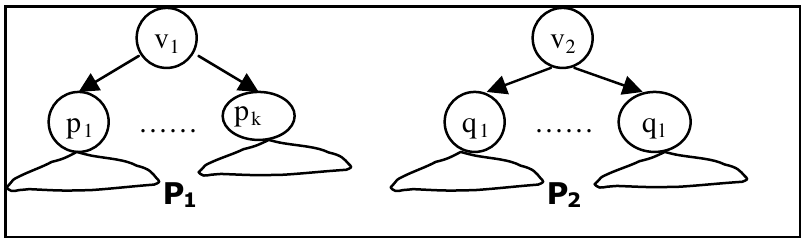

图 3. 两个子计划 P1 和 P2。

图 4(a) 构造的子计划从父节点直接计算 $v _ 1$ 和 $v _ 2$ 的子节点，因而避免计算和物化 $v _ 1$ 、 $v _ 2$ 的代价。当然，只有当 $v _ 1$ 和 $v _ 2$ 都不是必需节点时，才会生成这种子计划。另一方面，图 4(b) 构造的计划会计算并物化 $v _ 1$ 和 $v _ 2$ 。无论二者是否为必需节点，都可以考虑这种计划。直观上，当 $v _ 1\cup v _ 2$ 的大小比 $v _ 1$ 或 $v _ 2$ 大不了多少时，子计划 (a) 可能较好；当 $v _ 1\cup v _ 2$ 比 $v _ 1$ 和 $v _ 2$ 大得多时，子计划 (b) 则可能较好。前者更可能出现在 $v _ 1$ 和 $v _ 2$ 的值高度相关时，后者更可能出现在二者独立时。

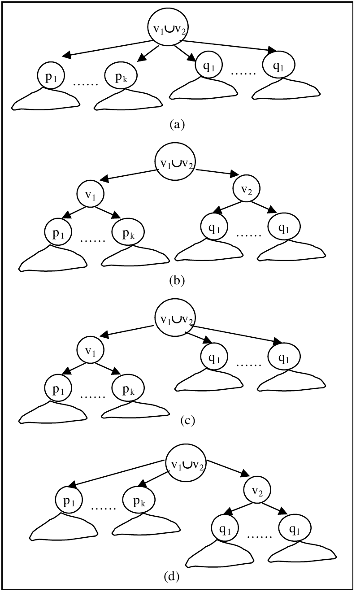

图 4. SubPlanMerge 算子引入的新子计划空间。

当 $v _ 1$ 和 $v _ 2$ 中恰有一个远小于 $v _ 1\cup v _ 2$ 时，子计划 (c)、(d) 可能有利。例如，若 $v _ 1\cup v _ 2$ 的大小仅略高于 $v _ 2$ ，却显著高于 $v _ 1$ ，那么子计划 (c) 可能是最佳计划。这是因为，虽然 $q _ 1,\ldots,q _ l$ 这些子计划改为从 $v _ 1\cup v _ 2$ 而非 $v _ 2$ 计算，代价会上升，但省去计算和物化 $v _ 2$ 所节约的代价可能超过这部分增加。另一方面，对于 $p _ 1,\ldots,p _ k$ 这些子计划，即便支付了计算和物化 $v _ 1$ 的代价，从 $v _ 1$ 计算它们也可能更有利。

如果 $v _ 1$ 和 $v _ 2$ 之间存在包含关系，这在实践中很常见，那么图 4 中的 (b)、(c)、(d) 会退化为同一种情况：从 $v _ 1$ 计算 $v _ 2$ ，再从 $v _ 2$ 计算 $q _ 1,\ldots,q _ l$ ，这里假设 $v _ 2\subseteq v _ 1$ 。

### 4.2 GB-MQO 问题的算法

图 5 给出了为关系 R 上的输入集合 $S=\lbrace s _ 1,\ldots,s _ n\rbrace$ 计算逻辑计划的算法。它从每个 $s _ i$ 都直接从 R 计算的“朴素”计划开始，逐步改进解，直到达到局部最小值。与此前针对该问题的算法 [2,10,14,21] 不同，我们的算法不要求将搜索 DAG 作为输入，而是自底向上构造逻辑计划。因此，它能够扩展到较大的输入，例如计算多列关系上所有单列 Group By 查询这一常见情形。

```text
1.  令 P 为朴素计划，即每个 si ∈ S 都是一个直接从关系 R 计算的子计划。
2.  令 C = Cost(S, P)。
3.  Do
4.      令 MP 为对 P 中每对子计划调用 SubPlanMerge 所得到的全部计划集合。
5.      令 P′ 为 MP 中代价最低的计划，其代价为 C′。
6.      BetterPlanFound = False
7.      If C′ < C Then
8.          P = P′; C = C′; BetterPlanFound = True
9.      End If
10. While (BetterPlanFound)
11. Return P
```

图 5. 为给定 Group By 查询集合 S 寻找逻辑计划的算法。

**运行时间分析。** 令 $\lvert S\rvert=n$ 。上述算法的朴素实现会调用 SubPlanMerge $O(n^3)$ 次，因为每轮循环执行 $O(n^2)$ 次合并，最坏情况下有 $O(n)$ 轮。不过，容易看出，如果愿意保存先前各轮已计算的逻辑子计划，需要存储 $O(n^2)$ 个子计划，那么算法只需调用 SubPlanMerge $O(n^2)$ 次。这使算法在运行时间和内存需求两方面，都能够扩展到相对较大的输入，例如数百个 Group By 查询。

**将搜索空间限制为二叉树。** 根据上述算法及 SubPlanMerge 返回的四类子计划，容易看出，一般情况下逻辑计划可以是任意形状的树。如前所述，一种重要的数据分析特例是计算所有单列 Group By 查询。在这个特例中，全部输入互不重叠，即任意两个输入都没有公共列，例如 $S=\lbrace (A),(B),(C),(D)\rbrace$ 。对于这种情况，我们在实验中观察到（见第 6.5 节），仅搜索二叉树可以节约相当多的优化时间，同时仍能在实践中得到很好的逻辑计划。这种限制类似于许多现有查询优化器仅考虑左深树的搜索空间限制。由于算法的每一步只考虑对子计划进行两两合并，因此对于上述情形，只要将 SubPlanMerge 限制为仅产生 (b) 类计划，就能将逻辑计划空间限制为二叉树。

### 4.3 剪枝技术

本节介绍两种技术，对 GB-MQO 算法（第 4.2 节）考虑的执行计划空间进行剪枝。它们是在基数代价模型、且仅应用图 4 的 SubPlanMerge (b) 的限制下推导出来的，因此在一般情况下是启发式方法；不过，在实验使用的多个真实数据集上表现良好（第 6.6 节）。这些剪枝技术显著缩短了算法运行时间，对所生成逻辑计划的代价影响相对较小。

#### 4.3.1 基于包含关系的剪枝

第 4.2 节算法的第 4 步考虑合并任意一对子计划。剪枝的直觉是，从更近的祖先计算 Group By 应当更便宜：在算法第 4 步中，给定分别以 $v _ i$ 和 $v _ j$ 为根的两个子计划，如果存在以 $v _ x$ 和 $v _ y$ 为根的两个子计划，使得 $(v _ x\cup v _ y)\subset(v _ i\cup v _ j)$ ，就不考虑合并 $v _ i$ 和 $v _ j$ ，即不考虑以 $v _ i\cup v _ j$ 为根的子计划。例如，如果有三个子计划分别以 (A,B)、(B,C)、(C,D) 为根，就不考虑合并以 (A,B) 和 (C,D) 为根的子计划，因为 $(A,B)\cup(B,C)\subset(A,B)\cup(C,D)$ 。

**命题。** 假设 $v _ i$ 与 $v _ j$ 不重叠， $v _ x$ 与 $v _ y$ 也不重叠。在使用基数代价模型、且将 SubPlanMerge 限制为图 4 的 (b) 类型时，上述剪枝技术是正确的，即不会影响算法找到的答案。

**证明。** 用 $\mathrm{Cost}(u)$ 表示以节点 u 为根的子计划 $T _ u$ 的代价，以 $\mathrm{Child}(u)$ 表示 u 的子节点集合，以 R 表示基关系。于是，合并分别以 u、v 为根的两个子计划的收益为 $\mathrm{Cost}(u)+\mathrm{Cost}(v)-\mathrm{Cost}(u\cup v)$ 。要证明剪枝正确，需要证明：

$$
\mathrm{Cost}(v _ x)+\mathrm{Cost}(v _ y)-\mathrm{Cost}(v _ x\cup v _ y)\geq\mathrm{Cost}(v _ i)+\mathrm{Cost}(v _ j)-\mathrm{Cost}(v _ i\cup v _ j)
$$

这就能保证算法选择合并 $v _ x$ 和 $v _ y$ ，而不是合并 $v _ i$ 和 $v _ j$ 。根据基数代价模型可知：

$$
\mathrm{Cost}(v _ i)+\mathrm{Cost}(v _ j)=2\lvert R\rvert+\sum _ {c\in\mathrm{Child}(v _ i)}\mathrm{Cost}(c)+\sum _ {c\in\mathrm{Child}(v _ j)}\mathrm{Cost}(c)
$$

$$
\mathrm{Cost}(v _ i\cup v _ j)=\lvert R\rvert+2\lvert v _ i\cup v _ j\rvert+\sum _ {c\in\mathrm{Child}(v _ i)}\mathrm{Cost}(c)+\sum _ {c\in\mathrm{Child}(v _ j)}\mathrm{Cost}(c)
$$

因此：

$$
\mathrm{Cost}(v _ i)+\mathrm{Cost}(v _ j)-\mathrm{Cost}(v _ i\cup v _ j)=\lvert R\rvert-2\lvert v _ i\cup v _ j\rvert\qquad\text{(1)}
$$

类似地：

$$
\mathrm{Cost}(v _ x)+\mathrm{Cost}(v _ y)-\mathrm{Cost}(v _ x\cup v _ y)=\lvert R\rvert-2\lvert v _ x\cup v _ y\rvert\qquad\text{(2)}
$$

因为 $(v _ x\cup v _ y)\subset(v _ i\cup v _ j)$ ，所以 $\lvert v _ i\cup v _ j\rvert\geq\lvert v _ x\cup v _ y\rvert$ 。因此，式 (2) 不小于式 (1)，命题得证。

#### 4.3.2 基于单调性的剪枝

这种剪枝技术与生成频繁项集的 Apriori 算法 [1] 中的剪枝基于相同直觉。给定以 $v _ i$ 、 $v _ j$ 为根的两个子计划，如果 `SubPlanMerge(vi, vj)` 没有得到更低代价的子计划，那么对于满足 $v _ i\cup v _ j\subseteq v _ x\cup v _ y$ 的任意两个子计划 $v _ x$ 、 $v _ y$ ，都不再考虑合并。例如，如果 `SubPlanMerge((A), (B))` 没有得到更低代价的子计划，那么后面就不考虑合并 (A,C) 和 (B,D) 等子计划。由于算法自底向上枚举计划，可以利用这一技术，对潜在的大量计划空间进行剪枝，只需用一个 $n\times n$ 数组保存不能合并的子计划对。

**命题。** 假设 $v _ i$ 与 $v _ j$ 不重叠， $v _ x$ 与 $v _ y$ 也不重叠。在使用基数代价模型、且将 SubPlanMerge 限制为图 4 的 (b) 类型时，上述剪枝技术是正确的。

**证明。** 需要证明，对于以 $v _ i$ 和 $v _ j$ 为根的两个子计划，如果 $\mathrm{Cost}(v _ i)+\mathrm{Cost}(v _ j)\leq\mathrm{Cost}(v _ i\cup v _ j)$ ，那么对任何以 $v _ x$ 、 $v _ y$ 为根，且满足 $(v _ i\cup v _ j)\subseteq(v _ x\cup v _ y)$ 的子计划，都有 $\mathrm{Cost}(v _ x)+\mathrm{Cost}(v _ y)\leq\mathrm{Cost}(v _ x\cup v _ y)$ 。

由基数代价模型可得：

$$
\mathrm{Cost}(v _ i)+\mathrm{Cost}(v _ j)=2\lvert R\rvert+\sum _ {c\in\mathrm{Child}(v _ i)}\mathrm{Cost}(c)+\sum _ {c\in\mathrm{Child}(v _ j)}\mathrm{Cost}(c)
$$

$$
\mathrm{Cost}(v _ i\cup v _ j)=\lvert R\rvert+2\lvert v _ i\cup v _ j\rvert+\sum _ {c\in\mathrm{Child}(v _ i)}\mathrm{Cost}(c)+\sum _ {c\in\mathrm{Child}(v _ j)}\mathrm{Cost}(c)
$$

由于 $\mathrm{Cost}(v _ i)+\mathrm{Cost}(v _ j)\leq\mathrm{Cost}(v _ i\cup v _ j)$ ，可得 $\lvert R\rvert\leq2\lvert v _ i\cup v _ j\rvert$ 。又因为 $v _ i\cup v _ j\subseteq v _ x\cup v _ y$ ，可知 $\lvert v _ i\cup v _ j\rvert\leq\lvert v _ x\cup v _ y\rvert$ 。于是：

$$
\lvert R\rvert\leq2\lvert v _ x\cup v _ y\rvert\qquad\text{(1)}
$$

类似地，有：

$$
\mathrm{Cost}(v _ x)+\mathrm{Cost}(v _ y)=2\lvert R\rvert+\sum _ {c\in\mathrm{Child}(v _ x)}\mathrm{Cost}(c)+\sum _ {c\in\mathrm{Child}(v _ y)}\mathrm{Cost}(c)\qquad\text{(2)}
$$

$$
\mathrm{Cost}(v _ x\cup v _ y)=\lvert R\rvert+2\lvert v _ x\cup v _ y\rvert+\sum _ {c\in\mathrm{Child}(v _ x)}\mathrm{Cost}(c)+\sum _ {c\in\mathrm{Child}(v _ y)}\mathrm{Cost}(c)\qquad\text{(3)}
$$

比较展开式 (2)、(3)，再利用式 (1)，得到 $\mathrm{Cost}(v _ x)+\mathrm{Cost}(v _ y)\leq\mathrm{Cost}(v _ x\cup v _ y)$ 。证毕。

### 4.4 中间存储的考虑

逻辑计划的每个节点对应一个 SQL Group By 查询；对于中间节点，需要将查询结果物化为临时表。这里关注用户可能感兴趣的两类约束：对于给定逻辑计划，最小化执行期间任意时刻中间节点消耗的存储；以及用用户指定的中间临时表最大存储限制来约束计划空间。这些约束很容易纳入现有商业优化器的查询提示框架。

#### 4.4.1 最小化中间存储

一般而言，可以通过广度优先或深度优先遍历执行计划树 P，生成相应 SQL 语句。当节点 u 的所有子节点都已从它计算完成后，就可以删除对应于 u 的中间表，从而降低所需存储。然而，生成 SQL 时遍历执行计划树的方式，会影响中间节点所需的存储。

图 6 的例子说明了这一问题。考虑节点 (ABCD)。如果使用深度优先遍历策略，就必须先执行以 (ABC) 为根的完整子树，再执行以 (BCD) 为根的完整子树，才能删除临时表 (ABCD)。因此，该策略消耗的最大存储是 20（10+6+4），对应同时物化 (ABCD)、(ABC)、(AB) 所需的存储。如果使用广度优先策略，最大存储则为 18（10+6+2），对应 (ABCD)、(ABC)、(BCD) 所需的存储。因此，在这个例子中，广度优先遍历的最大存储需求更低。容易看出，在其他情况下，深度优先遍历可能更好。因此，对每个节点而言，哪种策略更优只取决于其子树中各节点的存储需求。

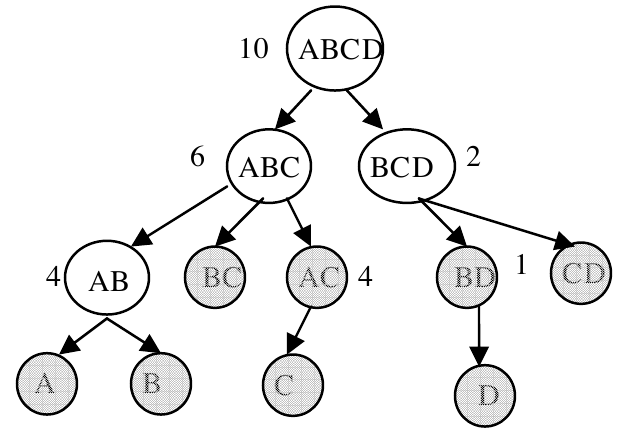

图 6. 执行计划的一棵子树。数字表示物化相应节点所需的存储。

令 u 为任意节点， $d(u)$ 表示物化 u 所需的存储。令 $\mathrm{Storage}(u)$ 表示在所有可能的树执行方式中，以 u 为根的子树所需的最小中间节点存储。令 $v _ 1,\ldots,v _ k$ 为 u 的子节点，则以 u 为根的子树的最小存储可写为以下递推式：

$$
\mathrm{Storage}(u)=\min\left\lbrace \begin{aligned}
&d(u)+\sum _ {i=1}^{k}d(v _ i)\\
&d(u)+\max _ {i=1,\ldots,k}\mathrm{Storage}(v _ i)
\end{aligned}\right\rbrace
$$

第一项表示在节点 u 采用广度优先遍历时所需的中间存储，第二项表示采用深度优先遍历时所需的中间存储。根据上式，可以自底向上计算树中任意节点的 $\mathrm{Storage}(u)$ ，从而在每个节点决定采用广度优先（BF）还是深度优先（DF）遍历。具体而言，根据公式第一项和第二项谁更小，将节点标记为 BF 或 DF。所有节点都标记完成后，按标记遍历树，并按该顺序计算各节点。这种遍历保证计划执行期间消耗的存储最小。

需要注意的是，这种优化可能影响返回首个结果元组的时间，尽管完成整个结果集计算的时间相同。因此，如果用户希望尽早返回首个元组，这种优化可能不适用。另外， $d(u)$ 来自查询优化器的估计，其准确性也取决于优化器统计信息的准确性。

#### 4.4.2 中间存储约束

第 4.4.1 节说明了如何安排给定逻辑计划中的查询执行次序，以最小化该计划的中间表存储消耗。也可以在 GB-MQO 问题（第 3.3 节）中，指定计划中间表所消耗存储的上限。解决这个受约束问题的简单方法，是将图 5 的算法与第 4.4.1 节确定最小存储的算法结合：对第 4 步 MP 中的每个计划，同时计算其最小中间存储，只保留满足指定约束的计划。

## 5. 实现

第 5.1 节概述如何将本文优化技术集成到 DBMS 的查询优化器中，以优化 GROUPING SETS 查询。另一种方法是在客户端，即应用本身中使用这些技术，使现有应用有可能在现有数据库系统上获得这些优化的收益（第 5.2 节）。

### 5.1 与查询优化器集成

第 4.2 节的技术可以在查询优化器内部实现，用于优化 GROUPING SETS 查询。现有查询优化器使用代数变换，将逻辑查询树改写为等价的逻辑查询树 [6]。在 Cascades 风格的优化器 [12] 中，这些变换以基于代价的方式应用。第 4.2 节的算法可以视为获得原 GROUPING SETS 查询等价改写的方法。例如，图 7 展示了计算 `GROUPING SETS ((A), (B))` 的两个等价逻辑表达式。图中标为 Expr 的子树是 GROUPING SETS 查询其余部分的逻辑表达式，例如基关系、连接、选择等。图 5 的 GB-MQO 算法每轮都会考虑不同的逻辑等价表达式，它们各自都与输入 GROUPING SETS 查询等价。此外，还可以基于代价比较这些表达式。

在查询优化器中很容易实现计划估价，因为优化器本来就是基于代价的，我们只需要能够估计任意 Group By 查询结果的基数和平均行大小；现有优化器已经具备这种能力。对含 Group By 查询的查询表达式估计统计信息的技术 [4]，也有助于提高这里的代价估计准确性。

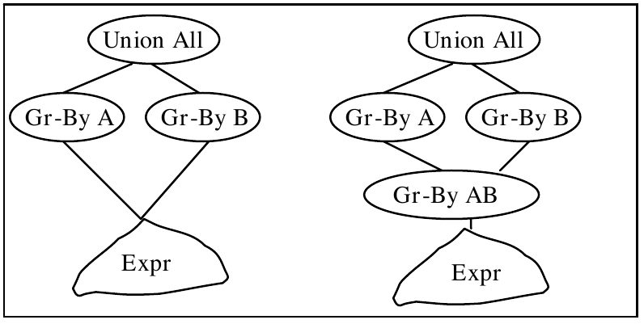

图 7. GROUPING SETS 查询 ((A),(B)) 的两个逻辑等价表达式。

我们的技术不需要新的物理算子。原则上，除了标准 Sort、Hash 算子，还可以使用任何高效计算（部分）立方体的技术，例如 PipeSort、PipeHash [2,21]。这些算子采用共享扫描与共享排序的基本思想 [2,8,15,16,21]。物化中间结果的能力则由 Spool 算子提供，现有 DBMS 同样具备它。

#### 5.1.1 含选择与连接的 GROUPING SETS 查询

一般来说，GROUPING SETS 查询可以定义在任意 SQL 表达式上，而不只是在单个基关系上。交换选择、连接与 Group By 次序的变换 [7] 可以扩展到 GROUPING SETS。容易看出，选择可以下推到 GROUPING SETS 之下，例如成为图 7 中 Expr 的一部分。

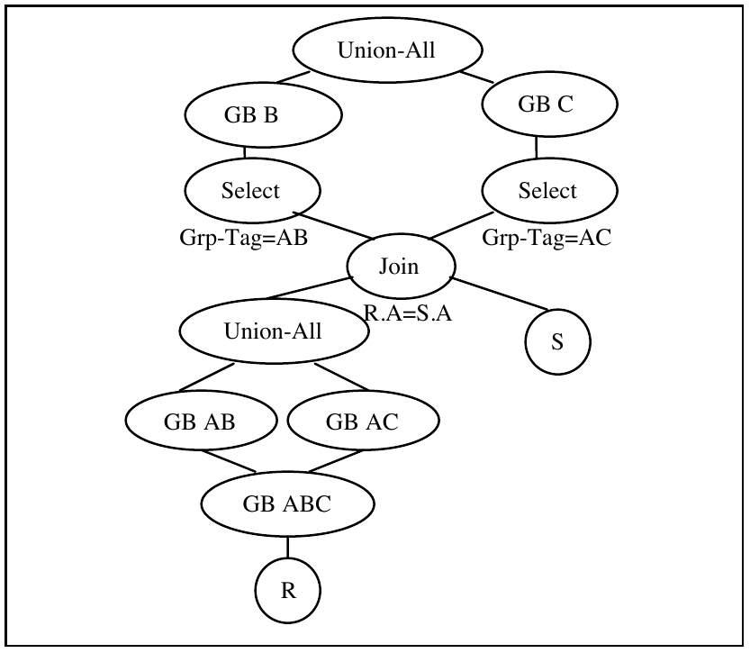

图 8. 视图 Join(R, S) 上 GROUPING SETS 查询 ((B), (C)) 的逻辑表达式。

文献 [7] 中交换连接与 Group By 次序的变换，只需很小改动也能用于 GROUPING SETS。例如，考虑定义在 R、S 两个关系的内连接上的 GROUPING SETS 查询，连接列为 A。假设要计算 `GROUPING SETS ((B), (C))`，为简化讨论，假设 B、C 都属于 R。此时可以使用图 8 的变换，将 Grouping Set 计算“下推”到 R、S 的连接之下。与 [7] 中的 coalescing grouping 变换一样，下推到 R 上的 Group By 查询需要将连接属性加入分组，以便随后与 S 连接。注意，如图所示，可以引入 R 上的 Group By (A,B,C)，再次利用我们的优化技术。

需要注意的重要一点是：Join 下方的 Union-All 会将其下方全部 Group By 的结果合并为单一结果集。因此，必须保证 Join 上方的各个 Group By 只接收各自相关的行。可以为每个元组引入 Grp-Tag，即一个新列，表示它来自哪个 Group By 查询的结果，再用该标记过滤无关行。该变换可以看作将 [7] 中的思想推广到多个 Group By 查询。

### 5.2 客户端实现

如前所述，在数据库服务器尚未对某些数据分析场景提供高效 GROUPING SETS 实现之前，客户端实现可能很有用。在这种背景下，图 5 的算法可视为一种方法，用来确定为了高效执行输入 Group By 查询集合，需要额外执行并物化哪些 Group By 查询。

给定逻辑计划，即算法输出，应用可以按以下方式执行。考虑计划中从 u 到 v 的任意边。假设对应节点 x 的表名为 Tx；若 x 是逻辑计划的根，对应表就是 R。如果 v 是中间节点，因而需要物化，就生成查询：

```sql
SELECT v, COUNT(*) AS cnt INTO Tv FROM Tu GROUP BY v
```

如果 v 是叶节点，就生成查询：

```sql
SELECT v, COUNT(*) AS cnt FROM Tu GROUP BY v
```

注意，如果 Tu 是中间节点而不是 R，就需要将 `COUNT(*)` 替换为 `SUM(cnt)`。

## 6. 实验

如前所述，我们在一个商业 DBMS 之上，采用查询优化器代价模型（第 3.2.2 节），以客户端方式实现了第 4.2 节的算法。本节的实验结果展示：(1) 在真实和合成数据集的某些数据分析场景下，算法显著优于 GROUPING SETS；(2) GB-MQO 计划与最优计划的质量比较；(3) 算法能随表的列数，因而也随 Group By 查询数良好扩展；(4) 将计划空间限制为二叉树的影响（第 4.2 节）；(5) 第 4.3 节剪枝技术的影响；(6) 创建统计信息的开销（第 3.2.2 节）；(7) 数据倾斜的影响；(8) 数据库物理设计的影响。

表 1. 实验使用的数据集。

| 数据集 | 行数 | 大小 | 使用的列数 |
| --- | --- | --- | --- |
| 1g TPC-H (lineitem) | 6M | 1G | 12 |
| 10g TPC-H (lineitem) | 60M | 10G | 12 |
| SALES | 24M | 2.5G | 15 |
| NREF (neighboring_seq) | 78M | 5G | 10 |

实验运行在 Windows XP Professional 机器上，配备 3GHz Pentium4 CPU 和 1 GB RAM。除第 6.1 节所述实验外，全部实验都在 Microsoft SQL Server 上运行。合成数据集为 TPC-H 10GB 和 1GB 数据集中的 lineitem 关系 [24]。真实数据集为一个专有销售数据仓库数据集，以及 PIR-NREF [20] 数据集；对后者，我们使用其最大的关系 neighboring_seq。表 1 总结了数据集及其特征。第 6.1、6.2、6.3、6.5、6.6、6.7 节的 TPC-H 数据集使用基准测试中的标准物理设计：l_shipdate 上的聚集索引，l_orderkey 上的非聚集索引，以及 l_suppkey、l_partkey 组合上的非聚集索引。

### 6.1 与 GROUPING SETS 比较

我们在 TPC-H 数据库上，将算法性能与商业数据库系统支持的 GROUPING SETS 比较，测试两类输入。第一种场景需要计算许多单列 Group By 查询，称为 SC；这时输入之间没有重叠列。第二类输入中，查询之间有许多包含关系，这是 GROUPING SETS 原本针对的场景，简称 CONT。为便于实现，表 2 中报告的 GB-MQO 计划，即一系列 Group By 查询，是在 Microsoft SQL Server 上，对相同数据集和相同物理设计运行我们的算法得到的。理想情况下，所报告的 GB-MQO 计划应使用执行计划的 DBMS 自身的 what-if API 来获得。不过，我们预期，目前报告的计划性能会比这种“理想”方法得到的计划差，因为原生 what-if API 与优化器和查询执行引擎相协调，应能产生更好的 GB-MQO 计划。

在 SC 情形中，输入是除浮点列 l_extendedprice、l_tax、l_discount 之外的全部单列 Group By 查询，因此共有 12 个。从表 2 可见，在 SC 下，我们的方法显著优于 GROUPING SETS。检查 SC 的 GROUPING SETS 查询计划，可以看到，除了先对全部 12 列分组，再从该结果计算全部 12 个 Group By 之外，该计划无法为这 12 个 Group By 安排任何处理共享。由于对 12 列分组的中间结果几乎与基表同样大，这种优化并不足够。另一方面，我们的算法引入了两个包容其他查询的 Group By 查询，并在这两个小得多的中间结果集上执行 12 个 Group By 中的 7 个。因此，我们的算法比使用 GROUPING SETS 快 4.5 倍。

在 CONT 情形中，输入为 {(l_shipdate), (l_commitdate), (l_receiptdate), (l_shipdate, l_commitdate), (l_shipdate, l_receiptdate), (l_commitdate, l_receiptdate)}。此时，GROUPING SETS 与我们的算法性能相当。由于输入之间存在许多包含关系，GROUPING SETS 计划利用共享排序，比对每个输入查询分别执行一次 Group By 的朴素方法更快：它安排排序顺序，使得当一个分组集合包含另一个时，被包含的分组几乎不再增加代价。我们的算法没有引入新的 Group By，而是安排单列分组集合使用索引，或使用双列分组集合中最小的结果集。注意，我们是在客户端实现的，因此只能发出 SQL 查询。如果在服务器内部实现，我们的方法也可能利用上述共享排序。因此，我们预期服务器端实现能比 GROUPING SETS 获得更大的加速。

表 2. 相对于 GROUPING SETS 的加速比。

| 查询 | GrpSet 时间（秒） | GB-MQO 时间（秒） | 加速比 |
| --- | --- | --- | --- |
| CONT | 213 | 167 | 1.2 |
| SC | 1230 | 270 | 4.5 |

### 6.2 在不同数据集上的评估

我们在合成和真实数据集上，研究了算法相对于朴素方法的性能。对每个数据集的全部列，计算单列 Group By（记为 SC）以及双列 Group By 查询（记为 TC）。表 3 总结了运行时间。可以看到，我们的方法始终优于对每个输入查询都在原始表上执行的朴素方法，加速比为 1.9–4.5。虽然此处省略了具体数字，我们观察到，在大多数这些情形下，GROUPING SETS 的性能再次几乎与朴素方法相同。

表 3. 不同数据集上相对于朴素计划的加速比。

| 数据集 | Sales (SC) | NREF (SC) | 10g (SC) | 1g (SC) | Sales (TC) | NREF (TC) | 10g (TC) | 1g (TC) |
| --- | --- | --- | --- | --- | --- | --- | --- | --- |
| Group By 数量 | 15 | 11 | 12 | 12 | 105 | 44 | 66 | 66 |
| 加速比 | 1.9 | 1.4 | 2.3 | 2.3 | 4.5 | 1.7 | 2.3 | 2.0 |

译注：原文正文给出的加速比范围为 1.9–4.5，而表 3 同时列出 1.4 和 1.7；表 1 的 NREF 使用列数为 10，表 3 则列出 NREF 的 SC 查询数为 11、TC 查询数为 44。这里均保留各处原始数据。

### 6.3 与最优计划比较

为了实验研究 GB-MQO 计划与最优计划的质量差异，我们实现了穷举搜索算法，在 Microsoft SQL Server 优化器的代价模型下寻找最优计划。由于穷举搜索具有指数复杂度，我们将列数限制为 7。我们从 TPC-H 1G 数据集的 12 个非浮点列中随机选择 7 列，再计算这 7 列上的单列 Group By，以此随机生成 10 个查询，标为 Q0–Q9。图 9 总结了 GB-MQO 计划和最优计划相对于朴素计划的运行时间降低比例。可以看到，大多数情况下，GB-MQO 计划的质量接近最优计划。

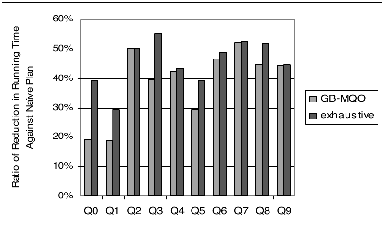

图 9. GB-MQO 计划与最优计划的运行时间降低比例。

### 6.4 随列数扩展

本实验考察，当需要计算全部单列 Group By 查询、并增加表的列数时，算法的可扩展性。我们从 1GB TPC-H lineitem 关系在其 12 个非浮点列上的投影出发，通过重复全部 12 列来加宽表。这里不计创建统计信息的时间，因为这些统计信息也能用于优化许多其他查询，而不限于当前这条 grouping-sets 查询，因而其代价可以摊销。此时优化开销主要由调用查询优化器对查询估价所占据，因此，我们以优化器调用次数作为优化代价指标，同时报告算法得到的计划相对于朴素计划的运行时间。

由于算法具有二次复杂度，如图 10 所示，它在宽表上具有较好的扩展性。优化 48 个单列 Group By 查询可以在 100 秒内完成。再次指出，如果在服务器内部实现，这种优化还能更快，因为优化期间无需创建虚拟中间表，也不需要反复调用查询优化器所带来的开销。

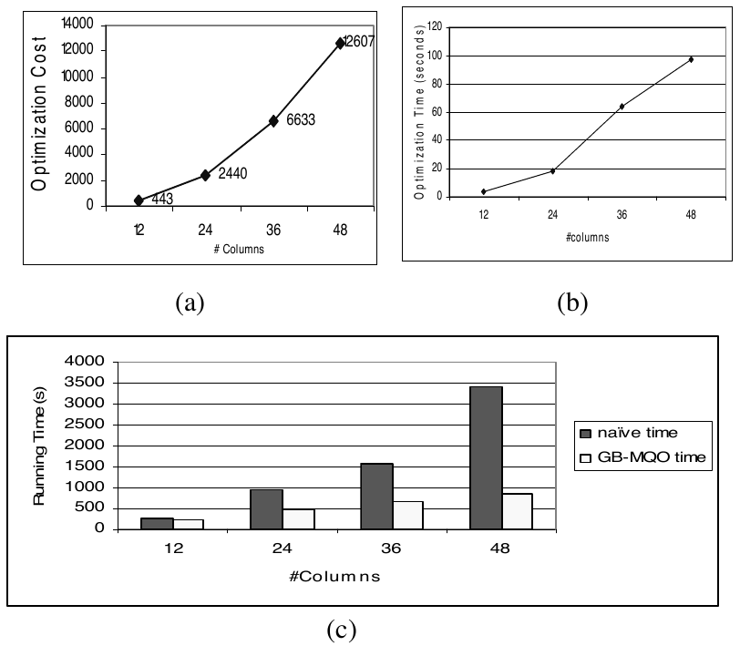

图 10. (a) 查询优化器调用次数；(b) 优化时间；(c) 相对于朴素计划的运行时间。

### 6.5 限制为二叉树计划的影响

我们研究了在 TPC-H 和 Sales 数据库上计算全部单列 Group By 查询时，将算法搜索的计划空间限制为二叉树的影响。具体而言，比较仅应用图 4 的 SubPlanMerge (b)，与应用全部四种合并方式时的优化代价及所找到计划的运行时间。与第 6.4 节一样，用提交给优化器进行估价的查询数，作为优化代价指标。我们发现，在这两个数据集上，优化器调用次数均减少了 30%，而执行时间差异不到 10%。这是因为算法的大部分收益来自合并中间结果较小的子计划。因此，尽管相较于 k 叉树（k 大于 2），二叉树引入了更多需要物化的查询，但物化代价相对较小。

### 6.6 剪枝技术的影响

本实验使用 TPC-H 1G 和 Sales 数据集，评估第 4.3 节剪枝启发式方法对计划质量和算法效率的影响。我们计算全部单列和双列 Group By 查询，比较启用一种或两种剪枝技术时的优化代价，以查询优化器调用次数衡量，以及计划的运行时间。

从图 11 可以看出，基于包含关系的剪枝，图中记为 S，以及基于单调性的剪枝，记为 M，都能大幅缩小双列情形下的搜索空间。两者结合后，优化器调用次数最多可减少 80%，而优化后的计划仍能相对于朴素方法将运行时间降低超过 65%。

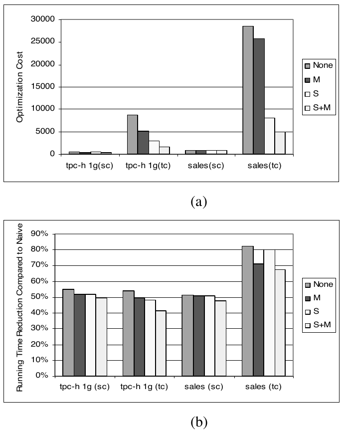

图 11. (a) 查询优化器调用次数；(b) 执行时间。

### 6.7 创建统计信息的开销

本实验研究创建统计信息的开销，将其定义为创建统计信息的时间占运行时间节省量的百分比。我们在 TPC-H 1G 和 10G 数据集上计算全部单列和双列 Group By 查询。假设最初基表上不存在任何统计信息，图 5 的算法启用了基于包含关系的剪枝，并在第一次遇到某个 Group By 查询时，在其分组列上创建一份统计信息。从图 12 可见，与 GB-MQO 计划相对于朴素计划节约的运行时间相比，创建统计信息只占很小一部分。总体上，随着数据集变大，创建统计信息的相对开销似乎会更小。

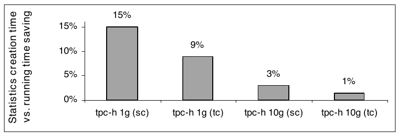

图 12. 创建统计信息的时间与运行时间节省量的比较。

### 6.8 改变数据倾斜

本实验考察数据倾斜对算法的影响。我们生成 TPC-H 1GB 数据集，使用 Zipf 分布，倾斜因子分别为 0、0.5、1、1.5、2、2.5、3，并将算法的执行时间与朴素计划比较。图 13 展示了加速比与数据倾斜的关系。加速比上升是因为某列越倾斜，就越稀疏，即不同值越少。这通常会使子计划合并更有吸引力。

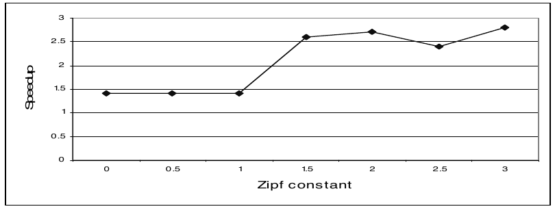

图 13. 加速比与变化的数据倾斜程度（Zipf 分布）的关系。

### 6.9 数据库物理设计的影响

算法（第 4.2 节）的一项吸引人的性质是，它不假定已知物理设计。本实验在 TPC-H 1GB 数据库上，考察算法在不同物理设计下的表现。从组合主键 l_orderkey、l_linenumber 上的聚集索引开始，按以下顺序，每一步增加一个非聚集索引：l_receiptdate、l_shipdate、l_commitdate、l_partkey、l_suppkey、l_returnflag、l_linestatus、l_shipinstruct、l_shipmode、l_comment，并比较每一步之后的运行时间。

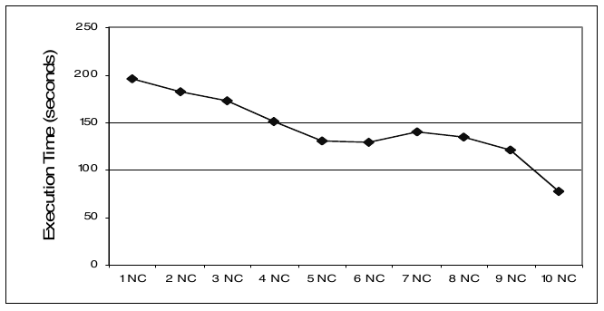

图 14. TPC-H 1GB 上随物理设计的变化。

从图 14 可以看到，我们的方法会自动受益于新增索引，尤其是无法与其他 Group By 合并的高度稠密列，例如 l_comment。进一步检查计划，可以看到生成的计划会适应物理设计。例如，在 l_receiptdate 上建立索引之前，l_shipdate 和 l_receiptdate 被合并在一起；建立索引之后，l_receiptdate 保持单独计算，而 l_shipdate 会与其他列合并。这种适应物理设计的能力并不意外，因为优化器代价模型会自动捕获不同访问计划的影响。

## 7. 扩展

### 7.1 使用 CUBE 和 ROLLUP

逻辑计划中的节点被定义为一个 Group By 查询。不过，某些情况下，计划中同时考虑 CUBE 和 ROLLUP 查询也可能有益。例如，假设 (AB)、(A)、(B) 都是必需节点。那么，相比使用一棵 Group By 查询子树，只使用 (AB) 上单个 CUBE 查询的计划，可能代价更低，同时也能给出相同结果。然而，如果只有 (A) 和 (B) 是必需节点，那么直接在关系 R 上通过 Group By 查询计算 (A)、(B) 的朴素计划，可能比使用 CUBE 算子更高效，因为计算 (A,B) 所做的工作，可能超过它带来的任何收益。ROLLUP 查询也有类似情况。例如，`ROLLUP A, B` 会计算 (A,B) 和 (A)，但不计算 (B)。因此，在某些情况下，它可能比使用 CUBE 或普通 Group By 查询更有利。

可以如下将 CUBE 和 ROLLUP 纳入算法（图 5）：合并两个子计划时，除图 4 中的候选方案外，也考虑将 $v _ 1\cup v _ 2$ 替换为 `CUBE` 或 `ROLLUP` 作用于 $v _ 1\cup v _ 2$ 的查询。查询优化器能够像普通 Group By 一样对 CUBE、ROLLUP 查询估价，因此，这些候选计划同样可以基于代价加以考虑。

### 7.2 处理不同聚合

到目前为止，我们假设全部查询都包含相同的 COUNT(*) 聚合。方案可以扩展到 MIN(X)、MAX(X)、SUM(X) 等其他聚合。在 SubPlanMerge 模块（第 4.1 节）中处理多种聚合的一种方法，是对节点 $v _ 1$ 和 $v _ 2$ 的全部聚合取并集。缺点是，这可能导致节点 $v _ 1\cup v _ 2$ 的大小，具体说是列数，急剧膨胀，从而降低物化它的吸引力。因此，原则上，考虑物化 $v _ 1\cup v _ 2$ 的多个副本，每个副本只包含所需聚合的一个子集，可能更有利。不过，后一种方法的缺点是，计算并物化这些副本的代价可能很高。究竟采用哪种方法，同样可以基于代价决定。由于篇幅所限，我们省略细节。

## 8. 结论

我们提出了一种 GROUPING SETS 查询优化技术，适用于计算关系上全部单列 Group By 查询等常见数据分析场景。与之前的方法不同，我们采用自底向上的方法，不要求将整个搜索 DAG 作为输入。基于代价的方法很重要，因为它既便于集成到现有查询优化器中，也便于从客户端应用高效实现。相较朴素方法，甚至相较现有商业 DBMS 提供的 GROUPING SETS 功能，我们都观察到了显著的性能改善。针对 GROUPING SETS 查询与其他关系算子共同出现的情况，开发相应优化变换，是未来一个值得研究的方向。

## 9. 参考文献

[1] Agrawal, R., Ramakrishnan, S. Fast Algorithms for Mining Association Rules in Large Databases. In Proc. of VLDB 1994, 487–499.

[2] Agrawal et al. On the Computation of Multidimensional Aggregates. In Proc. of VLDB 1996, 506–521.

[3] Agrawal, S., Chaudhuri, S., and Narasayya, V. Automated Selection of Materialized Views and Indexes for SQL Databases. In Proc. of VLDB 2000, 496–505.

[4] Bruno, N. and Chaudhuri, S. Exploiting Statistics on Query Expressions for Query Optimization. Proc. of SIGMOD 2002, 263–274.

[5] Chaudhuri, S., and Narasayya, V. AutoAdmin ‘What-If’ Index Analysis Utility. In Proc. of SIGMOD 1998, 367–378.

[6] Chaudhuri, S. An Overview of Query Optimization in Relational Systems. In Proc. of PODS 1998, 34–43.

[7] Chaudhuri S., and Shim K. Including Group-By in Query Optimization. In Proc. of VLDB 1994, 354–366.

[8] Dalvi N., Sanghai S, Roy P., and Sudarshan S. Pipelining in Multi-Query Optimization. In Proc. of PODS 2001.

[9] Wolfgang Lehner, et al. fAST Refresh Using Mass Query Optimization. In Proc. of ICDE 2001, 391–398.

[10] Gupta, H. Selection of views to materialize in a data warehouse. In Proc. of ICDT 1997, 98–112.

[11] Gupta H., and Mumick, I.S. Selection of Views to Materialize Under a Maintenance-Time Constraint. In Proc. of ICDT 1999, 453–470.

[12] Graefe G. The Cascades Framework for Query Optimization. In Data Engineering Bulletin (Sept 1995), 19–29.

[13] Haas P., Naughton J., Seshadri S., and Stokes L. Sampling-based estimation of the number of distinct values of an attribute. In Proc. of VLDB 1995, 311–322.

[14] Harinarayan V., Rajarama A., and Ullman J. Implementing Data Cubes Efficiently. In Proc. of SIGMOD 1996, 205–216.

[15] Hinneburg A., Habich D., and Lehner W. COMBI-Operator – Database Support for Data Mining Applications. In Proc. of VLDB 2003, 429–439.

[16] Ross K., and Srivastava D. Fast Computation of Sparse Datacubes. In Proc. of VLDB 1997, 116–125.

[17] Ross K., Srivastava D, and Sudarshan S. Materialized View Maintenance and Integrity Constraint Checking: Trading Space for Time. In Proc. of SIGMOD 1996, 447–458.

[18] Jack Olsen. Data Quality: The Accuracy Dimension. Morgan Kaufmann Publishers, 2002.

[19] Roy P., et al. Efficient and extensible algorithms for multi query optimization. In Proc. of SIGMOD 2000, 249–260.

[20] Protein Information Resource (PIR) web site. <http://pir.georgetown.edu/>

[21] Sarawagi S., Agrawal R., and Gupta A. On Compressing the Data Cube. IBM Technical Report.

[22] Scheufele, W., and Moerkotte, G. On the Complexity of Generating Optimal Plans with Cross Products. In Proc. of ACM PODS 1997, 238–248.

[23] Sellis T. Multiple Query Optimization. ACM TODS, 13(1) (March 1988), 23–52.

[24] TPC Benchmark H. Decision Support. <http://www.tpc.org>

[25] Zilio D. et al. Recommending Materialized Views and Indexes with IBM’s DB2 Design Advisor. In Proc. of ICAC 2004, 180–188.

## 附录 A：困难性结果

**命题。** 即便将输入集合 S 限制为仅包含单列 Group By 查询，并使用基数代价模型（第 3.2.1 节），GB-MQO 问题也是 NP 完全的。

**证明。** 我们将 N 个关系的笛卡尔积查询最优 bushy 计划求解问题，简称 XR 问题，归约到 GB-MQO。XR 已知是 NP 完全的 [22]。

在 XR 中，两个关系 $R _ i$ 与 $R _ j$ 的笛卡尔积代价假定为 $\lvert R _ i\rvert\cdot\lvert R _ j\rvert$ ，称为表基数代价模型。给定 N 个关系 $R _ 1,\ldots,R _ N$ ，不失一般性，可以假设每个关系都只有一列，且全部元组互异。可以通过为 $R _ i$ 中的每个元组，将唯一行 ID 与该元组的全部列连接起来，构造新关系 $R _ i'$ ，从而满足这一点。不失一般性，还可以假设 $\lvert R _ i\rvert\gt1$ ，因为在表基数代价模型下，单元组关系不会改变笛卡尔积的代价。

令 $R=R _ 1\times\cdots\times R _ N$ 。注意，以下查询 $Q _ i$ 的结果就是 $R _ i$ ：

```sql
select ci from R Group By ci
```

而以下查询 Q 的结果就是 R：

```sql
select c1, …, cN from R Group By c1, …, cN
```

定义从 bushy 笛卡尔积计划，到从关系 R 计算全部单列 Group By 查询的逻辑计划的映射 f 如下。

笛卡尔积计划中的一个内部节点 n，若表示 $R _ {i _ 1}\times\cdots\times R _ {i _ k}$ ，就映射为：

```text
Qn = select c^(1), ..., c^(k) from QP Group By c^(1), ..., c^(k)
```

其中，如果 n 是根节点， $Q _ P$ 为 R；否则， $Q _ P$ 为 n 的父节点 P 的映射。表示 $R _ j$ 的叶节点则映射为：

```sql
Q = select cj from QP Group By cj
```

容易看出，f 是可逆的。

令 T 为 XR 中所有笛卡尔积计划的空间。我们需要证明：(1) GB-MQO 的最优逻辑计划 $P _ {\mathrm{opt}}$ 位于 $f(T)$ 空间中；(2) $f^{-1}(P _ {\mathrm{opt}})$ 是 XR 的最优连接计划。

**子命题 (1) 的反证。** 等价地，需要证明 GB-MQO 的最优逻辑计划由两个子计划组成，而且两者都是二叉树计划。首先，如果只有一个子计划，它的根必定为 $\lbrace c _ 1,\ldots,c _ N\rbrace$ ，这意味着 $P _ {\mathrm{opt}}$ 不是最优，因为从该根指向 R 的边是冗余的。

译注：上句“从该根指向 R”保留原文方向表述；第 3.1 节将逻辑计划的边定义为从计算来源指向被计算节点。

如果子计划超过两个，就应用 SubPlanMerge (b) 合并前两个子计划，得到新计划 P。令 $n _ 1$ 、 $n _ 2$ 为前两个子计划的根， $c _ x$ 为不包含在两者任一个中的列。则：

$$
\begin{aligned}
C(P)-C(P _ {\mathrm{opt}})
&=\lvert R\rvert+2\lvert n _ 1\cup n _ 2\rvert+\sum _ {e\in T _ 1}w(e)+\sum _ {e\in T _ 2}w(e)\\
&\quad-\lvert R\rvert-\sum _ {e\in T _ 1}w(e)-\lvert R\rvert-\sum _ {e\in T _ 2}w(e)\\
&=2\lvert n _ 1\cup n _ 2\rvert-\lvert R\rvert\\
&=2\prod _ {i\in n _ 1\cup n _ 2}\lvert R^{(i)}\rvert-\lvert R^{(1)}\rvert\cdots\lvert R^{(N)}\rvert\\
&\leq\left(\prod _ {i\in n _ 1\cup n _ 2}\lvert R^{(i)}\rvert\right)\left(2-\lvert R^{(x)}\rvert\right)\leq0
\end{aligned}
$$

其中，对于从 u 指向 v 的边 e， $w(e)=\lvert u\rvert$ 。最后一个不等式来自 $\lvert R^{(x)}\rvert\geq2$ 。这与 $P _ {\mathrm{opt}}$ 是最优计划矛盾。因此， $P _ {\mathrm{opt}}$ 必须有且仅有两个子计划。类似地，如果 $P _ {\mathrm{opt}}$ 的某个节点 n 有 m 个子节点，且 m 大于 2，令 $n _ 1$ 、 $n _ 2$ 为前两个子节点。通过引入 $n _ 1\cup n _ 2$ 作为 n 的子节点，再将 $n _ 1$ 、 $n _ 2$ 作为 $n _ 1\cup n _ 2$ 的子节点，可以构造代价更低的新计划 P：

$$
\begin{aligned}
C(P)-C(P _ {\mathrm{opt}})
&=2\lvert n _ 1\cup n _ 2\rvert-\lvert n\rvert\\
&=\left(\prod _ {i\in n _ 1\cup n _ 2}\lvert R^{(i)}\rvert\right)\left(2-\prod _ {j\in(n-n _ 1\cup n _ 2)}\lvert R^{(j)}\rvert\right)\leq0
\end{aligned}
$$

最后一个不等式成立，是因为 $n-n _ 1\cup n _ 2$ 非空，而且任意 $\lvert R^{(i)}\rvert\geq2$ 。因此， $P _ {\mathrm{opt}}$ 必须是二叉树。

译注：以上证明按原文保留。原文由“不大于 0”的代价差，直接声称与最优性矛盾，并在后一处称新计划“代价更低”；未另外讨论等号情形。

**子命题 (2) 的证明。** 给定连接计划树 T，有：

$$
C(T)=\sum _ {n\in I}\lvert n\rvert+\sum _ {n\in L}\lvert n\rvert=\sum _ {n\in I}\lvert n\rvert+\lvert R _ 1\rvert+\cdots+\lvert R _ N\rvert
$$

其中 I 和 L 分别是内部节点集合与叶节点集合。注意，第二项为常数，因此最小化 $C(T)$ 等价于最小化第一项：

$$
C'(T)=\sum _ {n\in I}\lvert n\rvert
$$

令 P 为 $f(T)$ 。注意：

$$
C(P)=\sum _ {n\in I}2\lvert n\rvert=2\cdot C'(T)
$$

因此，如果能够找到使 $C(P _ {\mathrm{opt}})$ 最小的最优 Group By 计划 $P _ {\mathrm{opt}}$ ，令 $T _ {\mathrm{opt}}=f^{-1}(P _ {\mathrm{opt}})$ ，则：

$$
C(T _ {\mathrm{opt}})=0.5\times C(P _ {\mathrm{opt}})+\lvert R _ 1\rvert+\cdots+\lvert R _ N\rvert
$$

也达到最小。证毕。
