# An Experimental Comparison of Thirteen Relational Equi-Joins in Main Memory（中文译文）

## 译者说明

本文依据同目录的 `source.pdf` 翻译。章节、图表、公式、算法、代码与参考文献按原文结构保留。

Stefan Schuh、Xiao Chen、Jens Dittrich<br>
萨尔大学，信息系统组<br>
http://infosys.cs.uni-saarland.de

SIGMOD ’16，2016 年 6 月 26 日至 7 月 1 日，美国加利福尼亚州旧金山。DOI：http://dx.doi.org/10.1145/2882903.2882917

## 摘要

关系等值连接是几乎所有查询计划的核心。自数据库研究领域诞生以来，人们便不断研究、改进和重新审视这类算法。过去四年间，多种新连接算法被提出并进行了实验评估。其中一些论文的实验发现彼此矛盾，使一个非常简单的问题变得出人意料地难以回答：2015 年最快的连接算法是什么？本文尝试给出答案。我们首先对最重要的方法进行端到端黑盒比较，随后通过白盒比较检查这些算法的内部实现。通过软件写合并缓冲区、不同哈希表实现，以及数据放置和调度方面的 NUMA 感知优化，我们推导出先进连接算法的改进变体，同时考察不同的基数分区策略。最终，我们能够对十三种不同的连接算法展开全面比较，考虑输入数据集大小、线程数、不同页大小及数据分布带来的扩展性影响。我们还分析了不同连接对一个未经修改的 TPC-H 查询的影响。最后，总结研究中得到的主要经验，为实现大规模内存连接的实践者提供指导。正如数据库中的几乎所有算法一样，我们将看到，没有一种连接算法在所有情形下都最好。每种算法都有自己的长处与短处，在参数空间的不同区域表现出色。

## 1 引言

数据库研究充满传统，其中最显著的传统之一就是每年发表新的连接算法。没错，我们说的是关系数据上的等值连接，并非概率 JSON 数据流上某种花哨的近似相似性连接。经过 40 年数据库研究，一个处于几乎所有查询计划核心的领域仍在不断进步，这难道不神奇吗？关系等值连接算法难道不应该早已解决了吗？那么，为什么还值得关心？

仔细阅读 2011–2015 年大量关系等值连接相关研究 [7,6,14,3,17,4,5]，很快就会发现，仅凭这些文献很难确定哪个连接算法最好。例如，[4] 似乎清楚表明，至少在 SIMD 寄存器宽度有限的当前硬件上，基于哈希的方法优于基于排序的方法。但对于不同的哈希表连接实现，硬件感知的分区算法（PRB 算法族）是否优于硬件无关的不分区算法（NOP 算法族），仍不清楚。2011 年 [7] 的实验表明 NOP 优于 PRB，2013 年 [4] 的实验则恰好相反，PRB 优于 NOP。同在 2013 年，[14] 又得出 NOP 优于 PRB。那么究竟哪个更好？奇数年选 NOP，偶数年选 PRB？答案是我们不知道。更值得问的是，这些实验为什么给出矛盾的结果？原因有几个。

1. **使用的实现不同。** [7] 的 NOP 实现非常基础，用链表实现并发链式哈希表，锁与头指针放在两个独立数组里。[5] 则提供更具缓存效率的链式实现，把锁和元组放入同一个数组并删除头指针。[14] 的 NOP 通过线性探测与 Compare-and-Swap 指令实现无锁哈希表。另一个例子是 PRB，[5] 重新实现了 [7] 的 PRB，因为后者关键路径中的函数调用与指针解引用过多。
2. **优化不同。** [4,6] 为 PRB 使用软件写合并缓冲区，[14,7] 没有使用，而 [5] 中论文所报告的结果是否使用这项优化并不明确。[14] 使用线性探测哈希表，[5,4,6] 使用链式哈希。[7,4] 完全没有考虑 NUMA 感知连接处理，而 [14,4] 至少把输入关系与工作内存分布在全部 NUMA 节点上。〔译注：此处 [4] 同时出现在原文两组描述中，按原文保留。〕
3. **性能指标不同。** “连接吞吐量”的定义便不相同。[4] 定义为每秒产生的连接结果数，即  $\mathrm{Throughput}=\lvert R\bowtie S\rvert/\lvert\mathrm{total\ runtime}\rvert$  。这关注输出元组数量，因此受连接选择率影响。[14] 则把吞吐量定义为两个输入关系大小之和除以总运行时间，即  $\mathrm{Throughput}=(\lvert R\rvert+\lvert S\rvert)/\lvert\mathrm{total\ runtime}\rvert$  。这关注连接输入，与连接选择率无关。本文使用后一种定义。
4. **机器不同。** [7] 使用单路六核 Intel Xeon X5650 Nehalem，[5] 报告了多种架构的结果，其中八核 Intel Xeon E5-2680 服务器性能最佳。[14] 使用四颗八核 Intel Xeon X7560 Nehalem CPU。[5] 同样使用了四颗八核 Intel CPU，不过采用 Sandy Bridge 架构。
5. **微基准与真实查询的差别。** [7,6,5,14,3,17,4,13] 没有考察真实查询（至少也应是 TPC-H 查询）的总执行时间，真实查询包含连接后谓词求值需要访问的多个属性。选择下推这类简单技术就可能显著缩小连接输入，即使原始关系很大。在这种情形下，连接算法的选择可能不再那么重要。另外，元组重建已被证明会显著影响查询总时间 [2]。连接是否包含元组重建，在实践中差别很大，而这些工作没有评估上述影响。

其中任何一项差异，都可能明显影响连接运行时间或对其结果的解释。多项差异叠加后，比较就十分困难，不同论文间的结果几乎无法直接对照。因此，我们认为是时候从头开始，对关系等值连接进行一次清晰的实验比较，本文填补这一空白。我们重点研究哈希连接，因为几乎所有近期研究都认为这类算法最有希望。尽管如此，仍使用一种现代排序连接作为基线 [4]。我们原本还希望使用第二种排序基线 [14]，但没有取得相应代码。近期证据表明排序连接无法匹敌其他连接，因此不进一步探索排序连接。所有算法都在现代 NUMA（非均匀内存访问）架构上评估。

本研究评估的算法基于四篇近期论文 [17,4,14,5]，而这些论文又改进了更早的工作 [13,7,3]。我们还引入其若干变体，总计评估十三种连接算法。本文贡献如下。

1. **黑盒比较。** 从 [14,5,17] 中的核心连接算法出发，它们已改进了 [7,13] 提出的方法，或已被证明优于 [3] 的方法。第 4 节首先对四种主要算法做端到端黑盒比较。
2. **白盒比较。** 启用先前工作提及的全部优化，考察其对运行性能的影响（第 5.1 节），再评估不同哈希表实现对 NOP 与 PRB 的影响（第 5.2 节）。
3. **优化连接算法。** 为提高 NUMA 上的连接性能，优化 PRB 的不同版本。第 6.1 节使分区阶段具备 NUMA 感知能力，相比 PRB 约改善 20%。第 6.2 节表明 NUMA 感知连接任务调度也能改善约 20%。这些收益不能累加，因为 NUMA 感知分区在连接阶段已经利用全部 NUMA 节点，因而无法继续从 NUMA 感知调度中获益。
4. **全面比较。** 第 7 节定义共同负载，对全部算法进行全面比较，并加入一个有实际意义的基线。主键通常使用自动生成的整数 ID，形成稠密整数键域。在这种分布下，简单数组可能比哈希表更好。虽然在稀疏域中其实用性值得质疑，但至少可作为连接算法所能达到性能的基线。对于非稠密分布，[17] 一类压缩数组也可能避免使用完整哈希表。随后考察虚拟内存页大小对各阶段的影响，其效果出人意料。再考察输入大小扩展性，提出基数分区位数的选择策略。附录 A 探索中度与高度倾斜数据，附录 B 考察线程扩展性并解释差异，附录 C 评估中度稠密域中的数组连接，附录 D 评估微架构性能。
5. **真实查询的影响。** 第 8 节从单连接 TPC-H Q19 出发，分析实际连接占查询总时间的比例。附录 E 改变 Q19 谓词选择率，另见附录 F、G。
6. **主要经验。** 第 9 节总结实验的关键经验。

## 2 相关工作

我们关注讨论多核系统上内存连接的论文。当然，内存排序、哈希、分区方面也有大量高度相关的工作，后文适当位置会引用。以下按时间顺序讨论。

Kim 等 [13] 在内存多核系统上重新研究排序与哈希之争，对比经过现代多核优化的哈希连接与排序归并连接。他们的哈希算法称为并行基数哈希连接，实验中比排序归并连接快一倍。他们还建立连接性能分析模型，预测两项未来硬件趋势会使排序归并连接更快。一是更宽的 SIMD 指令，其模型中的排序归并连接性能随 SIMD 宽度近乎线性增长，而哈希连接几乎没有利用 SIMD。二是受限的每核带宽。由于 TLB 条目有限，大数据集的哈希连接至少需要两遍分区，至少三次往返主存，排序归并只需两次。每核带宽受限时，更多主存往返会降低性能。

Blanas 等 [7] 提出不分区哈希连接，扩展了内存多核连接的分类。它完全不分区，是经典简单哈希连接的直接并行版本。他们使用带锁并发链式哈希表，和三种分区方法做比较，即共享分区、独立分区以及 Kim 等 [13] 的基数分区。实验表明不分区连接在几乎所有数据分布上优于分区算法，只在均匀数据上略慢于并行基数哈希连接。

Albutiu 等 [3] 后来的排序归并工作把 NUMA 优化纳入设计空间。其大规模并行排序归并连接（MPSM）仔细调整内存访问模式，尽可能避免线程间同步。实验中，在 32 核四路机器上，MPSM 显著快于不分区哈希连接 [7] 和 Vectorwise 中实现的基数哈希连接 [15]。我们未取得作者代码，因此使用免费公开、且已被证明优于 MPSM 的 Balkesen 等 [4] 的排序连接作为基线。

Balkesen 等 [5] 研究 Blanas 等 [7] 的并行基数与不分区哈希连接，通过提高两者哈希表的缓存效率，并给并行基数连接加入更好的倾斜处理，得到更高吞吐量。第 3 节进一步讨论其算法，本文称为 PRB。实验中，新实现的并行基数连接在几乎所有架构和负载上均优于不分区连接，唯一例外是 Niagara2（每核 8 线程）上使用极大 probe 关系的负载。这与 Blanas 等的结论相反。

Lang 等 [14] 的 NUMA 感知不分区哈希连接再次改变了局面。在四路、64 个硬件上下文的机器上，其不分区方法比 Balkesen 等 [5] 的并行基数连接快两倍以上。第 3 节进一步讨论该算法，本文称为 NOP。

Balkesen 等 [4] 又改进了 Kim 等 [13] 的排序归并和他们自己的并行基数连接 [5]。排序归并使用更宽 SIMD，并通过范围分区支持低同步开销多线程。第 3 节详述，本文称为 MWAY。与 Kim 等的预测相反，更宽 SIMD 尚未使排序归并胜出，实验中并行基数哈希连接仍始终更快。

上述研究关注连接时间，Barber 等 [17] 则研究哈希连接的内存效率，提出高度节省内存的线性探测简洁哈希表（concise hash table，CHT）。第 3 节将讨论相应 CHTJ。他们与 [5] 的不分区和并行基数连接对比，以具有竞争力的性能，将内存占用减少一至三个数量级。

此外，也有针对 GPU [12]、CPU-GPU 混合架构 [10]，以及 PCI Express 连接的协处理器（如 Intel Xeon Phi [11,18]）的优化。这些工作有趣，但超出本文范围。我们关注目前仍广泛使用的现代服务器 CPU。

## 3 内存连接算法的基本代表

近期连接算法大致归入三类，即分区哈希连接、不分区哈希连接和排序归并连接。以下详细讨论每类的一到两个现代变体，作为研究起点。

表 1：第 2 节连接算法的分类。

| 连接类别 | 提出现代变体的论文 |
| --- | --- |
| 分区哈希连接 | [13]、[7]、[5]、[4] |
| 不分区哈希连接 | [7]、[5]、[14]、[17] |
| 排序归并连接 | [13]、[3]、[4] |

同一论文（如 [7]）可能提出多类算法。

### 3.1 分区哈希连接

**核心思想。** 将输入关系划分成小的成对分区（co-partitions），其中一侧通常可放进某一级缓存。目标是减少构建与探测哈希表时的缓存未命中。

**PRB** 是 [5] 描述的两遍并行基数哈希连接。分区连接的问题在于，不同分区很可能位于不同内存页，随机写入大量分区会引发过多 TLB 未命中。PRB 使用两遍分区，保证分区数不超过 TLB 条目数。第一遍将等大的输入区域（块）分给各线程，通过直方图预计算各目标分区的输出内存范围。每个线程由此知道每个分区写到哪里、写多少，不再需要同步。建好直方图后，各线程扫描输入，将元组写到目标区域。第一遍已产生相当数量的分区，第二遍就通过任务队列将整个子分区分派给线程，而非像第一遍那样分配分区中的一块。如有需要，可将大分区分给多线程进一步拆分以处理倾斜。连接阶段，每个线程依次取一对分区，用链式哈希表执行教科书式哈希连接。

表 2：本文所评估算法的参考表。“原始”表示原作者实现，“修改”表示修改原始实现得到变体，“自实现”表示从头实现。

| 算法 | 描述 | 论文 | 代码 |
| --- | --- | --- | --- |
| PRB | 基本两遍并行基数连接，不使用软件管理缓冲与非临时流式写 | [5] | 原始 |
| NOP | 不分区哈希连接 | [14] | 原始 |
| CHTJ | 简洁哈希表连接 | [17] | 自实现 |
| MWAY | 多路排序归并连接 | [4] | 原始 |
| NOPA | 与 NOP 相同，但用数组替代哈希表 | 本文 | 修改 |
| PRO | 使用软件管理缓冲与非临时流式写的单遍并行基数连接 | [5] | 原始 |
| PRL | 与 PRO 相同，但用线性探测替代桶链 | 本文 | 修改 |
| PRA | 与 PRO 相同，但用数组替代哈希表 | 本文 | 修改 |
| CPRL | 使用软件管理缓冲与非临时流式写的分块并行基数连接 | 本文 | 自实现 |
| CPRA | 与 CPRL 相同，但用数组替代哈希表 | 本文 | 自实现 |
| PROiS | 改进调度的 PRO | 本文 | 修改 |
| PRLiS | 与 PROiS 相同，但用线性探测替代桶链 | 本文 | 修改 |
| PRAiS | 改进调度的 PRA | 本文 | 修改 |

前四种是第 3 节基本类别与第 4 节黑盒比较的算法；接着四种用于第 5 节白盒比较；最后五种用于第 6 节并行基数连接优化。

### 3.2 不分区哈希连接

**核心思想。** 并发构建一张全局哈希表，依靠同步多线程与乱序执行自动隐藏缓存未命中代价。与分区连接不同，不需要了解缓存大小或 TLB 条目数来调优。

**NOP** 是 [14] 描述的不分区连接，在线性探测哈希表中用 Compare-and-Swap 实现无锁同步。各线程先获得等大输入块，把 build 关系的块插入全局哈希表。全部插入完成后，每个线程用自己的 probe 块探测全局哈希表。

插入时，线程使用原子 CAS。这是有条件的事务性操作，只有槽位中为空键时才执行，以待插入键替换空键，否则返回 false。由于槽位条目从不删除或覆盖，线程可以随后通过另一个非事务性操作，把 payload 复制入桶。NOP 的另一项优化是把哈希表分配交错分布在所有可用 NUMA 节点，以更充分利用内存带宽。

**CHTJ** 是 [17] 的简洁哈希表连接。CHT 的核心有四个部分。第一是大小为  $n$  的数组  $A$ ，存储全部  $n$  个插入元组，不留额外空槽。第二是哈希函数  $\mathrm{hash}:\mathrm{Key}\mapsto[8n]$ ，其中 Key 是连接键域， $[8n]$  表示从 1 到  $8n$  的全部整数。为简化说明，假设  $n$  是 2 的幂。第三是大小为  $8n$  的位图  $B$ ，标记相应哈希桶是否占用。第四是大小为  $n/4$  的 population count 数组 PC，保存位图置位数的运行累计和，即每 32 位记录此前已存储的元素数。CHT 是一次批量装载、此后只查询的静态结构，十分适合连接。Google sparse hash map [8] 与 CHT 很相似，不过还支持插入与删除。

查询键时，首先检查  $B(\mathrm{hash}(\mathrm{key}))$  是否置位。若置位，说明相应数组槽位被占用，可能存在结果。此时，从 PC 位置  $\lfloor\mathrm{hash}(\mathrm{key})/32\rfloor-1$  取累计置位数，再加上  $B$  在  $[\lfloor\mathrm{hash}(\mathrm{key})/32\rfloor\cdot32,\ \mathrm{hash}(\mathrm{key})-1]$  范围内的置位数。为加速这一过程， $B$  与 PC 在同一结构中物理交错存放。

CHTJ 首先像 PRB 那样，将 build 输入基数分成少量分区。然后分配一个全局 CHT，各线程把自己的分区批量装入不重叠的区域，无需额外同步。最后，probe 处理类似 NOP，各线程用自己的 probe 块查询全局 CHT。此时不再插入，同样无需同步。〔译注：原文的阶段列举由“第二”直接跳为“第四”，这里按实际动作顺序叙述。〕

虽然 build 侧使用分区，我们仍将 CHTJ 归为不分区连接，因为分区只是为了并行构建全局 CHT，之后算法等同 NOP，并未像 PRB 那样对各对分区分别执行独立连接。

### 3.3 排序归并连接

**核心思想。** 排序归并是最古老的数据库连接方法之一。若输入尚未排序，就先按连接键排序，再用高效归并寻找匹配元组。这类算法能利用并产生“有趣顺序”。即使复杂多连接查询中的单个连接性能不佳，整个排序归并连接计划仍可能更好。

**MWAY** 是 [4] 的多路排序归并，与 [13] 也十分相似。数据分区类似 PRB，不过只做一遍、产生少量分区，同时使用第 5.1 节的软件写合并缓冲。随后，每个分区由独立线程归并排序。排序与归并网络采用双调网络，均用 SIMD 指令向量化，并采用多路归并以节约内存带宽。

## 4 黑盒比较

本节比较先前研究也曾比较的基本算法代表，找出结果矛盾的部分原因。表 2 给出全部算法及缩写。论文列指首次发表该具体算法的论文，“本文”表示本文提出；代码列说明所用实现来源。

实验设置与此前连接论文相似。连接元组包含两个 4 字节属性，即连接键与 payload。较小关系中的键稠密且唯一，类似主键。全文使用同一台 60 核机器，详见第 7.1 节。除非另有说明，虽然机器有 60 核，各算法最多使用 32 线程，因为 MWAY 实现只支持 2 的幂个线程。附录 B 才将线程数增加到 32 以上。吞吐量定义为  $(\lvert R\rvert+\lvert S\rvert)/t _ {\mathrm{join}}$ ，即两侧输入元组总数除以算法运行时间。

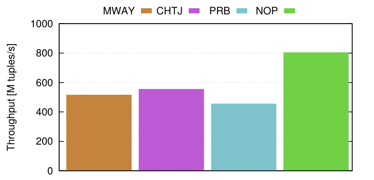

图 1：四种基本连接代表的黑盒比较。使用 32 线程，关系大小为  $\lvert R\rvert=128\mathrm{M}$ 、 $\lvert S\rvert=1280\mathrm{M}$ 。

图 1 显示吞吐量结果，输入分别为 1.28 亿和 12.8 亿元组。这与 [14,17] 的结果接近，却与 [4] 不符，例如后者发现 PRB 明显快于 MWAY。为了理解这种不一致，下一节将仔细检查并行基数分区连接。

## 5 白盒比较

先前发表材料未必清楚说明并行基数连接启用了哪些优化。为提高可比性，本节考察不同方法的可选优化。首先查看 [1] 提供的 PRB 代码，至少有两项优化可以启用。

### 5.1 优化基数分区

**NUMA 感知。** `-basic-numa` 标志把分区缓冲均匀分配到所有 NUMA 节点，否则缓冲会随机落在不同 NUMA 区域。相关研究很可能都启用了它，否则 NUMA 机器上的性能会显著下降。启用此项还有另一个重要影响。

**内存分配局部性。** 在真正连接之前，全部物理页已本地分配并映射到虚拟内存页表，因此执行连接时不再触发缺页及相应分配。数据库本来就有缓冲管理器，我们认为缓冲已被物理分配是合理假设。前节已使用此选项，之后所有实验也继续启用。

**软件写合并缓冲。** [1] 代码中的另一个标志 `-enable-swwc-part` 为并行分区启用软件写合并缓冲（SWWCB）和非临时流式指令。公平地说，此功能被标作实验性，因此早先工作未启用它也有原因。我们还修正了一些不影响性能的小型竞争条件。软件管理缓冲早已为人所知 [20]。每个分区分配一个小型本地缓冲，元组先写入缓冲，缓冲满后才输出，类似磁盘分区中的缓冲写，不过每个缓冲仅一个缓存行大小。缓冲很可能在缓存且只占极少页，只有满缓冲才刷入主存，因而减轻 TLB 压力。若每个缓冲能放  $N$  个元组，TLB 未命中数就减少  $N$  倍。算法 1 展示该过程。

算法 1：使用软件写合并缓冲进行分区。

```text
1: for all tuple ∈ relation do
2:     partition ← hash(tuple.key);
3:     pos ← slots[partition] mod TuplePerCacheline;
4:     slots[partition]++;
5:     buffer[partition].data[pos] = tuple;
6:     if pos == TuplePerCacheline - 1 then
7:         dest ← slots[partition] - TuplePerCacheline;
8:         copy buffer[partition].data to output[dest];
```

启用此项又带来另一重要影响。

**非临时流式写。** 此技术允许绕过全部缓存，将半个缓存行写入 DRAM，避免用永远不会再次读取的数据污染缓存。Schuhknecht 等 [21] 最近详细研究了软件写合并缓冲与非临时流式写对单线程基数分区的影响，我们遵循其指导。

启用全部特性后，得到高效得多的 PRO（采用优化分区的并行基数连接）。

**单遍分区。** 最初 PRO 使用两遍基数分区。我们以微基准对比单遍与两遍，并确定最佳分区数量。图 2 显示单遍、14 位分区吞吐量最高。此后所有 PRO 变体均使用该设置。

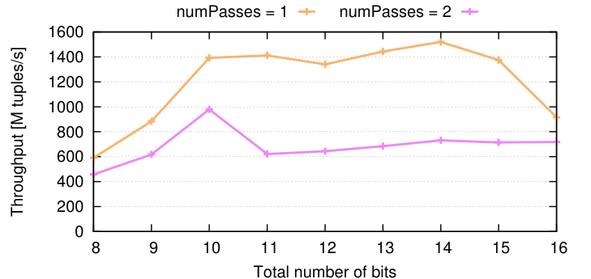

图 2：不同分区大小及基数位数下 PRO 的吞吐量，计入分区和连接阶段的总连接时间；两遍算法将位数平均分给两遍。

### 5.2 哈希方法的选择

**线性探测、链式与 CHT。** 不同算法使用不同哈希表，也使比较更困难。CHTJ 使用简洁哈希表，PRO 使用链式变体，NOP 使用线性探测。我们为 PRO 实现线性探测版本，称为 PRL。不同哈希策略的深入研究见 [19]。

**数组。** 对唯一稠密键域，还可使用更简单的数组。无需显式存储键值对，只需把键作为下标，在相应位置存储值。这一假设初看不现实，但实践中常沿一对多或多对一外键关系连接人工 ID，例如 `ID Integer PRIMARY KEY AUTOINCREMENT`。优化器也容易通过统计信息识别这一情形。数组同样能用于 NOP，于是得到不分区数组连接 NOPA 和并行基数分区数组连接 PRA。它们适用范围当然较小，附录 C 将考察键域有空洞时的效果。

**性能比较。** 应用第 5.1、5.2 节优化后，图 3 重新比较吞吐量。PRO 明显快于 NOP，其表现也接近 [4]。但 PRA、PRO、PRL 的时间几乎没有差异，乍看可能认为哈希方法不影响运行时间，后文第 6.2 节将表明，这一结论是错的。

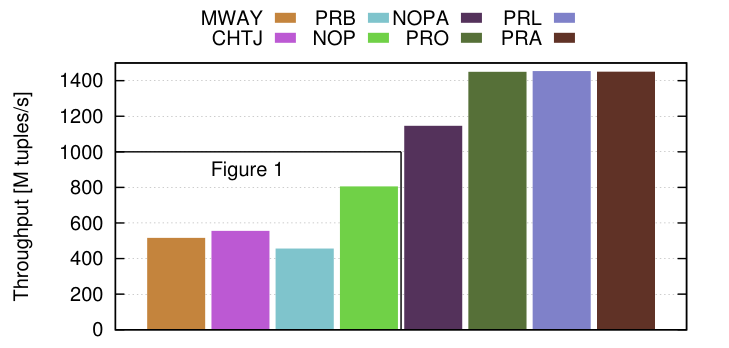

图 3：加入改进版本后的连接吞吐量。与图 1 的黑盒版本相比，性能几乎提高一倍。

## 6 优化并行基数连接

图 3 中 PR* 算法的吞吐量最高，因此我们进一步分别优化分区与连接阶段。

### 6.1 NUMA 感知分区

图 4(a) 展示并行基数分区流程。首先，每个线程顺序读取一段水平输入块，建立本地直方图。其次，一个全局线程合并本地直方图，生成全局直方图，用作目标分区的索引。由于必须等待全部本地直方图完成才能计算最终输出位置，此处需要同步屏障。从技术上说，也可以各线程独立合并直方图，因为第三阶段每个线程只需全局直方图的一部分。

第三，每个线程再次读取本地输入块，将数据放入相应 SWWCB，每线程为每个目标分区保留一个 SWWCB。缓冲满后，通过非临时流式写刷到目标分区的最终位置。第二阶段已确定所有位置，因此无需更多同步。probe 关系按相同分区函数执行相同阶段。两侧分区后，每对分区独立连接，对左侧建表、用右侧探测。因此从高层看，这是适用于 NUMA 的 Grace Hash Join 变体。

分区会触发大量内存读写，特别是向目标位置输出元组。NUMA 中远端访存比本地延迟高、带宽低，草率的访问模式会严重伤害性能。我们分析 PRO 后发现可以避免的随机远端写。图 4(b) 以四 socket、四线程、四分区简化示例展示这种写入模式。基于这一观察，提出分块并行基数分区（CPRL），消除将元组刷入分区时的远端写。

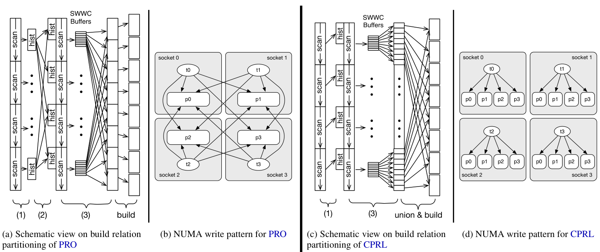

图 4：PRO 与 CPRL 的高层示意及 NUMA 写模式。(a) PRO 的 build 关系分区流程；(b) PRO 的 NUMA 写模式；(c) CPRL 的 build 关系分区流程；(d) CPRL 的 NUMA 写模式。

图 4(c) 展示 CPRL。直方图阶段 (1) 与 PRO 相同，但省去阶段 (2)，不生成全局直方图，而直接进入阶段 (3)，每个线程仅凭本地直方图在自己的块中分区。这相当于在块内运行单线程直方图基数分区。probe 侧采用相同分区函数和相应阶段。两侧完成后，各对分区独立连接。

此时与 PRO 不同，build 和 probe 分区都不在物理连续区域，因此必须先从可能位于远端 NUMA 节点的各个来源读取 build 块，直接装入本地哈希表，再读取对应 probe 块并直接探测。从高层看仍是 NUMA 版 Grace Hash Join，但每次连接的输入无需物理连续。CPRL 由此以大段远端顺序读取替换小粒度随机远端写。它采用与 PRL 相同的线性探测表，一方面较容易集成自己的实现，另一方面相比 Balkesen 等的链式表也略快。若连接阶段改用数组，则称 CPRA。软件写合并缓冲与非临时写同样启用，图 4(d) 展示其写模式。

图 5 按分区与连接阶段拆分端到端时间，对比 PRO、PRL、PRA、CPRL、CPRA。CPR* 比 PR* 快约 20%，分区时间如预期下降，意外的是连接时间也下降了。我们原本用连接阶段从全部 socket 远端读替换分区阶段远端写，因而这一结果有悖直觉，下一节解释原因。

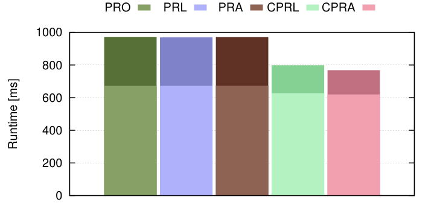

图 5：PR* 与 CPR* 算法运行时间， $\lvert R\rvert=128\mathrm{M}$ 、 $\lvert S\rvert=1280\mathrm{M}$ 。浅色表示分区，深色表示连接。

### 6.2 NUMA 感知调度

PR* 和 CPR* 都生成随后独立连接的成对分区。那么任务如何调度，对性能有什么影响？分区后，任务放入一个 LIFO 队列（实际上是栈），由不同线程处理。PR* 把输入数组划为  $p$  个分区，分区编号与虚拟地址一致，即  $i\lt j$  时， $j$  的起始地址大于  $i$ 。所有 PR*、CPR* 都按  $0,\ldots,p-1$  的升序入队。

执行前，每个输入的四分之一被物理分配在一个 NUMA 区域，分区与建表工作内存也均匀分配，这已存在于 [5] 的代码。假设线程数远小于分区数，典型设置为  $p=16384$ 、 $t=60$ 。原文由此指出，最先的  $\lceil16384/60\rceil=274$  个分区处于同一 NUMA 区域，最先取任务的 60 个线程都要读同一区域，其中四分之三即 45 个线程需远端读取。其他 274 分区块也有相似瓶颈。〔译注：这里关于 274 个分区与 NUMA 区域的对应关系按原文保留。〕

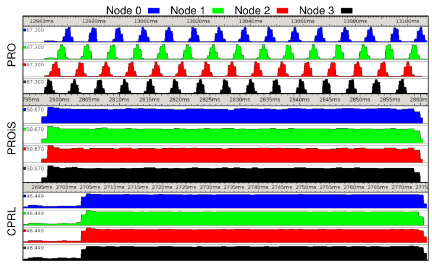

图 6：使用 Intel VTunes 获得的 PRO、PROiS 与 CPRL 带宽剖析。

图 6 表明，PRO 大部分时间只使用一个 NUMA 区域。我们通过重新排列连接任务修正这一点，让所有 PR* 都按轮转方式入队，先放来自第一个 NUMA 区域的分区，再放第二个，以此类推。另一种办法是为每个 NUMA 区域建独立队列。这样各内存控制器很可能同时得到利用。

改进的 PRO 称为 PROiS，类似地有 PRLiS、PRAiS。图 6 显示调度对总带宽利用影响显著，所有 NUMA 节点同时工作。CPRL 虽也使用次优调度，却不受影响，因为每个分区本来就必须从全部节点读取。图 7 显示，改进调度使 PRL、PRA 的连接阶段快两倍以上。正如第 6.1 节的预期，CPR* 的连接阶段现在略贵于 PR*iS，但总时间仍略短。与图 3 不同，此时可以清楚看到不同哈希表实现对时间的影响。

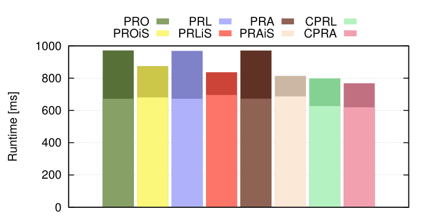

图 7：PR*、CPR* 与改进调度 PR*iS 的运行时间。 $\lvert R\rvert=128\mathrm{M}$ 、 $\lvert S\rvert=1280\mathrm{M}$ 。浅色表示分区，深色表示连接。

## 7 综合比较

在第 4 节黑盒比较、第 5 节基数分区和哈希表分析，以及第 6 节 NUMA 分配与访问优化之后，终于可以全面比较全部连接算法。本节在共同框架中对表 2 的十三种算法展开大规模实验。原 PDF 中算法缩写可点击跳转到描述。倾斜与半稠密域等补充实验见附录。

### 7.1 设置

全部实验使用一台拥有半 TB 主存、四颗 Intel Xeon E7-4870 v2 的服务器，CPU 为 2014 年第一季度发布，主频 2.30 GHz。每颗有 15 个物理核、30 个硬件上下文，共享 30 MB L3。每核有独立 32 KB L1 数据缓存、32 KB 指令缓存与 256 KB L2。4 KB 页时有 256 个 TLB 条目，2 MB 页时却只有 32 个。操作系统为 64 位 Debian 7，内核 3.2.0-4，CPU 支持 AVX 1.0。

与 [13,4,3,14,6] 相同，假定列式存储，每元组是 `<Key, Payload>` 对。为公平比较，键与 payload 都是 4 字节整数，因为一些公开实现只支持这一键宽。除非另有说明，build 关系为稠密主键分布，probe 关系的键与之形成外键关系，此前研究也使用这一配置。

使用原作者 PRO、PRB、NOP 实现，以之为基础实现 PRA、PRL、PRAiS、PROiS、NOPA；CPRL、CPRA、CHTJ 从头实现。由于 build 侧主键稠密，全部哈希连接使用恒等函数对哈希表大小取模，这在此配置中既有效又高效，也是此前研究的做法。Lang 等 [14] 还评估过 Murmur、CRC、乘法哈希，本文不评估哈希函数的影响。全部代码以 C/C++ 编写，gcc/g++ 4.7.2 编译，优化级别 `-O3`。

### 7.2 改变页大小

分区对 TLB 未命中十分敏感，所以页大小很重要。前面均为 2 MB 大页。本节切换内核设置 `transparent_hugepage/enabled` 的 `never` 与 `always`，对比 4 KB、2 MB 页，并确保全部分配使用默认 `malloc` 或 `posix_memalign`。

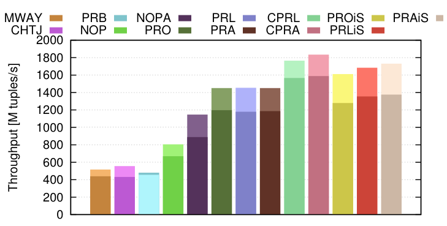

图 8：十三种连接在小页（4 KB，深色）和大页（2 MB，浅色）下的性能。

除 PRB 外，全部算法都因大页获益。PRB 的朴素分区没有 SWWCB，每遍用 7 位产生 128 个分区。小页时分区条目可放进 TLB，大页时却只有 32 个 TLB 条目，很多分区写触发 TLB 未命中。PRO 通过 SWWCB 缓解这一影响。

由于部分算法已明确被其他方法支配，之后不再报告 PRB、PRO、PRL、PRA，并在所有后续实验使用大页。

### 7.3 数据集大小的扩展性

考察两类负载。第一类 probe 是 build 的十倍，这源于 TPC-H 常见比例，以及 OLAP 星型模式中的维表通常远小于事实表。第二类两侧等大，接近哈希连接的最差情形，因为较昂贵的 build 后只有较短 probe。原文接着写道，若 build 比 probe 小，优化器应先交换两侧。〔译注：此句与此前“build 通常选较小关系”的语境存在不一致，保留原文条件。〕另一方面，两侧等大接近排序连接的最佳情形，因为排序代价超线性，两侧大小相同能使总排序代价最小。[4,14] 也用过类似负载。

**微调分区连接。** 扩大输入后，我们很快发现基数算法对分区位数高度敏感。第 5.1 节已在固定大小上考察过。根据图 2，我们原先假定输入加倍就多用一位，使分区大小不变，性能就会好。事实果真如此吗？

图 11 给出随分区数与输入大小变化的单元组平均分区时间。横轴是对数尺度，每格分区数翻倍，分区数量使单分区上的链式哈希表可装入 L2。平均时间直到  $2^{15}$  分区都几乎不变，从  $2^{16}$  开始恶化。这与 SWWCB 大小有关。使用 32 线程、 $2^{15}$  分区、每分区一个缓存行时，全部 SWWCB 加上直方图等工作变量仍可装入共享末级缓存（LLC）， $2^{16}$  时便不行。

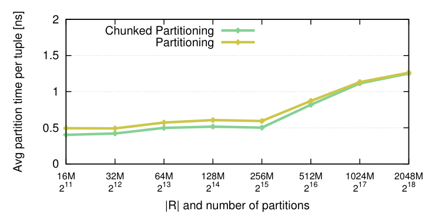

图 11：分块与不分块分区的分区阶段扩展性。

过多分区可能抵消连接阶段的收益。因此，我们对所有分区算法以不同位数做微基准，结果见图 9。(a)、(b) 按哈希表能装进 L2 选择位数，(c)、(d) 则使用总时间真正最短的位数。只要 SWWCB 仍放得进共享 LLC，L2 原则就接近最优。但数据更大时，图 9(b) 分区成本陡增。此时应平衡分区与连接成本，选择能使分区仍装入共享 LLC 的最少位数。

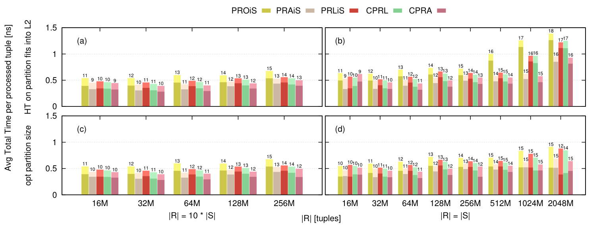

图 9：改变分区基数位数时，每元组的平均总时间（分区加连接）。深色为分区、浅色为连接。(a)、(b) 令分区上的哈希表可装入 L2；(c)、(d) 使用总时间最低的位数。尤其在右列  $\lvert R\rvert=\lvert S\rvert$  且  $\lvert R\rvert\ge512\mathrm{M}$  时，两种选择明显偏离。(b) 中分区成本显著上升，而连接成本不变。〔译注：左列横轴原图写作  $\lvert R\rvert=10\lvert S\rvert$ ，与正文及图 10 的  $\lvert S\rvert=10\lvert R\rvert$  相反，图中按原样保留。〕

**预测最优基数位数。** 设 build 关系大小为  $\lvert R\rvert$ ，元组大小为  $s _ t$ ，连接哈希表目标负载因子为  $l$ ，分区缓冲大小为  $s _ b$ ，L2 大小为  $L2$ ，每线程可用末级缓存为  $LLC _ t$ ，则分区位数为

$$
n_p(\lvert R\rvert)=
\begin{cases}
\log_2\left(\frac{\lvert R\rvert s_t}{l\cdot L2}\right), & \frac{\lvert R\rvert s_b s_t}{L2\cdot l}\lt LLC_t,\\
\log_2\left(\frac{\lvert R\rvert s_t}{l\cdot LLC_t}\right), & \text{其他情况}.
\end{cases}
\qquad\text{(1)}
$$

LLC 在各核间共享，因此每线程份额取决于并发线程数。图 12 用黑点给出 CPRL 在 8–18 位之间的实测时间，用红线给出式 (1) 选定位数的结果，后者几乎总能获得最低时间。其他算法也有类似结果，因篇幅限制未展示。

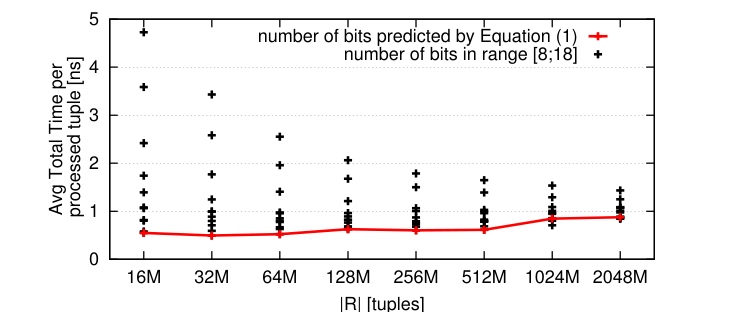

图 12：按式 (1) 设置分区位数时 CPRL 的运行时间。

图 9 还能看到，哈希表实现影响最优分区位数，这是因为其空间效率不同。例如数组连接只保存 payload，键由下标隐式表示，而线性探测表还必须显式保存键。此后全部 PR*、CPR* 都用式 (1) 设定位数，再评估输入大小扩展性。

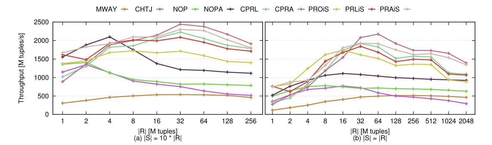

图 10：输入数据集大小变化时的连接吞吐量。(a) $\lvert S\rvert=10\lvert R\rvert$ ；(b)  $\lvert S\rvert=\lvert R\rvert$ 。

**扩展性结果。** 图 10 中，对极小输入（不超过 4M 元组），不同分区方法性能相似。输入扩大后，PR*、CPR* 优于 NOP*、CHTJ、MWAY。NOP* 到 4M 为止表现很好，再增大则下降，符合预期：它们构建一张大型全局哈希表，数据变大后放不进本机 30 MB LLC，build 越大，LLC 与 TLB 未命中概率越高。图 10(a) 中，这种下降持续到  $\lvert R\rvert=32\mathrm{M}$ ，之后几乎不再恶化，因为由于缺少空间邻近性，几乎每次表访问本来就已触发 LLC 与 TLB 未命中，瓶颈已经饱和。

分区方法则相反。虽然内存操作更多，其假设是单元组访存可能昂贵，尤其可能触发 LLC 未命中，类似外存算法把操作组合成大粒度以避免单次磁盘寻道。PR*、CPR* 按分区或内存页这种更大粒度访问并隐式缓存。输入本来就能放入 LLC 时，这种算法模式收益不大，因其假设不成立；一旦输入超过 LLC，便能有效避免逐元组昂贵 DRAM 访问。

不分区方法中，CHTJ 每次操作至少两次随机访问，因此对大小尤其敏感。MWAY 排序归并非常稳定，甚至在大数据上超过 CHTJ。

## 8 对真实查询的影响

此前遵循 [7,6,5,14,3,17,4,13] 的微基准思路，只测多线程连接原始性能。但微基准总会引出重要问题，这些影响放到完整查询中究竟有多大？

实现完整多线程 NUMA 感知执行引擎超出本文范围。不过现代内存数据库通常采用代码编译 [16]，将 SQL 翻译为机器码，然后在无需锁的情况下（本文正是如此）较独立地执行这个程序。因此，我们用 C++ 模拟列存，类似 MonetDB，将每列表示为 `<virtual oid,value>` 数组，虚拟 oid 隐含在数组位置中，详见附录 F。

选择附录 F 清单 1 的 TPC-H Q19，因为它是唯一不含子查询、只有一次连接后再聚合的查询，连接 Lineitem 与 Part。两表存为数组结构，字符串列字典压缩，任意精度数值改用 float。全部外键与主键列表示为 `<Key,Payload>`，payload 是行 ID，这样仅需最少修改即可使用连接实现。

高层计划如图 13，由教科书式查询优化得到，HyperDB 网页 EXPLAIN 也采用同样计划。接口地址为 http://hyper-db.de/interface.html 。下推到 Lineitem 扫描的选择率为 3.57%。SF100 下 build 表 Part 有 20M 元组，probe 表 Lineitem 有 600M 元组，过滤后  $600\mathrm{M}\times3.57\verb0%0=21.42\mathrm{M}$ ，实际两侧连接输入近乎相等。这对应图 10(b) 中  $\lvert R\rvert\approx20\mathrm{M}$  的微基准。

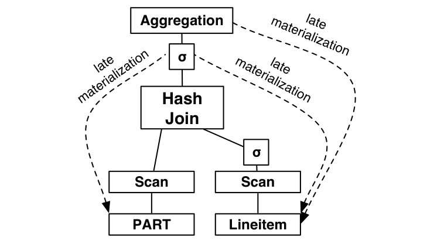

图 13：TPC-H Q19 的优化半物理查询计划，以及列存中的物化策略。

图 13 只算半物理计划，因为未指定何时重建元组。我们采用延迟物化，即操作真正需要时才访问属性，MonetDB 也使用该策略。

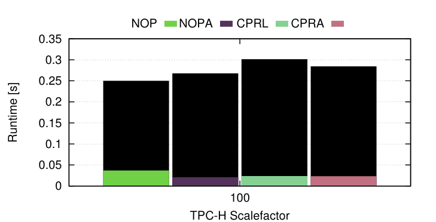

图 14：TPC-H Q19 在 SF100 下的运行时间。彩色部分为真正连接的时间，黑色部分为查询其余时间。

图 14 的彩色时间来自与前文相同的微基准，每种连接收到 20M build 元组和已过滤、已物化的 21.42M probe 元组。查询总时间减去该微基准时间就是黑色部分。由于连接和其他部分可能重叠，这种方法并非完全公平，但可很好地指示实际连接占总时间多少。

即使这个相对简单的查询，大部分时间也花在连接之外。实际连接仅占总时间约 10%–15%，而且不同方法在非连接部分消耗的时间也不同。

原因有几个。首先，连接键稠密且为主键，Part 表甚至按该键有序生成，NOPA 构建数组时具有理想顺序访问（参见第 5.2 节和附录 C）。其次，从 600M Lineitem 元组扫描过滤到 21.42M 本来就耗时。第三，与微基准不同，Q19 必须访问连接键以外的多个属性，以求值 probe 后的复杂谓词并聚合最终结果，也就是执行隐式位置连接进行元组重建。

NOPA 不分区两张表，其他属性仍与连接数组及 probe 关系对齐。特别是 probe 属性在复杂谓词求值时能顺序访问。CPR* 则不具备这一优势，访问非键属性要追随窄连接元组中的行 ID，分区后这些行 ID 指向任意位置，其他属性会污染缓存与 TLB，并丢失访问局部性。因此值得进一步详细探索 CPR* 的元组重建策略。

## 9 经验总结

1. **小输入不要使用 CPR*。** 少于 800 万元组时，在本地块内而非全局分区没有收益，甚至会变慢。主要有两个原因。首先，创建全部线程的开销在小输入上不划算，其他算法也如此。其次，块可能小于一个页，导致页随机落在各 NUMA 节点，多线程不得不远端读写，违背 CPR* 避免远端写的优势。极小输入时 NOP* 很有吸引力，尤其 build 可装进 LLC 时。
2. **明确说明全部实验选项。** 虽然这似乎是实验常识，但我们解释不同论文结果时确实遇到了问题。作者提供的实现通常有多种优化选项，难以知道论文实际启用了哪些。宁可说明得过细，也不要遗漏。
3. **大型连接拿不准时使用分区算法。** 本文对三种不分区、八种分区变体改变两侧比例、大小、线程数与倾斜进行比较，几乎所有情况下分区都更快，只有两类例外。第一是输入扩大到 32 GB 时，最慢的分区算法略慢于最快的不分区算法。第二是 probe 高度倾斜，分区算法线程负载不均，而不分区算法缓存未命中减少。只有 Zipf 因子大于 0.9 时，不分区才开始优于分区。
4. **使用大页。** 第 7.2 节表明，PRB 之外都受益。相同数据所需页数减少，降低 TLB 压力。
5. **使用软件写合并缓冲。** SWWCB 能有效降低 TLB 未命中，让我们采用单遍分区，加速分区算法。
6. **选择正确的分区位数。** 分区方法对位数敏感，不同输入需要不同位数。图 9 表明次优位数可造成最高 2.5 倍性能退化。
7. **能用简单算法时就用。** 稠密主键上数组非常高效，在全部负载中比非数组变体最多快 44%。分块也是简单有效的办法，消除分区远端写，连接最多改善 26%。
8. **确保 NUMA 感知。** PRO、PRB [5] 发表时主要在单路多核机器上测试，未针对 NUMA 设计，直接搬到 NUMA 会次优。本文用分块避免远端写，用 NUMA 感知调度避免单控制器带宽饱和，分别最高改善 26% 和 20%。
9. **注意连接时间不等于查询时间。** TPC-H 实验表明，连接可能仅占总时间 10%–15%。我们找到多种值得未来研究的原因，也再次表明，若希望理解整查询等更大语境的性能，单靠微基准可能误导。

## 10 结论

本文在共同环境中评估十三种内存连接，解释了一些相互矛盾的结果。现代多核 NUMA 上，硬件感知的分区方法通常优于硬件无关的不分区方法，至少 probe 不高度倾斜时如此。极倾斜时，不分区哈希表可追平乃至超过分区方法。我们还提出 CPRL、CPRA，常比此前 PR* 更快，最高达到每秒 34 亿输入元组的连接吞吐量。

关系连接终于能算解决了吗？坏消息是，我们可能永远无法说 100% 解决，因为总会出现花哨的新 SIMD 指令或其他“新”硬件，改变相对性能。好消息是，我们相信本研究大幅推进了对截至 2015 年先进连接算法性能的理解。

不过此前几乎全部工作 [7,6,5,14,3,17,4,13] 都只评估微基准。我们进一步把最有希望的连接放入一个简单 TPC-H 查询，初步实验已表明，连接可能只占总时间一小部分，大部分时间在扫描、过滤和元组重建等处。因此，未来希望交叉评估不同连接算法与广泛元组重建算法的组合，尤其是很有希望的 CPR* 算法族。

## 11 参考文献

[1] https://www.systems.ethz.ch/node/334.

[2] D. J. Abadi, D. S. Myers, D. J. DeWitt, and S. R. Madden. Materialization Strategies in a Column-Oriented DBMS. ICDE, pages 466–475, 2007.

[3] Martina-Cezara Albutiu, Alfons Kemper, and Thomas Neumann. Massively Parallel Sort-Merge Joins in Main Memory Multi-Core Database Systems. PVLDB, 5(10):1064–1075, 2012.

[4] Cagri Balkesen, Gustavo Alonso, Jens Teubner, and M. Tamer Ozsu. Multi-Core, Main-Memory Joins: Sort vs. Hash Revisited. PVLDB, 7(1):85–96, 2013.

[5] Cagri Balkesen, Jens Teubner, Gustavo Alonso, and M. Tamer Ozsu. Main-Memory Hash Joins on Multi-Core CPUs: Tuning to the Underlying Hardware. ICDE, pages 362–373, 2013.

[6] Cagri Balkesen, Jens Teubner, Gustavo Alonso, and M. Tamer Ozsu. Main-Memory Hash Joins on Modern Processor Architectures. TKDE, 27(7):1754–1766, 2015.

[7] Spyros Blanas, Yinan Li, and Jignesh M. Patel. Design and Evaluation of Main Memory Hash Join Algorithms for Multi-Core CPUs. SIGMOD, pages 37–48, 2011.

[8] Google Inc. Google Sparse and Dense Hashes. https://code.google.com/p/sparsehash/.

[9] Jim Gray, Prakash Sundaresan, Susanne Englert, Ken Baclawski, and Peter J. Weinberger. Quickly Generating Billion-Record Synthetic Databases. SIGMOD, pages 243–252, 1994.

[10] Jiong He, Shuhao Zhang, and Bingsheng He. In-cache Query Co-processing on Coupled CPU-GPU Architectures. PVLDB, 8(4):329–340, 2014.

[11] Saurabh Jha, Bingsheng He, Mian Lu, Xuntao Cheng, and Huynh Phung Huynh. Improving Main Memory Hash Joins on Intel Xeon Phi Processors: An Experimental Approach. PVLDB, 8(6):642–653, 2015.

[12] Tim Kaldewey, Guy Lohman, Rene Mueller, and Peter Volk. GPU Join Processing Revisited. DaMoN, pages 55–62, 2012.

[13] Changkyu Kim, Tim Kaldewey, Victor W. Lee, Eric Sedlar, Anthony D. Nguyen, Nadathur Satish, Jatin Chhugani, Andrea Di Blas, and Pradeep Dubey. Sort vs. Hash Revisited: Fast Join Implementation on Modern Multi-Core CPUs. PVLDB, 2(2):1378–1389, 2009.

[14] Harald Lang, Viktor Leis, Martina-Cezara Albutiu, Thomas Neumann, and Alfons Kemper. Massively Parallel NUMA-aware Hash Joins. IMDM, pages 3–14, 2013.

[15] Stefan Manegold, Peter Boncz, and Martin Kersten. Optimizing Main-Memory Join on Modern Hardware. TKDE, 14(4):709–730, 2002.

[16] Thomas Neumann. Efficiently Compiling Efficient Query Plans for Modern Hardware. PVLDB, 4(9):539–550, 2011.

[17] R. Barber, G. Lohman, I. Pandis, V. Raman, R. Sidle, G. Attaluri, N. Chainani, S. Lightstone, and D. Sharpe. Memory-Efficient Hash Joins. PVLDB, 8(4):353–364, 2014.

[18] Orestis Polychroniou, Arun Raghavan, and Kenneth A. Ross. Rethinking SIMD Vectorization for In-Memory Databases. SIGMOD, pages 1493–1508, 2015.

[19] Stefan Richter, Victor Alvarez, and Jens Dittrich. A Seven-Dimensional Analysis of Hashing Methods and its Implications on Query Processing. In PVLDB, 2016.

[20] Nadathur Satish, Changkyu Kim, Jatin Chhugani, Anthony D. Nguyen, Victor W. Lee, Daehyun Kim, and Pradeep Dubey. Fast Sort on CPUs and GPUs: A Case for Bandwidth Oblivious SIMD Sort. SIGMOD, pages 351–362, 2010.

[21] Felix Martin Schuhknecht, Pankaj Khanchandani, and Jens Dittrich. On the Surprising Difficulty of Simple Things: the Case of Radix Partitioning. PVLDB, 8(9):934–937, 2015.

## 附录 A 倾斜数据分布

此前只看均匀数据。接下来改变 probe 倾斜因子，用 Gray 等 [9] 的算法快速生成大量倾斜键。为了更真实，并避免最高频的最小键全落在一个分区，将最小的 10 个键映射为整个域内的随机键。

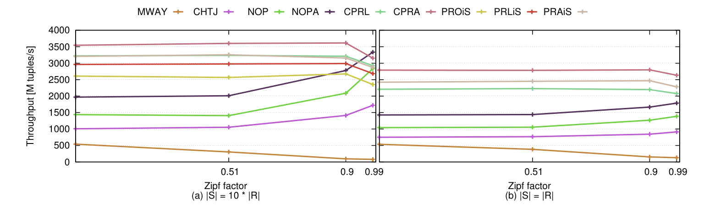

图 15：倾斜数据上连接吞吐量， $\lvert R\rvert=128\mathrm{M}$ 。(a) $\lvert S\rvert=10\lvert R\rvert$ ；(b)  $\lvert S\rvert=\lvert R\rvert$ 。

图 15 的 Zipf 因子  $\theta$  从 0 到 0.99。每种方法选择吞吐量最高的线程数，因此不分区方法用全部超线程，分区方法每核只用一线程以免污染私有缓存。较轻倾斜对算法性能没有实际影响。

高度倾斜时，优势转向不分区方法。首先，分区方法要处理不等大的分区，目前只由任务队列自动处理，大分区的负责线程少做几个分区。我们未利用多线程并行处理最大分区连接。其次，高倾斜使缓存更有效，高频键很可能已缓存。分区本已提高缓存效率，因而该影响对其帮助不大。不过在所展示数据规模上，分区与不分区仍有竞争力。

## 附录 B 线程数的扩展性

此前实验均用 32 线程。MWAY 只支持 2 的幂个线程，所以无法报告超过 32 的结果。我们也试过 64，但结果不具竞争力且不公平，因为 60 核中只有 4 核要各跑两个线程。

从四线程开始，每个 NUMA 区域一线程，增加线程时在四区域间均匀分配。图 16 将线程数从 4 扩展至 120。使用全部物理核即 60 线程时，各方法都较好。所有分区方法使用超线程后变慢，因为超线程连私有缓存也要共享。NOP* 的超线程收益也很小，因为本文哈希函数很快，计算量不够多，无法充分隐藏内存延迟。计算更密集的哈希函数可能更受益。

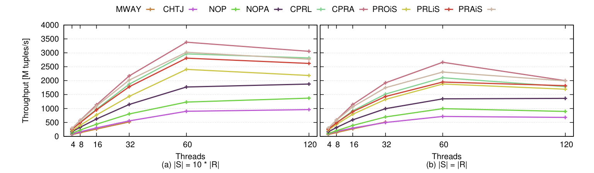

图 16：增加线程数时的连接吞吐量， $\lvert R\rvert=128\mathrm{M}$  元组。(a) $\lvert S\rvert=10\lvert R\rvert$ ；(b)  $\lvert S\rvert=\lvert R\rvert$ 。

表 3 汇总相对加速比。原文把定义写为 `runtime(T > 4 threads)/runtime(4 threads)`，其中  $T$  是线程数，并指出 60 线程的完美加速比应为 15。〔译注：该比值写法与其“完美加速比 15”及表中数据方向相反，按原文保留并说明。〕没有算法达到理论理想值，CPRA、CPRL 接近 12。

表 3：从 4 线程扩展到 60 线程的相对加速比。吞吐量单位 M 元组/秒。(a) $\lvert R\rvert=128\mathrm{M}$ 、 $\lvert S\rvert=1280\mathrm{M}$ 。

| 连接 | 4 线程 | 60 线程 | 总加速比 | Build 或分区阶段 | Probe 或连接阶段 |
| --- | --- | --- | --- | --- | --- |
| CHTJ | 87.3 | 945.7 | 10.8 | 8.4 | 10.9 |
| NOP | 122.1 | 1291.2 | 10.6 | 9.4 | 10.7 |
| NOPA | 176.2 | 1859.5 | 10.6 | 6.8 | 11.2 |
| CPRL | 264.3 | 3105.4 | 11.7 | 12.1 | 10.6 |
| CPRA | 300.1 | 3545.1 | 11.8 | 12.4 | 10.1 |
| PROiS | 212.0 | 2522.9 | 11.9 | 11.3 | 13.2 |
| PRLiS | 263.7 | 2944.0 | 11.2 | 11.3 | 10.8 |
| PRAiS | 302.3 | 3168.0 | 10.5 | 10.7 | 9.8 |

表 3(b)： $\lvert R\rvert=\lvert S\rvert=128\mathrm{M}$ 。

| 连接 | 4 线程 | 60 线程 | 总加速比 | Build 或分区阶段 | Probe 或连接阶段 |
| --- | --- | --- | --- | --- | --- |
| CHTJ | 96.6 | 751.6 | 7.8 | 8.5 | 7.7 |
| NOP | 109.8 | 1043.7 | 9.5 | 9.7 | 9.3 |
| NOPA | 173.0 | 1413.1 | 8.2 | 7.1 | 9.8 |
| CPRL | 260.2 | 2207.9 | 8.5 | 8.5 | 8.4 |
| CPRA | 304.9 | 2790.2 | 9.2 | 9.2 | 9.1 |
| PROiS | 234.2 | 1971.2 | 8.4 | 7.3 | 12.9 |
| PRLiS | 263.5 | 2046.0 | 7.8 | 7.3 | 10.4 |
| PRAiS | 312.3 | 2422.4 | 7.8 | 7.3 | 9.6 |

## 附录 C 键范围中的空洞

此前键域都稠密。本节考察空洞对算法特别是数组方法的影响。生成的 build 键域为  $k\lvert R\rvert$ ，逐渐增加  $k$ 。图 17 显示 NOPA 受影响不大，这是预期结果。即使无空洞，相邻数组元素的探测间隔也很难短到让第二个元组仍留在缓存；大域中相邻元素甚至很可能根本不存在，这种微小机会也消失了。

数组大小当然随键域线性增长，整个连接期间占用更多可用内存。分区数组方法受大域影响严重，因为数组渐渐放不进缓存。可通过更细分区使其重新装入缓存。我们对 PRAiS、CPRA 应用这一办法，图 17 的虚线显示结果。两者内存占用远低于 NOPA，因为只为小分区建临时数组，分区连接后即可释放。另外，域扩大时各哈希表均略慢，因为插入、探测开始出现冲突。

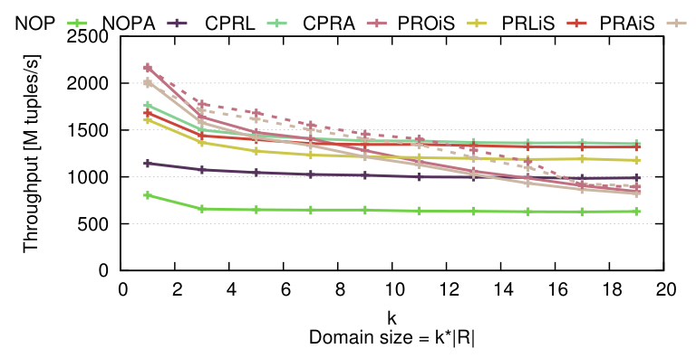

图 17：键域扩大时连接性能， $\lvert R\rvert=128\mathrm{M}$ 、 $\lvert S\rvert=1280\mathrm{M}$ 。CPRA 和 PRAiS 虚线表示按域大小调整分区数后的吞吐量。

只要愿意且能够承担额外内存，NOPA 在任意大域上似乎仍很有竞争力。PRAiS、CPRA 也可处理合理稠密的域，尤其是在按域大小调整分区策略后。

## 附录 D 微架构性能

我们还测量缓存未命中与每周期指令数（IPC），表 4 给出全部结果。缓存未命中以百万计，已退休指令数（IR）以十亿计。分区连接确实大幅减少缓存未命中，连接阶段命中率最高达 99%。CHTJ 多一次位图查找，缓存未命中约为 NOP 两倍，符合预期。分区算法虽然指令更多，但 IPC 也高很多，因此更快。PRA、PRL、PRO 的分区阶段未命中数不同，是因为按式 (1) 分别使用 12、13、14 位。

表 4： $\lvert R\rvert=128\mathrm{M}$ 、 $\lvert S\rvert=1280\mathrm{M}$ 、32 线程时的性能计数器。M 为百万，B 为十亿。表按原文的两个阶段分开呈现。

| 连接 | 排序/Build/分区 L2 未命中 M | L3 未命中 M | L2 命中率 | L3 命中率 | IR B | IPC |
| --- | --- | --- | --- | --- | --- | --- |
| MWAY | 430 | 388 | 0.64 | 0.10 | 260 | 1.36 |
| CHTJ | 559 | 353 | 0.20 | 0.37 | 15 | 0.40 |
| PRB | 558 | 555 | <0.01 | 0.01 | 65 | 0.33 |
| NOP | 394 | 393 | 0.38 | <0.01 | 8 | 0.36 |
| NOPA | 409 | 391 | <0.01 | 0.04 | 6 | 0.27 |
| PRO | 981 | 209 | 0.51 | 0.79 | 42 | 0.87 |
| PRL | 791 | 209 | 0.45 | 0.74 | 41 | 0.90 |
| PRA | 396 | 110 | 0.61 | 0.72 | 41 | 1.05 |
| CPRL | 730 | 193 | 0.47 | 0.74 | 43 | 1.06 |
| CPRA | 341 | 85 | 0.65 | 0.75 | 44 | 1.24 |
| PROiS | 976 | 209 | 0.51 | 0.79 | 40 | 0.83 |
| PRLiS | 788 | 209 | 0.45 | 0.73 | 40 | 0.87 |
| PRAiS | 398 | 110 | 0.61 | 0.72 | 40 | 1.00 |

| 连接 | Probe/连接 L2 未命中 M | L3 未命中 M | L2 命中率 | L3 命中率 | IR B | IPC |
| --- | --- | --- | --- | --- | --- | --- |
| MWAY | 10 | 10 | 0.01 | 0.04 | 17 | 1.78 |
| CHTJ | 1911 | 1561 | <0.01 | 0.18 | 29 | 0.25 |
| PRB | 59 | 40 | 0.98 | 0.33 | 30 | 1.46 |
| NOP | 957 | 955 | 0.39 | <0.01 | 20 | 0.39 |
| NOPA | 335 | 320 | <0.01 | 0.05 | 5 | 0.28 |
| PRO | 60 | 45 | 0.98 | 0.26 | 30 | 1.34 |
| PRL | 86 | 52 | 0.93 | 0.40 | 24 | 1.08 |
| PRA | 88 | 52 | 0.92 | 0.42 | 17 | 0.83 |
| CPRL | 72 | 25 | 0.94 | 0.65 | 29 | 2.26 |
| CPRA | 64 | 24 | 0.94 | 0.62 | 22 | 1.94 |
| PROiS | 31 | 13 | 0.99 | 0.59 | 30 | 2.10 |
| PRLiS | 55 | 23 | 0.95 | 0.58 | 24 | 2.28 |
| PRAiS | 63 | 31 | 0.94 | 0.50 | 17 | 1.80 |

## 附录 E 改变 Q19 选择谓词的选择率

我们还改变 probe 上选择率测量查询性能。图 18 显示，当连接实际 probe 输入变大时，分区连接确实优于不分区连接。

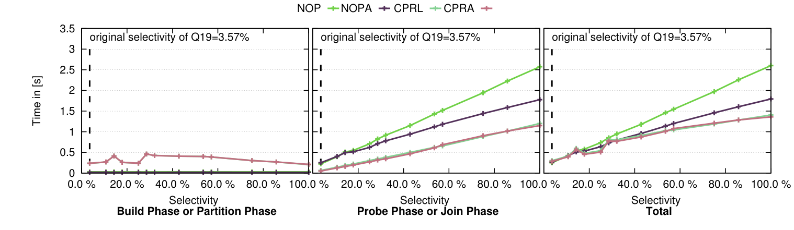

图 18：改变下推选择谓词选择率时 TPC-H Q19（SF100）的运行时间，分别展示 build/分区阶段、probe/连接阶段和总时间；Q19 原选择率为 3.57%。

## 附录 F 使用的 TPC-H 查询

清单 1 给出 TPC-H Q19 的完整 SQL。

清单 1：TPC-H 查询 19。

```sql
select
    sum(l_extendedprice* (1 - l_discount)) as revenue
from
    lineitem,
    part
where
(
    p_partkey = l_partkey
    and p_brand = 'Brand#12'
    and p_container in ('SM CASE', 'SM BOX', 'SM PACK', 'SM PKG')
    and l_quantity >= 1 and l_quantity <= 1 + 10
    and p_size between 1 and 5
    and l_shipmode in ('AIR', 'AIR REG')
    and l_shipinstruct = 'DELIVER IN PERSON'
)
or
(
    p_partkey = l_partkey
    and p_brand = 'Brand#23'
    and p_container in ('MED BAG', 'MED BOX', 'MED PKG', 'MED PACK')
    and l_quantity >= 10 and l_quantity <= 10 + 10
    and p_size between 1 and 10
    and l_shipmode in ('AIR', 'AIR REG')
    and l_shipinstruct = 'DELIVER IN PERSON'
)
or
(
    p_partkey = l_partkey
    and p_brand = 'Brand#34'
    and p_container in ('LG CASE', 'LG BOX', 'LG PACK', 'LG PKG')
    and l_quantity >= 20 and l_quantity <= 20 + 10
    and p_size between 1 and 15
    and l_shipmode in ('AIR', 'AIR REG')
    and l_shipinstruct = 'DELIVER IN PERSON'
)
```

清单 2：表示 Lineitem 与 Part 表的数据结构。

```cpp
struct LineitemTable {
    size_t numTuples;
    float *l_extendedprice;
    float *l_discount;
    tuple_t *l_partkey;
    unsigned int *l_quantity;
    uint8_t *l_shipmode;
    uint8_t *l_shipinstruct;
};
struct PartTable {
    size_t numTuples;
    tuple_t *p_partkey;
    uint8_t *p_brand;
    uint8_t *p_container;
    unsigned int *p_size;
};
```

模拟列存以列指针结构体表示 TPC-H 表，见清单 2，仅保存 Q19 会访问的列。`tuple_t` 是 `<key,payload>`，payload 为 rowID。过滤谓词见清单 3，与清单 1 的 SQL 谓词一一对应。

清单 3：过滤条件。

```cpp
inline bool preJoin(LineitemTable *l, size_t rowID) {
    return (l->l_shipinstruct[rowID] == DELIVER_IN_PERSON
        && (l->l_shipmode[rowID] == AIR || l->l_shipmode[rowID] == AIR_REG));
}
inline bool postJoin(LineitemTable *l, PartTable *p,
                    size_t rowIDL, size_t rowIDP) {
    uint8_t p_brand = p->p_brand[rowIDP];
    uint8_t p_container = p->p_container[rowIDP];
    auto l_quantity = l->l_quantity[rowIDL];
    auto p_size = p->p_size[rowIDP];
    return (p_brand == BRAND12
        && (p_container == SM_CASE || p_container == SM_BOX
            || p_container == SM_PACK || p_container == SM_PKG)
        && l_quantity >= 1 && l_quantity <= 1 + 10
        && 1 <= p_size && p_size <= 5) ||
        (p_brand == BRAND23
        && (p_container == MED_BAG || p_container == MED_BOX
            || p_container == MED_PKG || p_container == MED_PACK)
        && l_quantity >= 10 && l_quantity <= 10 + 10
        && 1 <= p_size && p_size <= 10) ||
        (p_brand == BRAND34
        && (p_container == LG_CASE || p_container == LG_BOX
            || p_container == LG_PACK || p_container == LG_PKG)
        && l_quantity >= 20 && l_quantity <= 20 + 10
        && 1 <= p_size && p_size <= 15);
}
```

清单 4 是 NOP 的 Q19 伪代码。各线程并发在 `p_partkey` 上建表。随后各负责固定 probe 块，访问 Lineitem 中所需属性并求值 `preJoin`。通过的元组探测哈希表，一旦找到连接伙伴，就求值 `postJoin`；再通过时立即访问 `l_extendedprice`、`l_discount` 并累加最终聚合。此策略无需为后续处理物化连接索引，也对应 HyperDB [16] 描述的策略。

清单 4：NOP 的 Q19 伪代码。

```cpp
query_result_t
NOPQ19(LineitemTable *L, PartTable *P, int threadCount) {
    parallelBuild(P,threadCount);
    parallel for in chunks numTuples/threadCount
        for (int i=0;i < L->numTuples;++i) {
            if (preJoin(L,i)) {
                auto tuple=probe(L->l_partkey);
                if (postJoin(L,P,i,tuple.rowID)) {
                    res+=L->l_extendedprice[i] * (1.0 - L->l_discount[i]);
                }}}}
```

## 附录 G Q19 的进一步成本分解

为确定每个组件对总时间的贡献，我们针对 NOP 增加一个实验。从“裸连接”微基准开始，逐步变成 TPC-H Q19，观察每步新加的开销。

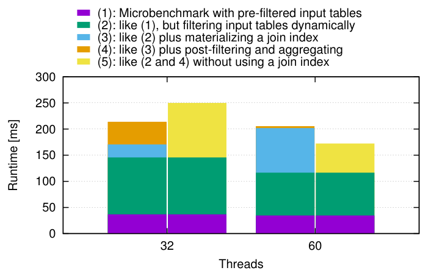

图 19：逐步把微基准变成 Q19 的额外成本分解。(1) 输入预先过滤的微基准；(2) 与 (1) 相同，但动态过滤输入；(3) 在 (2) 基础上物化连接索引；(4) 在 (3) 基础上做后过滤与聚合；(5) 与 (2)、(4) 相同，但不使用连接索引。分别测量 32 与 60 线程，纵轴为毫秒。

从图 19 可以得到几点认识。

1. 元组重建并非额外开销的主要原因。实际上，无论 32 还是 60 线程，此查询大多数新增时间都花在输入过滤上。
2. 先把连接结果写入连接索引，再执行后过滤、元组重建（顺序与此前相同）及聚合，甚至比完全流水线执行更快，但只在 32 线程下如此。60 线程时结果倒转，创建和使用连接索引的开销不再划算。
3. 32 线程下，元组重建算法仍有优化空间，即假定元组重建耗时为零，最多似乎可改善约 20%。
