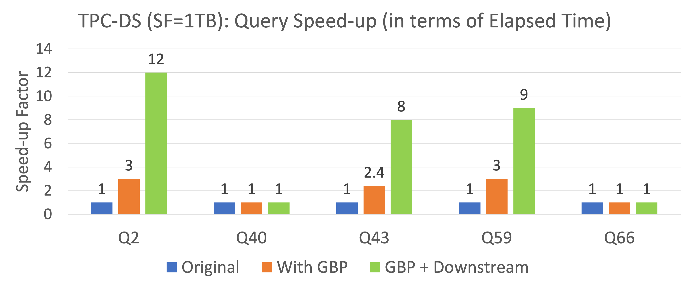
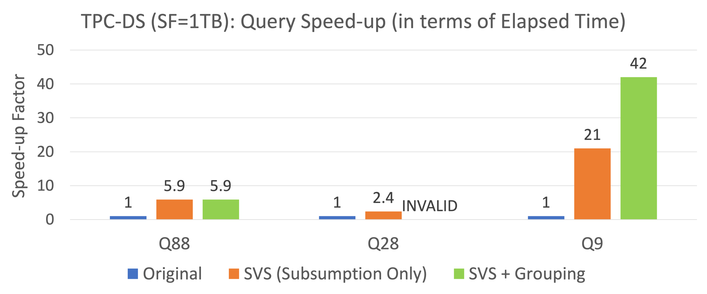

# Grouping, Subsumption, and Disjunctive Join Optimizations in Oracle（中文译文）

## 译者说明

本文依据同目录的 `source.pdf` 翻译。章节、图表、公式、算法、代码与参考文献按原文结构保留。

| 作者 | 机构 | 地点 | 电子邮件 |
| --- | --- | --- | --- |
| Rafi Ahmed | Oracle America Inc. | 美国加利福尼亚州雷德伍德城 | rafi.ahmed@oracle.com |
| Krishna Kantikiran Pasupuleti | Oracle America Inc. | 美国加利福尼亚州雷德伍德城 | kanti.kiran@oracle.com |
| Sriram Tirupattur | Oracle America Inc. | 美国加利福尼亚州雷德伍德城 | sriram.tirupattur@oracle.com |
| Lei Sheng | Oracle America Inc. | 美国加利福尼亚州雷德伍德城 | lei.sheng@oracle.com |
| Hong Su | Oracle America Inc. | 美国加利福尼亚州雷德伍德城 | hong.su@oracle.com |
| Mohamed Ziauddin | Oracle America Inc. | 美国加利福尼亚州雷德伍德城 | mohamed.ziauddin@oracle.com |

## 摘要

查询优化必须随新工作负载演进。随着分析和数据仓库工作负载日益普及，必须深入研究能够减少查询执行期间的数据处理量、共享计算，以及避免昂贵数据访问和连接的优化技术。本文提出聚合分解技术，以增强现有的连接前分组变换。增强后的变换能生成更多查询改写候选，并适用于更多查询。我们还提出两种新的查询变换：一是视图和子查询的包含变换，用来寻找共享计算的机会；二是面向含析取连接谓词查询的 UNION ALL 复制器变换，用来免去多次访问数据和执行连接。这些技术适用于客户负载中常见的查询模式。性能研究表明，它们能带来显著的性能收益。这些技术已在 Oracle RDBMS 中实现。

**PVLDB 引用格式**

Rafi Ahmed, Krishna Kantikiran Pasupuleti, Sriram Tirupattur, Lei Sheng, Hong Su, and Mohamed Ziauddin. Grouping, Subsumption, and Disjunctive Join Optimizations in Oracle. PVLDB, 17(12): 4200–4212, 2024. DOI：[10.14778/3685800.3685837](https://doi.org/10.14778/3685800.3685837)。

原文采用 [知识共享署名-非商业性使用-禁止演绎 4.0 国际许可](https://creativecommons.org/licenses/by-nc-nd/4.0/)。若用途超出该许可范围，请联系 info@vldb.org 获取许可。版权由权利人或作者持有，出版权授予 VLDB Endowment。Proceedings of the VLDB Endowment，第 17 卷第 12 期，ISSN 2150-8097。

## 1 引言

现代数据库工作负载越来越多地由需要处理大量数据的分析查询组成。随着越来越多的数据被收集并上传到数据仓库和混合事务与分析处理（HTAP）系统，分析这些数据以获得洞见的查询仍须以性能最优的方式处理。Oracle 查询优化器利用多种查询变换，把查询改写成与之等价、执行效果更好的形式。子查询、视图和连接是这类查询中常见的结构。为了取得最优形式，通常需要改写这些结构，使新的等价形式能够：一是在执行期间尽可能早地裁减数据，降低后续计算开销；二是共享公共部分，避免冗余计算；三是利用原来不可用的访问路径和操作，等等。本文介绍 Oracle 查询优化器中实现上述目标的若干技术。

在连接前对行分组是一种已知技术 [5, 22]。查询优化器借此减少后续参与连接的行数，提高连接效率。具体做法是在连接前引入新的分组操作。Oracle RDBMS 将这一查询变换称为分组位置选择（group-by placement，GBP），它采用基于代价的框架 [2]。当查询中的聚合表达式引用多个表的列时，先前的工作 [5, 22] 缺少关于进一步拆分这些表达式、从而在这些表的一个子集的连接结果上执行分组的方法。采用本文方案以前，Oracle RDBMS 也缺少这类方法。本文提出的技术允许连接图的子集先行分组，使以前无法得到的最优计划成为可能。执行这种分组时，必须改写原查询的聚合，将分组产生的部分聚合合并为所需结果（示例见第 2.1 节）。如果聚合包含复杂的算术表达式、条件表达式或两者兼有，为 GBP 变换分解这些聚合并不简单。我们展示了如何进行这种分解，从而得到更多分组组合。第 2 节详细介绍这些技术。

包含多个子查询和视图的查询在许多基准测试和客户负载中都很常见。以前的研究 [17, 24] 建议对这类公共查询子表达式求值一次，将结果物化并复用。我们提出了另一种改写方法，将公共计算统一在一个包含它们的内联视图中，从而避免物化。第 3 节讨论这项适用于特定查询形式的技术。

我们在客户负载中观察到一类查询，同时包含合取连接和析取连接谓词。仅执行合取连接时，产出的行数相对于输入很多，即构成一个“膨胀型”连接，而后续的析取连接会淘汰其中许多行。膨胀型连接一旦生成大量中间行，性能就会显著下降。第 4 节提出一种新的执行算子，通过当场生成行的副本，使合取连接谓词与某些析取连接谓词能够同时应用，从而消除中间的膨胀型连接。

上述变换技术已在 Oracle RDBMS 中实现并发布。据我们所知，本文首次描述这些技术，并利用优化阶段的查询改写来驱动它们。

### 1.1 基于代价的查询变换框架（CBQT）概述

Oracle 中相当多的查询变换基于代价，将逻辑变换（亦称查询改写）与物理优化结合起来，生成最优执行计划。在基于代价的变换过程中，先复制查询并对副本执行逻辑变换，然后由基于代价的物理优化器计算代价。对新的变换组合重复多次这一过程。最后，如果一个或多个变换能降低代价，则选中并应用到原查询上。基于代价的查询变换（CBQT）框架 [2] 提供了探索每种变换所产生的状态空间的机制，使 Oracle 优化器能够高效地选出最优状态。

#### 1.1.1 状态空间搜索技术

关于基于代价的变换，一个基本问题是：待评估的候选方案是否会出现组合爆炸，以及应如何权衡优化代价和执行代价。候选方案既来自各种变换本身，也来自适用变换的一组对象，例如子查询块、视图块、表、表组、连接边和谓词。如果有 $N$ 个相互独立的对象适用变换 T，应用 T 最多可能产生 $2^N$ 种候选组合。为简便起见，我们用位数组表示状态，其中第 $n$ 位表示第 $n$ 个对象（例如子查询、视图或表组）是否接受变换，1 表示变换，0 表示不变换。

基于代价的变换的复杂度取决于候选组合数，也就是状态空间的大小，该空间随变换对象数呈指数增长。为限制优化时间可能出现的增长，我们使用多种技术搜索不同变换的状态空间，包括穷举、迭代、线性、两遍搜索和扰动游走。CBQT 框架根据待变换元素的数量、变换的特征和查询整体复杂度，自动选择搜索技术。

## 2 含复杂聚合的查询的分组位置选择

本节先简要回顾 Oracle 现有的 GBP 变换。在该变换中，聚合内涉及的所有表都被视为一个分组单元。接着介绍面向复杂聚合的新分解技术，使这些表组可以进一步拆分。

### 2.1 背景：GBP 变换的形式

根据查询的聚合表达式引用哪些表的列，以及由此决定对哪些表进行提前分组，GBP 主要有三种形式。

第一种称为“合并分组”（coalesced grouping，CG），对列出现在聚合表达式中的表进行提前分组。以图 1 的 Q1 及其变体为例，表 T1 与 T2 按列 `x` 连接，而聚合针对 T1 的列 `a`。应用 GBP 的 CG 变体得到查询 Q1C。新视图 V 先对表 T1 分组，再在外层查询块中与 T2 连接。V 生成外层查询块所需的所有列（`T1.x` 和 `T1.g`）以及部分聚合列 `Sa`。外层查询块中的原聚合 `SUM(T1.a)` 改为 `SUM(V.Sa)`，对各组的部分聚合求和，得到所需结果。

```sql
-- Q1
SELECT SUM(T1.a)
FROM T1, T2
WHERE T1.x = T2.x and T2.k > 4
GROUP BY T1.g;

-- Q1C
SELECT SUM(V.Sa)
FROM T2, (SELECT T1.x, T1.g, SUM(T1.a) Sa
          FROM T1
          GROUP BY T1.x, T1.g) V
WHERE V.x = T2.x and T2.k > 4
GROUP BY V.g;

-- Q1F
SELECT SUM(T1.a * V.CNT)
FROM T1, (SELECT T2.x, COUNT(*) CNT
          FROM T2
          WHERE T2.k > 4
          GROUP BY T2.x) V
WHERE T1.x = V.x
GROUP BY T1.g;

-- Q1CF
SELECT SUM(Vc.Sa * Vf.CNT)
FROM (SELECT T1.x, T1.g, SUM(T1.a) Sa
      FROM T1
      GROUP BY T1.x, T1.g) Vc,
     (SELECT T2.x, COUNT(*) CNT
      FROM T2
      WHERE T2.k > 4
      GROUP BY T2.x) Vf
WHERE Vc.x = Vf.x
GROUP BY Vc.g;
```

**图 1：** 查询 Q1 及 GBP 变换产生的三个变体。

第二种称为“因子分组”（factored grouping，FG），对列未出现在聚合表达式中的表进行提前分组。这些组产生乘法“因子”，用于按比例缩放其他表的聚合。图 1 的 Q1F 展示了 Q1 经过这一变换后的形式。因为现在对表 T2 分组，视图 V 用 `COUNT(*)` 聚合收集表示各组大小的因子。外层查询中的原聚合改为 `SUM(T1.a * V.CNT)`，得到在连接列 `x` 上匹配的各组经缩放后的总和。

第三种结合前两种做法，在外层查询中同时创建合并分组视图和因子分组视图，如图 1 的 Q1CF 所示。

如果原查询采用 `MIN`、`MAX`、`COUNT` 等其他聚合，也很容易推导出类似变体，为简洁起见这里省略。即使原查询没有类似 Q1 中 `GROUP BY T1.g` 的分组子句，或没有聚合函数，这些技术仍可适用。对于只含一个表的查询也可直接适用。此外还有一些 GBP 的专门变体，本文不讨论。

为了便于后文对这些技术做形式化描述，我们引入以下术语。查询的聚合表达式引用其列的表（如 Q1 中的 T1）称为“聚合表”，用集合 AT 表示。其余表（如 Q1 中的 T2）称为“非聚合表”，用集合 NAT 表示。

#### 2.1.1 GBP 变换的状态空间

进行基于代价的 GBP 变换时，对每个符合条件的查询块，先生成多个状态并估算代价，再选代价最低的状态应用于该查询块。我们构造一个连接图，每张表或视图是一个顶点，两张表同时出现在一个连接条件中时，顶点间就有一条边。例如，若连接条件为 `T1.x = T2.y`，则连接图中有一条边连接顶点 T1 和 T2。状态空间由查询块中的表集合、连接图类型（链、星、环、团等）以及前述一种或多种变体能否应用共同决定。GBP 要求连接图是连通的。

每个状态的各个子状态对应上述不同变体。如果查询块有 $N$ 张表，且连接图是一个团（即强连通），则会生成 $3 \ast 2^N$ 种组合（3 个变体和 $2^N$ 个状态）。我们采用启发式方法限制空间的组合爆炸，有时也采用线性探索策略。

状态空间的各状态通过把表划分成 C 和 F 两个集合来生成。C 必须包括所有聚合表，也就是 AT 的超集，F 包括其余的表。另外，如果要为 C 或 F 生成视图，相应集合中的表必须连通，以免引入笛卡尔连接。一个状态的三个变体（子状态）分别只在 C 上生成视图（合并视图），只在 F 上生成视图（因子视图），以及在 C、F 上都生成视图。

```sql
-- Q2
SELECT T2.B2, T3.C3, SUM(T1.A1), COUNT(T1.D1)
FROM T1, T2, T3, T4
WHERE T1.B1 = T2.B2 and T2.D2 = T3.D3 and T3.C3 = T4.C4
GROUP BY T2.B2, T3.C3;
```

**图 2：** 查询 Q2，表 T1 在聚合表集合 AT 中。

考虑图 2 的查询 Q2。它有四张表，其中一张（T1）出现在聚合中，因此 $\mathrm{AT} = \lbrace\mathrm{T1}\rbrace$。生成的状态空间见表 1。每个状态用一组位表示，每张表占一位。位值为 1 表明相应表纳入 C。由于 T1 属于 AT，在所有状态中 T1 都在 C 中。因此，状态空间在其余表上生成。某些状态的 C 或 F 诱导出的连接图可能不连通，因此这类状态的子状态更少。

**表 1：** 查询 Q2 的 GBP 状态空间（AT = {T1}，连接图 = T1–T2–T3–T4）。

| T2 | T3 | T4 | C | F | 连接图连通的集合 | GBP 子状态数 |
| --- | --- | --- | --- | --- | --- | ---: |
| 1 | 1 | 1 | {T1, T2, T3, T4} | ∅ | C | 1 |
| 1 | 1 | 0 | {T1, T2, T3} | {T4} | C, F | 3 |
| 1 | 0 | 1 | {T1, T2, T4} | {T3} | F | 1 |
| 1 | 0 | 0 | {T1, T2} | {T3, T4} | C, F | 3 |
| 0 | 1 | 1 | {T1, T3, T4} | {T2} | F | 1 |
| 0 | 1 | 0 | {T1, T3} | {T2, T4} | — | 0 |
| 0 | 0 | 1 | {T1, T4} | {T2, T3} | F | 1 |
| 0 | 0 | 0 | {T1} | {T2, T3, T4} | C, F | 3 |

### 2.2 含复杂算术表达式的聚合

当聚合表达式包含查询中一部分表的列时，合并聚合要把整个聚合放入 GBP 视图。例如在 Q1C 中，`SUM(T1.a)` 与表 T1 一起被移入视图 V。考虑查询 Q3（图 3），其聚合表达式包含两张表的列。这里不容易进行合并分组，因为整个聚合 `SUM(T1.a * T2.b)` 无法随任何一张表一起移入视图（也不能把两张表都移走，因为要使连接有效，外层查询块必须保留至少一张表）。不过，利用乘法对 `SUM` 的分配性质，可以把一张表（例如 T2）移入合并视图，并按图 3 的 Q3C 改写外层查询块中的聚合。类似地，也可应用因子分组得到变体 Q3F。（不过，Q3C 很可能比 Q3F 更优，并会被剪枝。原文如此表述。）

```sql
-- Q3
SELECT SUM(T1.a * T2.b)
FROM T1, T2
WHERE T1.x = T2.x
GROUP BY T2.g;

-- Q3C
SELECT SUM(T1.a * V.Sb)
FROM T1, (SELECT T2.x, T2.g, SUM(T2.b) Sb
          FROM T2
          GROUP BY T2.x, T2.g) V
WHERE T1.x = V.x
GROUP BY V.g;

-- Q3F
SELECT SUM(T1.a * V.b * V.CNT)
FROM T1, (SELECT T2.x, T2.g, T2.b, COUNT(*) CNT
          FROM T2
          GROUP BY T2.x, T2.g, T2.b) V
WHERE T1.x = V.x
GROUP BY V.g;
```

**图 3：** 对查询 Q3 的表 T2 执行合并分组和因子分组。该查询的聚合内含一个简单算术表达式。

本节余下部分介绍一种算法，将含算术运算符 `*`、`+`、`-`、`/` 组合的表达式进行分解，以完成 GBP 变换。过程分为三步。

1. 规范化，把查询块中的聚合表达式转为标准规范形式。
2. 按照新提出的规则生成 GBP 状态。这些规则识别可移入一个或多个 GBP 视图的表。
3. 针对每个 GBP 状态，使用一组新规则，变换外层查询块中已规范化的聚合，并在视图查询块中生成相应的聚合。

#### 2.2.1 聚合表达式的规范化

考虑图 4 的 Q4，其聚合包含如下复杂算术表达式。

$$
SUM((T1.a + T2.b) \ast (T2.c - T1.d))
$$

```sql
-- Q4
SELECT SUM((T1.a + T2.b)*(T2.c - T1.d))
FROM T1, T2
WHERE T1.x = T2.x
GROUP BY T2.g;
```

**图 4：** 含复杂聚合的查询 Q4。

对这样的查询应用合并分组并不简单，因为必须正确分解聚合，才能把一张表移入合并视图。不过，考虑到 Q3 形式的表达式可以利用分配律，如果将上式转换为该形式，就有可能应用类似技术。

给定聚合内的任意算术表达式（使用运算符 `*`、`+`、`-`、`/`），GBP 变换先将其转换为“积的和”（sum of products，SOP）范式。规范化后的表达式由加法或减法连接的“乘积”项组成。每个乘积项又由乘法、除法或两者组合起来的基本项组成。基本项可以是表中的列或其他常量（包括绑定变量等）。例如，下列规范化表达式由三个用加号和减号连接的乘积项组成，其中乘号省略。

$$
xyz + ab - pq/r
$$

查询 Q4 中 `SUM` 表达式的规范形式如下。

$$
SUM(T1.a \ast T2.c - T1.a \ast T1.d + T2.b \ast T2.c - T2.b \ast T1.d)
$$

#### 2.2.2 生成额外的 GBP 状态

规范化有助于生成更多有效的 GBP 状态，扩大 GBP 变换的适用范围。如第 2.1.1 节和表 1 所示，通常有效的 GBP 状态都满足 $\mathrm{AT} \subseteq C$。然而，Q4 无法得到这种状态，因为它要求把外层查询块中的所有表都移入视图。因此，我们引入以下新规则。

- 某一 GBP 状态中的 C 必须至少包含 AT 的一张表，即 $C \cap \mathrm{AT} \ne \emptyset$ 。
- 如果聚合算子是 `SUM`，对于任何 $\mathrm{T}x \in C$，一旦 SOP 表达式的任一乘积项里出现了对 $\mathrm{T}x$ 的列引用，且该引用位于除法运算符的分母中，该状态就无效。

第一条规则放宽了 $\mathrm{AT} \subseteq C$ 的条件，从而可以生成新的 GBP 状态。第二条规则是必要的，因为对分母而言，除法对加法不满足分配律，即 $x/(y + z) \ne x/y + x/z$ 。第 2.2.4 节给出了应用这些规则生成额外状态的示例。

我们还使用其他启发式方法减少需要估算代价的状态，例如检查某状态是否引入了 NDV（不同值的个数）很高的分组键列，并舍弃前景不佳的状态等。这些启发式方法的详细内容均超出本文范围。

#### 2.2.3 聚合的变换

按某个 GBP 状态创建视图并把适当的表移入视图后，外层查询块里的聚合表达式也必须相应变换，才能保持正确语义。如何变换取决于：一是生成的 GBP 状态，即如何把表具体划分到 C 和 F 中；二是相关的聚合操作（`SUM`、`MIN` 等）及其内部的 SOP 表达式。做法如下。

根据聚合算子，对 SOP 表达式里的每个乘积项 P 分别检查和变换。（为简便起见，“P 的表”指其列出现在 P 中的表。）

**聚合函数 `SUM()`**

- 如果 P 的表都不在 C 中，就要按 GBP 视图形成的各组的基数对 P 进行缩放。因此，在 GBP 视图 V 中增加聚合 `count(*) CNT`，把 P 替换成 `P * V.CNT`。例如，若 T1 和 T2 均不在 C 中，则 `T1.a*T2.b` 改为 `T1.a*T2.b*V.CNT`。
- 如果 P 至少有一张表在 C 中，就把 P 拆成两项 P1 和 P2，使 P1 属于 C，P2 不属于 C。利用分配律，在 GBP 视图中创建聚合 `SUM(P1) S`，并把 P 中的 P1 换成 GBP 视图中的 S 列。例如，若 T3、T4 在 C 中而 T5 不在 C 中，则 `T3.x*T4.y*T5.z` 改为 `V.S*T5.z`，其中 `V.S = SUM(T3.x*T4.y)`。

图 5 展示应用两条规则完成的整个聚合变换。

```sql
-- 原查询
SELECT SUM(T1.a * T2.b - T3.x * T4.y * T5.z)
FROM T1, T2, T3, T4, T5
...

-- GBP 状态 C = {T3, T4}
SELECT SUM(T1.a * T2.b * V.CNT - V.S * T5.z)
FROM T1, T2, T5, (SELECT COUNT(*) CNT, SUM(T3.x * T4.y) S
                  FROM T3, T4
                  ..) V
...
```

**图 5：** GBP 状态 C = {T3, T4} 下的 SUM 聚合变换。仅展示查询的一部分。

**聚合函数 `MIN()`（`MAX()` 类似）**

- 若 P 中所有表都在 C 中，就在 GBP 视图中创建聚合 `MIN(P) M`，并把 P 换成该视图的 M 列。例如，当 T3、T4 在 C 中时，`T3.x*T4.y` 被替换为 `V.M`，其中 `M = MIN(T3.x*T4.y)`。
- 若 P 至少有一张表不在 C 中，就把 P 中属于 C 的列引用加入 GBP 视图的分组键。例如，当 T3 在 C 中、T2 不在 C 中时，`T3.x*T2.b` 改为 `V.x*T2.b`，其中 `V.x = T3.x`。

如果列有额外的约束（如已知上文的 `T2.b` 始终为正），也有可能在 GBP 视图中引入 `MIN` 或 `MAX` 聚合来代替分组键。在此不再详述。图 6 展示应用两条规则完成的整个聚合变换。

```sql
-- 原查询
SELECT MIN(T3.x * T2.b + T3.x * T4.y)
FROM T1, T2, T3, T4, T5
...

-- GBP 状态 C = {T3, T4}
SELECT MIN(V.x * T2.b + V.M)
FROM T1, T2, T5, (SELECT T3.x x, MIN(T3.x * T4.y) M
                  FROM T3, T4
                  ...
                  GROUP BY T3.x..) V
...
```

**图 6：** GBP 状态 C = {T3, T4} 下的 MIN 聚合变换。仅展示查询的一部分。

**聚合函数 `COUNT()`**

外层查询块的 `COUNT` 聚合变换为 `SUM`，因为它要将 GBP 视图产生的每组计数相加。不过，加入 GBP 视图的 `COUNT` 聚合可以用加法算子计算其中的算术表达式，因为计算出的数值与结果无关。例如，`COUNT(T1.a*T2.b)` 与 `COUNT(T1.a+T2.b)` 相同。具体示例的推导与其他聚合函数类似，因此略去。

#### 2.2.4 GBP 变换的新状态空间

为展示 GBP 的新状态空间，我们在 Q4（图 4）中加入另一张表 T3，得到查询 Q5。图 7 展示了该查询及其规范化后的聚合表达式。表 2 给出生成的新状态空间。状态 {1 1 1} 和 {0 0 0} 无效，因而没有列出。不进行分解时，由于 $\mathrm{AT} \subseteq C$ 的限制，只可能有状态 {1 1 0}。粗体状态是按照放宽后的规则 $C \cap \mathrm{AT} \ne \emptyset$ 生成的新状态。

```sql
-- Q5
SELECT SUM((T1.a + T2.b)*(T2.c - T1.d))
FROM T1, T2, T3
WHERE T1.x = T2.x
  AND T2.y = T3.y
GROUP BY T2.g;

-- 规范化后的聚合
SELECT SUM(T1.a*T2.c + T2.b*T2.c - T1.a*T1.d - T2.b*T1.d)
```

**图 7：** 查询 Q5 及其规范化后的聚合表达式。

**表 2：** 查询 Q5 的新 GBP 状态空间（AT = {T1, T2}，连接图 = T1–T2–T3）。粗体表示新状态。

| T1 | T2 | T3 | C | F | 连接图连通的集合 | GBP 子状态数 |
| --- | --- | --- | --- | --- | --- | --- |
| 1 | 1 | 0 | {T1, T2} | {T3} | C, F | 3 |
| **1** | **0** | **1** | {T1, T3} | {T2} | F | 1 |
| **1** | **0** | **0** | {T1} | {T2, T3} | C, F | 3 |
| **0** | **1** | **1** | {T2, T3} | {T1} | C, F | 3 |
| **0** | **1** | **0** | {T2} | {T1, T3} | C | 1 |
| **0** | **0** | **1** | {T3} | {T1, T2} | C, F | 0（C ∩ AT = ∅） |

译注：表 2 将 {0 0 1} 也标为粗体，但该行的 C 与 AT 交集为空，子状态数为 0。

表 3 给出了按照第 2.2.3 节的规则，各状态下外层查询块的聚合中的乘积项如何变换。因子视图（表中未列出）也以同样的方式生成。表中最后两列在同一行展示外层查询块中改写后的各乘积项 P 和视图中对应的聚合项。例如，在状态 {1 0 0} 下，乘积项 `V.Sa * T2.c` 的 `V.Sa` 来自视图 V 中的聚合 `SUM(T1.a) Sa`。

**表 3：** 表 2 的新 GBP 状态中，合并视图 V 对应的聚合（SUM）变换。

| T1 | T2 | T3 | V 中的表 | 外层查询块中改写后的项 | V 中相应的聚合项 |
| --- | --- | --- | --- | --- | --- |
| **1** | **0** | **0** | T1 | `V.Sa * T2.c +`<br>`T2.b * T2.c * V.CNT -`<br>`V.Sad -`<br>`T2.b * V.Sd` | `SUM(T1.a) Sa`<br>`COUNT(*) CNT`<br>`SUM(T1.a * T1.d) Sad`<br>`SUM(T1.d) Sd` |
| **0** | **1** | **1** | T2, T3 | `T1.a * V.Sc +`<br>`V.Sbc -`<br>`T1.a * T1.d * V.CNT -`<br>`V.Sb * T1.d` | `SUM(T2.c) Sc`<br>`SUM(T2.b * T2.c) Sbc`<br>`COUNT(*) CNT`<br>`SUM(T2.b) Sb` |
| **0** | **1** | **0** | T2 | `T1.a * V.Sc +`<br>`V.Sbc -`<br>`T1.a * T1.d * V.CNT -`<br>`V.Sb * T1.d` | `SUM(T2.c) Sc`<br>`SUM(T2.b * T2.c) Sbc`<br>`COUNT(*) CNT`<br>`SUM(T2.b) Sb` |

### 2.3 含条件表达式的聚合

本节处理另一类具有条件逻辑的聚合表达式。此类表达式常见于客户负载和基准测试。考虑图 8 的查询 QC1，其中聚合内有一个 `CASE` 表达式。按原先做法，因两张表都出现在聚合里，二者都被视为聚合表。因此，AT = {T1, T2}，GBP 变换无法进行。然而，T1 的列只用于条件判断，不参与聚合。因此可以进行变换，得到查询 QC2。（还可以在 T1 上创建因子视图，生成另一个变体。）

```sql
-- QC1
SELECT SUM(CASE WHEN T1.a = 2 THEN T2.b ELSE T2.c END)
FROM T1, T2
WHERE T1.x = T2.x AND T2.y > 2
GROUP BY T1.g;

-- QC2
SELECT SUM(CASE WHEN T1.a = 2 THEN V.Sb ELSE V.Sc END)
FROM T1, (SELECT SUM(T2.b) Sb, SUM(T2.c) Sc
          FROM T2
          GROUP BY T2.x) V
WHERE T1.x = V.x AND V.y > 2
GROUP BY T1.g;
```

**图 8：** 使用合并 GBP 视图将查询 QC1 变换为 QC2。

译注：原图的 QC2 引用了 `V.x` 和 `V.y`，视图 V 的投影仅列出两个聚合。此处照录。

提出的增强包括两步：一是识别聚合表达式中出现在条件里的表，二是生成新的 GBP 状态并相应变换聚合。

#### 2.3.1 预处理条件表达式

把表达式涉及的表划分成两个集合：CT（“条件表”）包含参与条件判断的表，AT 包含参与聚合的表。在 QC1 中，CT = {T1}，AT = {T2}。图 9 展示了如何对一个嵌套条件聚合求得 CT 和 AT。如果有表同时出现在 CT 和 AT 中，就不做分解，因为这种情形使表达式更难拆分。

```sql
SUM(CASE
      WHEN
        (CASE WHEN T1.b > 5    -- 条件列
              THEN T1.c        -- 条件列
              ELSE T1.a        -- 条件列
         END) = 5
      THEN
        (CASE WHEN T2.b < 5    -- 条件列
              THEN T3.x        -- 聚合列
              ELSE T3.y        -- 聚合列
         END)
      ELSE
        T3.y                   -- 聚合列
    END)
```

**图 9：** 嵌套条件聚合的条件表集合与聚合表集合。

#### 2.3.2 生成新的 GBP 状态

我们引入以下规则，根据识别出的 CT、AT 集合扩大 GBP 的适用范围。对于生成的每个划分 C、F（满足 $\mathrm{AT} \subseteq C$ ）：

- 若 C 包含 CT 中的所有表（即 $\mathrm{CT} \cup \mathrm{AT} \subseteq C$ ），或者 C 不包含 CT 中的任何表（即 $C \cap \mathrm{CT} = \emptyset$ ），则生成分别在 C 上、在 F 上、以及在 C 与 F 上都建立分组视图的 GBP 子状态。
- 若 C 包含 CT 中的一部分表但未包含全部（即 $(C \cap \mathrm{CT}) \subset \mathrm{CT}$ ），则生成仅在 F 上建立分组视图的 GBP 状态。

译注：按第二条的文字条件，C 与 CT 的交集须非空；原式仅写了真子集关系。

第一条规则让我们可以拆分条件表达式，并把 CT 中所有表作为一个整体移走。第二条规则避免生成必须移动 CT 表的某个子集、从而需要对聚合做复杂拆分的合并视图。因此，对于合并视图，要么移入 CT 中的全部表，要么一张也不移入。如第 2.2.2 节所述，我们还用其他启发式方法舍弃前景不佳的状态。

#### 2.3.3 新状态空间

以图 10 的查询 QC3 为例，表 4 展示了划分条件聚合中各表所产生的新状态空间。

```sql
-- QC3
SELECT SUM(CASE WHEN T1.b=4 THEN T3.b+1 ELSE T3.a END)
FROM T1, T2, T3
WHERE T1.x = T2.x
  AND T1.y = T3.y
  AND T2.b > 2
GROUP BY T1.g;
```

**图 10：** 聚合中含条件表达式的查询 QC3。

**表 4：** 查询 QC3 的新 GBP 状态空间（AT = {T3}，CT = {T1}，连接图 = T2–T1–T3）。粗体表示新状态。

| T1 | T2 | C | F | C 与 CT 的关系 | 连通的集合 | GBP 子状态数 |
| --- | --- | --- | --- | --- | --- | ---: |
| 1 | 0 | {T1, T3} | {T2} | C 包含 CT 中的所有表 | C, F | 3 |
| **0** | **1** | {T2, T3} | {T1} | C 不包含 CT 中的任何表 | F | 1 |
| **0** | **0** | {T3} | {T1, T2} | C 不包含 CT 中的任何表 | C, F | 3 |

外层查询块的聚合变换相对直接。

- 当 C 包含 CT 中的全部表时，把整个条件聚合移入 GBP 视图。
- 当 C 不包含 CT 中的任何表时，在 GBP 视图中放置简单聚合，条件聚合仍留在外层查询块中，并将相应的列换成对视图的引用，如图 8 所示。

总之，我们提出了新的“聚合分解”和“状态生成”方法，使查询能够以更高效的方式完成分组。

## 3 视图和子查询的包含变换

按 Oracle 的术语，出现在另一个查询块 `FROM` 子句中的查询块称为“视图”，而出现在 `WHERE`、`SELECT` 或 `HAVING` 子句中的查询块称为“子查询”。本节介绍一种包含多个视图或子查询的技术，用一个视图替换它们。这样能够减少重复的表访问和连接，从而提高查询性能。这是一种启发式查询变换，满足适用条件时才使用。

在客户负载（特别是应用程序生成的查询）和基准测试中，常见的查询块具有以下模式。

- 所有视图或子查询都出现在同一个外层查询块中。
- 每个视图或子查询都有聚合且没有分组子句，因此恰好产生一行。
- 所有视图或子查询中的表及连接谓词都相同。

考虑图 11 中满足上述条件的查询 QV1。各视图具有相同的连接谓词 `F.a = D1.a`，但包含不同的过滤谓词。包含算法根据给定的视图创建一个新的包含视图，然后执行以下操作。

- 对每个被包含视图的每个 `SELECT` 项构造 `CASE` 表达式，封装其 `WHERE` 子句中的过滤谓词以及聚合函数的参数。
- 对各视图中出现的过滤谓词提取公因子，并在包含视图中合并它们。

**提取公因子。** 从被包含的视图中移除公共过滤谓词，将其加入包含视图的 `WHERE` 子句。

**合并。** 将各被包含视图中的不同过滤谓词合并为一个析取或范围过滤谓词，再将其加入包含视图。

提取公因子和合并旨在让包含视图中的连接和聚合更高效。图 11 的 QV2 是用上述技术变换所得的查询。V1、V2、V3 被纳入同一个视图 SV。三个视图共有的过滤谓词 `F.c = 5` 被提取出来，放入 SV。三个谓词 `F.g = 69`、`F.g = 40` 和 `F.g = 2` 合并为 `F.g IN (69, 40, 2)`，并放入包含视图。各自的过滤谓词（例如 `F.g = 40`）仍出现在相应的 `CASE` 表达式中。未被提取或合并的谓词（例如 `D1.m > 8`）也会出现在相应的 `CASE` 中。注意，SV 返回一行，与 QV1 相同。

```sql
-- QV1
SELECT *
FROM (SELECT AVG(F.x) AV
      FROM F, D1
      WHERE F.a = D1.a AND F.c = 5
        AND F.g = 69) V1,
     (SELECT SUM(F.y) SM
      FROM F, D1
      WHERE F.a = D1.a AND F.c = 5
        AND F.g = 40) V2,
     (SELECT COUNT(F.z) CN
      FROM F, D1
      WHERE F.a = D1.a AND F.c = 5
        AND F.g = 2
        AND D1.m > 8) V3;

-- QV2
SELECT *
FROM (SELECT AVG(CASE WHEN F.g = 69
                      THEN F.x ELSE NULL END) AV,
             SUM(CASE WHEN F.g = 40
                      THEN F.y ELSE NULL END) SM,
           COUNT(CASE WHEN F.g = 2 and D1.m > 8
                      THEN F.z ELSE NULL END) CN
      FROM F, D1
      WHERE F.a = D1.a
        AND F.c = 5              /* 提取公因子 */
        AND F.g IN (69, 40, 2)   /* 合并 */
     ) SV;
```

**图 11：** 使用包含变换将查询 QV1 改写为 QV2。

图 12 展示了子查询包含的一个示例。四个 `SELECT` 子句子查询的过滤谓词合并成一个范围过滤谓词，放入同一个视图 SV。根据被包含视图中不同聚合函数和过滤谓词的相似性，还可引入分组视图来预计算聚合，从而进一步提高效率。如图 13 所示，这使通常开销更高的条件聚合在分组后处理更少的行。

```sql
-- QS1
SELECT (SELECT SUM(F.x)
        FROM F
        WHERE F.c between 1 and 5) SM1,
       (SELECT AVG(F.x)
        FROM F
        WHERE F.c between 6 and 10) AV,
       (SELECT COUNT(F.x)
        FROM F
        WHERE F.c between 11 and 15) CN,
       (SELECT SUM(F.x)
        FROM F
        WHERE F.c between 16 and 20) SM2
FROM T
WHERE T.k = 1;

-- QS2
SELECT *
FROM (SELECT SUM(CASE WHEN F.c between 1 and 5
                      THEN F.x ELSE NULL END) SM1,
             AVG(CASE WHEN F.c between 6 and 10
                      THEN F.x ELSE NULL END) AV,
             COUNT(CASE WHEN F.c between 11 and 15
                        THEN F.x ELSE NULL END) CN,
             SUM(CASE WHEN F.c between 16 and 20
                      THEN F.x ELSE NULL END) SM2
      FROM F
      WHERE F.c between 1 and 20
                            /* 范围合并 */
     ) SV, T
WHERE T.k = 1;
```

**图 12：** 使用包含变换将查询 QS1 改写为 QS2。

满足下列启发式条件时，应用分组和预计算。我们使用称为“分组缩减因子”（Grouping Reduction Factor，GRF）的可配置目标值（通常介于 5 和 10 之间），以判断分组是否可能有益，即是否不会生成过多的组。

- 包含视图只引用一张表（例如 T）。
- 分组视图中的聚合函数数量不超过包含视图中聚合数量的一半，即至少减少到原来的二分之一。
- 包含视图的 `WHERE` 子句中有合并后的过滤谓词。
- 如果表 T 有 $N$ 列，则其缩放后的 NDV 的乘积满足下式，假定这些列相互独立。

$$
\prod _ {i=1}^{N} NDV(C_i) \lt Cardinality(T)/GRF \qquad \text{(1)}
$$

也就是说，分组的估计基数小于期望的目标。

```sql
-- QSG2
SELECT *
FROM (SELECT SUM(CASE WHEN GV.c between 1 and 5
                      THEN GV.Vsm ELSE NULL END) SM1,
             SUM(CASE WHEN GV.c between 6 and 10
                      THEN GV.Vsm ELSE NULL END) /
             SUM(CASE WHEN GV.c between 6 and 10
                      THEN GV.Vcn ELSE NULL END) AV,
             SUM(CASE WHEN GV.c between 11 and 15
                      THEN GV.Vcn ELSE NULL END) CN,
             SUM(CASE WHEN GV.C between 16 and 20
                      THEN GV.Vsm ELSE NULL END) SM2
      FROM (SELECT SUM(F.x) Vsm, COUNT(F.x) Vcn, F.c
            FROM F
            WHERE F.c between 1 and 20
                              /* 范围合并 */
            GROUP BY F.c) GV  /* 分组 */
     ) SV, T
WHERE T.k = 1;
```

**图 13：** 对查询 QS2 应用分组后得到 QSG2。

例如，在均匀分布的假设下，`T.b` 缩放后的 NDV 为 $NDV(T.b) \ast ((B2 - B1)/(Max(T.b) - Min(T.b)))$，其中 B1 和 B2 分别是合并后过滤谓词范围的最小值和最大值。如果合并后的谓词是 `IN` 列表，缩放后的 NDV 就是列表元素数。在图 12 的查询 QS2 中，SV 的 `CASE` 表达式中的四个聚合定义在同一列上，且存在合并后的过滤谓词。因此在 SV 内创建分组视图 GV（图 13 的查询 QSG2）。

TPC-DS 的 Q9、Q28 和 Q88 都是包含优化的候选查询。

## 4 用于析取查询的 UNION ALL 复制器

本节介绍一项新技术，使用“UNION ALL 复制器”算子优化包含膨胀型连接和特定模式析取谓词的查询块。许多客户查询包含如下类型的连接谓词。

```sql
T1.x = T2.x and (T1.y IS NULL OR T1.y = T2.y)
```

T1 和 T2 是大表，`T1.x = T2.x` 上的内连接为膨胀型连接。在这种情况下，用 UNION ALL 复制器算子变换此类查询能带来显著的性能收益。描述变换前，先介绍相关术语。

- **膨胀型连接。** 当连接谓词中的列拥有很低的 NDV，且列值显著重叠时，连接基数远高于任一输入表的基数。此类连接会降低性能，因为必须处理大型中间结果，甚至可能将其溢写到磁盘。并行计划可能受影响更大，因为此类中间行往往呈现严重倾斜，影响并行线程之间的行分布。
- **连接后过滤谓词。** 此谓词必须应用于连接的结果。连接后过滤谓词不能用于构造连接键。例如，前面给出的析取谓词 `(T1.y IS NULL OR T1.y = T2.y)`，必须在 T1 与 T2 按合取项 `T1.x = T2.x` 连接之后用作连接后过滤。
- **`SYS_OP_MAP_NONNULL`。** 该 Oracle 算子把不同数据类型的值和 NULL 映射为 RAW 类型下的唯一值，可用于匹配 NULL。下文使用其简写 `OP_MAP_NN`。`OP_MAP_NN(NULL)` 是固定值 `FF`。
- **`NVL2`。** 此算子接受三个参数。若第一个参数非 NULL，就返回第二个参数，否则返回第三个参数。

### 4.1 UNION ALL 复制器算子

UNION ALL 复制器（UAD）是应用于表表达式的算子。它把行的一部分转为列中的数据，并复制该行的其余部分。用户指定的一组列的数据被旋转为另一个用户指定列名下的列值。例如，考虑图 14 中对表 `sales` 的查询 QUEx。对于 `sales` 的每一行，该算子会生成两个新行，分别把原行中的列值（例如第一行的 200、4000）放到用户指定的新列 `amount` 中。不过，原行列中的 NULL 值不会生成新行。因此产品“Jeans”只输出一行。执行期间，UAD 算子求值查询块，取出一行并产生多行，无须再次访问表。若涉及多张表，也无须再次执行连接。

**图 14：** 使用 UNION ALL 复制器（UAD）算子的查询结果。

```sql
-- QUEx
SELECT prod, qtr, amount
FROM sales
UNION_ALL DUPLICATOR
   (amount FOR qtr IN (Q1, Q2));
```

**表 `sales`**

| prod | Q1 | Q2 |
| --- | ---: | --- |
| Shoes | 200 | 4000 |
| Jeans | 700 | NULL |

**QUEx 的结果**

| prod | qtr | amount |
| --- | --- | ---: |
| Shoes | Q1 | 200 |
| Shoes | Q2 | 4000 |
| Jeans | Q1 | 700 |

### 4.2 其他变换策略

考虑图 15 的查询 QU1，其中有一个基于 `n` 的膨胀型连接。查询有三种变换方式：一是 OR 展开，二是 UAD 变换，三是在 UNION ALL 视图中复制表来模拟 UAD。

OR 展开变换先把 `WHERE` 子句中的谓词转换为析取范式（DNF），再把 DNF 的每个合取项放入一个 UNION ALL 分支，并在各分支中复制表与连接。QU1 的 DNF 谓词如下。

```sql
(T1.n = T2.n and T1.u IS NULL) OR (T1.n = T2.n and T1.u = T2.u)
```

展开后的查询在每个分支连接 T1 和 T2，并应用 DNF 谓词的一个合取项，如图 15 中的 QU2 所示。

```sql
-- QU1
SELECT T1.a, T2.b
FROM T1, T2
WHERE T1.n = T2.n
  AND (T1.u is NULL OR T1.u = T2.u);

-- QU2
SELECT T1.a, T2.b
FROM T1, T2
WHERE T1.n = T2.n AND T1.u is NULL
UNION ALL
SELECT T1.a, T2.b
FROM T1, T2
WHERE T1.n = T2.n AND T1.u = T2.u;
```

**图 15：** 在 `n` 上有膨胀型连接的查询 QU1，以及 OR 展开后的版本 QU2。

图 16 展示了如何用 UAD 把查询 QU1 变换成更高效的 QU3。观察使用 UNION ALL 分支模拟 QU3 中 UAD 算子的 QU4，有助于理解 QU3。以表 T2 的三行样本为例，QU3 的视图 V1 产生的对应行见表 5。若某行的 `T2.u` 为 NULL，其 P1 值为 NULL，否则为 `OP_MAP_NN(T2.u)`。T2 的每一行在 P2 中都产生固定值 `OP_MAP_NN(NULL)`（`FF`）。接着用 UAD 复制这些行，并使用连接谓词 `OP_MAP_NN(T1.u) = V2.K` 将结果与 T1 连接。对 V1 应用 UAD 后，输出（即视图 V2）含两组行，如表 6 所示。其中一组与 T1 中 `T1.u` 非 NULL 的行匹配，另一组与 T1 中 `T1.u` 为 NULL 的行匹配。

```sql
-- QU3
SELECT T1.a, T2.b
FROM T1,
     (SELECT b, n, K
      FROM (SELECT b, n
                   NVL2(u, OP_MAP_NN(u), NULL) P1,
                   OP_MAP_NN(NULL) P2
            FROM T2) V1
      UNION_ALL DUPLICATOR
       (K FOR KP IN (P1, P2))) V2
WHERE T1.n = V2.n AND OP_MAP_NN(T1.u) = V2.K;

-- QU4
SELECT T1.a, V2.b
FROM T1,
     (SELECT b, n, OP_MAP_NN(u) K
      FROM T2
      WHERE u IS NOT NULL
      UNION ALL
      SELECT b, n, OP_MAP_NN(NULL) K
      FROM T2) V2
WHERE T1.n = V2.n AND OP_MAP_NN(T1.u) = V2.K;
```

**图 16：** 使用 UAD 把 QU1 变换为 QU3。QU4 是对 QU3 的模拟。

译注：QU3 按原图转录，外层投影为 `T2.b`，内层 `n` 后无逗号。

1. 紫色行包含 `T2.u` 非 NULL 时的映射结果 `OP_MAP_NN(T2.u)`（QU4 的第一个 UNION ALL 分支）。只有当 `T1.u` 非 NULL 时，它们才允许按连接谓词 `T1.u is NULL OR T1.u = T2.u` 匹配。
2. 蓝色行包含 T2 每一行对应的 NULL 映射值（QU4 的第二个 UNION ALL 分支），因此允许在 `T1.u` 为 NULL 时匹配，也就模拟了析取项 `T1.u is NULL`。

注意，对 T2 的每一行，两个部分或分支中的 K 值互斥。

**表 5：** QU3 的视图 V1 中的样本行。b、n、u 列展示表 T2 的数据。T2 有 3 行。`OP_MAP_NN(NULL) = FF`。

| b | n | u | P1 | P2 |
| ---: | ---: | --- | --- | --- |
| 3 | 2 | 1 | C10200 | FF |
| 15 | 12 | NULL | NULL | FF |
| 2 | 14 | 5 | C10600 | FF |

**表 6：** 对 V1 应用 UAD 后，QU3 的视图 V2 产生的两组行。u 列仅供参考。括号中标出各行在原表中的颜色。原文第 1 项称相应行是紫色，表中实际显示为红色。

| b | n | u | K |
| ---: | ---: | --- | --- |
| 3 | 2 | 1 | C10200（红） |
| 3 | 2 | 1 | FF（蓝） |
| 15 | 12 | NULL | FF（蓝） |
| 2 | 14 | 5 | C10600（红） |
| 2 | 14 | 5 | FF（蓝） |

在 CBQT 框架下（第 1.1 节），可以估算上述候选方案的代价，再选择代价最低者。通常使用 UNION ALL 复制器算子的策略最优，因为它不需要多次访问表和执行连接。例如，QU3 通常比 QU4 更高效，尤其当它们内部包含复杂嵌套视图而非简单的表时。

UNION ALL 复制器变换可以应用于 T1 上的任意一般过滤谓词，如图 17 所示。基本思想不变，仍由 UNION ALL 复制器算子生成两组互斥的 T2 行。这里，当给定的过滤谓词 `T1.d > 313` 求值为 TRUE 时，`WHERE` 子句中的 `CASE` 表达式产生 `FF`，即映射后的 NULL。在 Oracle 中，变换后查询的执行计划可以用 T1 与 V2 之间的复杂连接谓词（包括 `CASE` 表达式）构造哈希连接键或排序归并连接键，因为这些连接谓词被认为形式有效。

```sql
-- QU5
SELECT T1.a, T2.b
FROM T1, T2
WHERE T1.n = T2.n AND
     (T1.d > 313 OR T1.u = T2.u);

-- QU6
SELECT T1.a, T2.b
FROM T1,
     (SELECT b, n, K
      FROM (SELECT n,
                   NVL2(u, OP_MAP_NN(u), NULL) P1,
                   OP_MAP_NN(NULL) P2
            FROM G_4K T2) V1
      UNION-ALL DUPLICATOR
       (K FOR KP IN (V1.P1, V1.P2))) V2
WHERE T1.n = V2.n AND
     (CASE WHEN T1.d > 313
           THEN OP_MAP_NN(NULL)
           ELSE NVL2(T1.u, OP_MAP_NN(T1.u), NULL)
      END) = V2.K;
```

**图 17：** 使用 UAD 将带有一般过滤谓词的 QU5 变换为 QU6。

译注：QU6 的外层投影、内层表名以及 `UNION-ALL DUPLICATOR` 的拼写均按原图转录。

总而言之，UAD 变换对同时包含膨胀型连接和析取谓词的查询有显著收益。这种模式常见于客户工作负载。

## 5 性能研究

本节给出数据，展示本文所述优化技术的效果。我们先讨论 TPC-DS 基准中各项查询的性能改善，再给出具有代表性的客户工作负载数据。

### 5.1 TPC-DS 工作负载

所述变换技术各自适用于 TPC-DS 基准中的不同查询。以下观察来自在按 1 TB 规模因子生成的数据集上进行的实验。完整查询文本请参阅 TPC-DS 规范。

#### 5.1.1 含条件聚合的查询

TPC-DS 的 Q2、Q40、Q43、Q50、Q59、Q62、Q66 和 Q99 的聚合内含条件表达式。在这些查询中，许多会把 `date_dim` 表与 `store_sales` 等事实表连接，并在聚合内部用 `CASE` 表达式检查 `date_dim` 的某一列。例如，Q59 包含聚合 `sum(case WHEN (d_day_name = 'Sunday') THEN ss_sales_price ELSE null)`（原文未写 `END`）。通过分解聚合，可以在 `store_sales` 表上执行分组。优化器选择分组位置变换后，有时还能在其基础上做更多后续优化，例如将分组下推到 UNION ALL 的各个分支（Q2），或在 Oracle Exadata 中将分组和聚合下推到磁盘上的表扫描等，从而取得可观的累计性能改善。

图 18 以加速比展示各符合条件的查询的耗时改善，对比最终计划选择 GBP 和不使用 GBP 的情况。



**图 18：** GBP 增强对符合条件的 TPC-DS 查询耗时的影响。规模因子为 1 TB，纵轴为耗时加速比。蓝、橙、绿分别表示原计划、采用 GBP、采用 GBP 并启用后续优化。

Q2、Q43 和 Q59 的改善最大，因为它们除分组外还受益于后续优化。拆分和分组分别将 Q2 和 Q59 中事实表的数据量缩减至原来的百万分之一和四千分之一，这是这两个查询的大部分改善的来源。Q40 和 Q66 没有从增强所带来的额外状态中受益。Q40 的条件聚合相对较少，除聚合涉及的表之外还有多张表，拆分后改善很小。虽然拆分可以让分组将数据量缩小 16 倍，但其中一个连接结合增强以前的旧 GBP 状态，带来的缩减倍数更大，为 30 倍。类似地，虽然 Q66 含有许多条件聚合，旧的 GBP 状态足以利用 `web_sales` 和 `catalog_sales` 上较大的缩减倍数，分别为 65,000 倍和 155,000 倍。因此，优化器没有选用新的 GBP 状态。

TPC-DS 查询 Q50、Q62 和 Q99 中的 `CASE` 表达式检查单个表中的列，并对常量值进行聚合。因此没有拆分表达式并生成额外 GBP 状态的机会，这些查询不受增强影响。

一般而言，执行聚合内的 `CASE` 等条件表达式开销更大。通过分组减少需要计算条件逻辑的行数，可显著提高性能。

#### 5.1.2 视图和子查询的包含变换

TPC-DS 的 Q9、Q28 和 Q88 是包含变换的候选查询。图 19 用变换前后的加速比展示这些查询的耗时改善。



**图 19：** 包含与分组变换对符合条件的 TPC-DS 查询耗时的影响。规模因子为 1 TB，纵轴为耗时加速比。蓝、橙、绿分别表示原计划、仅应用包含变换、应用包含及分组。Q28 的包含及分组方案无效（INVALID）。

Q88 有八个视图，每个含四张表，符合第 3 节给出的包含变换前置条件。这些视图被归入一个视图，同时进行谓词合并和公因子提取。包含变换使查询的耗时加速约 6 倍。由于查询包含多张表，不符合通过分组来预计算聚合的条件。即使强制执行，也不能改善性能。

Q28 的六个视图被一个视图包含。这里对过滤谓词应用了多种合并方式，但无法提取公因子。变换后的查询比原查询快约 2.4 倍。由于存在 `COUNT DISTINCT`，对该查询不能应用分组和聚合预计算。

Q9 外层查询块的等值过滤谓词作用在唯一列上，保证 `SELECT` 子句最多求值一次。该查询有 15 个引用 `store_sales` 的子查询，由一个查询块包含。最终计划还创建了一个分组视图，从而能够预计算公共聚合函数。包含变换带来约 21 倍的加速，分组又使其加速约 2 倍。

### 5.2 客户工作负载

本节介绍我们对所述技术在真实工作负载中的效果所做的观察。

#### 5.2.1 聚合中带有算术或条件表达式的查询

在 Oracle Application Server、大型企业 ERP、金融和医疗行业的工作负载中，我们遇到一些查询，将一张大事实表与多张维度表连接，聚合表达式涉及事实表和其中一些维度表。聚合对事实表和维度表的列进行算术运算。在这类查询中，虽然希望只在事实表上提前分组，但要做到这一点就必须分解聚合。符合此模式的一个简化查询示例见图 20。通常约有 10% 的查询含有这样的结构。

```sql
SELECT f.c2, d1.c2,
       SUM(f.c3 * d1.c3), SUM(f.c4)
FROM fact f, dim d1
WHERE f.c1 = d1.c1
  AND f.c4 < 120
  AND d1.c2 < 1000
GROUP BY f.c2, d1.c2;
```

**图 20：** 一个简化的代表性客户查询。

这些不同负载的性能改善程度各有不同。具体来说，在 ERP 和金融服务领域的两个大型客户应用中，使用了数百 TB 数据。对其中数百个符合条件的查询，我们观察到加速比的中位数约为 5 倍。当基表装入内存或存放在 Oracle Exadata 存储单元上时，加速比进一步提高，因为如果在单表上引入分组，分组操作会随表扫描一起执行，放大收益。这类工作负载的查询也常在聚合中使用条件表达式，我们观察到这些查询的加速比中位数约为 7 倍。这是因为不分组时，逐行计算条件会产生开销。由于保密原因，我们无法公开客户查询的形式和性质。

#### 5.2.2 使用 UNION ALL 复制器的析取查询

根据我们的经验，大型银行的金融服务工作负载往往包含具有析取连接谓词的查询（图 15 的 QU1），其非析取连接为膨胀型连接。此外，连接对象是复杂视图，既含表，也包含其他可嵌套多层的视图。这类查询的膨胀型连接通常产生数千万行，然后由析取连接谓词将行数减少到几百。工作负载中包含数百条这样的查询。应用 UNION ALL 复制器变换后，符合条件的查询在耗时上的加速比中位数介于 7 倍和 8 倍之间，部分查询高达 19 倍。改善来自消除了中间步骤的膨胀型连接。连接若返回大量有待用连接后过滤谓词处理的行，临时结果甚至可能溢写到磁盘，产生 I/O。使用 UAD 后，所有连接谓词同时应用，结果相对较小且不物化。除了改善连接性能，这还节省了 I/O。

存在膨胀型连接时，并行查询常受数据倾斜影响，因为大型中间结果往往出现倾斜。应用 UAD 算子消除中间步骤，大幅缓解倾斜，因此并行查询计划往往能从 UAD 获得更大收益。

下面详细介绍我们在一家大型金融市场交易所的应用中遇到的一类查询。这类代表性查询具有以下模式。查询含数十张表和多个嵌套超过五层的视图，其中多张表各有数十 TB 数据。在所有连接中，有一个连接同时含析取连接谓词和膨胀型连接谓词。膨胀型连接产生超过 2 亿行，析取谓词将其减少到 600 万行。查询并行执行，并行度介于 64 和 128 之间。

UAD 优化前（均为中位数）：

- 整个连接耗时占查询总耗时的 93.6%。
- 连接在查询开始后 30 秒启动，在第 440 秒结束，查询总耗时为 472 秒。

UAD 变换后（均为中位数）：

- 整个连接耗时占查询总耗时的 73.3%。
- 由于连接顺序改变，连接在查询开始后 8 秒启动，耗时约 21 秒，在第 29 秒结束。

上述查询类别的加速比中位数约为 16.3 倍。

**优化开销。** 本文描述的技术，尤其是 GBP 的扩展，会因探索新状态而增加优化器耗时。为限制开销，涉及许多表时使用线性探索。实践中，我们观察到开销低于编译时间的 5%。本节给出的性能数据已计入这项开销。

### 5.3 结论

本文提出的优化技术适用于真实客户负载及基准测试中的许多查询。我们在各类工作负载中评估了这些技术，观察到查询耗时获得 3 倍至 40 倍的加速，验证了我们的设想。

译注：此处总结给出的上限为 40 倍。图 19 中 Q9 的包含加分组柱标为 42 倍。

## 6 相关文献

连接前分组的思想最先由文献 [22] 提出。文献 [5] 随后加以推广，描述了各种分组技术，可以通过与连接互换次序，把分组放到连接树的多个位置。我们的工作聚焦于分解复杂聚合表达式，为在表达式涉及的表子集上把分组穿插到连接之间提供更多选择。

文献 [13] 讨论了在函数决定分组列与聚合列的各列上进行部分预聚合。文献 [18–20] 描述在并行数据库系统中处理连接与聚合。文献 [14] 提出将连接与聚合合并到一个算子中，并通过建立等价关系来证明正确性的思路。这些论文都未处理分解问题。

早期文献 [17, 24] 探索了查询内部和跨查询共享公共子表达式的计算。其作者建议将公共子表达式的结果物化，并在可行时通过查询改写复用结果。这些技术更通用。我们的包含变换针对特定模式，较为轻量，通过合并其他视图就地创建包含视图，无须物化和读取。这些经包含处理的视图可以进一步参与其他变换，例如合并到它们各自的外层查询块。它们不会产生物化算子带来的物理边界。

据我们所知，以往的研究尚未讨论将新算子用于查询改写，通过实时复制行来执行析取连接。可以实现维护多个哈希表或其他类似结构的哈希连接，在各结构上应用析取连接谓词，再合并结果。我们提出的算子更通用，因为它也可用于排序归并连接。

## 参考文献

[1] Rafi Ahmed, Randall Bello, Andrew Witkowski, and Praveen Kumar. 2020. Automated generation of materialized views in Oracle. Proc. VLDB Endow. 13, 12 (aug 2020), 3046–3058. https://doi.org/10.14778/3415478.3415533

[2] Rafi Ahmed, Allison Lee, Andrew Witkowski, Dinesh Das, Hong Su, Mohamed Zait, and Thierry Cruanes. 2006. Cost-based query transformation in Oracle. In Proceedings of the 32nd International Conference on Very Large Data Bases (Seoul, Korea) (VLDB ’06). VLDB Endowment, 1026–1036.

[3] Rafi Ahmed, Rajkumar Sen, Meikel Poess, and Sunil Chakkappen. 2014. Of snowstorms and bushy trees. Proc. VLDB Endow. 7, 13 (aug 2014), 1452–1461. https://doi.org/10.14778/2733004.2733017

[4] Srikanth Bellamkonda, Rafi Ahmed, Andrew Witkowski, Angela Amor, Mohamed Zait, and Chun-Chieh Lin. 2009. Enhanced subquery optimizations in Oracle. Proc. VLDB Endow. 2, 2 (aug 2009), 1366–1377. https://doi.org/10.14778/1687553.1687563

[5] Surajit Chaudhuri and Kyuseok Shim. 1994. Including Group-By in Query Optimization. In Proceedings of the 20th International Conference on Very Large Data Bases (VLDB ’94). Morgan Kaufmann Publishers Inc., San Francisco, CA, USA, 354–366.

[6] Surajit Chaudhuri and Kyuseok Shim. 1996. Optimizing Queries with Aggregate Views. In Proceedings of the 5th International Conference on Extending Database Technology: Advances in Database Technology (EDBT ’96). Springer-Verlag, Berlin, Heidelberg, 167–182.

[7] Jens Claussen, Alfons Kemper, Guido Moerkotte, Klaus Peithner, and Michael Steinbrunn. 2000. Optimization and Evaluation of Disjunctive Queries. IEEE Trans. on Knowl. and Data Eng. 12, 2 (mar 2000), 238–260. https://doi.org/10.1109/69.842265

[8] Sara Cohen, Werner Nutt, and Alexander Serebrenik. 1999. Rewriting aggregate queries using views. In Proceedings of the Eighteenth ACM SIGMOD-SIGACT-SIGART Symposium on Principles of Database Systems (Philadelphia, Pennsylvania, USA) (PODS ’99). Association for Computing Machinery, New York, NY, USA, 155–166. https://doi.org/10.1145/303976.303992

[9] Dinesh Das, Jiaqi Yan, Mohamed Zait, Satyanarayana R. Valluri, Nirav Vyas, Ramarajan Krishnamachari, Prashant Gaharwar, Jesse Kamp, and Niloy Mukherjee. 2015. Query optimization in Oracle 12c database in-memory. Proc. VLDB Endow. 8, 12 (aug 2015), 1770–1781. https://doi.org/10.14778/2824032.2824074

[10] Sheldon Finkelstein. 1982. Common expression analysis in database applications. In Proceedings of the 1982 ACM SIGMOD International Conference on Management of Data (Orlando, Florida) (SIGMOD ’82). Association for Computing Machinery, New York, NY, USA, 235–245. https://doi.org/10.1145/582353.582400

[11] Ashish Gupta, Venky Harinarayan, and Dallan Quass. 1995. Aggregate-Query Processing in Data Warehousing Environments. In Proceedings of the 21th International Conference on Very Large Data Bases (VLDB ’95). Morgan Kaufmann Publishers Inc., San Francisco, CA, USA, 358–369.

[12] Albert Kim and Samuel Madden. 2024. Optimizing Disjunctive Queries with Tagged Execution. Proc. ACM Manag. Data 2, 3, Article 158 (may 2024), 25 pages. https://doi.org/10.1145/3654961

[13] P.-A. Larson. 2002. Data reduction by partial preaggregation. In Proceedings 18th International Conference on Data Engineering. 706–715. https://doi.org/10.1109/ICDE.2002.994787

[14] Guido Moerkotte and Thomas Neumann. 2011. Accelerating queries with group-by and join by groupjoin. Proc. VLDB Endow. 4, 11 (aug 2011), 843–851. https://doi.org/10.14778/3402707.3402723

[15] Werner Nutt, Yehoshus Sagiv, and Sara Shurin. 1998. Deciding equivalences among aggregate queries. In Proceedings of the Seventeenth ACM SIGACT- SIGMOD-SIGART Symposium on Principles of Database Systems (Seattle, Washington, USA) (PODS ’98). Association for Computing Machinery, New York, NY, USA, 214–223. https://doi.org/10.1145/275487.275512

[16] Hamid Pirahesh, Joseph M. Hellerstein, and Waqar Hasan. 1992. Extensible/rule based query rewrite optimization in Starburst. SIGMOD Rec. 21, 2 (jun 1992), 39–48. https://doi.org/10.1145/141484.130294

[17] Yasin N. Silva, Paul-Ake Larson, and Jingren Zhou. 2012. Exploiting Common Subexpressions for Cloud Query Processing. In Proceedings of the 2012 IEEE 28th International Conference on Data Engineering (ICDE ’12). IEEE Computer Society, USA, 1337–1348. https://doi.org/10.1109/ICDE.2012.106

[18] D. Taniar, Y. Jiang, K.H. Liu, and C.H.C. Leung. 2000. Aggregate-join query processing in parallel database systems. In Proceedings Fourth International Conference/Exhibition on High Performance Computing in the Asia-Pacific Region, Vol. 2. 824–829 vol.2. https://doi.org/10.1109/HPC.2000.843554

[19] D. Taniar and J.W. Rahayu. 2001. Parallel processing of "GroupBy-Before-Join" queries in cluster architecture. In Proceedings First IEEE/ACM International Symposium on Cluster Computing and the Grid. 178–185. https://doi.org/10.1109/CCGRID.2001.923191

[20] D. Taniar and W. Rahayu. 2006. Parallel "GroupBy-Before-Join" Query Processing for High Performance Parallel/Distributed Database Systems. In 20th International Conference on Advanced Information Networking and Applications - Volume 1 (AINA’06), Vol. 1. 693–700. https://doi.org/10.1109/AINA.2006.256

[21] Andrew Witkowski, Srikanth Bellamkonda, Tolga Bozkaya, Gregory Dorman, Nathan Folkert, Abhinav Gupta, Lei Shen, and Sankar Subramanian. 2003. Spreadsheets in RDBMS for OLAP. In Proceedings of the 2003 ACM SIGMOD International Conference on Management of Data (San Diego, California) (SIGMOD ’03). Association for Computing Machinery, New York, NY, USA, 52–63. https://doi.org/10.1145/872757.872767

[22] W.P. Yan and P.-A. Larson. 1994. Performing group-by before join /spl lsqb/query processing/spl rsqb/. In Proceedings of 1994 IEEE 10th International Conference on Data Engineering. 89–100. https://doi.org/10.1109/ICDE.1994.283001

[23] Weipeng P. Yan and Per-Åke Larson. 1995. Eager Aggregation and Lazy Aggregation. In Proceedings of the 21th International Conference on Very Large Data Bases (VLDB ’95). Morgan Kaufmann Publishers Inc., San Francisco, CA, USA, 345–357.

[24] Jingren Zhou, Per-Ake Larson, Johann-Christoph Freytag, and Wolfgang Lehner. 2007. Efficient exploitation of similar subexpressions for query processing. In Proceedings of the 2007 ACM SIGMOD International Conference on Management of Data (Beijing, China) (SIGMOD ’07). Association for Computing Machinery, New York, NY, USA, 533–544. https://doi.org/10.1145/1247480.1247540
