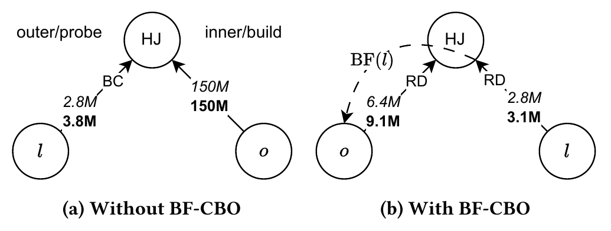
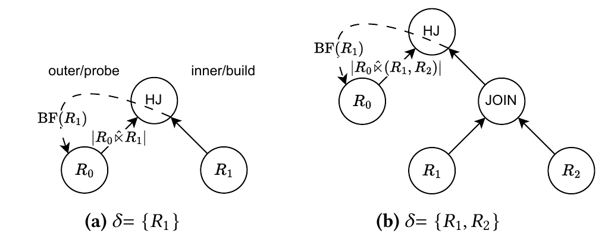
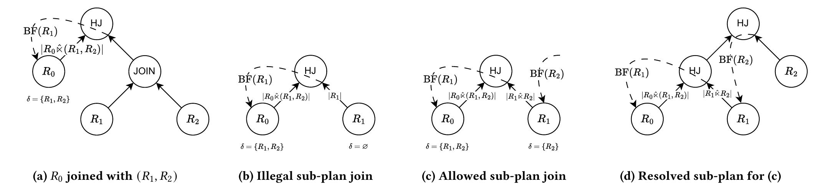
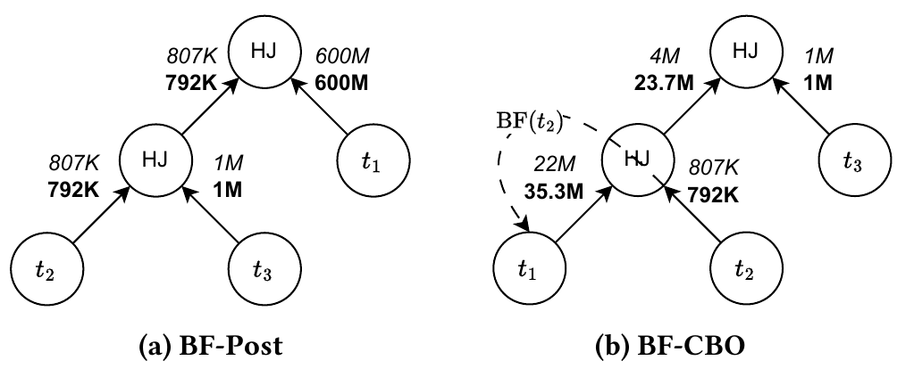
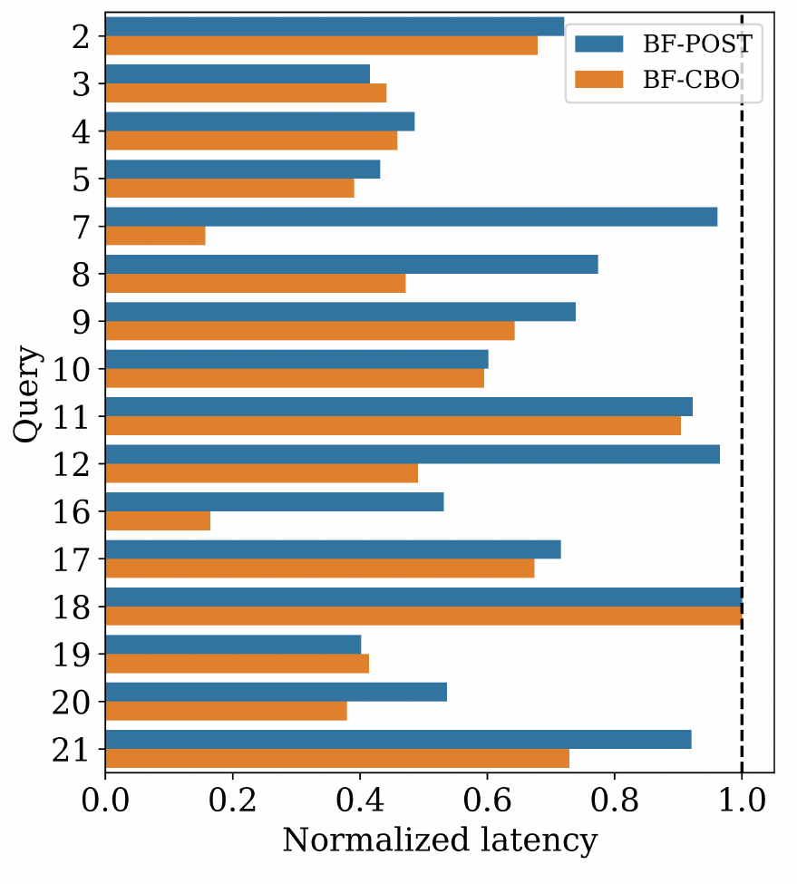
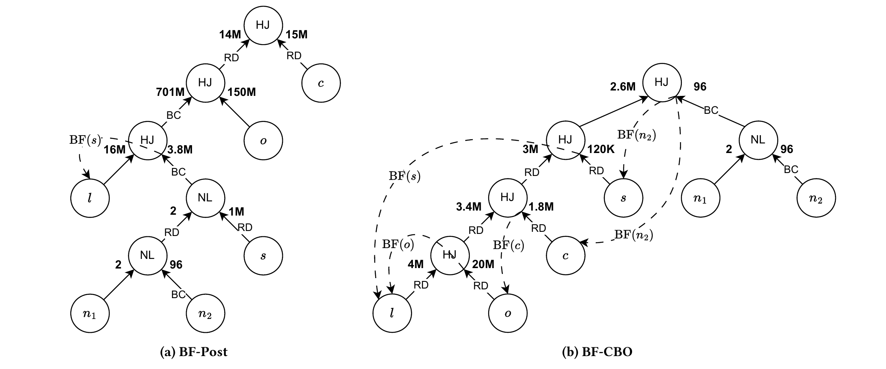

# Including Bloom Filters in Bottom-up Optimization（中文译文）

## 译者说明

本文依据同目录的 `source.pdf` 翻译。章节、图表、公式、算法、代码与参考文献按原文结构保留。

作者均来自 Huawei, Cloud BU（华为云业务部），加拿大 Markham：

| 作者 | 电子邮件 |
| --- | --- |
| Tim Zeyl | timothy.zeyl@huawei.com |
| Qi Cheng | qi.cheng1@h-partners.com |
| Reza Pournaghi | reza.pournaghi1@huawei.com |
| Jason Lam | jason.lam@huawei.com |
| Weicheng Wang | ben.wang@huawei.com |
| Calvin Wong | calvin.wong1@huawei.com |
| Chong Chen | chongchen@huawei.com |
| Per-Ake Larson | paul.larson@h-partners.com |

arXiv:2505.02994v1 [cs.DB]，2025 年 5 月 5 日。

## 摘要

Bloom 过滤器用于在查询处理中提前减少数据，从而改善查询性能。使用 Bloom 过滤器时，最优查询计划可能发生变化，因此需要能够感知 Bloom 过滤器的查询优化。迄今为止，感知 Bloom 过滤器的查询优化只被纳入自顶向下的查询优化器，而且仅限于雪花型查询。本文展示如何将 Bloom 过滤器纳入自底向上的基于代价的查询优化器。我们指出限制优化器搜索空间扩张所面临的挑战，并给出一种高效的解决方案。我们表明，将 Bloom 过滤器纳入基于代价的优化，可以得到更好的连接顺序，并在算子之间实现有效的谓词传递。在一个 100 GB 的 TPC-H 数据库实例上，对于涉及 Bloom 过滤器的查询，与传统的在优化后单独添加 Bloom 过滤器的方法相比，我们的方法使延迟进一步降低了 32.8%。我们的方法适用于所有查询类型，并提供了若干启发式规则，在有限增加优化时间与改善查询延迟之间取得平衡。

**CCS 概念：** 信息系统 → 查询优化；查询规划。

**关键词：** 数据库，查询优化，Bloom 过滤器。

**ACM 引用格式：** Tim Zeyl, Qi Cheng, Reza Pournaghi, Jason Lam, Weicheng Wang, Calvin Wong, Chong Chen, and Per-Ake Larson. 2025. Including Bloom Filters in Bottom-up Optimization. In *Companion of the 2025 International Conference on Management of Data (SIGMOD-Companion ’25)*, June 22–27, 2025, Berlin, Germany. ACM, New York, NY, USA, 13 pages. https://doi.org/10.1145/3722212.3724440

## 1 引言

Bloom 过滤器和其他位向量过滤器被广泛用于数据库管理系统，以提前减少数据 [4–7, 16]。Bloom 过滤器提供了一种按概率提前去除行的高效方式，可以减少参与后续处理的行数，从而提高查询性能。通常，Bloom 过滤器等位向量过滤器会在哈希连接构建哈希连接表时建立，并应用到该哈希连接探测侧的表扫描中 [8, 11, 19]。如果探测侧是一棵算子节点子树，Bloom 过滤器往往可以穿过这些算子下推到表扫描。穿过中间算子下推时，Bloom 过滤器也可以减少参与该中间算子的行数，从而放大使用 Bloom 过滤器所带来的收益 [5, 6]。

由于应用于表扫描的 Bloom 过滤器会减少表扫描产生的行数，在优化时有意识地考虑这个修正后的行数估计，有望得到更好的查询计划。文献 [8] 表明，计划包含 Bloom 过滤器时，代价最低的连接顺序可能不同于没有 Bloom 过滤器时的最低代价连接顺序。由于 Bloom 过滤器通常是在后处理阶段添加的（例如 [5, 6]），此时最优计划结构已经确定，因此未必能找到包含 Bloom 过滤器的最优计划。

虽然文献 [8] 描述了如何将 Bloom 过滤器作为变换规则纳入自顶向下的查询优化器 [9, 10]，但据我们所知，尚无工作描述如何将 Bloom 过滤器纳入自底向上的优化器 [21, 23]。我们认为，通过修正含有 Bloom 过滤器的扫描计划的基数估计，并纳入构建和应用 Bloom 过滤器的代价模型，自底向上的优化器也可以产生比仅在后处理阶段添加 Bloom 过滤器具有更好连接顺序、连接方法和重分区策略的查询计划。

图 1 展示了一个例子：对于 TPC-H [24] 查询 12，图中给出了我们的系统在自底向上的基于代价的优化（CBO）中考虑和不考虑 Bloom 过滤器时所生成的连接。当代价估算包含 Bloom 过滤器（BF-CBO）时，规划器探索了一个将 Bloom 过滤器应用到 `orders` 表的计划，其估计行数显著低于不使用 Bloom 过滤器的情况。随后，规划器选择了更好的连接输入顺序，使需要参与查询连接的行数大幅减少，并降低了总运行时间。



**图 1：** 在自底向上的 CBO 中不考虑 Bloom 过滤器时（图 a），TPC-H 查询 12 的连接顺序将包含 150M 行的表 `o:orders` 用作哈希连接（HJ）的构建侧。表 `l:lineitem` 经本地谓词过滤后估计为 2.8M 行、实际为 3.1M 行，被广播（BC）到本例使用的 48 个计算线程中的每一个。此时，后处理不会应用 Bloom 过滤器，因为探测侧是引用构建侧未经过滤的主键列的外键列；在这种情况下，Bloom 过滤器无法过滤任何探测侧行。当 CBO 考虑 Bloom 过滤器时（图 b），连接输入顺序反转，因此可以在 `l:lineitem` 上构建 Bloom 过滤器并应用于 `o:orders`，将其估计行数显著降至 6.4M。`o:orders` 降低后的行数估计使这一连接输入顺序的代价降低。规划器随后选择图示的最低代价计划，保留新的连接输入顺序，并对两侧进行重分布（RD）。将 Bloom 过滤器纳入代价估算后，该查询的延迟降低了 49.2%。

译注：原图 a 将 `lineitem` 的实际行数标为 3.8M，而原图注写为 3.1M；这里分别保留原图和原图注的数字。

从高层看，我们的方法为可以应用单列 Bloom 过滤器的扫描节点添加额外的子计划。我们对这些 Bloom 过滤器扫描子计划计算代价，并赋予新的基数估计。评估两个关系之间的连接时，将额外的 Bloom 过滤器子计划与另一个关系的所有兼容子计划组合，并为每个组合计算各自的代价和基数估计。这样，自底向上的优化器就可以构建出与后处理添加 Bloom 过滤器的方法完全不同的查询计划。

加入额外的 Bloom 过滤器子计划必然会扩大优化器的搜索空间。向 DBMS 添加新算子时，评估额外子计划是优化器必须处理的常见问题。我们采用的一种方法是施加限制搜索空间的启发式规则。不过，Bloom 过滤器子计划还有一个特有的细节，我们将在第 3 节进一步说明：只有知道提供 Bloom 过滤器的那个连接的构建侧所包含的完整关系集合，才能估计这些子计划的行数。如果直接采用朴素方式处理，就意味着必须在代价未知的情况下保留这些额外的 Bloom 过滤器子计划，直到计算到提供所需 Bloom 过滤器构建关系的连接。这种朴素方法会导致搜索空间爆炸，并使优化时间增加到难以接受的程度。

本文的贡献包括：1）指出自底向上 CBO 中 Bloom 过滤器子计划的一项独特性质，该性质要求对其进行特殊处理；2）提出一种两阶段的自底向上方法，尽量减少优化器搜索空间的增长。我们的方法使自底向上的 CBO 能够考虑 Bloom 过滤器，从而让优化器找到不同的连接顺序，这些顺序可能提供应用更多 Bloom 过滤器的机会，并实现更好的谓词传递。

接下来，我们介绍相关工作（第 2 节）。在其余部分，我们详细介绍方法（第 3 节，符号列于表 1），展示实验结果（第 4 节），最后通过讨论结束全文（第 5 节）。

## 2 相关工作

文献 [25]（Pred-Trans）描述了利用 Bloom 过滤器在多个连接之间传递谓词的思想。作者说明，表 $T_1$ 上的谓词可以通过 Bloom 过滤器传递给与其连接的表 $T_2$。 $T_2$ 应用从预先过滤后的 $T_1$ 构建的 Bloom 过滤器，就能够获得 $T_1$ 上谓词的过滤效果。 $T_2$ 又可以使用另一个 Bloom 过滤器，将该谓词的过滤效果继续传递到另一个表（例如 $T_3$），依此类推。这个思想源于更早的研究：半连接可在连接之前减小关系的规模 [2]，并在分布式场景中尽量减少数据传输 [1, 3]。这些工作表明，寻找最佳的数据缩减调度本身就是一个优化问题。文献 [5, 6] 的作者以位向量过滤器代替半连接来缩减行数，扩展了这一研究方向。他们表明，对于固定执行计划，位向量过滤器的放置位置和应用顺序会影响实际观察到的数据缩减量；这再次说明需要优化缩减调度。

在 Pred-Trans 论文中，Bloom 过滤器被作为预过滤步骤，在任何连接开始计算之前应用。然而，Bloom 过滤器的应用安排由启发式方法决定：将表从小到大排列，然后在一次正向遍历和一次反向遍历中应用所有可能的 Bloom 过滤器。在输入表被缩减之后，再独立寻找最佳连接顺序。这种方法有益，但由于没有对缩减调度进行基于代价的优化，可能错过实现最优谓词传递的最佳 Bloom 过滤器安排。我们的方法不同：构建连接图时直接考虑应用 Bloom 过滤器的估计选择率和代价，从而找到本身就考虑 Bloom 过滤器谓词传递能力的有效连接顺序。

文献 [26] 研究了星型模式查询的连接顺序，其中在多个维表上构建 Bloom 过滤器，并将其应用到单个事实表。他们发现，应用这些 Bloom 过滤器之后，查询计划对于多个维表的连接顺序具有稳健性；测试的每种连接顺序都有类似代价。Ding 等人将这一发现扩展到雪花型模式查询，并证明应用 Bloom 过滤器时，查询的最佳连接顺序可能发生变化 [8]。他们提出了 Bloom 过滤器的代价模型，并将感知 Bloom 过滤器的优化作为变换规则实现到 Microsoft SQL Server [18] 中；该系统采用自顶向下的 Volcano/Cascades 风格查询优化器。其优化器使用启发式规则识别雪花型查询，以触发 Bloom 过滤器变换规则。

我们的工作适用于自底向上而非自顶向下的查询优化器，并适用于所有查询模式，不局限于星型或雪花型查询。它的构造具有通用性，因为我们在构建每个查询计划时，直接纳入 Bloom 过滤器的代价和基数估计。

## 3 方法

### 3.1 预备知识与朴素方法

我们将 Bloom 过滤器纳入自底向上查询优化所遵循的基本原则，是在这些过滤器将要应用的节点中维护其信息。众所周知，自底向上的 CBO 首先评估实现查询中基关系的所有受支持方法的代价，也就是扫描所需数据库表的不同方式。访问这些关系的每一种方式都可以看作一个子计划。在自底向上的 CBO 期间，会为每个关系（包括连接关系和基关系）维护一份子计划列表；关系的计划列表（plan-list）中的每个子计划，都代表具有某组特定属性、用于实现相应关系的最低代价方法。评估两个关系之间的连接时，会将一个关系的子计划与另一个关系的子计划组合起来测试，计算其连接代价，并且只保留连接关系中代价最低的子计划，供下一层自底向上 CBO 使用（在该层，这个连接关系的子计划可能再与其他关系的子计划组合）。代价更高的子计划被剪枝。这样可以限制优化器在自底向上 CBO 更高层需要评估的子计划组合搜索空间。

在我们的方法中，首先为基关系（或表扫描）添加新的 Bloom 过滤器子计划，其中包含可应用到这些扫描的 Bloom 过滤器的额外信息。所有 Bloom 过滤器信息都放在应用侧。在连接评估时，将一个关系的子计划与另一个关系的子计划组合时，也纳入这些额外的 Bloom 过滤器子计划。Bloom 过滤器信息成为一项额外属性，而代价较高的子计划可以依据共同的属性集合被剪枝 [15]。因此，维护 Bloom 过滤器子计划的方式，类似于支持值得保留的连接顺序的方式 [22]。

我们只考虑在扫描节点上添加 Bloom 过滤器子计划，因为这样可以确保最终计划将 Bloom 过滤器尽可能下推到这些扫描节点。这意味着构建 Bloom 过滤器时，必须使用由单列值导出的哈希键，而不支持基于多列值的哈希键。因此，当连接包含多个连接列时，我们规划并构建彼此独立的单列 Bloom 过滤器，而不是构建多列 Bloom 过滤器。此外，我们只考虑在哈希连接节点的构建侧构建 Bloom 过滤器。虽然也可以支持在其他节点中构建，但遵循这个约定可以确保 Bloom 过滤器在探测侧使用之前已经完全构建好。

我们为扫描节点子计划添加的 Bloom 过滤器属性可以向上传播，穿过连接。它可能存在于为连接关系创建的子计划中，也可能在连接后的关系满足 Bloom 过滤器依赖时被移除；也就是说，连接后的关系提供了 Bloom 过滤器子计划所需的构建侧。不过，Bloom 过滤器属性与排序顺序等其他属性有一项重要区别：应用 Bloom 过滤器后的扫描基数（或估计行数），取决于创建这个过滤器的哈希连接的构建侧所涉及的关系集合。

**表 1：符号表。**

| 符号 | 说明 |
| --- | --- |
| $R_n$ | 由 $n$ 标识的基关系或表。 |
| $\lvert R_n\rvert$ | 关系 $R_n$ 的行数或基数。 |
| $(R_0,R_1)$ | 关系 $R_0$ 与 $R_1$ 连接得到的连接关系。 |
| $R_0\ltimes(R_1,R_2)$ | $R_0$ 与 $(R_1,R_2)$ 的半连接。 |
| $R_0\hat{\ltimes}(R_1,R_2)$ | 从 $(R_1,R_2)$ 的某列构建 Bloom 过滤器并应用到 $R_0$ 后的结果。可以将其视为近似半连接。 |
| $R_0\leftarrow(R_1,R_2)$，箭头标为 $\mathrm{BF}(R_1)$ | 图中使用的 $R_0\hat{\ltimes}(R_1,R_2)$ 的另一种记法。Bloom 过滤器的构建列来自 $R_1$。 |
| $\delta=\lbrace R_a,\ldots,R_z\rbrace$ | 与某个 Bloom 过滤器子计划进行哈希连接时，要求出现在构建侧的基关系集合。 |
| $\Delta=[\delta_0,\ldots,\delta_n]$ | 可用于在一个基关系上创建不同 Bloom 过滤器子计划的可能 $\delta$ 的列表。 |

为解释这种依赖关系，我们首先指出，对于关系 $R_0$，应用从单个关系 $R_1$ 构建的 Bloom 过滤器之后的基数（记为 $\lvert R_0\hat{\ltimes}R_1\rvert$，见图 2a），可以用 $R_0$ 与 $R_1$ 的半连接基数（记为 $\lvert R_0\ltimes R_1\rvert$）加上一定的 Bloom 过滤器误报影响来估计。换句话说， $\lvert R_0\hat{\ltimes}R_1\rvert\geq\lvert R_0\ltimes R_1\rvert$，误报率为 0 时等号成立。接着注意到，如果半连接条件在 $R_0$ 与 $R_1$ 之间，则 $\lvert R_0\ltimes R_1\rvert\geq\lvert R_0\ltimes(R_1,R_2,\ldots,R_n)\rvert$，因为 $R_1$ 在与 $R_0$ 连接之前与其他关系进行的任何连接，都可能去掉 $R_1$ 连接列中的某些不同元素，从而减少在 $R_1$ 上构建的 Bloom 过滤器中的元素数量。这又会减少在 $R_0$ 上应用该过滤器的扫描所输出的行数。因此，要估计 Bloom 过滤器子计划的基数、进而估计其代价，就必须知道哈希连接构建侧出现的关系集合。如图 2 所示，当 $R_1$ 先与 $R_2$ 连接时， $R_0$ 应用从 $R_1$ 构建的 Bloom 过滤器之后的基数会有所不同。



**图 2：** 对 $R_0$ 的扫描应用从关系 $R_1$ 某列构建的 Bloom 过滤器（用标为 $\mathrm{BF}(R_1)$ 的虚线箭头表示）之后，其基数取决于创建该过滤器的哈希连接构建侧的关系集合。如图 a 所示，构建侧仅包含关系 $R_1$ 时， $R_0$ 的基数为 $\lvert R_0\hat{\ltimes}R_1\rvert$。因此，这种情况下 $R_0$ 的 Bloom 过滤器子计划具有属性 $\delta=\lbrace R_1\rbrace$；它要求关系 $R_1$ 与之连接，才能满足该过滤器的依赖。当构建侧同时包含 $R_1$ 和 $R_2$ 时（图 b）， $R_0$ 应用过滤器之后的基数变为 $\lvert R_0\hat{\ltimes}(R_1,R_2)\rvert$，可能低于图 a 的值。此时， $R_0$ 的 Bloom 过滤器子计划具有属性 $\delta=\lbrace R_1,R_2\rbrace$；它要求关系 $R_1$ 和 $R_2$ 都与之连接，才能满足该过滤器的依赖。请注意，按照本文的约定，哈希连接的构建侧（内侧）画在右边。

这种依赖关系给自底向上的优化器带来了问题，因为连接构建侧的关系集合通常无法预先知道。由于计划是自底向上构建的，在优化器知道某个子计划将与哪些关系连接之前，无法知道 $R_0$ 上 Bloom 过滤器子计划的基数。朴素的解决方案可能会维护若干尚未计算代价、且带有未满足依赖的 Bloom 过滤器信息的子计划。这些尚未计算代价、依赖未满足的子计划不可避免地会与不提供 Bloom 过滤器构建侧的关系组合；而在未计算代价时，它们又不能被剪枝，因此，每遇到一个不能满足 Bloom 过滤器依赖的连接，需要维护的子计划数量就会指数增长。只有当 Bloom 过滤器依赖被满足时，即评估某个所需关系出现在构建侧的连接时，才能完整计算 Bloom 过滤器子计划的代价。此时才能估计其基数，这必然是一个递归过程：遍历子计划直到叶表扫描，根据现已知晓的哈希连接构建侧关系集合，计算该扫描的基数和代价。计算出的叶表扫描基数又会影响从该叶节点向上直到依赖满足节点之间的所有中间计划节点的基数和代价。我们发现，这样的朴素方法会带来难以接受的优化时间：例如，三表连接查询需要 28 ms，四表连接查询需要 375 ms，五表连接查询需要 56 s。六表连接的优化在超过 30 min 后仍未结束，我们没有继续等待。

### 3.2 我们的方法：BF-CBO

防止搜索空间指数增长的关键，是将计划生成推迟到可以剪枝的时候。这样就不必维护大量尚未计算代价的计划。我们通过两阶段的自底向上优化方法，实现“延迟计划生成，直到可以剪枝”这一性质。从高层看，它包括下列步骤，我们将在后续各节详细说明。

1. **标记 Bloom 过滤器候选。** 首先识别哪些基表适合作为应用 Bloom 过滤器的候选，并将所需的 Bloom 过滤器信息附加到这些表上。
2. **第一阶段自底向上遍历。** 进行第一遍自底向上遍历，确定所有合法连接组合，并识别与带有 Bloom 过滤器候选的关系连接时出现在构建侧的所有关系集合（可以将其中一个集合记为 $\delta=\lbrace R_a,R_b,\ldots,R_z\rbrace$，即满足某个 Bloom 过滤器子计划依赖所必需的构建侧关系）。
3. **计算 Bloom 过滤器子计划的代价。** 在基表上创建新的 Bloom 过滤器扫描子计划，并根据 $\delta$ 估计其基数和代价。
4. **第二阶段自底向上遍历。** 再进行一遍自底向上遍历，完整计算所有中间子计划的代价并生成计划；任何 Bloom 过滤器子计划都遵守 $\delta$ 所隐含假设规定的连接顺序限制。

### 3.3 标记 Bloom 过滤器候选

我们的方法在优化器估计了每个基关系（即表扫描）的基数、并为这些基关系的扫描添加了子计划之后开始，但此时优化器还没有创建任何连接子计划，也没有评估任何连接组合的代价。我们首先根据查询中的连接条件，识别可应用到基关系上的所有 Bloom 过滤器候选。

Bloom 过滤器候选包含用于标识连接条件、过滤器构建表和构建列以及应用列的信息，并作为附加信息挂到可应用相应过滤器的基关系上（构建侧关系不附加任何信息）。来自不同连接条件的多个 Bloom 过滤器候选可以附加到同一个关系。每个候选都具有一个初始为空的所需构建侧关系集合列表 $\Delta=[]$，它会在第一遍自底向上遍历时被填充（例如 $\Delta=[\delta_0,\delta_1,\ldots,\delta_n]$），用于标识所有合法的 Bloom 过滤器扫描子计划。应将 Bloom 过滤器候选理解为可能应用过滤器的关系的一项属性，而不是实现该关系的众多子计划的属性。

我们使用一些启发式规则帮助限制 Bloom 过滤器候选总数，从而减少 CBO 期间必须评估的额外子计划数量。这些规则分布在整个方法的不同环节，因此我们会在正文中逐一编号，并在第 3.10 节汇总。首先，对于连接条件中的一对关系，只在两者中较大的表上保留 Bloom 过滤器候选（**启发式规则 1**），因为在这种配置下，过滤器通常更可能具有较强的过滤能力。如果存在多路等价条件，则只考虑从最小的表构建 Bloom 过滤器，并将其应用到更大的表上。其次，如果应用侧表的估计行数低于某个阈值，那么应用过滤器可能本就不值得，因此不为这种情况保留候选（**启发式规则 2**）。在自底向上优化期间，还会应用其他启发式规则。

如果构建列和应用列之间需要跨越全外连接或反连接，我们也限制应用任何 Bloom 过滤器候选；在这些情况下应用过滤器可能产生错误结果，因此这一限制不算启发式规则。同样，如果某个候选的构建列和应用列之间需要跨越左外连接，就必须禁止应用列位于保留行的左侧，因为那也会产生错误结果。

接下来，我们引入一个贯穿各步骤的例子。

**例 3.1：标记 Bloom 过滤器候选。** 考虑如下查询：

```sql
SELECT *
FROM t1, t2, t3
WHERE t1.c2 = t2.c1
    AND t2.c2 = t3.c1
    AND t2.c3 < 100;
```

其基关系估计基数如下：

| 关系 | 行数估计 |
| --- | ---: |
| `t1` | 600M |
| `t2 WHERE t2.c3 < 100` | 807K |
| `t3` | 1M |

并且 `t2.c2` 是引用 `t3.c1` 的外键。

对于每个可哈希的连接条件，我们可以放置一个 Bloom 过滤器候选（BFC）。因此，对于 `t1.c2 = t2.c1`，我们在 `t1` 上放置 BFC，因为它的基数大于 `t2`（启发式规则 1）。同样，对于 `t2.c2 = t3.c1`，在 `t3` 上放置 BFC，因为其基数大于 `t2`。汇总起来，我们具有以下 BFC：

- `t1.bfc1`： $a=t1.c2$， $b=t2.c1$， $\Delta=[]$。
- `t3.bfc1`： $a=t3.c1$， $b=t2.c2$， $\Delta=[]$。

其中， $a$ 记录应用侧的关系和列， $b$ 记录构建侧的关系和列。

### 3.4 第一阶段自底向上遍历

在第一遍自底向上遍历中，我们模拟常规自底向上 CBO 合并关系的过程。但不计算任何子计划的代价，而只填充在此过程中观察到的关系集合 $\delta$ 的列表 $\Delta$。例如，对于涉及三个关系 $R_0,R_1,R_2$ 的连接，如果有一个应用于 $R_0$、从 $R_1$ 的某列构建的 Bloom 过滤器候选，那么在这个过程中，可能观察到两个关系集合： $\delta_0=\lbrace R_1\rbrace$ 和 $\delta_1=\lbrace R_1,R_2\rbrace$，对应图 2 中的连接顺序。因此， $R_0$ 上该候选的可能关系集合列表就是 $\Delta=[\delta_0,\delta_1]$。

在第一遍自底向上遍历中，还可以剪去这样的 $\delta$：对应的候选连接条件由应用侧外键引用构建侧无损主键组成（**启发式规则 3**）。当主键列没有经过过滤，且被用于构建 Bloom 过滤器时，我们就知道该过滤器不会过滤掉应用侧的任何行，因此不必为这种情形创建 Bloom 过滤器扫描子计划。之所以在这里实现此启发式规则，是因为只有知道将出现在连接构建侧的完整关系集合 $\delta$，才能确定对于这个子计划而言，主键是否无损。

**例 3.2：第一阶段自底向上遍历。** 接续例 3.1，在第一阶段中，我们会观察到以下有序连接组合（按其创建的连接关系分组），并在可能时为每个 BFC 填充 $\Delta$。对于每种情况，我们都推迟计算任何连接子计划。

连接关系： $(t1,t2)$。

- `t1 JOIN t2`：此时 `t1` 是外关系，`t2` 是内关系。`t1` 有一个 BFC，即 `t1.bfc1`，而内关系 `t2` 提供了所需的构建列。因此，将该连接对观察到的内侧关系填入 $\Delta$（即 $\delta=\lbrace t2\rbrace$）。更新后的 BFC 为：

    $t1.bfc1:\ a=t1.c2,\ b=t2.c1,\ \Delta=[\lbrace t2\rbrace ]$。

- `t2 JOIN t1`：此时 `t2` 是外关系，`t1` 是内关系，因此该连接对不能为 `t1.bfc1` 提供构建列，因为 Bloom 过滤器必须在哈希连接的内侧（构建侧）构建。对这个连接对无需进行任何操作。

连接关系： $(t2,t3)$。

- `t2 JOIN t3`：此时 `t3` 有一个 BFC（`t3.bfc1`），但它位于连接内侧，因此其构建列的依赖不能在这里得到满足。对这个连接对无需进行任何操作。
- `t3 JOIN t2`：此时 `t3` 是外关系，而内关系 `t2` 提供所需的构建列。因此按如下方式填充 $\Delta$：

    $t3.bfc1:\ a=t3.c1,\ b=t2.c2,\ \Delta=[\lbrace t2\rbrace ]$。

连接关系： $(t1,t2,t3)$。

- `(t1,t2) JOIN t3`：内关系是 `t3`，它不提供 `t1.bfc1` 的构建列，因此无需操作。
- `t3 JOIN (t1,t2)`：内关系是 $(t1,t2)$，它提供 `t3.bfc1` 的构建列。将其 $\Delta$ 更新为：

    $t3.bfc1:\ a=t3.c1,\ b=t2.c2,\ \Delta=[\lbrace t2\rbrace ,\lbrace t1,t2\rbrace ]$。

- `(t2,t3) JOIN t1`：内关系 `t1` 不提供外侧 BFC（`t3.bfc1`）的构建关系，因此无需操作。
- `t1 JOIN (t2,t3)`：内关系是 $(t2,t3)$，它提供 `t1.bfc1` 的构建列。将其 $\Delta$ 更新为：

    $t1.bfc1:\ a=t1.c2,\ b=t2.c1,\ \Delta=[\lbrace t2\rbrace ,\lbrace t2,t3\rbrace ]$。

在这个例子中，没有遇到候选连接条件由应用侧外键引用构建侧无损主键组成的连接对，因此没有因启发式规则 3 而剪去任何潜在的 $\delta$。

### 3.5 计算 Bloom 过滤器子计划的代价

第一遍自底向上遍历结束后，每个 Bloom 过滤器候选都应当有一份合法的 $\delta$ 列表。对于其中的每个 $\delta$，我们创建一个扫描子计划，其中包含在扫描期间应用 Bloom 过滤器的操作。我们根据该关系与 $\delta$ 中关系的半连接估计选择率，加上估计的 Bloom 过滤器误报率，计算这个子计划的基数。例如，可以为 $R_0$ 的扫描创建一个 $\delta=\lbrace R_1\rbrace$ 的 Bloom 过滤器子计划，其基数估计为 $\lvert R_0\hat{\ltimes}(R_1)\rvert$。也可以为 $R_0$ 的扫描创建另一个 $\delta=\lbrace R_1,R_2\rbrace$ 的子计划，其基数估计为 $\lvert R_0\hat{\ltimes}(R_1,R_2)\rvert$；后者可能有更少的估计行数，但也要求在构建 Bloom 过滤器的哈希连接的构建侧出现更多关系。

创建这些新的 Bloom 过滤器子计划后，我们尝试将其添加到基关系的最低代价子计划列表（即该关系的计划列表）中。在这个过程中，可以依据 $\delta$ 属性在新的 Bloom 过滤器子计划之间进行剪枝。具体而言，如果新子计划的 $\delta$ 要求的关系比计划列表中已有子计划更多，但它的行数更少，那么无论代价如何，都将它作为一个值得保留的选项留下。如果新子计划的 $\delta$ 要求更多关系，却没有更少的行数，那么我们就知道 $\delta$ 中额外要求的关系没有提供更多过滤能力，可以立即剪去这个新子计划。这种即时剪枝有助于限制整个自底向上优化期间探索的搜索空间。

如果同一个关系上有多个 Bloom 过滤器候选（来自不同连接条件），我们会创建同时应用所有可能候选的 Bloom 过滤器扫描计划，而不会尝试应用各种候选子集的子计划。换句话说，我们同时在一个基表上应用所有合法候选过滤器，以此作为限制搜索空间的另一项启发式规则（**启发式规则 4**）。不过，创建新的 Bloom 过滤器扫描子计划时，我们确实允许 $\delta$ 的不同组合。

Bloom 过滤器的误报率可根据过滤器数组的位数和所用哈希函数数量推导。过滤器的位数由构建侧不同值数量的上界估计决定。出于性能原因，哈希函数数量固定为两个。

我们删除所有估计 Bloom 过滤器大小超过阈值的子计划（**启发式规则 5**）。这一限制的目的，是约束所创建过滤器的大小，使其大部分能够容纳在 L2 缓存中。如果过滤器超出这个范围，访问和探测它会变慢，从而降低收益。我们也会删除估计选择率（不含误报）低于阈值的 Bloom 过滤器子计划（**启发式规则 6**）。这样，只保留可能有足够强过滤能力的候选。

译注：本段及第 3.10 节原文将规则 6 写为删除选择率“低于”阈值的候选；但例 3.3 中 0.77 被拒绝，以及第 4.1 节“阈值为 2/3、至少过滤掉 1/3 行”的说明，使用的是保留行比例的口径。这几处原文的方向表述不一致，本文分别保留。

我们将应用 Bloom 过滤器的代价建模为一个常数 $k$ 乘以待过滤行数，用以表示为每行计算过滤器哈希函数的代价。 $k$ 被设为小于常规哈希表查找的每行代价。我们也提供了计入构建每个 Bloom 过滤器代价的机制，但实践中发现这一代价可以忽略，因此在代价模型中将其设为零。

**例 3.3：计算 Bloom 过滤器子计划的代价。** 接续例 3.2，第一阶段之后，我们具有以下 Bloom 过滤器候选：

- `t1.bfc1`：
    - $a=t1.c2$， $b=t2.c1$。
    - $\Delta=[\lbrace t2\rbrace ,\lbrace t2,t3\rbrace ]$。
- `t3.bfc1`：
    - $a=t3.c1$， $b=t2.c2$。
    - $\Delta=[\lbrace t2\rbrace ,\lbrace t1,t2\rbrace ]$。

对于 `t1` 的扫描，我们创建两个 Bloom 过滤器子计划，各应用一个过滤器，但每个子计划中的过滤器有不同的 $\delta$，对应上面候选的 $\Delta$ 中的各项。各子计划连同其基数如下：

- `t1.bf-subplan0`：
    - $\mathrm{bfs}=[(a=t1.c2,b=t2.c1,\delta=\lbrace t2\rbrace )]$。
    - $\mathrm{rows}=\lvert t1\hat{\ltimes}t2\rvert$。
- `t1.bf-subplan1`：
    - $\mathrm{bfs}=[(a=t1.c2,b=t2.c1,\delta=\lbrace t2,t3\rbrace )]$。
    - $\mathrm{rows}=\lvert t1\hat{\ltimes}(t2,t3)\rvert$。

现在假设这两个子计划中的过滤器产生相同的估计基数，例如 $\lvert t1\hat{\ltimes}t2\rvert=\lvert t1\hat{\ltimes}(t2,t3)\rvert=22M$。在这种情况下，优化器认为构建 Bloom 过滤器时先将 `t2` 与 `t3` 连接并无额外收益。这是因为 `t3` 上没有可通过 `t2` 与 `t3` 的连接传递到 `t1` 的本地谓词。

接下来，计算每个子计划的代价，并尝试将其添加到基关系的计划列表。`t1` 的计划列表至少应当已有一个已计算代价、不含 Bloom 过滤器的子计划，行数估计为 6 亿。随后，对于每个 Bloom 过滤器子计划，添加将过滤器应用到 `t1` 每一输入行的额外代价：

$$
\mathrm{extra\ cost}=k\ast 600M.
$$

因此，各 Bloom 过滤器子计划的代价相同。第一个子计划 `t1.bf-subplan0` 将被 `t1` 的计划列表接受，因为它将行数从 6 亿降至 2200 万；第二个子计划 `t1.bf-subplan1` 则被拒绝，因为它与 `t1.bf-subplan0` 的行数（2200 万）和代价相同，却要求连接构建侧多出一个关系。

对于 `t3` 的扫描，同样有两个 Bloom 过滤器子计划：

- `t3.bf-subplan0`：
    - $\mathrm{bfs}=[(a=t3.c1,b=t2.c2,\delta=\lbrace t2\rbrace )]$。
    - $\mathrm{rows}=\lvert t3\hat{\ltimes}t2\rvert$。
- `t3.bf-subplan1`：
    - $\mathrm{bfs}=[(a=t3.c1,b=t2.c2,\delta=\lbrace t1,t2\rbrace )]$。
    - $\mathrm{rows}=\lvert t3\hat{\ltimes}(t1,t2)\rvert$。

在本例中，半连接 $t3\ltimes t2$ 的选择率为 0.77，超过我们的阈值，因此 `t3.bf-subplan0` 被启发式规则 6 拒绝。而半连接 $t3\ltimes(t2,t1)$ 的选择率为 0.006，使子计划 `t3.bf-subplan1` 的基数估计为 3.6 万行，远低于 `t3` 已有子计划的 100 万行估计。因此，此子计划被 `t3` 的计划列表接受。额外代价为 $k\ast 1M$。

### 3.6 第二阶段自底向上遍历

在第二遍自底向上遍历开始时，访问查询中每个基表的子计划都已有完整的代价。其中某些子计划可能包含应用 Bloom 过滤器的操作（即所谓 Bloom 过滤器子计划），并包含过滤器的信息，包括构建列、应用列以及所需的关系集合 $\delta$。既然这些子计划都已有基数估计和完整代价，自底向上优化就可以照常进行，只需遵守一些附加约束。

首先，当一个 Bloom 过滤器子计划与另一个提供其构建关系的子计划连接时，这对子计划的连接方法必须是哈希连接，并且 Bloom 过滤器子计划必须位于外侧（探测侧）。其他连接类型由不含 Bloom 过滤器的子计划满足。其次，如果另一子计划提供了 Bloom 过滤器子计划的 $\delta$ 中列出的任何关系，那么连接方法必须是哈希连接，因为其基数假设 $\delta$ 中的所有关系都将位于哈希连接的内侧（构建侧）。因此，连接内侧必须提供 $\delta$ 中的所有关系，只有一个例外：如果内侧本身也是 Bloom 过滤器子计划，且其 $\delta$ 与外侧 $\delta$ 中尚未满足的关系相匹配，则内侧不必提供 $\delta$ 中的全部关系。图 3 说明了允许这一例外的原因。



**图 3：** 在第一遍自底向上遍历中，可能观察到 $R_0$ 与 $(R_1,R_2)$ 的连接，如图 a 所示。我们的方法为 $R_0$ 的扫描创建一个子计划，应用从 $R_1$ 构建的 Bloom 过滤器，估计基数为 $\lvert R_0\hat{\ltimes}(R_1,R_2)\rvert$。该子计划具有属性 $\delta=\lbrace R_1,R_2\rbrace$，因为只有 $R_1$ 和 $R_2$ 都在哈希连接（HJ）的构建侧，其基数才准确。在第二遍自底向上遍历中，我们禁止图 b 所示的子计划连接，因为 $R_2$ 没有出现在 HJ 的构建侧，违反了 $R_0$ 子计划的基数假设。图 c 展示了允许的连接：虽然 $R_2$ 仍没有出现在 HJ 的构建侧，但与 $R_0$ 连接的子计划要求使用从 $R_2$ 构建的 BF（即 $R_1$ 的子计划具有属性 $\delta=\lbrace R_2\rbrace$）。因此， $R_2$ 对 $R_1$ 的任何过滤，都会经由应用于 $R_1$ 的 Bloom 过滤器（即 $\mathrm{BF}(R_2)$）有效传递到 $R_0$。图 c 中不完整的子计划，可以在下一层自底向上优化中通过以 $R_2$ 为构建侧的 HJ 补全，如图 d 所示；忽略 Bloom 过滤器误报时，我们认为它与图 a 的连接顺序等价。

这些附加约束限制了 Bloom 过滤器子计划的组合方式，却不会排除对其他所有非 Bloom 过滤器子计划的评估。因此，在第二阶段中，我们评估的子计划组合比以前更多：所有原有的不含 Bloom 过滤器的子计划，加上新加入的 Bloom 过滤器子计划。尽管遵循了“将计划生成推迟到子计划可剪枝时”的性质，搜索空间仍然扩大，因此我们预期规划时间会增加。第 3.10 节将讨论若干应对这一增长的附加启发式规则。

当关系 $R_0$ 的某个 Bloom 过滤器子计划与另一个关系 $R_1$ 的子计划连接，并且该连接满足了其中所有 Bloom 过滤器的依赖时，就计算这对子计划对应的哈希连接代价。其基数估计直接变为连接关系 $(R_0,R_1)$ 原本的基数估计，因为连接后的子计划中所有 Bloom 过滤器依赖都已满足。相应地，从连接后的子计划中移除 Bloom 过滤器信息，使其可以与连接关系 $(R_0,R_1)$ 中任何其他不含 Bloom 过滤器的子计划竞争。

当 $R_0$ 的某个 Bloom 过滤器子计划与另一个关系 $R_2$ 的子计划连接，却没有满足其中所有 Bloom 过滤器依赖时，将在连接后的子计划中保留所有尚未满足依赖的过滤器信息。例如，如果 $R_0$ 的子计划要求的构建侧关系为 $\delta=\lbrace R_1\rbrace$，当它与 $R_2$ 的子计划连接时，过滤器依赖尚未满足，因此连接关系 $(R_0,R_2)$ 的新子计划会保留属性 $\delta=\lbrace R_1\rbrace$。它的基数通常会低于 $(R_0,R_2)$ 计划列表中其他不含 Bloom 过滤器的子计划。

**例 3.4：第二阶段自底向上遍历。** 接续例 3.3，在计算完 Bloom 过滤器代价后，基关系 `t1` 和 `t3` 各自的计划列表包含以下 Bloom 过滤器子计划：

- `t1.bf-subplan0`：
    - $\mathrm{bfs}=[(a=t1.c2,b=t2.c1,\delta=\lbrace t2\rbrace )]$。
    - $\mathrm{rows}=22M$。
- `t3.bf-subplan1`：
    - $\mathrm{bfs}=[(a=t3.c1,b=t2.c2,\delta=\lbrace t1,t2\rbrace )]$。
    - $\mathrm{rows}=36K$。

所有基关系各自的计划列表中，也保留着原有的全部不含 Bloom 过滤器的子计划。

接下来，评估来自基关系的子计划的所有连接组合，自底向上构建带有代价的计划。我们会观察到与第一阶段相同的有序连接对，但这次会对所有子计划（包括新增的 Bloom 过滤器子计划）评估全部连接类型的代价，即嵌套循环连接、归并连接和哈希连接。

连接关系： $(t1,t2)$。

- `t1 JOIN t2`：子计划 `t1.bf-subplan0` 所需的 Bloom 过滤器依赖可由内关系 `t2` 满足。我们计算对应哈希连接的代价，并允许它与关系 $(t1,t2)$ 计划列表中已有的子计划竞争。它被接受，并从列表中淘汰了若干代价更高的子计划。由于连接后的子计划不再要求任何 Bloom 过滤器，所需构建侧关系集合变为空集（即 $\delta=\varnothing$）。
- `t2 JOIN t1`：子计划 `t1.bf-subplan0` 所需的过滤器依赖无法得到满足，因为构建关系 `t2` 位于外侧。其他不含 Bloom 过滤器的子计划照常接受评估并加入计划列表。

连接关系： $(t2,t3)$。

- `t2 JOIN t3`：子计划 `t3.bf-subplan1` 所需的过滤器依赖无法得到满足，因为构建关系 `t2` 位于外侧。
- `t3 JOIN t2`：尽管构建列出现在内侧，子计划 `t3.bf-subplan1` 所需的过滤器依赖仍不能满足；它还要求 `t1` 出现在内侧，即具有属性 $\delta=\lbrace t1,t2\rbrace$。

连接关系： $(t1,t2,t3)$。

- `(t1,t2) JOIN t3`：子计划 `t1.bf-subplan0` 的依赖已经在关系 $(t1,t2)$ 中得到满足；而子计划 `t3.bf-subplan1` 位于内侧，故无法满足其依赖。
- `t3 JOIN (t1,t2)`：子计划 `t3.bf-subplan1` 所需的两个关系 $(t1,t2)$ 都出现在连接内侧，因此其依赖可以满足。然而，在本例中，这个连接后的子计划被拒绝，因为估计的 Bloom 过滤器过大（启发式规则 5）。
- `(t2,t3) JOIN t1`：子计划 `t1.bf-subplan0` 的依赖不能满足，因为所需的过滤器构建关系在外侧。
- `t1 JOIN (t2,t3)`：所需关系 `t2` 出现在连接内侧，故子计划 `t1.bf-subplan0` 的依赖可以满足。我们计算对应哈希连接的代价，并允许它与关系 $(t1,t2,t3)$ 计划列表中的已有子计划竞争。然而在本例中，它被计划列表拒绝，因为已有计划的代价更低。

这个贯穿示例最终胜出的计划如图 4 所示：它将从 `t2` 构建的 Bloom 过滤器应用于 `t1`，然后再连接 `t3`。



**图 4：** 第 3 节贯穿示例得到的连接顺序。每个连接左侧（外侧/探测侧）和右侧（内侧/构建侧）的粗体数字表示观察到的输入行数，斜体数字表示规划器的行数估计。后处理添加 Bloom 过滤器的方法（图 a）没有应用任何过滤器。BF-CBO（图 b）改变连接顺序，以在 `t1` 上应用 Bloom 过滤器，显著降低了每个连接实际观察到的输入行数。

### 3.7 后处理

我们的代价计算方法限于单个选择—投影—连接查询块，但有时存在可以穿过子查询下推的有用 Bloom 过滤器。因此，在 BF-CBO 确定计划树之后，我们仍保留通过后处理应用 Bloom 过滤器的步骤。凡是代价估算确定应放置过滤器的位置，或者已有后处理方法原本会标记过滤器的位置，都会添加 Bloom 过滤器。后处理会再次检查过滤器的选择率（忽略误报）大于阈值这一要求，以及其他若干启发式规则。

### 3.8 集成

我们将 BF-CBO 方法集成到 GaussDB [12]（另见 [13, 14, 17]）。GaussDB 是一个云原生分布式关系数据库系统，采用自底向上的查询优化器。它的查询优化器从 PostgreSQL [20] 扩展而来，特别增加了跨多个节点的分布式支持和对称多处理（SMP）支持。我们将 Bloom 过滤器作为规划器后处理步骤加入 GaussDB 优化器，以作为基线（**BF-Post**）；而两阶段自底向上的 BF-CBO 方法则集成到单个查询块（即单个选择—投影—连接块）的基于代价优化中。当前工作是 BF-CBO 的初步实现，所用启发式规则尚未充分调优；我们预计完成这项工作后还会有进一步改善。

### 3.9 运行时实现

我们的执行引擎当前支持在 SMP 单节点部署中应用 Bloom 过滤器。在这种配置下，并行度（DOP）大于 1 的哈希连接，可以使用多种已知的数据流传输策略执行。这些策略对 Bloom 过滤器使用方式的影响如下：

1. **广播连接，广播构建侧。** 构建侧关系可以来自单个线程，在与探测侧的 $n$ 个线程计算哈希连接之前，被广播到 $n$ 个线程。这种情况下，只从构建侧 $n$ 份冗余哈希表中的一份构建一个 Bloom 过滤器，并将其用于过滤器应用侧的关系。
2. **广播连接，广播探测侧。** 探测侧关系来自单个线程，然后被广播，与构建侧的 $n$ 个线程进行哈希连接。这种情况下，构建侧的 $n$ 个线程不是冗余的，因此必须为每个线程创建独立的 Bloom 过滤器。我们对这些过滤器的位向量取并集以合并它们，然后将合并后的过滤器应用到单线程的应用侧。
3. **分区连接，分区不对齐。** 哈希连接的构建侧和探测侧均为多线程；在按连接列相同值分组、由 $n$ 个局部哈希连接分别计算每组值之前，任意一侧可能需要重分布操作来重新组织数据。此时，在构建侧构建 $n$ 个局部 Bloom 过滤器，哈希连接的每个分区一个。一般而言，Bloom 过滤器可以应用到探测侧某些中间节点之下的关系，而该关系的分区方式未必与构建过滤器的哈希连接的分区方式相同。当分区像这样不对齐时，只要应用侧关系中存在过滤器的分区列，就可以根据该列的值进行分布式查找，确定应使用哪个过滤器分区。若该列不存在，则可以使用前述广播连接的位向量合并策略。
4. **分区连接，分区对齐。** 这也是一种分区连接，但应用 Bloom 过滤器的关系的分区方式，与哈希连接构建侧的分区方式对齐。此时，以与分区不对齐情形相同的方式，在构建侧构建 $n$ 个局部过滤器。在过滤器应用侧，对关系的每个分区，直接应用适当的过滤器分区即可。

虽然可以在 Bloom 过滤器代价模型中考虑这些不同的数据流传输策略，但本文给出的实验结果没有这样做。无论采用何种策略，表扫描都要等待所有 Bloom 过滤器分区就绪后才能开始。

### 3.10 限制 Bloom 过滤器的启发式规则

在介绍两阶段自底向上方法时，我们描述了若干启发式规则，用于限制评估 Bloom 过滤器子计划的搜索空间，或提高预期效率。前面是在各规则的实现位置介绍它们，这里汇总列出，便于读者查阅。

- **启发式规则 1：** 对每个可哈希的连接条件，只在较大的关系上应用 Bloom 过滤器候选（第 3.3 节）。
- **启发式规则 2：** 只在估计基数超过阈值的关系上应用候选（第 3.3 节）。
- **启发式规则 3：** 不能对与无损主键连接的外键应用 Bloom 过滤器（第 3.4 节）。
- **启发式规则 4：** 创建扫描子计划时，能够应用到一个关系上的所有候选必须同时应用（第 3.5 节）。
- **启发式规则 5：** 如果过滤器的预期大小超过阈值，就不创建该过滤器（第 3.5 节）。
- **启发式规则 6：** 删除估计选择率低于阈值的过滤器（第 3.5 节；原文方向表述的差异见该节译注）。

还可以使用其他若干启发式规则限制搜索空间，但我们在主要实验结果（第 4.2 节）中没有实现它们。例如：

- **启发式规则 7：** 在规划期间，如果某个关系的 Bloom 过滤器子计划太多，就只保留估计行数最少的一个。若行数相同，可以只保留总代价最低的子计划。这条规则应能限制 BF-CBO 的搜索空间。第 4.4 节探索其效果。
- **启发式规则 8：** 如果第一阶段自底向上遍历中的总连接输入基数低于阈值，应跳过添加 Bloom 过滤器候选。没有候选，规划搜索空间就不会扩张，因此第二阶段会退化为常规 CBO。这条规则旨在区分快速事务型查询与长时间运行的分析查询：前者不需要额外优化时间，而后者在规划时额外花费时间考虑过滤器，可能带来很大差异。总连接输入基数可计算为第一阶段所考虑的所有连接的输入基数之和。最大连接输入规模也可作为是否跳过候选的另一项信号。
- **启发式规则 9：** 允许对一个连接条件中的两个关系都应用候选，但只保留比应用侧关系更小的 $\delta$。这是比规则 1 略宽松的替代方案：对于构建侧各种连接关系组合，只要应用侧关系比构建侧关系更大，就会考虑过滤器。这样，过滤器候选也能应用到连接条件关系对中较小的基关系，但仅限于中间连接会缩减该关系对中较大基关系的情况。

## 4 实验分析

### 4.1 数据集与环境

我们在规模因子为 100（约 100 GB）的 TPC-H 数据集上进行分析。22 个 TPC-H 查询各运行五次，本文报告后四次的平均值，以代表数据载入内存之后的性能。数据集中的表采用列式格式存储，按日期范围分区，并依据 TPC-H 文档添加外键约束。所有查询的 DOP 均为 48，因为实验在配备 48 个 CPU 和 503 GB 内存的 x86 服务器上执行。由于优化器的其他部分仍在积极改进，若干查询使用了特定于查询的数据库配置参数；为公平比较，我们在基线和 BF-CBO 之间保持这些参数不变。

实验中，选择率阈值设为 $\frac{2}{3}$，因此仅当预期至少能过滤掉 $\frac{1}{3}$ 的行时，才保留 Bloom 过滤器候选（启发式规则 6）。仅当应用侧表的行数大于 1 万时，我们才标记候选（启发式规则 2）。如果构建侧不同值数量的估计上界超过 200 万，则认为过滤器过大（启发式规则 5）。

### 4.2 结果

图 5 展示了 TPC-H 查询延迟，表 2 给出更多细节。单表查询（Q1 和 Q6），以及任何情形下都不产生 Bloom 过滤器的查询（Q13–15、Q22），均未纳入分析。延迟以不启用 Bloom 过滤器（**No BF**）时运行该查询的延迟作归一化。表 2 还给出了 BF-CBO 相对 BF-Post 的查询延迟降幅（% ↓），以及二者进行计划优化的绝对延迟。请注意，归一化之前测量的绝对查询延迟包含规划器运行时间。对于 BF-CBO 选出了与 BF-Post 不同计划的查询，查询编号（Q#）在原文中用红色斜体标出；下表以斜体保留这些标记。



**图 5：** TPC-H 查询延迟以各查询不应用任何 Bloom 过滤器时的延迟作归一化（No BF，以虚线表示）。在计划后处理阶段添加过滤器（BF-Post，蓝色）使查询延迟降低 28.8%。在自底向上的基于代价优化中纳入过滤器（BF-CBO，橙色）又在 BF-Post 基础上进一步降低 32.8%。没有应用任何 Bloom 过滤器的 TPC-H 查询已省略。

**表 2：TPC-H 查询延迟。**

| Q# | 归一化查询延迟：BF-Post | 归一化查询延迟：BF-CBO | 降幅（% ↓） | 规划延迟：BF-Post（ms） | 规划延迟：BF-CBO（ms） |
| --- | ---: | ---: | ---: | ---: | ---: |
| *2* | 0.721 | 0.679 | 5.9 | 18.4 | 24.9 |
| 3 | 0.416 | 0.442 | -6.1 | 1.8 | 2.1 |
| 4 | 0.486 | 0.459 | 5.6 | 0.7 | 0.7 |
| *5* | 0.432 | 0.391 | 9.5 | 22.8 | 41.0 |
| *7* | 0.962 | 0.157 | 83.7 | 17.6 | 28.3 |
| *8* | 0.774 | 0.472 | 38.9 | 61.6 | 166.3 |
| *9* | 0.739 | 0.643 | 12.9 | 81.6 | 155.2 |
| 10 | 0.602 | 0.595 | 1.2 | 1.7 | 2.0 |
| *11* | 0.923 | 0.904 | 2.0 | 8.0 | 11.1 |
| *12* | 0.966 | 0.491 | 49.2 | 0.8 | 0.8 |
| *16* | 0.532 | 0.165 | 69.1 | 3.3 | 4.2 |
| 17 | 0.716 | 0.674 | 5.9 | 1.8 | 2.0 |
| *18* | 1.001 | 1.001 | 0.0 | 5.5 | 9.4 |
| 19 | 0.402 | 0.414 | -3.0 | 1.2 | 1.2 |
| *20* | 0.537 | 0.380 | 29.3 | 6.0 | 7.7 |
| *21* | 0.921 | 0.729 | 20.8 | 21.5 | 83.8 |
| 总计 | 0.712 | 0.478 | 32.8 | 254.3 | 540.7 |

对于所有纳入分析的查询，与完全不使用 Bloom 过滤器相比，在计划后处理阶段加入过滤器（BF-Post）使运行时间降低了 28.8%，而在自底向上的 CBO 中纳入过滤器使运行时间降低了 52.2%。BF-CBO 比 BF-Post 又降低了 32.8% 的运行时间，因此，在 CBO 期间考虑过滤器的效果，比仅将其作为后处理具有显著收益。若干查询的延迟降幅很大，例如 Q7、Q8、Q12、Q16、Q20 和 Q21。后续各节会分析其中一些查询的计划，解释这些改善。

表 2 也表明，BF-CBO 相比 BF-Post 存在一定的规划器运行开销。规划全部查询时，BF-CBO 花费 540.7 ms，BF-Post 花费 254.3 ms。许多查询使用 BF-CBO 的开销可以忽略，但 Q8、Q9 等查询的规划延迟增长较大。由于要搜索更多子计划组合，BF-CBO 的规划器运行时间增长是预期之中的；不过从端到端看，查询延迟有很大改善。规划器运行时间增加与查询计划改善之间的权衡取决于具体场景，相比快速事务型查询，BF-CBO 更适合长时间运行的分析查询。

由于在查询优化中纳入 Bloom 过滤器会调整应用过滤器的扫描节点的基数，我们也预期基数估计会改善。我们发现，对所有中间计划节点的基数估计，BF-CBO 的平均绝对误差（MAE）为 $5.3\mathrm{e}6$，而 BF-Post 为 $2.5\mathrm{e}7$，改善了 78.8%。事实上，由此可知，改善 Bloom 过滤器表扫描的基数估计，使本文中改进的查询计划成为可能。

### 4.3 查询计划分析

图 1 已表明，只要在扫描 `orders` 时应用 Bloom 过滤器，BF-CBO 就能够选择将其放在哈希连接探测侧的计划。这个计划能够被选中的原因是：BF-CBO 包含一个对 `orders` 应用过滤器的子计划，将该表的行数估计从 1.5 亿降至 640 万，进而降低了执行哈希连接的估计代价。

图 6 给出了另一个例子，即 TPC-H 查询 7 的 `FROM` 子句连接顺序，该子句见清单 1。此时，BF-CBO 允许采用不同的连接顺序，从而能够应用五个而非仅一个 Bloom 过滤器。BF-CBO 使用过滤器显著缩减了查询 7 中的若干大表。它对 `lineitem` 表应用两个过滤器，将行数降至 400 万（BF-Post 中为 1600 万）；对 `orders` 表应用一个过滤器，将行数从 1.5 亿降至 2000 万。`customer` 和 `supplier` 表也通过过滤器得到了显著缩减。行数减少意味着整个查询中的连接都更快，查询性能更好。



**图 6：** TPC-H 查询 7 的连接顺序。各连接左侧（外侧/探测侧）和右侧（内侧/构建侧）以粗体标出观察到的输入行数。跨线程的数据流传输用 RD（重分布）或 BC（广播）表示。后处理应用过滤器（图 a）在关系 `l:lineitem` 上应用一个依据关系 `s:supplier` 构建的过滤器（标为 $\mathrm{BF}(s)$ 的黑色虚线箭头）。BF-CBO（图 b）改变连接顺序，使五个 Bloom 过滤器得以应用，降低了许多连接的输入行数，并使查询延迟改善了 83.7%。

这种连接顺序能够如此减少行数的原因之一，是它有效地传递了谓词。请注意，BF-Post（图 a）没有在 `lineitem` 上应用来自 `orders` 的过滤器，因为两者之间的连接条件（`o.orderkey = l.orderkey`）由引用未经过滤的主键列（`orders`）的外键列（`lineitem`）组成。前面已解释过，在这种情形下，过滤器不会过滤外键列的任何行。然而，当在自底向上的 CBO 中纳入过滤器时（原文此处写为“图 a”），规划器知道应用到 `orders` 的过滤器（即 $\mathrm{BF}(c)$）会去掉部分主键，这就使得在 `lineitem` 上增加过滤器（即 $\mathrm{BF}(o)$）成为可能。类似地，BF-CBO 能够启用 `orders` 上的过滤器（ $\mathrm{BF}(c)$），也是因为 `customer` 关系先被另一个基于 `n2.nationkey` 的过滤器预先过滤。因此，我们实现了 `nation` 谓词的有效传递：它们缩减 `customer` 表，进而使过滤器可以缩减 `orders` 表，继而又使过滤器可以缩减 `lineitem` 表。

译注：上一段原文在描述 BF-CBO 时写为“panel a”，但图 6 中 BF-CBO 标为 b；此处保留原文指向并说明其与图标的差异。原文正文使用 `o.orderkey`、`l.orderkey` 和 `n2.nationkey`，清单 1 中对应列名则为 `o_orderkey`、`l_orderkey` 和 `n_nationkey`，分别按原文保留。

BF-CBO 有效的另一个原因是，它将过滤器放置在能够穿过连接下推的位置。跨过中间连接后，每个过滤器实际上减少了多个连接的输入，从而放大自身效果。

**清单 1：TPC-H Q7 的 FROM 子句。**

```sql
select
    n1.n_name as supp_nation,
    n2.n_name as cust_nation,
    extract(year from l_shipdate)
        as l_year,
    l_extendedprice * (1 - l_discount)
        as volume
from
    supplier,
    lineitem,
    orders,
    customer,
    nation n1,
    nation n2
where
    s_suppkey = l_suppkey
    and o_orderkey = l_orderkey
    and c_custkey = o_custkey
    and s_nationkey = n1.n_nationkey
    and c_nationkey = n2.n_nationkey
    and ((n1.n_name = 'FRANCE'
        and n2.n_name = 'GERMANY') or
        (n1.n_name = 'GERMANY'
        and n2.n_name = 'FRANCE'))
    and l_shipdate between
        date '1995-01-01'
        and date '1996-12-31'
```

读者还会从表 2 中发现，为查询 18 添加 Bloom 过滤器并未改善运行时间，甚至 BF-Post 也是如此。查询 18 的运行时间主要由一个没有应用过滤器的子查询（未画出）占据，因此，以该子查询的输出构建过滤器并添加到查询中的其他表扫描，并没有改善整体延迟。延迟未改善的部分原因可能是，在我们的实现中，表扫描必须等所需过滤器完全构建好之后才能继续。因此，查询不使用过滤器时，这些扫描本来可能与子查询并行启动，而无需等子查询完成。另一种实现可以在过滤器尚未构建完时提前扫描数据批次，以利用并行处理；过滤器就绪后，再对剩余待扫描批次改用过滤器。不过，我们认为通常先等待过滤器再开始扫描更好，因为相比提前扫描，下游算子会受益于减少后的行数。使用 BF-CBO 时，整个下游查询计划都假定所有过滤器会得到充分利用，违反这一假设可能带来不利影响。

### 4.4 限制 Bloom 过滤器子计划

本节分析启用启发式规则 7 的效果，它用于限制自底向上优化过程中 Bloom 过滤器子计划的搜索空间。具体而言，在自底向上优化中，如果某个关系的 Bloom 过滤器子计划过多（实验中是超过四个），我们就将其剪枝到只剩一个：保留预期行数最少的子计划，行数相同时保留代价最低的。启用该规则后，我们预期规划会更快，但也会损失一些寻找最佳查询计划的机会。表 3 给出了这一限制下的结果。BF-CBO 得到与表 2 不同查询计划的查询，在原文中以绿色斜体表示，下表仍以斜体标记。BF-Post 的各列与表 2 完全相同，为方便比较重复列出。

**表 3：启用启发式规则 7 时的 TPC-H 查询延迟。**

| Q# | 归一化查询延迟：BF-Post | 归一化查询延迟：BF-CBO | 降幅（% ↓） | 规划延迟：BF-Post（ms） | 规划延迟：BF-CBO（ms） |
| --- | ---: | ---: | ---: | ---: | ---: |
| *2* | 0.721 | 0.741 | -2.7 | 18.4 | 21.3 |
| 3 | 0.416 | 0.442 | -6.2 | 1.8 | 2.0 |
| 4 | 0.486 | 0.457 | 5.9 | 0.7 | 0.7 |
| 5 | 0.432 | 0.379 | 12.3 | 22.8 | 32.6 |
| 7 | 0.962 | 0.148 | 84.6 | 17.6 | 22.6 |
| *8* | 0.774 | 0.805 | -4.0 | 61.6 | 107.2 |
| 9 | 0.739 | 0.603 | 18.4 | 81.6 | 153.1 |
| 10 | 0.602 | 0.609 | -1.2 | 1.7 | 2.0 |
| 11 | 0.923 | 0.842 | 8.8 | 8.0 | 11.1 |
| 12 | 0.966 | 0.483 | 49.9 | 0.8 | 0.8 |
| 16 | 0.532 | 0.170 | 68.1 | 3.3 | 4.3 |
| 17 | 0.716 | 0.722 | -0.8 | 1.8 | 2.1 |
| 18 | 1.001 | 0.996 | 0.5 | 5.5 | 8.9 |
| 19 | 0.402 | 0.391 | 2.6 | 1.2 | 1.2 |
| 20 | 0.537 | 0.391 | 27.2 | 6.0 | 7.5 |
| 21 | 0.921 | 0.711 | 22.8 | 21.5 | 44.4 |
| 总计 | 0.712 | 0.488 | 31.4 | 254.3 | 421.9 |

启用规则 7 后，第一个明显差别是规划延迟更短。全部查询的规划时间总计为 421.9 ms，而禁用该规则时为 540.7 ms。特别是 Q8 和 Q21，通过启用规则 7 限制搜索空间，可以节省可观的规划时间。但是，搜索空间受限时 Q8 的计划更差，查询运行时间现在比 BF-Post 退化了 4%。

规划延迟与找到最佳查询计划之间存在权衡。通过规则 7 限制搜索空间后，我们观察到查询规划更快，但整体查询延迟略有退化（相对 BF-Post 的延迟降幅为 31.4%，原来是 32.8%），说明对于这个数据集，继续探索更多路径仍然值得。因此，我们的启发式规则可能还需要进一步调优。

限制搜索空间时 Q8 结果变差，存在两种可能的解释。首先，应用启发式规则会将一些 Bloom 过滤器子计划排除在考虑范围之外。最佳计划可能就在这些被移除的子计划中，但由于其他子计划的代价被 Bloom 过滤器降低，BF-CBO 选择了另一个计划。BF-Post 在规划时不考虑过滤器，可能恰好得到最佳计划。其次，较差的结果可能来自不完善的基数估计或代价模型。我们的方法可以看作改善了应用过滤器的基表的基数估计，但仍使用已有的连接基数估计方法和已有的代价模型。即使基数估计更好，不完善的代价模型有时仍会导致更差的查询计划。

## 5 结论与未来工作

未来工作有几个值得探索的方向。首先，可以扩展到多节点部署。在多节点部署中，Bloom 过滤器可能需要跨节点传输和合并。额外的数据流传输很可能影响过滤器性能，应纳入代价模型。其次，可以增加对多列过滤器的支持。本文支持单列 Bloom 过滤器：存在多个连接列时，针对每一列分别规划和构建过滤器。未来应探索如何在基于代价的优化中纳入多列 Bloom 过滤器，这可能带来额外收益。第三，运行时执行可以主动监控过滤器位向量的饱和程度，以适应不同条目数量估计不准确的情况。如果低估了不同条目数量，过滤器可能无法过滤任何行，此时就不值得把它发送到探测侧。最后，可能还需要进一步调优本文使用的启发式规则，以确保在规划延迟和查询计划质量之间取得适当权衡。

本文展示的有利查询计划，只有直接将 Bloom 过滤器纳入基于代价的优化才有可能得到。我们描述了将过滤器代价纳入自底向上优化器所面临的挑战。特别地，我们表明：在知道创建过滤器的哈希连接构建侧所包含的完整关系集合之前，无法对 Bloom 过滤器子计划进行剪枝；只有知道该集合后，才能完整计算这些子计划的代价。我们提出了一种高效的两阶段自底向上方法，将子计划生成和代价计算推迟到可以剪枝时，从而避免不必要的搜索空间扩张。尽管采用了这种高效方法，纳入 Bloom 过滤器子计划后搜索空间仍然扩大，因此我们施加了若干限制搜索空间的启发式规则。对于涉及 Bloom 过滤器的 TPC-H 查询，我们的方法使查询延迟降低了 32.8%，并展示了产生这种改善的原因。

## 参考文献

[1] P.M.G. Apers, A.R. Hevner, and S.B. Yao. 1983. Optimization Algorithms for Distributed Queries. *IEEE Transactions on Software Engineering* SE-9, 1 (1983), 57–68. https://doi.org/10.1109/TSE.1983.236170

[2] Philip A. Bernstein and Dah-Ming W. Chiu. 1981. Using Semi-Joins to Solve Relational Queries. *J. ACM* 28, 1 (Jan. 1981), 25–40. https://doi.org/10.1145/322234.322238

[3] Philip A. Bernstein, Nathan Goodman, Eugene Wong, Christopher L. Reeve, and James B. Rothnie. 1981. Query processing in a system for distributed databases (SDD-1). *ACM Trans. Database Syst.* 6, 4 (Dec. 1981), 602–625. https://doi.org/10.1145/319628.319650

[4] Kjell Bratbergsengen. 1984. Hashing methods and relational algebra operations. In *Proceedings of the 10th International Conference on Very Large Data Bases*. 323–333.

[5] MS. Chen, HI. Hsiao, and P. Yu. 1997. On applying hash filters to improving the execution of multi-join queries. *The VLDB Journal* 6 (1997), 121–131.

[6] Ming-Syan Chen, Hui-I Hsiao, and Philip S. Yu. 1993. Applying hash filters to improving the execution of bushy trees. In *Proceedings of the 19th VLDB Conference*. 505–516.

[7] Dinesh Das, Jiaqi Yan, Mohamed Zait, Satyanarayana R Valluri, Nirav Vyas, Ramarajan Krishnamachari, Prashant Gaharwar, Jesse Kamp, and Niloy Mukherjee. 2015. Query optimization in Oracle 12c database in-memory. *Proceedings of the VLDB Endowment* 8, 12 (2015), 1770–1781.

[8] Bailu Ding, Surajit Chaudhuri, and Vivek Narasayya. 2020. Bitvector-aware Query Optimization for Decision Support Queries. In *Proceedings of the 2020 ACM SIGMOD International Conference on Management of Data* (Portland, OR, USA) (SIGMOD ’20). Association for Computing Machinery, New York, NY, USA, 2011–2026. https://doi.org/10.1145/3318464.3389769

[9] Goetz Graefe. 1995. The cascades framework for query optimization. *IEEE Data Eng. Bull.* 18, 3 (1995), 19–29.

[10] Goetz Graefe and David J. DeWitt. 1987. The EXODUS optimizer generator. In *Proceedings of the 1987 ACM SIGMOD International Conference on Management of Data* (San Francisco, California, USA) (SIGMOD ’87). Association for Computing Machinery, New York, NY, USA, 160–172. https://doi.org/10.1145/38713.38734

[11] Tim Gubner, Diego Tomé, Harald Lang, and Peter Boncz. 2019. Fluid Co-processing: GPU Bloom-filters for CPU Joins. In *Proceedings of the 15th International Workshop on Data Management on New Hardware* (Amsterdam, Netherlands) (DaMoN’19). Association for Computing Machinery, New York, NY, USA, Article 9, 10 pages. https://doi.org/10.1145/3329785.3329934

[12] Huawei. 2024. Gaussdb relational database system.

[13] Guoliang Li, Ji Sun, Lijie Xu, Shifu Li, Jiang Wang, and Wen Nie. 2024. GaussML: An End-to-End In-Database Machine Learning System. In *2024 IEEE 40th International Conference on Data Engineering (ICDE)*. 5198–5210. https://doi.org/10.1109/ICDE60146.2024.00391

[14] Guoliang Li, Xuanhe Zhou, Ji Sun, Xiang Yu, Yue Han, Lianyuan Jin, Wenbo Li, Tianqing Wang, and Shifu Li. 2021. openGauss: an autonomous database system. *Proceedings of the VLDB Endowment* 14, 12 (July 2021), 3028–3042. https://doi.org/10.14778/3476311.3476380

[15] Guy M. Lohman. 1988. Grammar-like functional rules for representing query optimization alternatives. In *Proceedings of the 1988 ACM SIGMOD International Conference on Management of Data* (Chicago, Illinois, USA) (SIGMOD ’88). Association for Computing Machinery, New York, NY, USA, 18–27. https://doi.org/10.1145/50202.50204

[16] Lothar F Mackert and Guy M Lohman. 1986. R* optimizer validation and performance evaluation for local queries. In *Proceedings of the 1986 ACM SIGMOD international conference on Management of data*. 84–95.

[17] Puya Memarzia, Huaxin Zhang, Kelvin Ho, Ronen Grosman, and Jiang Wang. 2024. GaussDB-Global: A Geographically Distributed Database System. In *2024 IEEE 40th International Conference on Data Engineering (ICDE)*. 5111–5118. https://doi.org/10.1109/ICDE60146.2024.00383

[18] Microsoft Corporation. 2024. Microsoft SQL Server. https://www.microsoft.com/sql-server

[19] Oracle. 2024. Exadata Database Machine. https://docs.oracle.com/en/engineered-systems/exadata-database-machine/dbmso/larger-bloom-filters-faster-hash-joins.html

[20] PostgreSQL Global Development Group. 1986. PostgreSQL. https://www.postgresql.org/

[21] P. Griffiths Selinger, M. M. Astrahan, D. D. Chamberlin, R. A. Lorie, and T. G. Price. 1979. Access path selection in a relational database management system. In *Proceedings of the 1979 ACM SIGMOD International Conference on Management of Data* (Boston, Massachusetts) (SIGMOD ’79). Association for Computing Machinery, New York, NY, USA, 23–34. https://doi.org/10.1145/582095.582099

[22] David Simmen, Eugene Shekita, and Timothy Malkemus. 1996. Fundamental techniques for order optimization. In *Proceedings of the 1996 ACM SIGMOD International Conference on Management of Data* (Montreal, Quebec, Canada) (SIGMOD ’96). Association for Computing Machinery, New York, NY, USA, 57–67. https://doi.org/10.1145/233269.233320

[23] Michael Steinbrunn, Guido Moerkotte, and Alfons Kemper. 1997. Heuristic and randomized optimization for the join ordering problem. *The VLDB journal* 6 (1997), 191–208.

[24] TPC. 2024. TPC Benchmark H (TPC-H). http://www.tpc.org/tpch/

[25] Yifei Yang, Hangdong Zhao, Xiangyao Yu, and Paraschos Koutris. 2024. Predicate Transfer: Efficient Pre-Filtering on Multi-Join Queries. In *Proceedings of the Conference on Innovative Data Systems Research (CIDR)*. CIDR, California, USA. https://www.cidrdb.org/cidr2024/papers/p22-yang.pdf

[26] Jianqiao Zhu, Navneet Potti, Saket Saurabh, and Jignesh M Patel. 2017. Looking ahead makes query plans robust: Making the initial case with in-memory star schema data warehouse workloads. *Proceedings of the VLDB Endowment* 10, 8 (2017), 889–900.
