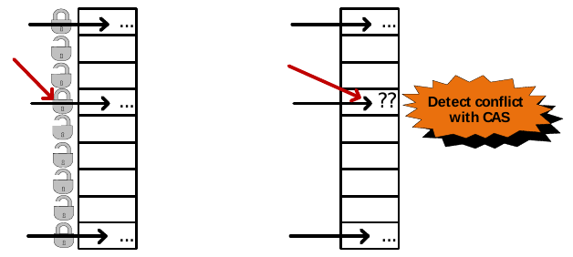
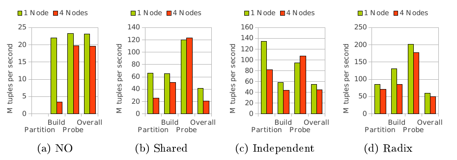
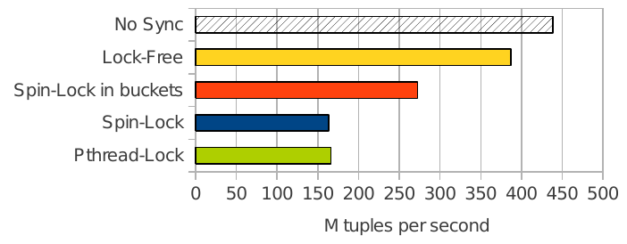
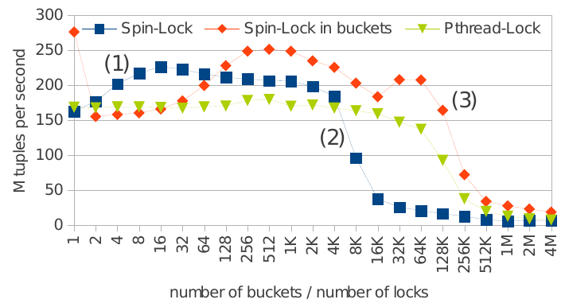
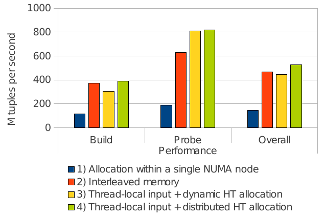

# Massively Parallel NUMA-aware Hash Joins（中文译文）

## 译者说明

本文依据同目录的 `source.pdf` 翻译。章节、图表、公式、算法、代码与参考文献按原文结构保留。

Harald Lang、Viktor Leis、Martina-Cezara Albutiu、Thomas Neumann、Alfons Kemper

慕尼黑工业大学（Technische Universität München）

联系邮箱：`firstname.lastname@in.tum.de`

## 摘要

近年来，主存容量不断增大以及大规模并行多核处理这两大硬件趋势，推动了对经典连接算法并行化的大量研究。然而，这些体系结构对主存的非一致内存访问（NUMA）特性，在算法设计中只得到了有限关注。我们研究了近期提出的内存哈希连接实现，找出它们在 NUMA 体系结构上的主要性能问题。随后，我们为大规模并行环境开发了一种 NUMA 感知哈希连接，并展示具体实现细节如何影响 NUMA 系统上的性能。实验评估表明，精心设计的哈希连接实现，性能超过以往高性能哈希连接的两倍，连接输入元组的吞吐量达到前所未有的每秒 7.5 亿。

## 1 引言

硬件近来的发展提供了巨大的主存容量和大量处理器核，促成了内存数据库系统的兴起，也推动了对并行数据库算子的大量研究。其中，可能最重要的算子——等值连接——尤其受到关注。Blanas 等人 [1] 和 Kim 等人 [2] 提出了性能很高的哈希连接变体，性能数倍于先前的实现。

迄今，这些算法只考虑了整个主存具有一致访问延迟和带宽的硬件环境。随着通过非一致内存访问扩展主存的体系结构出现，NUMA 感知算法成为必要。在文献 [3] 中，我们为多核 NUMA 机器重新设计了经典的排序归并连接。这里，我们着重重新设计另一种经典连接方法，即哈希连接。

本文介绍我们的 NUMA 感知哈希连接方案。核心改进在于构建输入的哈希表设计。如图 1 所示，我们采用基于乐观验证的无锁同步机制，以替代代价高昂的悲观加锁，从而优化并行性。我们还为哈希表设计了 NUMA 优化的存储布局，以有效利用所有 NUMA 节点的聚合内存带宽。此外，我们对哈希表进行了工程优化，使不可避免的冲突在局部解决，即保持在同一缓存行内。



图 1：对哈希表的悲观与乐观写访问。右侧通过 CAS 检测冲突。

与 Blanas 等人 [1] 最近发表的多核哈希连接相比，这些改进使性能提升了一个数量级。与此同时，Balkesen 等人 [4] 也研究了文献 [1] 的结果，发表了针对硬件优化的算法重新实现 [5]，其性能同样远远超过早期实现。他们的研究集中于具有一致内存访问的多核 CPU 体系结构，不过其源代码包含初步的 NUMA 支持，在我们的 NUMA 机器上能使性能提高四倍。

全文使用文献 [1] 中对哈希连接算法的如下称呼。

1. **不分区连接（No partitioning join）**。一种简单算法，没有分区阶段，在构建阶段创建单个共享哈希表。
2. **共享分区连接（Shared partitioning join）**。对两个输入关系分区，所有线程共享目标分区的写缓冲区。
3. **独立分区连接（Independent partitioning join）**。所有线程独立完成分区阶段，先在本地创建目标分区的一部分，待全部线程完成各自的独立工作后，再把这些部分链接起来。
4. **基数分区连接（Radix partitioning join）**。并行地对两个输入关系进行基数分区，通过递归应用算法完成多趟分区。该算法最初由 Manegold 等人 [6] 提出，随后在文献 [2] 中进一步改进。

我们首先在具有一致内存访问的系统上使用 Blanas 等人提供的原始代码，并成功复现了已发表的结果。相反，将代码运行在我们的 NUMA 系统上时（系统见第 4 节），所有算法的性能都下降了。我们识别出这些算法的三个主要问题。

1. 构建哈希表时的**细粒度加锁**降低并行性。这并非 NUMA 独有的问题，但随着并发线程数增加，问题会更加严重。
2. **大量远端内存访问**指向驻留在单个 NUMA 节点内的共享数据结构，例如基数分区连接中共享分区的写缓冲区。这导致链路争用，进而降低性能。
3. **在紧密循环中访问多个内存位置**会增加延迟，并带来缓存一致性协议的额外开销，而这在 NUMA 系统上代价更高。



图 2：文献 [1] 中算法在 NUMA 系统上的性能。8 个线程限制在 1 个内存节点内，或分布在 4 个节点上。子图依次为 (a) 不分区连接 NO、(b) 共享分区连接、(c) 独立分区连接、(d) 基数分区连接。纵轴为每秒百万元组数，横轴列出分区、构建、探测及总体性能。

下一节考察非一致内存访问对上述实现造成的主要影响。第 3 节着重讨论如何以 NUMA 感知方式实现哈希连接算子。我们在其中解决现代体系结构上哈希连接算法的主要挑战，包括降低同步开销、减少随机内存访问，以及针对有限内存带宽优化。第 4 节讨论实验评估结果。

## 2 NUMA 的影响

为了让 NUMA 的影响清晰可见，并使各种改动可比较，我们使用均匀数据集，在两种不同配置下重新运行原始实验。首先，在单个 NUMA 节点内的 8 个物理核上运行 8 个线程，以此模拟具有一致内存访问的机器。随后，将线程均匀分布到全部 4 个节点，每个节点使用 2 个核。

图 2 展示各个哈希连接实现的性能，概括了 NUMA 对连接各阶段的影响。所有实现的性能都下降了。只有共享分区和独立分区算法在探测阶段的性能略有提高。不分区算法和共享分区算法受影响最大的阶段分别是构建和分区阶段。这两个阶段都要大量写入共享数据结构。构建性能下降了 85%，分区阶段性能下降了 62%。在给定场景中，总体性能平均下降 25%。

与原始结果不同，这里的构建性能总是低于探测性能，这是我们通过打乱输入次序造成的。不过，由于同步开销，构建哈希表慢于探测本就是合理的。因此，构建阶段变得更加重要，尤其在构建输入与探测输入的基数比 $\lvert R\rvert/\lvert S\rvert$ 增大时。这就是我们在下一节额外关注构建阶段的原因。

## 3 NUMA 感知哈希连接

### 3.1 同步

使用单个共享哈希表的哈希连接，在构建阶段需要密集同步。该阶段读取构建输入，并把元组复制到相应的哈希桶。这里保证构建阶段完成后才开始探测哈希表，且构建完成后哈希表不再被修改。因此，后续探测阶段不需要同步。另一个关键部分是被并发访问的写缓冲区。尤其在共享分区算法的分区阶段，所有线程并发写入同一批缓冲区，大量使用锁。因此，线程数增加会加剧锁争用。本文只关注哈希表的同步。

实现线程安全哈希表有多种方式，同步机制是一项基本设计决策。Blanas 等人 [1] 提供的实现使用一种非常精简的自旋锁，在内存中仅占一个字节。每把锁保护一个哈希桶，每个桶可以存储两个元组。在该实现中，所有锁都放在连续数组内。遗憾的是，这个设计存在影响构建阶段的缺点。每次写哈希表，我们至少要访问两个不同缓存行。其中，存放锁的缓存行要访问两次，分别用于获取锁，以及桶被修改后释放锁。这大幅增加了内存访问延迟，是第 1 节列出的三个主要瓶颈之一。通过修改桶的数据结构，把对应锁也放进桶内，可以减少这一负面影响。Balkesen 等人 [4] 在一致内存访问系统上也识别出了这个瓶颈。NUMA 系统的延迟更高，因此我们预计它对构建性能的影响更大。后续实验评估（第 4 节）会展示锁的放置方式如何影响我们自己的哈希表，同时考虑一把锁负责多个哈希桶的情况。

我们的哈希表采用乐观无锁方式。设计的出发点是观察到连接用哈希表在构建阶段只有插入，在探测阶段只有查找，不执行更新或删除。桶实现为三元组 $(h,k,v)$，其中 $h$ 保存键 $k$ 的哈希值， $v$ 保存值，即载荷。所有实验中，每个分量使用 8 字节内存，这对大型数据库是现实的设置。我们将 $h$ 用作标记，指示桶为空还是已被占用。构建阶段，线程先检查标记是否已设置。如果对应桶为空，就通过一次原子的比较并交换（Compare-and-Swap，CAS）操作，把零替换为哈希值。如果另一线程已在此期间设置该标记，原子操作会失败，我们便线性探测，即在下一个写位置重试。一旦 CAS 成功，相应线程就隐式获得该桶的独占写权限，存储元组无需进一步同步。只需在两个阶段间设置屏障，确保开始探测哈希表前，所有键值对都已写完。

### 3.2 内存分配

本节描述本地与远端内存访问的影响，以及程序员分配和初始化主存时必须考虑的事项。在 NUMA 系统上，可以直接访问全部可用内存，但至少要区分本地和远端内存。本地内存访问的代价更小。代价取决于 NUMA 分区如何连接，因此与硬件有关。在我们的系统中，四个节点全互连，所以每次访问远端内存都恰好经过一条 QPI 链路，即一跳。系统默认在发起请求的线程所在节点上分配内存。可通过 `numactl` 工具改变此行为。尤其是命令行参数 `--interleave=all`，它让操作系统在所有可用节点间交错分配内存，非 NUMA 感知程序可能从中受益。若程序在交错内存上运行更快，这可能表明存在优化空间，而 NUMA 感知程序可能因失去内存分配控制权而受损。实验会展示这些影响。

对数据密集型算法，我们必须考虑算法所操作的数据放在哪里。C++ 通常使用 `new` 运算符或 `malloc` 函数动态分配内存。这只是预留内存，只要新分配的内存还未初始化，例如尚未调用 `memset`，它就未固定到某个特定 NUMA 节点上。首次访问会把目标页放到特定节点。如果请求的内存大于一页，那么只会固定部分内存，不影响尚未触及的其余空间。因此，只要节点数不超过内存页数，单个连续内存区就能分散到所有节点。利用这一点，可以在数据放置的控制程度和粒度上作合理让步，保持实现简单。

评估从一个朴素实现开始，再逐步改进。目标是让哈希连接实现在使用非交错内存时表现最佳，因为在实际场景中，可能无法把整个 DBMS 进程置于交错模式运行。我们也避免给哈希连接增加额外参数，尤其不希望让实现局限于某一种硬件布局。我们考虑一般情形，即输入均匀分布在各节点，且相应内存位置为“最近”的工作线程所知。我们会展示交错内存能提高非 NUMA 感知实现的性能，也会在下一节展示，自行管理内存分配能让我们的哈希连接表现得比交给操作系统管理更好。

### 3.3 哈希表设计

哈希表处理冲突通常采用两种策略之一，链式法或开放寻址法。使用链式法时，哈希表本身只保存指针，桶按需分配并链接到哈希表或前一个桶。开放寻址法则在哈希表自身内部处理冲突。也就是说，某个键哈希到的桶已满时，就按某种探测序列检查更多桶，例如线性探测或二次探测。开放寻址方面，我们着重采用线性探测，因为它比其他探测序列具有更好的缓存局部性。插入和探测时发生冲突，都很可能仍命中同一缓存行。两种策略各有优势，链式法的构建性能更好，线性探测的探测阶段吞吐量更高。实际场景中，构建输入通常远小于探测输入，因此我们为哈希连接实现选择线性探测。

### 3.4 实现细节

清单 1.1 给出哈希表插入函数的概要。第 2 行计算给定键的哈希值（哈希函数详见第 4.3 节），第 3 行通过将哈希值中超出哈希表大小的所有位屏蔽为零，来计算桶号。哈希表大小始终为二的幂，桶数至少为构建输入元组数的两倍。因此，对于 $n$ 个输入元组，桶数为 $b=2^{\lceil\log_2(n)\rceil+1}$，且 $\mathrm{mask}=b-1$。哈希表虽然占用相对宽裕的空间，但探测输入可以保持原位，足以补偿这项开销，因为探测输入常常比构建输入大几个数量级。相比之下，基数连接要对两个输入关系都进行分区。

清单 1.1：原子插入函数

```cpp
 1    insertAtomic(uint64_t key, uint64_t value) {
 2      uint64_t hash = hashFunction(key);
 3      uint64_t pos = hash & mask;
 4      while (table[pos].h != 0
 5          || (! CAS(&table[pos].h, 0, hash))) {
 6        pos = (pos + 1) & mask;
 7      }
 8      table[pos].k = key;
 9      table[pos].v = value;
10    }
```

在 `while` 循环条件中（第 4–7 行），先检查桶是否为空。若为空，便调用第 3.1 节所述的原子 CAS 函数。如果哈希值不等于零，或者 CAS 返回假，就递增桶号（写位置）并重试。一旦控制流到达第 8 行，当前线程就已获得位置 `pos` 所在桶的写权限，将键值对存入其中。[^1]

这里值得注意的是，没有相应的释放已获取锁的操作。通常线程获取锁、修改桶，最后释放锁，在修改与解锁之间建立先发生（happened-before）关系。在我们的实现里，CPU 可以延迟修改或乱序执行修改，因为直到探测阶段开始前都没有数据依赖。此外，我们使用开放寻址，并采用线性探测序列解决冲突，针对冲突情况下的顺序内存访问进行优化。这使访问模式易于预测，硬件预取器可以利用这一特点。

[^1]: `hashFunction` 将哈希值的最高有效位置为 1，确保没有哈希值等于 0。这将哈希定义域限制为 2⁶³，但不会增加冲突数，因为决定哈希表位置的是最低有效位。



图 3：采用不同同步机制的构建性能。横轴为每秒百万元组数，图中比较无同步、无锁、锁置于桶内的自旋锁、独立自旋锁和 pthread 锁。

## 4 评估

实验运行在一台 Linux 服务器上，内核版本为 3.5.0，主存为 1 TB，搭载 4 颗 2.27 GHz 的 Intel Xeon X7560 CPU。每颗 CPU 有 8 个物理核、16 个硬件上下文，总计 32 个物理核，并通过超线程提供 64 个硬件上下文。除非另有说明，实验使用全部可用硬件上下文。

### 4.1 同步

第一个实验测量不同同步机制对构建性能的影响。为减少测量波动，我们把构建输入 $R$ 的基数增至 128 M 个元组，仍使用具有唯一 64 位连接键的均匀数据集。结果见图 3。我们比较原始自旋锁实现、POSIX 线程互斥锁及我们的无锁实现。自旋锁和 pthread 实现的性能几乎相同，而我们的无锁实现性能达到它们的 2.3 倍。把锁放在哈希桶内，而非将全部锁放在一个单独的连续内存区域，还能带来 1.7 倍性能提升。带斜线的柱（标记为“No Sync”）表示同步代价为零时的理论值。



图 4：锁条带化对构建阶段的影响。纵轴为每秒百万元组数，横轴为桶数与锁数之比，曲线比较独立自旋锁、锁置于桶内的自旋锁和 pthread 锁；(1)、(2)、(3) 标出正文讨论的三种效应。

第二个实验减少用于同步哈希桶写访问的锁数 $n$。开始时每个桶一把锁，此后每轮将锁数减半，因此一把锁会负责多个哈希桶，即“锁条带化”（lock striping）。在我们的实现中，这些桶彼此相邻。第 $i$ 把锁负责桶区间 $[i\cdot b/n,(i+1)\cdot b/n)$，其中 $n$ 为锁数， $b$ 为总桶数， $b\geq2\cdot\lvert R\rvert$，且 $b$ 为二的幂。

图 4 显示，减少锁数可显著提高构建性能。尤其是自旋锁，在最初呈现陡峭上升。Blanas 的自旋锁实现只需一个字节，因此一条缓存行可容纳多达 64 把锁。减少总锁数使获取锁时的缓存未命中减少，对应图中标记 (1)。由于我们使用线性探测，哈希冲突之后获取相邻桶的锁时，很不容易发生缓存未命中。另一方面，当多个线程访问同一缓存行内的锁时，自旋锁性能会显著下降，对应 (2)。即使锁争用很少，修改同一条缓存行也会为维持缓存一致性而造成一致性未命中。当锁存储在桶内时，观察不到这种效应，此时只能看到锁争用增大带来的自然性能下降，对应 (3)。与一个字节的自旋锁不同，pthread 互斥锁没有表现出这些缓存效应，因为单把锁占 40 字节。

实验还显示，将锁条带化与桶内存锁结合，缓存效率非常低。一把锁负责的桶越多，单次哈希表访问需要加载两条缓存行（一条放锁，一条放桶）的概率就越大。

实验确认，高效的锁实现对构建阶段至关重要。用一把锁保护多个桶确实可能改善性能，但无法与无锁实现竞争。尤其是“Spin-Lock in buckets”曲线的前两个数据点，展示了在 NUMA 体系结构上，紧密循环内写入两条不同缓存行会造成关键的性能差异。

### 4.2 内存分配

评估不同内存分配策略时，我们分别考察构建和探测阶段，关注策略对各阶段的影响，同时也绘出总体性能以保持完整性。为获得良好的展示效果，把两个关系的基数设为同一数值 128 M。所有实验只计数，不物化输出元组。使用以下四种设置。

1. **非 NUMA 感知**。输入数据和哈希表全部分配在单个 NUMA 节点。
2. **交错**。与设置 1 相同，但在 `--interleave=all` 模式下运行。
3. **NUMA 感知／动态**。两个输入关系在线程本地分配并初始化，哈希表内存则在运行时动态初始化。
4. **NUMA 感知**。与设置 3 一样，两个关系都放在线程本地，而哈希表内存则以页大小的块，手工在全部 NUMA 节点间初始化。

图 5 展示四组实验结果。我们测量构建、探测和总体性能，单位为每秒百万元组数。设置 4 中哈希表的分布式内存分配过程如下。把哈希表划分为若干大小相等的 2 MB 块，所有线程并行初始化，第 $i$ 块由线程 `i mod #threads` 执行 `memset`。

仅把非 NUMA 感知实现放在交错内存上运行，性能就提高了三倍以上。设置 3 相比设置 2，构建性能有所下降，这是哈希表内存的动态分配造成的。设置 4 最终表现最好。我们自己的实现仅对哈希表内存模拟交错分配，构建性能与设置 2 大致相同，但探测性能额外增加 188 mtps，因为无须从交错内存读取探测输入。



图 5：不同数据放置／内存分配策略的实验结果。纵轴为每秒百万元组数；比较构建、探测和总体性能。四组柱依次对应单 NUMA 节点分配、交错内存、线程本地输入加动态哈希表分配、线程本地输入加分布式哈希表分配。

表 1：使用均匀数据集（主键／外键连接）比较 NO 与基数连接的性能。mtps 表示每秒百万元组数。

| 设置，构建／探测基数 | 我们的 NO | 基数连接 [5] | VectorWise |
| --- | --- | --- | --- |
| 16 M / 16 M | 503 mtps | 147 mtps | |
| 16 M / 160 M | 742 mtps | 346 mtps | |
| 32 M / 32 M | 505 mtps | 142 mtps | |
| 32 M / 320 M | 740 mtps | 280 mtps | |
| 1 G / 1 G | 493 mtps | — | |
| 1 G / 10 G | 682 mtps | — | 50 mtps |

我们假设实际中关系均匀分布于全部内存分区，只需把最近的输入分配给每个线程。表 1 与文献 [5] 的基数连接实现作比较。遗憾的是，该基数实现无法处理极大的工作负载，例如 1 G / 10 G，即 176 GB 数据。作为比较，TPC-H 纪录保持者 VectorWise 在这个大连接上达到 50 mtps [3]。

### 4.3 哈希函数

为与先前发表的工作一致，并得到可比较的性能结果，所有实验都使用模哈希函数，如第 3.4 节所述，通过逻辑 AND 实现。本节研究哈希函数对连接性能的影响。一方面，模哈希极快，在微基准中连接性能很好。另一方面，很容易构造出使其性能剧降的工作负载。例如，我们不使用连续整数，而是在连接键之间留出间隔，只使用键空间中每十个值里的一个。结果，文献 [5] 中 NO 实现的性能下降了 84%。我们自己的实现受二的幂次间隔影响，连接键间距为 16 时，性能下降 63%。

我们在哈希连接实现中评估了少量哈希函数，包括 Murmur64A、CRC 和 Fibonacci 哈希。结果表明，无论测试哪种工作负载，Murmur 哈希的性能几乎始终相同。同时，它也是代价最高的哈希函数，与连续键上的模哈希相比，总体连接性能降低 36%。现代 CPU 的 SSE 4.2 指令集中提供了 CRC 硬件指令，因此多数情况下其性能损失不到 1%。但它的稳健性不如 Murmur，在少数工作负载上产生的冲突明显更多。Fibonacci 哈希的性能几乎与模哈希相同，但遗憾的是也有相同弱点。

实际哈希函数自然会带来更高代价，但对各种算法的影响不同。使用昂贵的哈希函数对基数连接的影响比对 NO 连接更大，因为每个元组要多次计算哈希函数，在每个分区阶段以及最终探测阶段都要计算。最后，采用更现实的哈希函数，也使结果更易于和排序归并连接等不使用哈希的算法比较。

## 5 相关工作

并行连接处理已被广泛研究，尤其是在内存数据库出现以后。多数方案基于 MonetDB 团队开创的基数连接 [7, 6]。这种连接方法不断把输入分成更小的块，最终使其能够放进缓存，从而改善缓存局部性。Ailamaki 等人 [8] 使用软件控制的预取改善哈希连接探测阶段的缓存局部性。由于采用开放寻址，我们的哈希连接几乎始终每次查找或插入只产生一次缓存未命中。

Intel／Oracle 团队 [2] 将哈希连接适配到多核 CPU。他们还研究了排序归并连接，并推测随着 SIMD 加宽、核数增加、每核内存带宽缩小，排序归并连接在未来片上多处理器上的性能可能超过哈希连接。Blanas 等人 [1, 9] 和 Balkesen 等人 [4, 5] 的并行哈希连接变体给出了更好的性能结果。然而，这些算法未针对 NUMA 环境优化。

Albutiu 等人 [3] 提出了 NUMA 感知的排序连接算法设计，Li 等人 [11] 又对其作了改进，以避免交叉流量。

## 6 总结与结论

现代硬件体系结构拥有巨大的主存容量和不断增加的核数，推动了内存数据库系统中高度并行的内存算法发展，研究重点是基于哈希的算法 [1, 2]。然而，先前工作尚未考虑非一致内存访问体系结构。我们识别了 NUMA 给哈希连接算法带来的挑战，并据此开发自己的算法，以乐观验证替代昂贵的悲观加锁。算法精心分布数据，让分区间链路的带宽得到均衡利用。同时，无须特定体系结构知识，即算法不依赖具体 NUMA 拓扑。

我们的哈希连接在 NUMA 系统上超过了先前的并行哈希连接实现。我们进一步发现，高度并行的共享哈希表实现优于基数分区变体，因为后者带来了很高的分区开销。尽管哈希连接本身通过随机方式插入和探测哈希表，固有地缺少缓存局部性，上述结果仍然成立。但至少可以通过线性探测避免冲突带来的额外缓存未命中。因此，我们认为缓存效应对多核哈希连接的决定性较弱。在大型设置上，我们实现了每秒超过 740 M 元组的连接性能，比文献 [5] 发表的已知最佳基数连接高出两倍以上，比一流商业数据库系统 VectorWise 快一个数量级。

## 参考文献

1. Blanas, S., Li, Y., Patel, J.M. Design and evaluation of main memory hash join algorithms for multi-core CPUs. In: SIGMOD. (2011).
2. Kim, C., Sedlar, E., Chhugani, J., Kaldewey, T., Nguyen, A.D., Blas, A.D., Lee, V.W., Satish, N., Dubey, P. Sort vs. hash revisited: Fast join implementation on modern multi-core CPUs. PVLDB 2 (2009).
3. Albutiu, M.C., Kemper, A., Neumann, T. Massively parallel sort-merge joins in main memory multi-core database systems. PVLDB 5 (2012).
4. Balkesen, C., Teubner, J., Alonso, G., Özsu, T. Main-memory hash joins on multi-core CPUs: Tuning to the underlying hardware. In: ICDE. (2013).
5. Balkesen, C., Teubner, J., Alonso, G., Özsu, T. Source code. (`http://www.systems.ethz.ch/sites/default/files/multicore-hashjoins-0_1_tar.gz`).
6. Manegold, S., Boncz, P.A., Kersten, M.L. Optimizing Main-Memory Join on Modern Hardware. IEEE Trans. Knowl. Data Eng. 14 (2002).
7. Boncz, P.A., Manegold, S., Kersten, M.L. Database architecture optimized for the new bottleneck: Memory access. In: VLDB. (1999).
8. Chen, S., Ailamaki, A., Gibbons, P.B., Mowry, T.C. Improving hash join performance through prefetching. ACM Trans. Database Syst. 32 (2007).
9. Blanas, S., Patel, J.M. How efficient is our radix join implementation? `http://pages.cs.wisc.edu/~sblanas/files/comparison.pdf` (2011).
10. Porobic, D., Pandis, I., Branco, M., Tözün, P., Ailamaki, A. OLTP on hardware islands. PVLDB 5 (2012).
11. Li, Y., Pandis, I., Mueller, R., Raman, V., Lohman, G. NUMA-aware algorithms: the case of data shuffling. In: CIDR. (2013).
