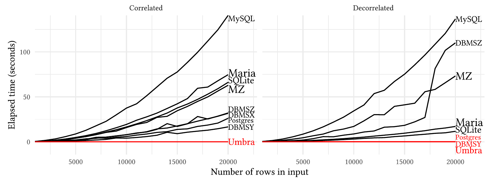
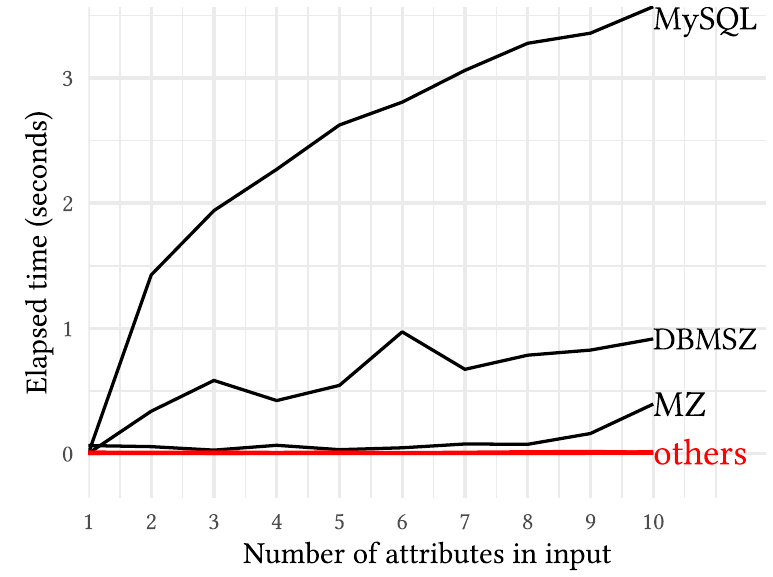
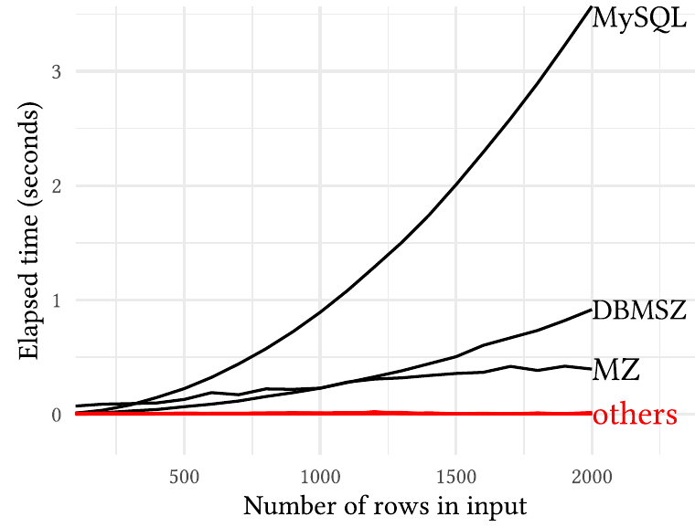
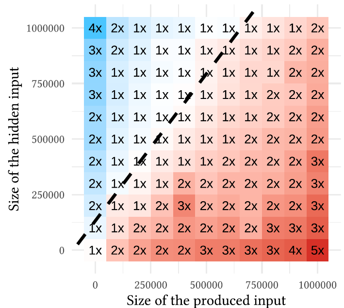

# On the Vexing Difficulty of Evaluating IN Predicates（中文译文）

## 译者说明

本文依据同目录的 `source.pdf` 翻译。章节、图表、公式、算法、代码与参考文献按原文结构保留。

Altan Birler，altan.birler@tum.de，慕尼黑工业大学（Technische Universität München），德国加兴。

Thomas Neumann，neumann@in.tum.de，慕尼黑工业大学（Technische Universität München），德国加兴。

第 16 届创新数据系统研究会议（CIDR ’26），2026 年 1 月 18—21 日，美国 Chaminade。

## 摘要

SQL 中的 IN 谓词及其语法上的近亲——量化比较谓词——被广泛使用，而且自 SQL 标准诞生起就是其中的一部分。或许有些出人意料的是，目前并没有已知的高效求值策略。乍看之下，这些构造的行为类似半连接，但这只在不涉及 NULL 值时成立。在一般情况下，SQL 标准规定的行为很难高效实现。据我们所知，所有现有系统要么在某些情况下表现出二次运行时间，要么产生错误结果。对于如此常见的操作，这相当令人困扰。

本文研究这一问题，并作出实践和理论两方面的贡献。在理论方面，我们说明这一问题具有内在难度；除非 SAT 能够更高效地求解，否则一般情况下不可能找到运行时间为次二次的算法。在实践方面，我们表明，虽然一般问题很难，常见情况仍可在线性时间内解决，甚至较差的情况通常也能更高效地处理。与现有方案相比，由此带来的运行时间收益几乎可以任意大。

## CCS 概念

- 信息系统 → 查询算子。

## 关键词

SQL，查询处理，IN 表达式，标记连接（mark join）

## 1 引言

SQL IN 谓词是检查一个元组是否包含在元组多重集中的常用方式。例如，查询

```sql
SELECT (3, 4) IN (VALUES (1, 2), (3, 4));
```

计算下述析取：

```sql
((3 = 1) AND (4 = 2)) OR ((3 = 3) AND (4 = 4))
```

由于第二个合取项为 TRUE，查询结果为 TRUE。考虑到可以在这个多重集上建立索引，该查询可以在相对于输入规模的线性时间内完成。但是，如果元组多重集包含 NULL 值，查询结果就必须遵守 SQL 的三值逻辑。例如，查询

```sql
SELECT (3, 4) IN (VALUES (1, 2), (3, NULL));
```

计算下述析取：

```sql
((3 = 1) AND (4 = 2)) OR ((3 = 3) AND (4 = NULL))
```

由于第一个合取项为 FALSE，第二个合取项为 NULL，查询结果为 NULL。我们将说明，NULL 的存在使问题显著变难。

```sql
-- IN 谓词
SELECT *
FROM R
WHERE (x,y) NOT IN (SELECT a,b FROM S)
-- EXISTS 谓词
SELECT *
FROM R
WHERE NOT EXISTS
  (SELECT FROM S WHERE (a,b) = (R.x,R.y))
```

图 1：用于检查包含关系的 NOT IN 与 NOT EXISTS 查询。NOT EXISTS 需要相关子查询，而 NOT IN 不需要。哪个查询运行得更快？视情况而定。

IN 谓词被广泛使用，自 SQL 标准诞生以来就是其中的基础组成部分。人们或许会期待它存在一个线性时间算法，但令人意外的是，事实并非如此。本文表明，在强指数时间假设成立的前提下，SQL 标准为含 NULL 值的 IN 谓词规定的行为，在一般情况下无法用次二次时间求值。尽管如此，我们也表明，许多常见情况可以在线性时间内解决，而且当可空属性的数量较少时，即使困难的情况也可以相对高效地解决。

遗憾的是，大多数现有数据库系统要么很慢，要么不符合标准。ClickHouse 25.8、Hyper 9.1.0、DuckDB 1.3.0、Snowflake 9.21.0、Redshift 1.0.118447 和 Firebolt Core 4.23.5，对于含有 IN 或 NOT IN 谓词及可空属性的查询，都会给出错误结果。SQL Server 2022 和 BigQuery 2025-07-22 不支持多属性 IN 谓词，但在其他方面是正确的。Materialize v0.151.0、Databricks 2025.16、CedarDB v2025-07-23、SQLite 3.46.1、DB2 Developer-C 11.1、MariaDB 11.4、Oracle 23c、PostgreSQL 17、TimescaleDB 2.14 和 YugabyteDB 2.18 会产生正确结果，但即使在简单情况下也可能表现出二次运行时间。我们的系统 Umbra 实现了本文提出的技术，既能产生正确结果，又比朴素方法显著更快。

许多用户比起 EXISTS 谓词更偏好 IN 谓词或量化比较谓词 [3, 6]，这种偏好也渗透到了 AI 生成的查询中 [17]。然而，含可空属性的 IN 谓词的语义及不佳的性能令用户十分困惑 [12, 20]。关于何时使用 IN 谓词、何时使用图 1 中相似的 EXISTS 谓词，流传着大量互相矛盾的经验说法。有时，人们推荐 IN 谓词，因为它避免了相关子查询。在撰写本文时，Google 搜索“exists vs in”的前三条结果中，有两条提到了这一建议 [7, 9]。其他来源，包括 Oracle 官方文档 [16]，则声称对较大的、选择性较低的子查询，EXISTS 谓词性能更好；这可能是因为某些数据库实现针对小型内联表优化了 IN 谓词。再往下查，有人声称 EXISTS 与 IN 的性能一样好 [18]，但如果涉及可空值，NOT EXISTS 的性能会比 NOT IN 好得“多得多”[19]。这让用户非常困惑，而且不清楚这些建议是否适用于广泛的数据库系统，更不用说某个特定系统。本文旨在澄清这一情况，并向系统实现者提出清晰的建议：结合查询去相关化（见第 4 节）、标记连接算子，以及我们提出的可空标记连接求值算法（见第 6 节），可以为尽可能广泛的查询提供稳健、高效的求值方案。

第 2 节讨论高效求值 IN 谓词方面为数不多的相关工作。第 3 节介绍 IN 和量化比较谓词的语义，并讨论相关难点。第 4 节讨论如何利用标记连接算子对这类谓词去相关化并在代数层优化。第 5 节概述一般问题为何困难，以及通用次二次算法为何极不可能存在。鉴于一般问题的难度，第 6 节着重高效解决常见情况。第 7 节评估我们的方法，表明相对于朴素方法可以获得显著加速。最后，第 8 节给出结论并归纳我们的建议。

## 2 相关工作

虽然 SQL 中 NULL 值的一般性问题已广为人知 [12, 20]，但高效求值 NOT IN 谓词这一具体问题在文献中受到的关注很少，尽管它自 SQL 标准诞生起就是其中的基础部分。许多系统仍使用依赖式嵌套循环来求值 NOT IN 谓词，这往往导致性能不佳。少数数据库系统，例如 PostgreSQL、SQLite 和 MariaDB，对涉及 NULL 值的 NOT IN 谓词有专门实现¹；其中，似乎只有 PostgreSQL 在仅涉及一个可空属性时能可靠地表现出线性运行时间（见第 7 节）。我们不知道有对它们算法进行形式化分析的工作。虽然源代码的文档并不详尽，PostgreSQL 的实现似乎与我们在第 6.2 节介绍的右标记连接方法类似。

Elhemali 等人 [6] 提出了一种通过将操作分解为一系列反连接来处理 NULL 值的方法，但它局限于单个属性。Bellamkonda 等人 [3] 推广了这种方法：通过物化谓词右侧，其算法花费 $O(2^d\cdot n)$ 时间，其中 $d$ 是可空属性数量， $n$ 是输入规模。Ahmed 和 Amor [2] 提出了一种物化左侧的方法，但细节较少。第 6 节提出两个新算法，可处理任意 NOT IN 谓词，并保证在仅涉及一个可空属性时具有线性运行时间：一个物化左侧，另一个物化右侧，从而可以根据查询作出适当选择。

¹ PostgreSQL 和 MariaDB 都将其称为“subselect”操作。

## 3 背景

本节回顾 SQL 中的 NULL 语义，并形式化定义 IN、量化比较及 EXISTS 表达式。

### 3.1 NULL 语义

SQL 使用三值逻辑，逻辑表达式的结果可以是 TRUE、FALSE 或 NULL。NULL 值意在表示未知值，但其语义可能不直观。

图 2 给出比较运算符 `=` 和 IS，以及逻辑运算符 AND 和 OR 的三值逻辑表。当一个操作数为 NULL 时，`=` 运算符返回 NULL。本文使用 IS 运算符表示 SQL 中的 IS NOT DISTINCT FROM 表达式：它检查两个操作数是否完全相同，只返回 TRUE 或 FALSE。IS 运算符很有用，因为它经常出现在 SQL 子查询去相关化之后，而且对于非 NULL 值，它等价于 `=`。由于不返回 NULL，它比 `=` 更容易求值。逻辑运算符 AND 和 OR 的定义保证：如果仅从非 NULL 操作数就能确定结果，结果就是该确定值。例如，如果 AND 的一个操作数为 FALSE，那么即使另一个操作数为 NULL，结果也总是 FALSE。

| = | $a$ | $b$ | NULL |
| --- | --- | --- | --- |
| $a$ | TRUE | FALSE | NULL |
| $b$ | FALSE | TRUE | NULL |
| NULL | NULL | NULL | NULL |

| IS | $a$ | $b$ | NULL |
| --- | --- | --- | --- |
| $a$ | TRUE | FALSE | FALSE |
| $b$ | FALSE | TRUE | FALSE |
| NULL | FALSE | FALSE | TRUE |

| AND | TRUE | FALSE | NULL |
| --- | --- | --- | --- |
| TRUE | TRUE | FALSE | NULL |
| FALSE | FALSE | FALSE | FALSE |
| NULL | NULL | FALSE | NULL |

| OR | TRUE | FALSE | NULL |
| --- | --- | --- | --- |
| TRUE | TRUE | TRUE | TRUE |
| FALSE | TRUE | FALSE | NULL |
| NULL | TRUE | NULL | NULL |

图 2：SQL 比较运算符 `=` 和 IS，以及逻辑运算符 AND 和 OR 的三值逻辑表。 $a$ 和 $b$ 是互不相同的非 NULL 值。

### 3.2 IN、SOME、ALL 和 EXISTS

令 $\mathbf{x}=(x _ 1,\ldots,x _ d)$ 为一个行值表达式。IN 谓词

$$
(x _ 1,\ldots,x _ d)\ \mathrm{IN}\ (\mathrm{SELEC{}T}\ r _ 1,\ldots,r _ d\ \mathrm{FROM}\ \mathcal{R})
$$

定义为 $\mathbf{x}$ 在关系 $\mathcal{R}:=\lbrace r^{(1)},\ldots,r^{(n)}\rbrace$ 中的三值成员资格测试：

$$
\mathrm{IN}(\mathbf{x},\mathcal{R}):=⋁ _ {i=1}^{n}\bigwedge _ {j=1}^{d}\left(x _ j=r _ j^{(i)}\right)
$$

如果 $\mathbf{x}$ 没有 NULL 值且在 $\mathcal{R}$ 中有一个精确匹配，结果为 TRUE。如果没有精确匹配，但存在一行 $\mathbf{y}\in\mathcal{R}$，使得所有 $x _ j$ 都等于 $y _ j$ 或为 NULL，则结果为 NULL。如果连部分匹配也没有，结果为 FALSE。注意，并不是所有数据库都支持任意属性数量的 IN 谓词，有些只支持单个属性。第 6 节的方法将特别针对这种情况优化。

译注：上一段关于部分匹配的文字按原文保留；结合紧邻的形式化定义与图 2，每一列比较在任一操作数为 NULL 时都可能为 NULL，不能把它理解为只有 $x _ j$ 一侧为 NULL 才构成部分匹配。

对于给定行 $\mathbf{x}$，判断 IN 谓词的结果是否为 TRUE 很容易。只需对 $\mathcal{R}$ 中的行建立哈希表，并检查其中是否包含 $\mathbf{x}$。但是，区分 NULL 与 FALSE 结果很难。因此，对于 NOT IN 表达式，FALSE 容易确定，但 NULL 与 TRUE 难以区分。所以，与 IN 谓词不同，NOT IN 即使用在 WHERE 子句中，也仍然难以求值。

量化比较谓词与之类似，但扩展到了不同的比较运算符。我们定义 SOME（ANY）谓词：

$$
\mathbf{x}\circ\mathrm{SOME}(\mathrm{SELEC{}T}\ \mathbf{r}\ \mathrm{FROM}\ \mathcal{R})
$$

其中 $\circ$ 是比较运算符 $\lbrace =,\lt \gt ,\lt ,\leq,\gt ,\geq\rbrace$ 中的一个。SOME 谓词的语义定义如下：

$$
\mathrm{SOME}(\circ,\mathbf{x},\mathcal{R}):=⋁ _ {i=1}^{n}\left(\mathbf{x}\circ\mathbf{r}^{(i)}\right)
$$

注意， $\mathrm{IN}(\mathbf{x},\mathcal{R})$ 等价于 $\mathrm{SOME}(=,\mathbf{x},\mathcal{R})$。然而，其否定 $\mathrm{NOT\ IN}(\mathbf{x},\mathcal{R})$ 并不等价于 $\mathrm{SOME}(\lt \gt ,\mathbf{x},\mathcal{R})$，而实际上等价于 $\neg\mathrm{SOME}(=,\mathbf{x},\mathcal{R})$ 或 $\mathrm{ALL}(\lt \gt ,\mathbf{x},\mathcal{R})$。

用于成员资格检查的 EXISTS 谓词，其语义与 IN 谓词有细微差别。EXISTS 谓词

$$
\mathrm{EXISTS}\ (\mathrm{SELEC{}T}\ \mathrm{FROM}\ \mathcal{R}\ \mathrm{WHERE}\ (r _ 1,\ldots,r _ d)=(x _ 1,\ldots,x _ d))
$$

定义为 $\mathbf{x}$ 在关系 $\mathcal{R}$ 中的二值成员资格测试：

$$
\mathrm{EXISTS}(\mathbf{x},\mathcal{R}):=⋁ _ {i=1}^{n}\bigwedge _ {j=1}^{d}\mathrm{COALESCE}\left(x _ j=r _ j^{(i)},\mathrm{FALSE}\right)
$$

如果 $\mathbf{x}$ 没有 NULL 值且有一个精确匹配，结果为 TRUE；否则为 FALSE。EXISTS 谓词比 IN 谓词更容易求值，因为不需要区分前述 NULL 与 FALSE 两种情况。因此，如果数据库优化器能够识别这样的查询，通常就可以通过半连接算子高效执行。

## 4 去相关化与优化

Neumann 和 Kemper [14] 给出了一种对任意相关子查询去相关化的方法。Neumann 等人 [15] 进一步扩展该工作，通过引入标记连接算子，处理任意表达式中的 IN 或 EXISTS 谓词。本节概述其中相关的部分，并给出与 NULL 语义和三值逻辑一致的新定义。

关系 $R$ 与关系 $S$ 之间的标记连接为：

$$
R\mathbin{⟕} _ {m:p}^{M}S:=\left\lbrace \mathbf{r}\circ\left(m:⋁ _ {s\in S}p(\mathbf{r}\circ\mathbf{s})\right)\thinspace{}\mid\thinspace{}\mathbf{r}\in R\right\rbrace
$$

换言之，对 $R$ 中的每一行，标记连接计算谓词 $p$ 在 $S$ 所有行上的析取，然后将该析取作为新属性 $m$ 加入结果。

标记连接可以表达包含 IN 和 EXISTS 谓词的去相关化查询。例如，查询

```sql
SELECT *
FROM R
WHERE R.x IN (SELECT S.a FROM S WHERE R.y = S.b)
```

可以用标记连接表示为：

$$
\sigma _ m\left(R\mathbin{⟕} _ {m:R.x=S.a\wedge R.y\ \mathrm{IS}\ S.b}^{M}\sigma _ {S.b\ \mathrm{IS\ NOT\ NULL}}(S)\right)
$$

IS 谓词是 SQL 中 IS NOT DISTINCT FROM 的简写（见第 3.1 节）。它检查等价性，返回 TRUE 或 FALSE。同样，标记连接也可用于表示量化比较谓词。查询

```sql
SELECT *
FROM R
WHERE R.x <> SOME (SELECT S.a FROM S WHERE R.y = S.b)
```

也可用标记连接表示为：

$$
\sigma _ m\left(R\mathbin{⟕} _ {m:R.x\lt \gt S.a\wedge R.y\ \mathrm{IS}\ S.b}^{M}\sigma _ {S.b\ \mathrm{IS\ NOT\ NULL}}(S)\right)
$$

去相关化之后，标记连接后面常常跟着一个对标记的选择。这类计划可转换为半连接和反连接：

$$
R\ltimes _ p S\equiv\sigma _ m\left(R\mathbin{⟕} _ {m:p}^{M}S\right)
$$

$$
R▷ _ {\mathrm{COALESCE}(p,\mathrm{TRUE})}S\equiv\sigma _ {\neg m}\left(R\mathbin{⟕} _ {m:p}^{M}S\right)
$$

半连接对 $R$ 的每一行检查：是否至少有一行 $S$ 使谓词 $p$ 为 TRUE；反连接则检查：是否 $S$ 的所有行都使谓词 $p$ 为 FALSE。对于许多谓词 $p$，所得半连接以及反连接（如果 COALESCE 表达式可以被优化掉）都可以高效求值。

虽然大多数 IN 和量化比较表达式会产生带相等或基本不等式谓词的标记连接，SQL 实际上允许任意谓词。我们可以将这样的谓词表达为下列一般形式：

```sql
SELECT (TRUE IN (SELECT p(R, S) FROM S)) AS m
FROM R
```

这里， $p(R,S)$ 是一个任意谓词，可以涉及 $R$ 和 $S$ 双方的多个属性。该查询等价于谓词 $p$ 上的标记连接：

$$
R\mathbin{⟕} _ {m:p}^{M}S
$$

## 5 IN 求值的复杂度

我们希望高效求值所有可能的 IN 谓词。遗憾的是，在复杂度理论中通常采用的假设之下，我们证明 SQL 标准规定的行为具有难以高效实现的内在性质。

为说明 IN 谓词的困难性，我们从正交向量问题 [10, 23] 进行归约。正交向量问题定义如下：给定一个由 $n$ 个 $\lbrace 0,1\rbrace ^d$ 中的二进制向量组成的集合，是否存在一对正交向量，即它们的点积为零？人们猜想该问题需要 $n^{2-o(1)}$ 时间才能解决 [1, 21]。这是强指数时间假设（SETH）[5, 8] 的一个推论。该假设认为，对于任意 $\epsilon\gt 0$，当 $k$ 足够大时，具有 $n$ 个变量和 $m$ 个子句的 $k$-SAT 无法在 $2^{n(1-\epsilon)}\mathrm{poly}(m)$ 时间内解决，其中 $\mathrm{poly}(m)$ 表示 $m$ 的某个多项式。简单地说，如果 SAT 需要以 2 为指数底数的时间，那么正交向量问题就需要二次时间，因而 IN 谓词也需要二次时间。

我们通过编写一个用 IN 计算正交向量的 SQL 查询，将正交向量问题归约到 IN 谓词，如图 3 所示。该 SQL 查询以三维向量为例展示正交向量问题，其中 $\mathcal{R}$ 是向量集合；通过增加 $\mathcal{R}$ 的属性数量并相应扩展 NULLIF 表达式，可将其扩展到任意维数。

```sql
WITH
R(v0,v1,v2) AS (VALUES (0,1,0),(1,1,0),(1,1,1)),
S(v0,v1,v2) AS
(SELECT NULLIF(1-v0,1),
        NULLIF(1-v1,1),
        NULLIF(1-v2,1)
        -- 可以扩展到更多维度
 FROM R),
SELECT
(SELECT count(*)
 FROM R
 WHERE (v0,v1,v2) NOT IN (SELECT v0,v1,v2 FROM S))
<
(SELECT count(*) FROM R);
```

图 3：利用 IN 谓词计算正交向量问题的查询。输入由 $\mathcal{R}$ 给出，输出表示是否存在一对正交向量。

译注：原文代码在 `FROM R)` 后、主查询 `SELECT` 前保留了一个逗号，此处按原文转录。

两个向量 $\mathbf{x},\mathbf{y}\in\mathcal{R}$ 正交，当且仅当对于所有满足 $y _ i=1$ 的下标 $i$，都有 $x _ i=0$。在 SQL 三值逻辑中，这编码为：

$$
\bigwedge _ i\left(x _ i=\mathrm{NULLIF}(1-y _ i,1)\right)
$$

注意，在 SQL 中，如果任一操作数为 NULL，相等比较就求值为 NULL（见图 2）。

1. 如果 $y _ i=1$，则 $\mathrm{NULLIF}(1-y _ i,1)\equiv0$，因此相等比较化为 $x _ i=0$。
2. 如果 $y _ i=0$，则 $\mathrm{NULLIF}(1-y _ i,1)\equiv\mathrm{NULL}$，因此相等比较化为 $x _ i=\mathrm{NULL}$。无论 $x _ i$ 的值是什么，相等比较都求值为 NULL。

因此，对所有下标 $i$ 的合取，当且仅当 $\mathbf{x}$ 与 $\mathbf{y}$ 不正交时求值为 FALSE，否则为 TRUE 或 NULL。对于给定向量 $\mathbf{x}$，IN 表达式给出上述表达式在所有向量 $\mathbf{y}\in\mathcal{R}$ 上的析取。因此，当且仅当不存在与 $\mathbf{x}$ 正交的向量 $\mathbf{y}\in\mathcal{R}$ 时，IN 表达式求值为 FALSE，否则为 TRUE 或 NULL。所以，要判断 $\mathcal{R}$ 中是否存在一对正交向量，我们可以用 NOT IN 谓词，统计有多少向量 $\mathbf{x}\in\mathcal{R}$ 在 $\mathcal{R}$ 中没有正交向量，再检查这个数量是否小于 $n$（向量总数）。扫描 $R$、由 $R$ 计算 $S$，以及最终聚合，都可以在线性时间内完成。查询的瓶颈是 NOT IN 谓词的求值。因此，求值 NOT IN 谓词（或 IN 表达式）至少和正交向量问题一样困难，而后者被猜想需要二次时间。

虽然我们的归约只沿一个方向进行，即正交向量问题的高效解法并不意味着 IN 谓词也有高效解法，但正交向量问题的进展可能仍值得关注。正交向量问题的朴素算法计算所有向量对的点积，花费 $O(n^2\cdot d)$ 时间，与 IN 谓词的朴素算法类似。另一种可映射到 IN 谓词的方法是，枚举一个向量中取值为 0 的下标集合的所有子集，并检查集合中是否存在一个在该子集位置取值为 1 的对应向量，耗时 $O(2^d\cdot n\cdot d)$。正交向量问题也有 $\widetilde{O}(n+2^d)$ 算法 [10]，其中 $\widetilde{O}$ 隐去了一个对数因子，不过这些算法利用了向量的二进制性质，未必可以扩展到任意值域上的 IN。最近，Williams [22] 给出了针对二进制向量的 $\widetilde{O}(n\cdot1.35^d)$ 算法，在 $d$ 上比朴素方法快一个指数级。

## 6 方法

本节介绍高效求值标记连接的方法。第 4 节讨论了标记连接，说明它们可以表达 IN、EXISTS 和量化比较谓词。第 5 节已证明一般问题很困难，这意味着我们不能指望为所有情况找到次二次算法。不过，仍可为常见情况找到高效算法。

标记连接有两侧：一侧的属性在输出中可见，称为输出侧（produced side）；另一侧只用于确定标记，称为隐藏侧（hidden side）。连接通常是不对称的 [4]，即一侧往往远小于另一侧。因此，出于性能和内存消耗两方面的考虑，我们希望只物化连接的一侧，而让另一侧以流水线方式处理、不作物化。我们实现了两个标记连接变体：右标记连接 $\mathcal{L}\mathbin{⟖} _ p^M\mathcal{R}$ 物化隐藏侧，左标记连接 $\mathcal{L}\mathbin{⟕} _ p^M\mathcal{R}$ 物化输出侧。右标记连接稍显直观，因为输出侧以流水线方式处理，直接计算标记。左标记连接更复杂，因为输出侧被物化，必须经过多遍处理计算标记。要高效覆盖所有用例，两者都必不可少；当连接谓词中只有一个可空属性这一常见情况出现时，我们对两者采用的方法都保证线性时间复杂度。

假设谓词具有下列形式：

$$
p(\mathbf{l},\mathbf{r})\equiv(\mathbf{l}.\mathbf{x}=\mathbf{r}.\mathbf{x})\wedge(\mathbf{l}.\mathbf{y}\ \mathrm{IS}\ \mathbf{r}.\mathbf{y})\wedge\mathrm{residual}(\mathbf{l},\mathbf{r})
$$

其中：

1. $\mathbf{x}$ 与 $\mathbf{y}$ 是属性集合。
2. $\mathbf{l}$ 是左侧的一个元组。
3. $\mathbf{r}$ 是右侧的一个元组。
4. `=` 是标准相等比较运算符；当任一侧为 NULL 时，它返回 NULL（见图 2）。
5. IS 是 SQL 的 IS NOT DISTINCT FROM 比较运算符。它检查精确等价性，返回 TRUE 或 FALSE，从不返回 NULL（见图 2）。我们也使用 IS 表示两侧都不可空的 `=` 谓词。

我们将 $\mathbf{x}$ 与 $\mathbf{y}$ 的组合称为谓词的键。将 $\mathbf{y}$ 称为不可空键属性，因为使用 IS 运算符后，它们不会使谓词产生 NULL。注意，当 $a$ 与 $b$ 都不可空时， $a=b$ 等价于 $a\ \mathrm{IS}\ b$，因此以同样方式处理。将 $\mathbf{x}$ 称为可空键属性，因为它们可能使谓词产生 NULL。残余谓词是谓词中未被键覆盖的部分，需要单独求值。它可以是 SQL 支持的任意布尔表达式，但最常见的是不等式谓词，因为量化表达式直接支持这类谓词。第 4 节描述了如何在 SQL 中表达带任意谓词的标记连接。

右标记连接和左标记连接的设计都尽可能简单，同时在只有一个可空比较（ $\lvert\mathbf{x}\rvert=1$）时退化为最优的线性时间算法。这是 IN 或量化比较谓词最常产生的特例，因为谓词本身往往只比较单个属性，而其余部分来自从子查询中上提的相关谓词。

### 6.1 共享逻辑

首先定义两个算法共用的几个辅助函数和数据结构。函数 `keys(t)` 返回元组 `t` 的整个键，即可空键属性和不可空键属性的组合。函数 `notNullable(t)` 只返回元组 `t` 的不可空键属性，即参与 IS 比较的属性。函数 `isAnyNull(k)` 检查键 `k` 中参与 `=` 比较的属性：只要其中任意一个为 NULL，就返回 TRUE，否则返回 FALSE。

右标记连接和左标记连接都在左侧（构建侧）建立哈希表，查询优化器选择连接中较小的一侧作为构建侧。我们在整个键上建立哈希表 `htFull`，以查找完全匹配，即使谓词求值为 TRUE 的元组。此外，在不可空键属性上建立第二张哈希表 `htProj`，用于寻找潜在的部分匹配，即可能使谓词求值为 NULL 的元组。`htProj` 包含构建侧的下列信息：（1）键属性中没有 NULL 值的元组；（2）键属性中有 NULL 值的元组；（3）用于存储右侧（探测侧）单个元组的空间，仅供左标记连接使用。

构建逻辑见图 4。对于构建侧的每个元组，先将其放入 `htFull`。然后检查可空键属性中是否存在 NULL 值，并将元组放入 `htProj` 中相应的列表。

```text
# 构建
for l in L:
  htFull[keys(l)].append(l)
  if not isAnyNull(keys(l)):
    htProj[notNullable(l)].nonNull.append(l)
  else:
    htProj[notNullable(l)].null.append(l)
  # 初始化标记及右侧元组的存储空间（仅用于左标记连接）
  l.m = False
  htProj[notNullable(l)].rightTuple = None
```

图 4：两种标记连接共用的构建逻辑伪代码。建立两张哈希表，一张基于完整键，另一张基于不可空键。

### 6.2 右标记连接

右标记连接记为 $\mathcal{L}\mathbin{⟖} _ p^M\mathcal{R}$。

在右标记连接中，探测侧是携带标记的输出侧。如果存在完全匹配，即左侧存在一个使谓词求值为 TRUE 的元组，探测侧就必须返回 TRUE。如果没有完全匹配，仍可能存在部分匹配，即左侧存在一个使谓词求值为 NULL 的元组。只有当 $\mathbf{x}$ 中各属性的对应值等价或其中一方为 NULL 时，谓词才可能求值为 NULL。探测算法见图 5。右侧（探测侧）使用整个键查找 `htFull`。如果已经找到完全匹配或部分匹配（残余谓词可能使匹配最终成为部分匹配），就返回。否则，使用不可空键探测具有相同不可空键的元组，因为对于其他元组，谓词会返回 FALSE。如果我们的键中没有任何 NULL，则只需检查 `htProj.null` 中的元组，即键中包含 NULL 值的元组，因为完全匹配已通过 `htFull` 检查过。如果键中包含 NULL 值，还必须检查 `htProj.nonNull` 中相应的元组。在 `htProj` 中与不可空键部分匹配的这些元组里，我们检查谓词是否求值为 NULL；若是，则返回 NULL 标记。若未找到匹配，则返回 FALSE。

```text
# 探测
for r in R:
  m = FALSE
  # 检查完全匹配
  for l in htFull[keys(r)]:
    # 仍需检查残余谓词
    m = m OR p(l, r)
    if m is TRUE:
      break

  if m is FALSE:
    # 尚无匹配，查找部分匹配
    # 最多只能返回 NULL 标记
    for l in htProj[notNullable(r)].null:
      if p(l, r) is NULL:
        m = NULL
        break
    # 如果我们有 NULL，可能与非 NULL 元组部分匹配
    if m is FALSE and isAnyNull(keys(r)):
      for l in htProj[notNullable(r)].nonNull:
        if p(l, r) is NULL:
          m = NULL
          break
  emit(r, m = m)
```

图 5：右标记连接的伪代码。

如果只有一个可空键属性，且没有残余谓词，算法对每个元组只需常数时间，总时间为线性。为说明这一点，我们论证对 `htProj.nonNull` 和 `htProj.null` 的遍历至多只会访问一个元组。如果只有一个可空键属性，`htProj.null` 就归结为一个条目：要么为空，要么包含单个 NULL 值。因此，如果探测侧不是 NULL，对 `htProj.null` 的遍历会立即退出，因为列表要么为空，要么有一个使谓词求值为 NULL 的元组。反之，如果探测侧为 NULL，对 `htProj.nonNull` 的遍历也会以同样方式立即退出。

### 6.3 左标记连接

左标记连接记为 $\mathcal{L}\mathbin{⟕} _ p^M\mathcal{R}$。

在左标记连接中，被物化的构建侧是携带标记的输出侧。因此，必须先物化左侧，在遍历右侧时正确设置标记，最后遍历被物化的元组产生结果。对于右侧每个元组，我们可能需要访问左侧所有元组，在存在部分匹配或完全匹配时更新其标记。不过，可以通过物化右侧的一些元组，再从左侧探测这些已物化元组来优化，类似于第 6.2 节右标记连接的做法。但我们仍不希望最终将两侧所有元组都物化。因此，对每个不可空键，右侧物化的元组数限制为一个。为简单起见，这个上限总是设为一，但也可按需提高到一个较小常数。如果超过上限，就遍历左侧已物化的元组并更新它们的标记。

算法见图 6。首先在 `htFull` 中为共享整个键的所有完全匹配打标记。接着，如果左侧存在具有相同不可空键的元组，就尝试在第二张哈希表 `htProj` 中存储该元组。如果 `htProj` 尚未为这个不可空键存储元组，就存储右侧元组。如果 `htProj` 已经有一个取值相同（采用 IS 比较）的元组，就可以跳过存储。否则，`htProj` 已有一个键不同的元组，我们就遍历左侧匹配的元组，通过求值谓词来更新其标记。最后遍历左侧已物化的元组。如果标记仍为 FALSE，就用 `htProj.rightTuple` 中共享相同不可空键且含 NULL 的元组检查谓词，并更新标记，然后输出带有最终标记的元组。

```text
# 更新标记
for r in R:
  # 检查完全匹配，更新标记
  for l in htFull[keys(r)]:
    # 检查残余谓词
    l.m = l.m OR p(l, r)

  # 处理部分匹配
  # 每个 notNullable 键最多存储 1 个元组
  # 稍后用构建侧元组检查这些元组
  # 如果超出上限，就不存储该元组
  # 转而手动更新标记
  if notNullable(r) in htProj:
    if isAnyNull(keys(r)):
      # 尚无元组或取值等价，复用
      if htProj[notNullable(r)].rightTuple in (None, r):
        htProj[notNullable(r)].rightTuple = r
        continue
      # 已存在元组，手动更新标记
      for l in htProj[notNullable(r)].nonNull:
        l.m = l.m OR p(l, r)
    # 手动更新 NULL 的标记
    for l in htProj[notNullable(r)].null:
      l.m = l.m OR p(l, r)

# 产生结果
for l in htFull.values():
  if l.m is FALSE:
    # 检查部分匹配
    rightTuple = htProj[notNullable(l)].rightTuple
    if rightTuple is not None:
      l.m = p(l, rightTuple)
  emit(l, m = l.m)
```

图 6：左标记连接的伪代码。

该算法的存储需求与连接中较小一侧的规模呈线性关系，因为只完整物化一侧，而对于左侧的每个不可空键，只存储另一侧常数个元组。此外，如果只有一个可空键属性且没有残余谓词，算法对每个元组只需常数时间。这是因为 `htProj.rightTuple` 要么为空，要么包含单个元组，其内容为单个 NULL 值。这意味着在处理右侧时永远不需要遍历 `htProj.nonNull`。此外，如果在 `isAnyNull(keys(r))` 为 FALSE 时手动更新标记，对 `htProj` 的 `null` 列表的遍历只会涉及一个含 NULL 值的唯一元组。这意味着，如果左侧不包含重复值，对于每个右侧元组，我们至多只需标记一个左侧元组。我们的实现还包含一项额外优化，适用于左侧可能含重复值且只有一个可空键属性的情况：如果右侧的键中没有任何 NULL 值，就在 `htProj` 中设置一个标志，表示左侧所有键中含 NULL 的元组都已被标记。最后遍历左侧产生结果时，如果左侧元组含 NULL 值，就检查该标志。

### 6.4 分析

右标记连接与左标记连接使用的内存都与连接中较小一侧的规模呈线性关系，因为它们只完整物化一侧。左标记连接还会对左侧的每个不可空键，从另一侧额外存储至多一个元组，这也与较小一侧的规模呈线性关系。我们还证明，在连接谓词只有一个可空属性且没有残余谓词这一常见情况下，右标记连接与左标记连接算法都具有线性时间复杂度。

遗憾的是，如果连接谓词有多个可空属性，两个算法都可能需要遍历 `htProj.nonNull` 和 `htProj.null` 中的多个元组，从而可能产生二次运行时间。考虑谓词有两个可空键属性且没有不可空键属性的情况。此时 `htProj` 只有一个条目，其中 `htProj.nonNull` 与 `htProj.null` 合起来包含整个构建侧。因此，对探测侧的每个元组，都需要遍历整个构建侧，产生二次运行时间。所以，只有存在不可空键属性、能将构建侧划分为足够小的组，或者只有一个可空键属性时，这些算法才保证性能良好。其他情况下，Bellamkonda 等人 [3] 的算法可能更合适，其时间复杂度为 $O(2^d\cdot n)$，其中 $d$ 为可空属性数量， $n$ 为输入规模。不过，这只在可空属性数量很小时才继续成立，因为指数因子很快就会占据主导。注意，该算法的内存需求也随可空属性数量呈指数增长。因此，我们认为，对常见情况而言，我们的方法在复杂度、性能和内存消耗之间取得了良好的实践折中。

### 6.5 优化

虽然上述算法是正确的，而且在单个可空属性时具有线性时间，但仍可以实施若干优化来进一步提高性能。例如，如果已知某输入侧没有任何属性可空，就不必存储可空元组列表。此外，如果只有一个可空属性，没有残余谓词，而不可空属性可以有任意多个，那么往往不需要存储完整的元组列表。

对于右标记连接，可以用一个标志替换 `htProj.null`，表示是否见过任何含 NULL 的元组。这样，对 `htProj.null` 的遍历就可以替换成检查是否存在这样的元组；若存在，就可将标记设为 NULL。对 `htProj.nonNull` 也可作同样处理：以单个标志替换列表，通过检查该标志将标记设为 NULL。

对于左标记连接，不需要 `htProj.nonNull`，可以将其去掉。`htProj.null` 可以替换为一个标志，表示是否有右侧元组意图标记左侧所有含 NULL 的元组。最后一遍遍历左侧元组时，可以检查该标志，在标记为 FALSE 时将其设为 NULL。此外，`htProj.rightTuple` 也可替换为一个表示是否见过 NULL 值的标志。这是因为能够放入其中的不同右侧元组只有一种：唯一的可空属性为 NULL 的那个元组。

在左标记连接中，对每个右侧元组，可能需要遍历多个左侧元组，将其标记更新为 NULL。每当将某个标记设为 NULL 时，都可以从相应列表中移除该元组。这样就避免了多次遍历同一个元组。

### 6.6 多线程

处理大型数据集需要可扩展的多线程执行。我们通过采用 morsel 驱动的并行机制 [11]，对输入关系进行多线程扫描来实现这一点。并行构建 `htFull` 时使用无链哈希表 [4]。我们将 `htProj` 的构建建模为并行聚合操作 [11]，合并两个条目意味着拼接它们的元组列表。在右标记连接中，不同探测可以并发执行，彼此互不干扰。在左标记连接中，多个线程可能尝试并发更新同一个已存储元组的标记，或者尝试并发地将右侧元组存入 `htProj`。对于这类操作，我们使用比较并交换指令²。标记只有三种状态，因此可以装入单个字节，而大多数体系结构都支持对单字节执行比较并交换。`htProj` 哈希表在构建阶段建立，此后不再修改，所以不需要并发扩容或缩容。

我们用链表维护 `htProj` 中的元组列表。为在左标记连接中并发地从 `htProj` 的列表移除元组（见第 6.5 节），我们以乐观方式更新链接。移除某个元组时，读取其 `next` 指针，再将该值原子地存入前一个元组的 `next` 指针。如果下一个元组已被并发移除，那次移除可能会丢失。但是这不成问题，因为其标记已经设为 NULL。我们会在下一次迭代再次尝试移除它。

² 在比较并交换循环中更新值时，我们确保先读取并检查该值，再实际执行比较并交换操作，采用 test-and-test-and-set 风格。这是为了避免对这些值产生不必要的争用。

## 7 评估

我们将该方法集成到自己的关系数据库系统 Umbra [13] 中。在一台搭载 Ryzen 9 5950X、64 GB 内存、16 个核心和 32 个线程的机器上，对以下数据库系统进行测量：Materialize v0.151.0（MZ）、MySQL 9.4.0、PostgreSQL 17、MariaDB 11.4、SQLite 3.46.1、Umbra 25.12，以及三个商业系统 DBMS{X,Y,Z}。在这些初始测量中，数据库运行在 Docker 容器内，每个容器限制为一个核心。我们省略了 ClickHouse 25.8、Hyper 9.1.0、DuckDB 1.3.0 和 Firebolt Core 4.23.5 的测量，因为它们产生错误结果。我们的目标不是展示系统之间的性能差异，而是展示算法在不同输入上的行为。

我们希望评估：当线性时间执行是可能的时，不同数据库系统如何随输入规模增加而扩展。我们评估相关查询

```sql
SELECT count(*) FROM R WHERE R.a NOT IN
  (SELECT S.a FROM S WHERE R.b = S.b)
```

以及使用两个属性的 NOT IN 的去相关化版本，其中 `a` 可空而 `b` 不可空。表中填入常量 $b=1$，以及取值从 0 到 20000 的 `a`。先运行查询，再向 `S` 中加入单行 `(NULL, 1)`，再次运行查询，并取两次耗时的最大值。结果见图 7。



图 7：不同输入规模下，相关查询与去相关化查询的 NOT IN 谓词运行时间。许多系统即使在简单情况下也表现出二次运行时间。横轴为输入行数，纵轴为耗时（秒）；左图为相关查询，右图为去相关化查询。

除 Umbra 外，所有被测数据库系统都无法在线性时间内运行这些相关查询。我们认为，这是因为其代数缺少标记连接算子；该算子能使许多去相关化变换变得简单，并使所得计划高效。PostgreSQL、DBMSY 和 Umbra 可以在线性时间内运行去相关化查询，而其余系统表现出二次运行时间。在最后一次运行中，线性时间系统比二次时间系统快若干个数量级。当然，如果增加可空属性数量，并让输入任意复杂，所有系统都必须退回到二次运行时间算法。

我们还发现，将 NOT IN 表达式替换为 IN 表达式后，所有系统都表现出线性运行时间，只有 SQLite 和 MariaDB 例外，因为它们无法自动对查询的相关版本去相关化。许多系统尚未实现 NOT IN 所需的更复杂优化，这可以理解，但由此产生的性能差距对用户而言仍是一种令人意外的不一致。

我们也希望评估系统如何处理带多个可空属性的、更复杂的 NOT IN 查询。为此，我们对随机生成取值的向量，在多个系统上运行了图 3 的正交向量查询。注意，这并不代表真实数据库工作负载，而是用于展示性能特征的合成基准测试。虽然问题在理论上具有二次复杂度，随机生成的向量却使实现能够很快找到部分匹配，运行远快于二次时间。为展示可空属性数量对性能的影响，图 8 将行数固定为 2000，并改变属性数量。虽然增加可空属性会提高一般问题的难度，但找到部分匹配的概率仍然很高。MySQL、DBMSZ 和 Materialize 未能充分利用数据的这些性质；其他数据库 MariaDB、Umbra、SQLite、DBMSY 和 PostgreSQL 则表现出接近线性的运行时间，说明它们有效利用了部分匹配很可能存在这一点。DBMSX 不支持多属性 IN 谓词，无法执行这些查询。集成到 Umbra 的方法属于最快的方法之列。



图 8：在 2000 个向量上运行正交向量查询，改变属性数量时的运行时间。横轴为输入属性数，纵轴为耗时（秒）。

图 9 将可空属性数量固定为 10，并改变输入行数。这里也出现了相似的模式。MySQL、DBMSZ 和 Materialize 未能充分利用数据的有利性质，MySQL 明显表现出二次运行时间。其余系统表现出接近线性的运行时间。令人意外的是，许多系统在这个非常不现实的查询上，表现竟比更简单的两属性情况更好。这说明，虽然带循环提前退出的嵌套循环执行在输入数据结构有利时能够获得较好的运行时间，但它并不可靠。



图 9：在 10 维向量上运行正交向量查询，改变向量数量时的运行时间。横轴为输入行数，纵轴为耗时（秒）。

此外，我们希望比较第 6 节介绍的两种标记连接变体。为此，在 Umbra 上使用标记连接查询

```sql
SELECT (L.a, L.b) IN (SELECT a, b FROM R) FROM L
```

运行两种变体，其中属性 `a` 可空。测量时改变输出侧与隐藏侧的规模（见第 6 节）。表中填入常量 $b=1$，以及从 0 到 $10^6$ 的 `a` 值，并额外加入一行 `(NULL, 1)`。查询使用机器上所有可用核心运行。每个查询重复 10 次，对每种变体报告执行时间的中位数加上编译时间。结果见图 10。

我们发现，当输出侧远小于隐藏侧时，左标记连接变体更快；反之亦然。这印证了限制被物化元组数量有利的预期。我们还发现，如果两侧规模相近，右标记连接往往更快，因为算法更简单，需要的原子操作更少。我们拟合了一条两种变体性能相等的线性边界（图 10 中的虚线）。查询优化器可以利用该边界，为给定查询选择最佳变体。边界斜率约为 1.3，这说明即使隐藏侧比输出侧大 30%，右标记连接仍然更可取。从绝对数值来看，网格右上角单元格中，两侧输入都包含 $10^6$ 个元组，右标记连接耗时 9 ms，左标记连接耗时 15 ms，约为每个元组 5 ns（7 ns）。



图 10：对两侧都只有一个可空属性的标记连接查询，比较左、右标记连接变体。我们改变输出侧与隐藏侧的规模，并对每种配置展示最快变体及运行时间比。虚线表示两种策略性能相同的最佳拟合线性边界。左上蓝色区域表示左标记连接更快，右下红色区域表示右标记连接更快。横轴为输出侧输入规模，纵轴为隐藏侧输入规模。

## 8 结论

我们已证明，当可空属性数量任意时，IN 谓词在理论上难以高效求值；同时也提出了一种实用算法，在只有单个可空属性时，能够高效地、即在线性时间内处理许多常见情况。对许多数据库系统而言，这已经足够，因为它们并不支持 IN 谓词中存在超过一个可空属性。我们的结论有两点。首先，SQL 标准为 IN 谓词和量化比较谓词规定的行为，在理解、使用和高效实现方面都困难得不合理。如果返回 FALSE 而非 NULL，就能避免三值逻辑的复杂性，使这些谓词更直观、更高效。其次，尽管规定的行为很困难，我们仍可实现高效的算法来计算这些谓词。高效实现不仅能加速现有查询，还能大幅减轻用户的负担，因为用户一直在应付 SQL 标准与数据库实现两者的种种特异行为。

## 参考文献

[1] Amir Abboud, Arturs Backurs, and Virginia Vassilevska Williams. 2015. Tight Hardness Results for LCS and Other Sequence Similarity Measures. In *IEEE 56th Annual Symposium on Foundations of Computer Science, FOCS 2015, Berkeley, CA, USA, 17–20 October, 2015*, Venkatesan Guruswami (Ed.). IEEE Computer Society, 59–78. doi:10.1109/FOCS.2015.14.

[2] Rafi Ahmed and Angela Amor. 2010. *Null aware anti-join*. https://patents.google.com/patent/US7676450B2/en

[3] Srikanth Bellamkonda, Rafi Ahmed, Andrew Witkowski, Angela Amor, Mohamed Zaït, and Chun Chieh Lin. 2009. Enhanced Subquery Optimizations in Oracle. *Proc. VLDB Endow.* 2, 2 (2009), 1366–1377. doi:10.14778/1687553.1687563.

[4] Altan Birler, Tobias Schmidt, Philipp Fent, and Thomas Neumann. 2024. Simple, Efficient, and Robust Hash Tables for Join Processing. In *Proceedings of the 20th International Workshop on Data Management on New Hardware, DaMoN 2024, Santiago, Chile, 10 June 2024*, Carsten Binnig and Nesime Tatbul (Eds.). ACM, 4:1–4:9. doi:10.1145/3662010.3663442.

[5] Chris Calabro, Russell Impagliazzo, and Ramamohan Paturi. 2009. The Complexity of Satisfiability of Small Depth Circuits. In *Parameterized and Exact Computation, 4th International Workshop, IWPEC 2009, Copenhagen, Denmark, September 10–11, 2009, Revised Selected Papers (Lecture Notes in Computer Science, Vol. 5917)*, Jianer Chen and Fedor V. Fomin (Eds.). Springer, 75–85. doi:10.1007/978-3-642-11269-0_6.

[6] Mostafa Elhemali, César A. Galindo-Legaria, Torsten Grabs, and Milind Joshi. 2007. Execution strategies for SQL subqueries. In *Proceedings of the ACM SIGMOD International Conference on Management of Data, Beijing, China, June 12–14, 2007*, Chee Yong Chan, Beng Chin Ooi, and Aoying Zhou (Eds.). ACM, 993–1004. doi:10.1145/1247480.1247598.

[7] GeeksforGeeks Contributors. 2024. *IN vs EXISTS in SQL*. https://www.geeksforgeeks.org/sql/in-vs-exists-in-sql/ 访问日期：2025-07-15。

[8] Russell Impagliazzo and Ramamohan Paturi. 2001. On the Complexity of k-SAT. *J. Comput. Syst. Sci.* 62, 2 (2001), 367–375. doi:10.1006/JCSS.2000.1727.

[9] Haroon Javed. 2024. *Understanding the Distinction Between EXISTS and IN in SQL*. https://www.baeldung.com/sql/in-vs-exists 访问日期：2025-07-15。

[10] Daniel M. Kane and Richard Ryan Williams. 2019. The Orthogonal Vectors Conjecture for Branching Programs and Formulas. In *10th Innovations in Theoretical Computer Science Conference, ITCS 2019, January 10–12, 2019, San Diego, California, USA (LIPIcs, Vol. 124)*, Avrim Blum (Ed.). Schloss Dagstuhl - Leibniz-Zentrum für Informatik, 48:1–48:15. doi:10.4230/LIPICS.ITCS.2019.48.

[11] Viktor Leis, Peter A. Boncz, Alfons Kemper, and Thomas Neumann. 2014. Morsel-driven parallelism: a NUMA-aware query evaluation framework for the many-core age. In *International Conference on Management of Data, SIGMOD 2014, Snowbird, UT, USA, June 22–27, 2014*, Curtis E. Dyreson, Feifei Li, and M. Tamer Özsu (Eds.). ACM, 743–754. doi:10.1145/2588555.2610507.

[12] Leonid Libkin and Liat Peterfreund. 2023. SQL Nulls and Two-Valued Logic. In *Proceedings of the 42nd ACM SIGMOD-SIGACT-SIGAI Symposium on Principles of Database Systems, PODS 2023, Seattle, WA, USA, June 18–23, 2023*, Floris Geerts, Hung Q. Ngo, and Stavros Sintos (Eds.). ACM, 11–20. doi:10.1145/3584372.3588661.

[13] Thomas Neumann and Michael J. Freitag. 2020. Umbra: A Disk-Based System with In-Memory Performance. In *10th Conference on Innovative Data Systems Research, CIDR 2020, Amsterdam, The Netherlands, January 12–15, 2020, Online Proceedings*. www.cidrdb.org. http://cidrdb.org/cidr2020/papers/p29-neumann-cidr20.pdf

[14] Thomas Neumann and Alfons Kemper. 2015. Unnesting Arbitrary Queries. In *Datenbanksysteme für Business, Technologie und Web (BTW), 16. Fachtagung des GI-Fachbereichs ”Datenbanken und Informationssysteme” (DBIS), 4.–6.3.2015 in Hamburg, Germany. Proceedings (LNI, Vol. P-241)*, Thomas Seidl, Norbert Ritter, Harald Schöning, Kai-Uwe Sattler, Theo Härder, Steffen Friedrich, and Wolfram Wingerath (Eds.). GI, 383–402. https://dl.gi.de/handle/20.500.12116/2418

[15] Thomas Neumann, Viktor Leis, and Alfons Kemper. 2017. The Complete Story of Joins (in HyPer). In *Datenbanksysteme für Business, Technologie und Web (BTW 2017), 17. Fachtagung des GI-Fachbereichs „Datenbanken und Informationssysteme” (DBIS), 6.–10. März 2017, Stuttgart, Germany, Proceedings (LNI, Vol. P-265)*, Bernhard Mitschang, Daniela Nicklas, Frank Leymann, Harald Schöning, Melanie Herschel, Jens Teubner, Theo Härder, Oliver Kopp, and Matthias Wieland (Eds.). GI, 31–50. https://dl.gi.de/handle/20.500.12116/657

[16] Oracle Corporation. 2008. *Use of EXISTS versus IN for Subqueries*. Oracle Corporation, Redwood Shores, CA. https://docs.oracle.com/cd/B19306_01/server.102/b14211/sql_1016.htm#i36215 *Oracle Database Performance Tuning Guide*, 10g Release 2 (10.2), document B14211-03，第 11.5.3.4 节。

[17] Tobias Schmidt, Viktor Leis, Peter Boncz, and Thomas Neumann. 2025. SQLStorm: Taking Database Benchmarking into the LLM Era. *Proc. VLDB Endow.* 18, 11 (2025), 4144–4157.

[18] Gail Shaw. 2009. *EXISTS vs IN*. https://www.sqlinthewild.co.za/index.php/2009/08/17/exists-vs-in/ 访问日期：2025-07-15。

[19] Gail Shaw. 2010. *NOT EXISTS vs NOT IN*. https://www.sqlinthewild.co.za/index.php/2010/02/18/not-exists-vs-not-in/ 访问日期：2025-07-15。

[20] Etienne Toussaint, Paolo Guagliardo, Leonid Libkin, and Juan Sequeda. 2022. Troubles with Nulls, Views from the Users. *Proc. VLDB Endow.* 15, 11 (2022), 2613–2625. doi:10.14778/3551793.3551818.

[21] Ryan Williams. 2005. A new algorithm for optimal 2-constraint satisfaction and its implications. *Theor. Comput. Sci.* 348, 2–3 (2005), 357–365. doi:10.1016/J.TCS.2005.09.023.

[22] Ryan Williams. 2024. The Orthogonal Vectors Conjecture and Non-Uniform Circuit Lower Bounds. In *65th IEEE Annual Symposium on Foundations of Computer Science, FOCS 2024, Chicago, IL, USA, October 27–30, 2024*. IEEE, 1372–1387. doi:10.1109/FOCS61266.2024.00088.

[23] Ryan Williams and Huacheng Yu. 2014. Finding orthogonal vectors in discrete structures. In *Proceedings of the Twenty-Fifth Annual ACM-SIAM Symposium on Discrete Algorithms, SODA 2014, Portland, Oregon, USA, January 5–7, 2014*, Chandra Chekuri (Ed.). SIAM, 1867–1877. doi:10.1137/1.9781611973402.135.
