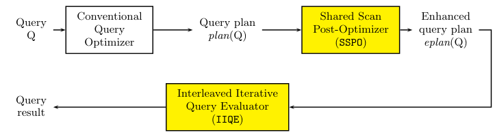
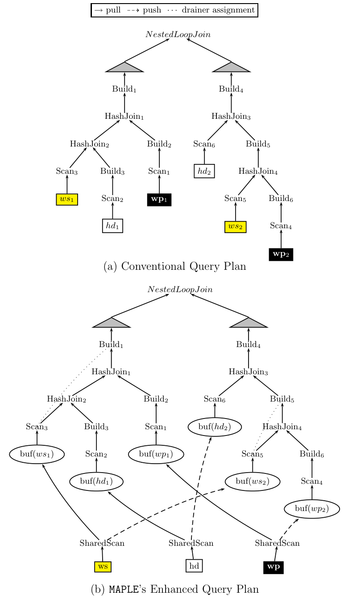
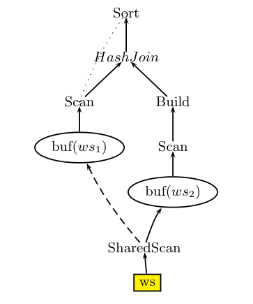
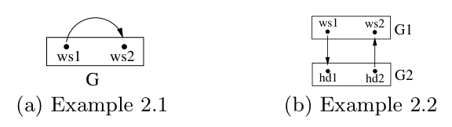
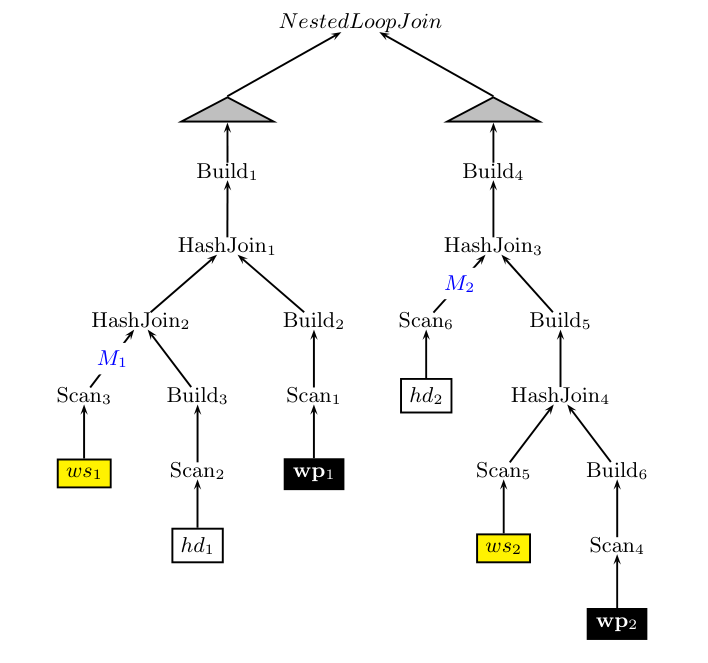
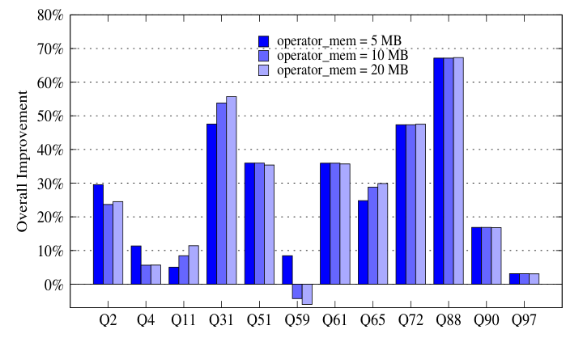
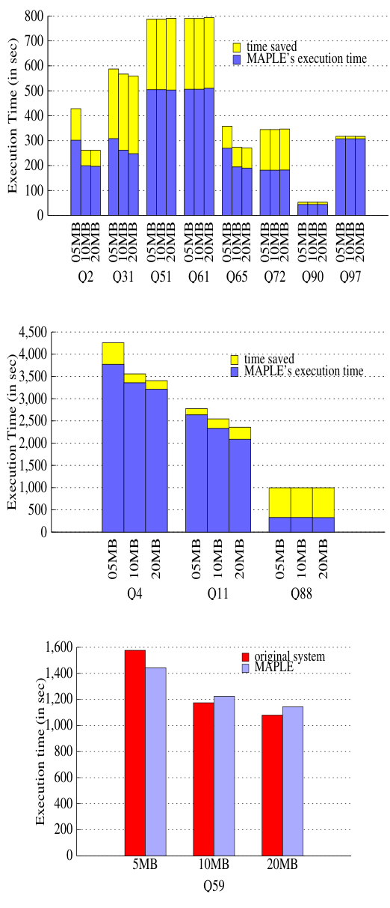
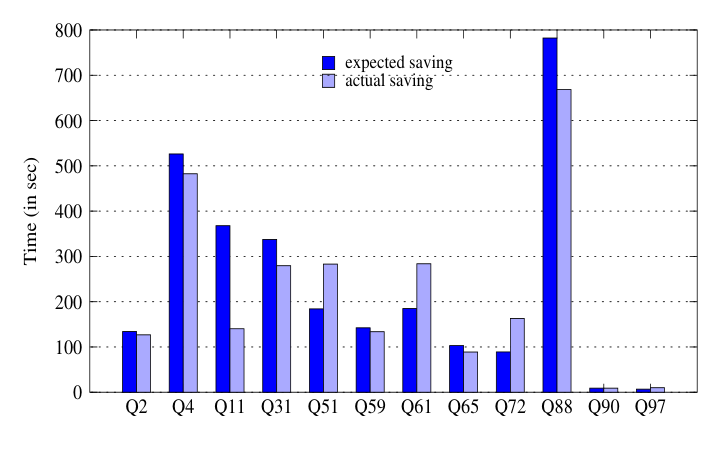
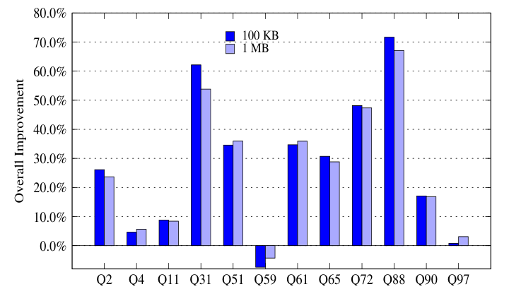
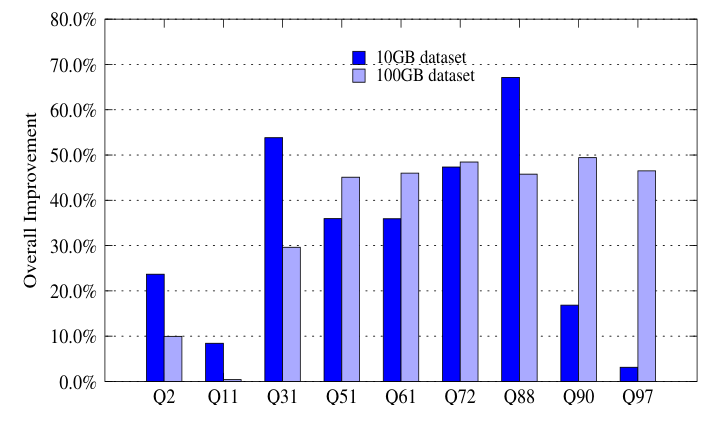

# Optimizing Complex Queries with Multiple Relation Instances（中文译文）

## 译者说明

本文依据同目录的 `source.pdf` 翻译。章节、图表、公式、算法、代码与参考文献按原文结构保留。

Yu Cao、Gopal C. Das、Chee-Yong Chan、Kian-Lee Tan 
新加坡国立大学计算机学院 
`{caoyu, gopal, chancy, tankl}@comp.nus.edu.sg`

SIGMOD 2008，2008 年 6 月 9–12 日，加拿大不列颠哥伦比亚省温哥华。

## 摘要

现有查询处理引擎没有利用一个关系在同一查询中多次出现的特点来提升性能。它们将每个实例视为不同的关系，分别采用独立的表访问方法。本文提出 MAPLE，即一种感知多实例的计划求值引擎（Multi-instance-Aware PLan Evaluation）。它让一个关系的多个实例在缓冲区空间有限的情况下共享一次物理扫描，称为 `SharedScan`。执行过程中，`SharedScan` 为任一实例拉取元组时，会将该元组也推送到谓词匹配的其他实例的缓冲区。为避免缓冲区溢出，我们提出一种新的交错执行策略：某个实例的缓冲区一旦填满，执行就临时切换到一个排空算子（drainer），即该实例的某个祖先阻塞算子，消费缓冲区内的全部元组。执行由此在常规处理和排空算子之间交错进行。我们也提出一种基于代价的方法，以生成尽可能利用共享扫描、同时避免交错执行死锁的计划。MAPLE 轻量，容易集成到现有 RDBMS 的执行器。我们在 PostgreSQL 中实现了 MAPLE，在 TPC-DS 基准上的实验显示，执行时间显著缩短。

**分类与主题描述符**　H.2.4［数据库管理］：系统——查询处理

**一般术语**　算法、设计、性能

**关键词**　共享扫描、交错执行、查询优化、查询处理

## 1. 引言

许多应用使用关系数据库管理系统（RDBMS）来管理海量数据。在这些应用中，一条查询包含同一关系的多个实例的情况并不少见。例如，在传统商业应用中，查询涉及多个视图时，展开视图通常会产生基表的多个关系实例。决策支持系统常常提出这样的多实例查询：在 TPC-DS 基准 [3] 的 99 条查询中，超过 60% 至少包含一个具有多个实例的关系；同一关系最多出现 8 个实例（如 Q11 和 Q88），一条查询中具有多个实例的关系最多有 15 个（如 Q78）。即使在以关系数据库管理 XML（RDF）数据的 Web 数据管理等非传统应用中，XPath/XQuery（SPARQL/RDQL）查询转换成 SQL 后也会包含许多自连接 [9, 5, 16]。

**图 1：MAPLE 的架构。**

令人意外的是，现今大多数关系查询引擎在查询优化或求值时，并不会显式识别查询中的多个实例。每个实例都被视为不同的关系，拥有独立的访问方法（表扫描或索引扫描）。因此，即使采用最优计划，性能也可能很差，尤其是在重复出现的关系是一张大表时。

已有工作尝试优化同一张表上的多次扫描来降低磁盘 I/O 代价，但其适用范围有限。文献 [1, 6, 10, 11, 12, 19] 对扫描进行协调，以更好地重用缓冲区（提高缓冲区局部性）。具体来说，共享数据的机会主要来自并发运行的不同查询各自发起的扫描。通过充分利用对查询访问模式的了解并精心调度查询执行，可以改善性能。但是，在采用拉取式迭代执行模型时，无法同步同一条多实例查询的磁盘访问模式，因此这类缓冲区重用方法对单条多实例查询帮助不大。文献 [7, 17] 研究如何在算子层面共享对基关系的一次扫描，但目标是把表元组以流水线方式传给不同 SQL [7]（OLAP [17]）查询的消费者，这些查询由独立线程处理。我们将看到，单条查询中的实例具有这些方法无法应对的特点。另一种做法是采用多查询优化（MQO）方案（例如 [14, 18]）来利用查询中的公共子表达式。然而，MQO 不会进一步优化公共子表达式物化视图上的多次扫描，而这些视图可以视为具有多个实例的基关系。此外，这些技术不处理公共子表达式之外的实例。

**图 2：TPC-DS 基准查询 Q90 的部分查询求值计划。**（a）常规查询计划；（b）MAPLE 的增强查询计划。实线箭头表示拉取，虚线箭头表示推送，点线表示排空算子指派。

本文提出 MAPLE，一种利用单条查询中的多个实例来降低磁盘 I/O 代价的多实例感知计划求值引擎。如图 1 所示，MAPLE 包含两个关键组件 SSPO 和 IIQE。首先，共享扫描后置优化器（SSPO）以现有任一查询优化器生成的查询求值计划为基础，按如下方式产生增强计划。SSPO 按需添加物化算子，并把一个关系的多个实例划入共享组，同一组内的实例共享一次物理表扫描（称为 `SharedScan`）。对于采用 `SharedScan` 的每个关系实例，分配一块小缓冲区。对每个有缓冲区溢出风险的实例，还会指定查询计划中的某个祖先阻塞算子作为它的排空算子。其次，由交错迭代查询求值器（IIQE）执行 SSPO 产生的增强查询计划。IIQE 采用交错拉取式迭代执行策略，确保每个 `SharedScan` 算子只为同一共享组的全部实例扫描一次表。具体来说，`SharedScan` 为共享组内任一实例拉取元组时，此元组也会被推送给谓词匹配的其他实例，存入它们各自的缓冲区供后续使用。一旦某个缓冲区填满，相应的排空算子就会激活。此时查询处理会临时切换到该排空算子，直至它消费完缓冲区中的所有元组。因此，查询处理在常规处理与已激活的排空算子之间交错进行。

**示例 1.1。** 图 2(a) 给出了由 PostgreSQL [2] 生成的 TPC-DS 基准 Q90 的部分求值计划。Q90 包含关系 `web_sales`（记为 `ws`）的两个实例 `ws1` 和 `ws2`，关系 `web_page`（记为 `wp`）的两个实例 `wp1` 和 `wp2`，以及关系 `household_demographics`（记为 `hd`）的两个实例 `hd1` 和 `hd2`。其中，哈希算子 `Build` 用于建立哈希连接的哈希表。计划树在顶层嵌套循环连接的两侧各有一棵哈希子树，所有实例均通过表扫描访问。

MAPLE 生成图 2(b) 所示的增强计划，其中有三个共享组 $\lbrace ws _ 1,ws _ 2\rbrace$、 $\lbrace wp _ 1,wp _ 2\rbrace$ 和 $\lbrace hd _ 1,hd _ 2\rbrace$。未引入额外的物化算子。此时每个关系实例 $r _ i$ 都关联一个缓冲区 $\mathrm{buf}(r _ i)$，用于存储 `SharedScan` 算子推送的元组。在迭代模型下，执行从 `Build1` 开始。由于 `wp` 和 `hd` 都是小表，两者的共享扫描不会使 `wp2` 和 `hd2` 的缓冲区溢出。但当 `ws1` 调用它的 `SharedScan` 时，由于 `ws` 表很大，推送给 `ws2` 的匹配元组会填满它的缓冲区。此时，每当 $\mathrm{buf}(ws _ 2)$ 填满，执行就会临时切换到 `ws2` 的排空算子 `Build5`。它消费缓冲区中的所有元组，构建一部分哈希表，然后再切换回 `ws1`。切换至 `ws2` 所执行的操作会利用 $\mathrm{buf}(wp _ 2)$ 中缓存的元组，完成 `Build6` 的正常执行。最后，三次共享扫描全部完成后，剩余计算从 `Build4` 开始按传统迭代模型继续执行（先完成 `Build5`，再用 $\mathrm{buf}(hd _ 2)$ 中缓存的元组探查哈希表来执行哈希连接）。

如示例所示，采用 MAPLE 时，一个共享组只需从磁盘读取该关系一次。此例中，`ws`、`wp` 和 `hd` 各减少一次完整扫描。由于 `ws` 很大（在 10 GB 的 TPC-DS 数据集中占 1.5 GB），实验结果表明，省去它的一次扫描可获得显著收益。同时，切换执行产生的 CPU 开销可以忽略。`Build` 排空算子会照常消费交错执行的中间结果，无需额外的 I/O。

SSPO 的主要任务是生成能够最大限度地利用 `SharedScan` 的增强计划。理想情况下，一个关系的全部实例应划入同一个共享组，且无需引入任何额外的阻塞算子。由于某些原因（例如交错执行死锁），这一做法无法保证在所有情况下都可行。此时，SSPO 力求找到性能收益最大的可行共享扫描计划。

MAPLE 轻量，容易集成到现有 RDBMS 中。我们在 PostgreSQL 中实现了原型，对 TPC-DS 基准进行的详细性能研究显示，某些查询的执行时间显著缩短，降幅最高可达 70%。

本文其余部分组织如下。第 2 节概述 MAPLE 方法。第 3 节描述共享扫描后置优化器。第 4 节介绍如何将 IIQE 集成到现有的查询执行器中。第 5 节给出详细的性能研究结果。第 6 节回顾相关工作，第 7 节总结并讨论未来方向。

## 2. MAPLE 概述

本节概述我们称为 MAPLE 的轻量优化方法。

用 $\mathrm{plan}(Q)$ 表示常规查询优化器为 $Q$ 生成的查询求值计划，用 $\mathrm{eplan}(Q)$ 表示 MAPLE 根据 $\mathrm{plan}(Q)$ 为 $Q$ 生成的增强查询求值计划。

如果查询计划算子必须完整消费其操作数后才能产生任何输出（例如排序、哈希表构建、聚合），则称其为**阻塞算子**。其余称为**非阻塞算子**（例如扫描、归并连接）。

设 $Q$ 中有一个多实例关系 $R$，拥有 $n$ 个实例且 $n \gt 1$，用 $\mathcal{G} = \lbrace r _ 1,r _ 2,\ldots,r _ n\rbrace$ 表示 $R$ 的各个实例。

### 2.1 共享组与共享扫描

常规的拉取式迭代执行引擎 [8] 独立扫描同一关系的各个实例。MAPLE 则将一个关系的实例集合划分为少量称为**共享组**的子集，尽可能共享对关系的扫描。

共享组中每个关系实例 $r _ i$ 都获得一小块内存空间，记作 $\mathrm{buf}(r _ i)$，用来保存满足 $r _ i$ 扫描选择谓词的元组。每个共享组都关联一个新扫描算子 `SharedScan`，组内任一实例均可调用它。[^1] 被调用去扫描实例 $r _ i$ 时，MAPLE 先检查 $\mathrm{buf}(r _ i)$ 是否为空。若有元组可用， $r _ i$ 的扫描会直接从 $\mathrm{buf}(r _ i)$ 取出该元组并传给扫描的父算子。若 $\mathrm{buf}(r _ i)$ 为空， $r _ i$ 的扫描就调用其共享组的 `SharedScan` 算子。除了将 $r _ i$ 的匹配元组拉到 $\mathrm{buf}(r _ i)$ 中以外，`SharedScan` 算子也将组内其他实例 $r _ j$ 的匹配元组推送到它们各自的缓冲区 $\mathrm{buf}(r _ j)$ 中。为节省空间，各 $\mathrm{buf}(r _ i)$ 所存的元组只保留扫描 $r _ i$ 所需的 $R$ 的相关属性。[^2]

理想情况下，每个 $\mathrm{buf}(r _ i)$ 中的元组都能及时消费，不会发生缓冲区溢出。但一般来说，共享扫描可能遇到阻塞。假如 `SharedScan` 算子是由与 $r _ i$ 同组的另一个实例 $r _ j$ 调用的，它试图将匹配元组推入已满的 $\mathrm{buf}(r _ i)$ 时就会阻塞。此时我们称 $r _ i$ 为**溢出实例**，称 $\mathrm{buf}(r _ i)$ **溢出**。

在迭代执行模型下，解决共享扫描阻塞的一种朴素方法是采用退出机制（drop-out）。把溢出实例 $r _ i$ 从 $R$ 的共享扫描中移除，其余未溢出的同组实例继续共享扫描 $R$。然而，为了为溢出实例 $r _ i$ 取得余下未缓冲的匹配元组，这一方案需要稍后再对 $R$ 发起一次单独的部分扫描，因而成效有限。

注意，如果一组中只有一个实例 $r _ i$， $r _ i$ 的扫描就不会与 $R$ 的任何其他实例共享，因此不分配 $\mathrm{buf}(r _ i)$，该组也不使用 `SharedScan`。

[^1]: 目前 MAPLE 只考虑为表扫描使用共享扫描。
[^2]: 另一种缓冲方案是让组内全部实例共用一个缓冲区。不过，这种方案通常需要存储整个元组，也需要采用更复杂的机制来追踪各个实例扫描会匹配哪些元组。

### 2.2 使用排空算子的交错执行

MAPLE 采用更主动的方法来处理共享扫描阻塞。设由 $r _ i$ 发起的共享扫描因 $\mathrm{buf}(r _ j)$ 溢出而阻塞。MAPLE 保留 $r _ j$ 在 $R$ 的共享扫描中的成员身份，并尝试解除阻塞：暂停该扫描，将执行控制权切换到另一个算子，即 $r _ j$ 的**排空算子**，记为 $\mathrm{drainer}(r _ j)$。它是 $r _ j$ 的一个祖先，执行它会将已满的 $\mathrm{buf}(r _ j)$ 中的元组排空。一旦其中的全部元组都已消费（即 $\mathrm{buf}(r _ j)$ 变空），被暂停的 $R$ 共享扫描便解除阻塞，可由 $r _ i$ 恢复。执行控制权切换可能嵌套发生，例如执行排空算子下的查询子计划又触发切换到另一个排空算子，如此继续。我们将 MAPLE 使用的增强型迭代执行模型称为**交错迭代执行**。

#### 2.2.1 排空算子

当 $r _ i$ 调用共享扫描而 $\mathrm{buf}(r _ j)$ 溢出时，MAPLE 会试图切换至排空算子 $\mathrm{drainer}(r _ j)$，清空 $\mathrm{buf}(r _ j)$。因此， $\mathrm{drainer}(r _ j)$ 必须是查询计划中 $r _ j$ 的一个祖先算子，这样， $r _ j$ 的扫描才会在求值以 $\mathrm{drainer}(r _ j)$ 为根的查询子计划时一并求值。

设 $r _ j$ 的各级祖先直至 $\mathrm{drainer}(r _ j)$（含）均为非阻塞算子。这样，求值 $\mathrm{drainer}(r _ j)$ 时产生的任何元组，要么需要缓存起来（可能产生磁盘 I/O），要么就必须返回给 $\mathrm{drainer}(r _ j)$ 的父算子。后一种做法在迭代执行模型下不可行，因为执行控制权交给了 $\mathrm{drainer}(r _ j)$，它的父算子并未获得控制权。为避免缓存该算子的输出元组带来不必要的磁盘 I/O，适合把阻塞算子指派为排空算子。如此一来，阻塞型排空算子会等整个查询子计划求值完毕才产生输出元组。为尽量减少排空 $\mathrm{buf}(r _ j)$ 所需的算子求值次数，MAPLE 选用 $r _ j$ 最近的祖先阻塞算子作为排空算子。

显然，溢出实例并非总有排空算子。如果一个溢出实例在查询计划中有祖先阻塞算子，则将其归为**可排空实例**，否则为**不可排空实例**。

对于不可排空实例 $r _ j$，无法为它指派排空算子，所以即使 $\mathrm{buf}(r _ j)$ 已满，也无法通过交错执行将其排空。因此，不可排空实例不能参与共享扫描（每个不可排空实例都需要独立的物理扫描）。不过，可以在查询计划中插入一个显式物化算子 $op$，让它成为 $r _ j$ 的祖先，使 $r _ j$ 变得可排空，即 $\mathrm{drainer}(r _ j) = op$。

在图 2(b) 的示例中，假定 `ws1` 与 `ws2` 均为溢出实例。每个溢出实例 $r _ j$ 的排空算子指派用连接 $\mathrm{scan}(r _ j)$ 与 $\mathrm{drainer}(r _ j)$ 的点线表示。

#### 2.2.2 无死锁的交错执行

为最大限度地共享扫描，理想的查询计划会为每个不同的多实例关系 $R$ 设立一个共享组，并将 $R$ 的所有实例都放入该组。这样，只需对 $R$ 进行一次物理扫描，即可扫描它的所有实例。这一做法并非总是可行，有两个原因：（1）存在不可排空实例；（2）存在交错执行死锁。

一般来说，为排空已满的 $\mathrm{buf}(r _ j)$ 而触发的交错执行，若最终要把更多元组推入 $\mathrm{buf}(r _ j)$，就会产生交错执行死锁。以下是一个简单的执行死锁示例。

**图 3：简单的执行死锁。**

**示例 2.1。** 图 3 给出了 TPC-DS 中关系 `web_sales` 的两个实例 `ws1` 和 `ws2` 之间的自连接，`ws1` 是与 `ws2` 共享扫描的溢出实例。执行从扫描 `ws2` 开始。在扫描 `ws2` 时， $\mathrm{buf}(ws _ 1)$ 会填满，执行切换到 $\mathrm{drainer}(ws _ 1)$，即 `Sort` 算子。然而，此时哈希表尚未构建完毕，处理来自 `ws1` 的元组前，必须先完成 `ws2` 的扫描。由于 $\mathrm{buf}(ws _ 1)$ 已满，执行陷入死锁。

下例展示更复杂的死锁场景。

**示例 2.2。** 再看图 2(b) 中 Q90 的查询计划。假设 `hd2` 现在是溢出实例。执行会从 `Build1` 开始。在 `hd1` 和 `hd2` 的共享扫描过程中， $\mathrm{buf}(hd _ 2)$ 填满，执行切换至 `hd2` 的排空算子 `Build4`。这最终触发 `ws2` 的扫描，从而发起 `ws1` 和 `ws2` 的共享扫描，使 $\mathrm{buf}(ws _ 1)$ 填满。于是执行又切换到 `ws1` 的排空算子 `Build1`。由于 $\mathrm{buf}(ws _ 1)$ 和 $\mathrm{buf}(hd _ 2)$ 都已填满，却还需要向其中推入更多元组，发生死锁。

为了生成能最大程度共享扫描且无死锁的查询计划，MAPLE 采用基于代价的方法，对显式物化算子的使用和共享组的划分进行优化。显式物化算子既可使不可排空实例变得可排空，使其能够参与共享扫描，也可避免死锁。

### 2.3 MAPLE 的架构

图 1 展示了 MAPLE 的架构。其中有两个组件，即共享扫描后置优化器（SSPO）和交错迭代查询求值器（IIQE）。

MAPLE 分两步优化输入查询 $Q$。首先，使用常规查询优化器生成查询求值计划 $\mathrm{plan}(Q)$。接下来，将 $\mathrm{plan}(Q)$ 输入 SSPO，得到增强查询计划 $\mathrm{eplan}(Q)$。 $\mathrm{eplan}(Q)$ 使用共享组、`SharedScan` 算子和可能添加的显式物化算子来增强 $\mathrm{plan}(Q)$。

随后，生成的 $\mathrm{eplan}(Q)$ 由 IIQE 组件求值。IIQE 是常规迭代查询执行引擎的一种变体，增加了对共享扫描和算子交错执行的支持。

## 3. 共享扫描后置优化器

本节介绍 MAPLE 的共享扫描后置优化器（SSPO）组件如何生成支持共享扫描及算子交错执行的增强查询计划。

### 3.1 溢出实例

由于 SSPO 对查询计划进行静态优化，它需要估计实例 $r _ i$ 溢出的可能性，并在必要时为 $r _ i$ 指派排空算子。具体来说，对于查询计划中共享组内的每个实例 $r _ i$，SSPO 根据 $R$ 的统计信息估计扫描 $r _ i$ 时匹配的元组数，并结合分配给 $\mathrm{buf}(r _ i)$ 的内存空间来判断 $r _ i$ 是否可能溢出。如果预计 $r _ i$ 的全部匹配元组无法放进 $\mathrm{buf}(r _ i)$，则将 $r _ i$ 视为溢出实例。若 $r _ i$ 可排空，SSPO 随后将 $r _ i$ 最近的祖先阻塞算子指派给 $\mathrm{drainer}(r _ i)$。

设实例 $r _ i$ 被 SSPO 判定为非溢出实例（即未给 $r _ i$ 指派排空算子）。如果 $r _ i$ 在运行时实际溢出，MAPLE 只能动态物化 $\mathrm{buf}(r _ i)$ 的内容。[^overflow-wording]

[^overflow-wording]: 原文括注为“no drainer has not assigned”，语法与否定有误；这里按上一段的指派规则及本句所指的非溢出实例翻译。

### 3.2 交错执行死锁

本节以执行依赖和溢出依赖刻画交错执行死锁。

#### 3.2.1 执行依赖与溢出依赖

**执行依赖。** 当共享扫描期间 $\mathrm{buf}(r _ i)$ 溢出，执行控制权切换至 $\mathrm{drainer}(r _ i)$，随后又使某个其他关系实例 $s _ j$ 的扫描得到求值，其中 $s _ j$ 是 $\mathrm{drainer}(r _ i)$ 的后代，我们就说存在从 $r _ i$ 到 $s _ j$ 的**执行依赖**，记为 $r _ i \to s _ j$。这里的 $r _ i$ 和 $s _ j$ 可以是同一关系的实例，也可以是不同关系的实例。注意，执行依赖具有传递性：若 $a \to b$ 且 $b \to c$，则 $a \to c$。此外，若 $a \to b$ 且 $b \to a$，则 $\mathrm{drainer}(a)$ 和 $\mathrm{drainer}(b)$ 必定相同。

**溢出依赖。** 考虑同一共享组中的两个实例 $r _ i$ 和 $r _ j$。如果 $r _ i$ 发起共享扫描时 $\mathrm{buf}(r _ j)$ 填满，则存在从 $r _ i$ 到 $r _ j$ 的**溢出依赖**，记为 $r _ i \xrightarrow{\mathrm{overflow}} r _ j$ （原文使用虚线箭头）。

**实例依赖环。** 现在可以用执行依赖和溢出依赖刻画交错执行死锁。如果一组关系实例 $\lbrace r _ 1,s _ 2,t _ 3,\ldots,z _ n\rbrace$（ $n \gt 1$）之间存在**实例依赖环**，且该环由 $\xrightarrow{\mathrm{overflow}}$ 和 $\to$ 两种依赖交替组成，形如 $r _ 1 \xrightarrow{\mathrm{overflow}} s _ 2 \to t _ 3 \xrightarrow{\mathrm{overflow}} \cdots \xrightarrow{\mathrm{overflow}} z _ n \to r _ 1$，则发生交错执行死锁。

可以看到，示例 2.1 中存在实例依赖环 $ws _ 2 \xrightarrow{\mathrm{overflow}} ws _ 1 \to ws _ 2$；示例 2.2 中存在实例依赖环 $hd _ 1 \xrightarrow{\mathrm{overflow}} hd _ 2 \to ws _ 2 \xrightarrow{\mathrm{overflow}} ws _ 1 \to hd _ 1$。

#### 3.2.2 消除依赖

上述交错执行死锁的刻画给出了打破死锁的两种办法：消除溢出依赖，或者消除执行依赖。溢出依赖 $r _ i \xrightarrow{\mathrm{overflow}} r _ j$ 源于对同时含有 $r _ i$ 和 $r _ j$ 的组执行共享扫描，导致 $\mathrm{buf}(r _ j)$ 溢出。将 $r _ i$ 和 $r _ j$ 分到两个不同的共享组即可消除这种溢出依赖。

对于执行依赖 $r _ i \to s _ j$，可在查询计划中引入物化算子 $op$ 来消除依赖，使 $op$ 成为 $r _ i$ 最近的祖先阻塞算子（即 $op$ 是 $\mathrm{drainer}(r _ i)$ 的后代），并使 $s _ j$ 位于以 $op$ 为根的查询子树之外。这样， $\mathrm{drainer}(r _ i)$ 就变成 $op$，求值 $r _ i$ 的这个新排空算子不会触发 $s _ j$ 扫描的求值。

**示例 3.1。** 再看图 2(b) 中的示例 2.2。每个不同关系（即 `hd`、`wp` 和 `ws`）都有一个容纳其全部实例的共享组，`hd2` 是溢出实例。此计划中，实例依赖环 $hd _ 1 \xrightarrow{\mathrm{overflow}} hd _ 2 \to ws _ 2 \xrightarrow{\mathrm{overflow}} ws _ 1 \to hd _ 1$ 导致执行死锁。在 `Scan6` 上方引入物化算子，可消除执行依赖 $hd _ 2 \to ws _ 2$，物化算子成为 `hd2` 的新排空算子。将 `hd1` 与 `hd2` 划入不同共享组则可以消除溢出依赖 $hd _ 1 \xrightarrow{\mathrm{overflow}} hd _ 2$。

#### 3.2.3 死锁避免

处理交错执行死锁有两种方法。第一种是动态方法，在运行时检测并打破实例依赖环，解除死锁。第二种是静态方法，只生成和处理无死锁查询计划，从而完全避免死锁。MAPLE 采用较简单的静态方法，因为它提供了轻量且容易集成到现有查询引擎中的方案。我们计划在未来研究动态方法。

由于缺少执行依赖和溢出依赖的运行时信息，静态方法生成的无死锁计划必然更保守。具体地，在 MAPLE 中，若共享组 $G$ 中的关系实例 $r _ i$ 被视为溢出实例，MAPLE 就保守地作出如下假设：

- 对于 $G$ 中其他每个实例 $r _ j$，均存在溢出依赖 $r _ j \xrightarrow{\mathrm{overflow}} r _ i$。
- 若 $r _ i$ 是可排空实例，则以 $\mathrm{drainer}(r _ i)$ 为根的查询子树中，其他每个实例 $s _ j$ 均存在执行依赖 $r _ i \to s _ j$。

根据上述有关执行依赖和溢出依赖的保守假设，可以推广实例执行依赖的概念，改用组执行依赖对交错执行死锁作出更简单、更高层次的刻画。

**组执行依赖。** 考虑两个共享组 $G _ 1$ 和 $G _ 2$。如果存在 $G _ 1$ 中的实例 $x$ 和 $G _ 2$ 中的实例 $y$，使得 $x \to y$，则存在从 $G _ 1$ 到 $G _ 2$ 的**组执行依赖**，记为 $G _ 1 \to G _ 2$。将 $x$ 和 $y$ 称为组执行依赖 $G _ 1 \to G _ 2$ 的**参与者**。注意， $G _ 1$ 和 $G _ 2$ 可以是同一个组。

**组依赖环。** 对于一组共享组 $\lbrace G _ 1,\ldots,G _ n\rbrace$， $n \geq 1$，如果存在组依赖构成的环 $G _ 1 \to G _ 2 \to \cdots \to G _ n \to G _ 1$，且对于每个 $G _ i$（ $i \in [1,n]$），涉及它的两条组执行依赖在组内的两个参与者不同，则称这组共享组之间存在**组依赖环**。

**图 4：组依赖环的示例。**（a）示例 2.1；（b）示例 2.2。

**示例 3.2。** 考虑图 4 中的示例。同一个共享组中的实例框在一起，实例之间的有向边表示实例执行依赖。图 4(a) 展示示例 2.1 中在单个共享组 $G$ 内形成的组依赖环（即 $G \to G$）。图 4(b) 展示示例 2.2 中在共享组 $G _ 1$ 和 $G _ 2$ 之间形成的组依赖环。

注意，组依赖环中的每个组都必须涉及两条组执行依赖。例如，图 4(b) 中有 $G _ 1 \to G _ 2$ 和 $G _ 2 \to G _ 1$。此外，每个组内的两个参与者必须不同，否则就意味着实例 $r _ i$ 的扫描调用共享扫描后会使自己的缓冲区 $\mathrm{buf}(r _ i)$ 溢出，而这是不可能的。

下面的结果说明，不存在组依赖环是交错执行无死锁的一个有用的充分条件。

**定理 3.1。** 如果查询计划 $P$ 中没有组依赖环， $P$ 中也没有实例依赖环。

**推论 3.2。** 如果查询计划 $P$ 中没有组依赖环，那么 $P$ 无交错执行死锁。

### 3.3 增强查询计划优化

本节介绍 SSPO 如何由常规优化器产生的最优查询计划 $\mathrm{plan}(Q)$ 生成增强查询计划 $\mathrm{eplan}(Q)$，使 $\mathrm{eplan}(Q)$ 最大限度地利用共享扫描，同时避免交错执行死锁。具体而言， $\mathrm{plan}(Q)$ 的增强计划记作 $\mathrm{eplan}(Q) = (\mathrm{plan}(Q),\mathcal{G},\mathcal{M})$，多出两个组成部分：

1. 共享组列表 $\mathcal{G} = \lbrace G _ 1,\ldots,G _ k\rbrace$，每个 $G _ i$ 都包含同一关系的实例的一个子集， $\bigcup _ {i=1}^{k} G _ i$ 为 $Q$ 中所有关系实例的集合， $\mathcal{G}$ 中的各 $G _ i$ 两两不相交。显然， $Q$ 中每个不同的多实例关系在 $\mathcal{G}$ 中至少有一个组。当每组都只有一个实例时，共享组数量最多（此时没有共享扫描）。
2. 要加入 $\mathrm{plan}(Q)$ 的物化算子集合 $\mathcal{M} = \lbrace M _ 1,\ldots,M _ n\rbrace$，可以为空。

根据第 3.2.2 节的讨论， $\mathcal{G}$ 与 $\mathcal{M}$ 都可以消除某些依赖，同时 $\mathcal{M}$ 也能使某些不可排空实例变得可排空。

为便于表示，给定增强查询计划 $P$，用 $G(P)$ 指代 $P$ 的共享组列表，用 $M(P)$ 指代 $P$ 的物化算子集合。

**代价模型。** 下面说明 SSPO 选择最优增强计划时使用的代价模型。设 $\mathcal{R} = \lbrace R _ 1,\ldots,R _ d\rbrace$ 表示查询 $Q$ 中不同的多实例关系集合， $n _ i$ 表示 $R _ i$ 的实例数。给定共享组列表 $\mathcal{G}$，用 $g _ i$ 表示 $\mathcal{G}$ 中含有关系 $R _ i \in \mathcal{R}$ 的实例的组数。因此， $n _ i \gt 1$ 且 $g _ i \geq 1$。示例 1.1 中， $d = 3$，且对 $i \in [1,3]$ 有 $n _ i = 2$、 $g _ i = 1$。

对于每个 $R _ i \in \mathcal{R}$，用 $\mathrm{scanCost}(R _ i)$ 表示完整扫描一次 $R _ i$ 的代价。对于每个 $M _ i \in \mathcal{M}$，用 $\mathrm{matCost}(M _ i)$ 表示 $M _ i$ 的物化代价，包括将中间结果写入磁盘以及随后读回的代价。给定 $M \subseteq \mathcal{M}$，定义 $\mathrm{matCost}(M) = \sum _ {M _ i \in M} \mathrm{matCost}(M _ i)$。

令 $\mathrm{cost}(\mathrm{plan}(Q))$ 表示在 $\mathrm{plan}(Q)$ 中独立扫描每个关系实例的总代价，即：

$$
\mathrm{cost}(\mathrm{plan}(Q)) =
\sum _ {R _ i \in \mathcal{R}} (\mathrm{scanCost}(R _ i)\times n _ i)
\qquad \text{(1)}
$$

令 $\mathrm{cost}(\mathrm{eplan}(Q))$ 表示 $\mathrm{eplan}(Q)$ 中 $\mathcal{G}$ 的关系扫描总代价加上 $\mathcal{M}$ 的物化总代价，即：

$$
\mathrm{cost}(\mathrm{eplan}(Q)) =
\sum _ {R _ i \in \mathcal{R}} (\mathrm{scanCost}(R _ i)\times g _ i) + \mathrm{matCost}(\mathcal{M})
\qquad \text{(2)}
$$

$\mathrm{eplan}(Q)$ 相对 $\mathrm{plan}(Q)$ 的收益，以采用 $\mathrm{eplan}(Q)$ 所节省的求值代价衡量，计算如下：

$$
\mathrm{benefit}(\mathrm{eplan}(Q)) =
\mathrm{cost}(\mathrm{plan}(Q)) -
\mathrm{cost}(\mathrm{eplan}(Q))
\qquad \text{(3)}
$$

**理想增强计划。** 根据式（1）至式（3），收益的上界为 $\sum _ {R _ i \in \mathcal{R}} (\mathrm{scanCost}(R _ i)\times(n _ i-1))$。当 $\mathrm{eplan}(Q)$ 对每个不同关系恰好扫描一次（即每个不同关系恰好有一个共享组），且没有物化代价（即 $\mathcal{M}$ 为空）时，便能达到这一上界。我们将这样的 $\mathrm{eplan}(Q)$ 称为**理想增强查询计划**。

现在可以更形式化地陈述 SSPO 的查询优化问题。

**增强计划优化问题。** 给定常规优化器为查询 $Q$ 产生的最优查询计划 $\mathrm{plan}(Q)$，找出一个增强查询计划 $\mathrm{eplan}(Q) = (\mathrm{plan}(Q),\mathcal{G},\mathcal{M})$，使其无交错执行死锁，且 $\mathrm{benefit}(\mathrm{eplan}(Q))$ 最大。

如所预料，上述优化问题很难求解。下面对该问题简化版本给出的结果说明了这一点。

**定理 3.3。** 给定 $\mathrm{plan}(Q)$ 和一组物化算子 $\mathcal{M}$，求共享组列表 $\mathcal{G}$，使 $\mathrm{eplan}(Q) = (\mathrm{plan}(Q),\mathcal{G},\mathcal{M})$ 无交错执行死锁且 $\mathrm{benefit}(\mathrm{eplan}(Q))$ 最大，是 NP 困难问题。

### 3.4 优化算法

由于增强计划优化问题难以求解，SSPO 采用算法 1 所示的启发式方法。

设查询 $Q$ 涉及 $d$ 个不同的多实例关系 $R _ 1,\ldots,R _ d$，其查询计划为 $\mathrm{plan}(Q)$。对于每个 $R _ i$ 的每个实例 $r _ j$，SSPO 先估计 $r _ j$ 是否是溢出实例，并将每个可排空关系实例的排空算子 $\mathrm{drainer}(r _ j)$ 初始化为 $r _ j$ 最近的祖先阻塞算子（步骤 1 至 4）。

接下来，SSPO 检查 $\mathrm{plan}(Q)$ 是否存在无死锁的理想增强查询计划（步骤 5 至 9）。回顾一下，理想增强查询计划有一个“理想”的增强方案：物化算子集合为空，共享组列表为 $\mathcal{G} = \lbrace G _ 1,\ldots,G _ d\rbrace$，其中各共享组 $G _ i$ 包含 $R _ i$ 除不可排空实例外的所有实例。如果 $\mathcal{G}$ 中的组依赖环集合 $C$ 为空，而且 $\mathrm{plan}(Q)$ 中所有溢出实例都可排空，那么构造所得的计划 $P _ {\mathrm{opt}}$ 就是一个无死锁的理想增强计划。此时，SSPO 返回 $P _ {\mathrm{opt}}$ 并结束。

如果构造出的增强计划 $P _ {\mathrm{opt}}$ 并非无死锁的理想增强计划，SSPO 就采用两个阶段来细分其共享组列表 $\mathcal{G}$、添加物化算子或兼用两者，以优化 $P _ {\mathrm{opt}}$。在第一阶段（步骤 10 至 17），SSPO 生成一系列候选物化算子集合。在第二阶段（步骤 18 至 30），SSPO 使用每个候选物化算子集合 $\mathcal{M}$ 创建一个无死锁的候选增强计划 $P$，使得 $M(P) = \mathcal{M}$ 且 $G(P) = \mathcal{G} _ {\mathrm{opt}}$，其中 $\mathcal{G} _ {\mathrm{opt}}$ 是对 $\mathcal{G}$ 相对于 $\mathcal{M}$ 优化后得到的细分结果。SSPO 从生成的全部候选增强计划中，选取收益最大的计划，并将其作为优化后的增强查询计划返回。

本节余下部分给出这两个阶段的细节。

#### 3.4.1 生成物化算子集合

**有用的物化算子集合。** 令 $M _ {\mathrm{all}}$ 表示可以插入到 $\mathrm{plan}(Q)$ 中的所有可能的物化算子集合。SSPO 只考虑有用的候选物化算子集合，无需生成 $M _ {\mathrm{all}}$ 的全部子集。

**算法 1：Post-Optimizer（后置优化器）**

~~~text
输入：查询 Q 的最优计划 plan(Q)
输出：增强查询计划 eplan(Q)

 1: 令 ℛ_multi = {R_1, ..., R_d} 为 Q 中不同的多实例关系的集合
 2: for 每个 R_i ∈ ℛ_multi do
 3:     for R_i 的每个溢出实例 r_j do
 4:         如果 r_j 可排空，初始化 drainer(r_j)
 5: 令 𝒢 = {G_1, ..., G_d}，各共享组 G_i 包含 R_i 中除不可排空实例外的全部实例
 6: 令 P_opt = (plan(Q), 𝒢, ∅)
 7: 令 C 为 𝒢 中组依赖环的集合
 8: if (C = ∅) and (每个溢出实例均可排空) then
 9:     return P_opt
10: 令 M_all 为可以插入 plan(Q) 的所有可能的物化算子构成的集合
11: 令 M_drain = {M_i ∈ M_all | drainSet(M_i) ≠ ∅}
12: 令 𝒮_drain 为 M_drain 的全部有用子集构成的集合
13: 令 M_cycle = {M_i ∈ M_all | cycleSet⁻(M_i, C) ≠ ∅}
14: for 每个 ℳ_drain ∈ 𝒮_drain do
15:     令 C′ = C ∪ cycleSet⁺(ℳ_drain, C)
16:     令 𝒮_cycle(ℳ_drain) 为 M_cycle 相对于 C′ 的全部有用子集构成的集合
17: 令 S = {(ℳ_drain, ℳ_cycle) | ℳ_drain ∈ 𝒮_drain, ℳ_cycle ∈ 𝒮_cycle(ℳ_drain)}
18: 初始化 P_best = (plan(Q), ∅, ∅)
19: for 每个 (ℳ_drain, ℳ_cycle) ∈ S do
20:     for 每个实例 r_j ∈ drainSet(ℳ_drain) do
21:         drainer(r_j) = ℳ_drain ∪ ℳ_cycle 中距离 r_j 最近的祖先算子
22:     令 𝒢′ = {{r_i} | r_i 是不可排空实例}
23:     令 𝒢_new = {G_1, ..., G_d}，各共享组 G_i 包含 R_i 中除不可排空实例外的全部实例
24:     if (ℛ_multi = {R_1}) and (R_1 中任意两个可排空实例的排空算子均不同) then
25:         𝒢_new = OptimalGrouping(G_1)
26:     else
27:         𝒢_new = HeuristicGrouping(𝒢_new)
28:     P = (plan(Q), 𝒢_opt, ℳ_drain ∪ ℳ_cycle)，其中 𝒢_opt = 𝒢_new ∪ 𝒢′
29:     if (cost(P) < cost(P_best)) then
30:         P_best = P
31: return P_best
~~~

直观地说，物化算子集合 $\mathcal{M} \subseteq M _ {\mathrm{all}}$ 被视为**无用的**，如果存在一个无死锁增强查询计划 $P'$，满足 $M(P') \ne \mathcal{M}$，而且对于所有满足 $M(P'') = \mathcal{M}$ 的无死锁增强查询计划 $P''$，均有 $\mathrm{cost}(P') \lt \mathrm{cost}(P'')$。因此，忽略无用的物化算子集合不会影响增强查询计划的最优性。

下面更具体地刻画什么是有用的物化算子集合。回顾一下，向 $\mathrm{plan}(Q)$ 添加物化算子 $M$ 可以从两方面帮助提升性能。首先， $M$ 可以使不可排空实例 $r _ i$ 变得可排空，从而让 $r _ i$ 能参与共享扫描。其次， $M$ 可以消除某些执行依赖，从而使计划无死锁（即 $C = \varnothing$）。下面定义 $M$ 的排空集合和消环集合，以形式化描述这两项收益。

$M$ 的**排空集合**记作 $\mathrm{drainSet}(M)$，定义为 $\mathrm{plan}(Q)$ 中那些在加入 $M$ 后变得可排空的不可排空实例的集合。因此， $M$ 成为 $\mathrm{drainSet}(M)$ 中每个实例的排空算子。

$M$ 相对于 $C$ 的**消环集合**记作 $\mathrm{cycleSet}^{-}(M,C)$，定义为 $C$ 中因将 $M$ 加入 $\mathrm{plan}(Q)$ 而被消除的组依赖环的集合。

下面的结果给出 $\mathrm{drainSet}(M)$ 与 $\mathrm{cycleSet}^{-}(M,C)$ 之间的一个有用关系。

**引理 3.4。** $\mathrm{drainSet}(M)$ 与 $\mathrm{cycleSet}^{-}(M,C)$ 中至多有一个非空。

引理 3.4 来自以下观察：若 $\mathrm{drainSet}(M)\ne\varnothing$，即 $M$ 成为某个不可排空实例 $r _ i$ 的排空算子，则加入 $M$ 前 $r _ i$ 不可能有任何祖先排空算子。这意味着不存在可以由 $M$ 消除的实例执行依赖，也没有它可以消除的组执行依赖。因此， $\mathrm{cycleSet}^{-}(M,C)=\varnothing$。反过来，若 $\mathrm{cycleSet}^{-}(M,C)\ne\varnothing$，则 $M$ 能消除某个组依赖环（通过消除某条实例执行依赖）。这意味着必定存在一个排空算子是 $M$ 的祖先。因此，以 $M$ 为根的查询子树中不可能有任何不可排空实例，即 $\mathrm{drainSet}(M)=\varnothing$。

根据引理 3.4，相对于 $C$ 有用的物化算子可划分为两个不相交的集合 $M _ {\mathrm{drain}}$ 和 $M _ {\mathrm{cycle}}$，定义如下：

$$
M _ {\mathrm{drain}}
=\lbrace M\in M _ {\mathrm{all}}\mid\mathrm{drainSet}(M)\ne\varnothing\rbrace
$$

$$
M _ {\mathrm{cycle}}
=\lbrace M\in M _ {\mathrm{all}}\mid\mathrm{cycleSet}^{-}(M,C)\ne\varnothing\rbrace
$$

不在 $M _ {\mathrm{drain}}\cup M _ {\mathrm{cycle}}$ 中的物化算子是无用的。

不过，将物化算子 $M$ 加入 $\mathrm{plan}(Q)$，除了带来处理代价，即 $\mathrm{matCost}(M)$，还可能引入额外的组依赖环。我们如下刻画 $M$ 的后一种代价。 $M$ 相对于 $C$ 的**增环集合**记作 $\mathrm{cycleSet}^{+}(M,C)$，定义为将 $M$ 加入 $\mathrm{plan}(Q)$ 后引入的新组依赖环（即原来不在 $C$ 中的环）的集合。

下面的结果说明，将 $M _ {\mathrm{cycle}}$ 中的一个物化算子加入 $\mathrm{plan}(Q)$ 不会产生新的组依赖环。

**引理 3.5。** 对于每个 $M\in M _ {\mathrm{cycle}}$，有 $\mathrm{cycleSet}^{+}(M,C)=\varnothing$。

引理 3.5 可用反证法证明。假设 $\mathrm{cycleSet}^{+}(M,C)\ne\varnothing$。那么，加入 $M$ 必定引入了新的实例执行依赖 $r _ i \to s _ j$，它参与形成新的组依赖环，且 $r _ i$ 与 $s _ j$ 都位于以 $M$ 为根的查询子树中。但 $M\in M _ {\mathrm{cycle}}$ 意味着在查询计划中必定存在一个排空算子是 $M$ 的祖先，这与 $r _ i \to s _ j$ 是一条新依赖矛盾。

$\mathrm{drainSet}(M)$、 $\mathrm{cycleSet}^{+}(M,C)$ 和 $\mathrm{cycleSet}^{-}(M,C)$ 的定义可自然推广到一组物化算子 $\mathcal{M}\subseteq M _ {\mathrm{all}}$（例如 $\mathrm{drainSet}(\mathcal{M})=\bigcup _ {M\in\mathcal{M}}\mathrm{drainSet}(M)$）。

根据引理 3.4 和 3.5，可用两个互不相交的子集来定义有用的物化算子集合，即 $M _ {\mathrm{drain}}$ 的有用子集和 $M _ {\mathrm{cycle}}$ 的有用子集，定义如下。

设 $\mathcal{M} \subseteq M _ {\mathrm{drain}}$。如果不存在另一个 $\mathcal{M}' \subseteq M _ {\mathrm{drain}}$，使得以下四项条件全部成立，则称 $\mathcal{M}$ 相对于 $C$ **有用**：（1） $\mathrm{drainSet}(\mathcal{M})\subseteq\mathrm{drainSet}(\mathcal{M}')$；（2） $\mathrm{cycleSet}^{+}(\mathcal{M}',C)\subseteq\mathrm{cycleSet}^{+}(\mathcal{M},C)$；（3） $\mathrm{matCost}(\mathcal{M})\geq\mathrm{matCost}(\mathcal{M}')$；（4）前三项不等关系中至少有一项是严格的。

类似地，设 $\mathcal{M} \subseteq M _ {\mathrm{cycle}}$。如果不存在另一个 $\mathcal{M}' \subseteq M _ {\mathrm{cycle}}$，使得以下三项条件全部成立，则称 $\mathcal{M}$ 相对于 $C$ **有用**：（1） $\mathrm{cycleSet}^{-}(\mathcal{M},C)\subseteq\mathrm{cycleSet}^{-}(\mathcal{M}',C)$；（2） $\mathrm{matCost}(\mathcal{M})\geq\mathrm{matCost}(\mathcal{M}')$；（3）前两项不等关系中至少有一项是严格的。

最后，考虑集合 $\mathcal{M} \subseteq M _ {\mathrm{all}}$，其中 $\mathcal{M}=\mathcal{M} _ {\mathrm{drain}}\cup \mathcal{M} _ {\mathrm{cycle}}$， $\mathcal{M} _ {\mathrm{drain}}\subseteq M _ {\mathrm{drain}}$， $\mathcal{M} _ {\mathrm{cycle}}\subseteq M _ {\mathrm{cycle}}$。如果 $\mathcal{M} _ {\mathrm{drain}}$ 相对于 $C$ 有用，且 $\mathcal{M} _ {\mathrm{cycle}}$ 相对于 $C\cup\mathrm{cycleSet}^{+}(\mathcal{M} _ {\mathrm{drain}},C)$ 有用，则称 $\mathcal{M}$ 相对于 $C$ **有用**。

无用的物化算子集合不能构成最优增强查询计划。

**算法。** SSPO（算法 1 中的步骤 10 至 17）按如下方式产生一系列有用的候选物化算子集合，记作 $S$。首先，SSPO 生成 $\mathcal{S} _ {\mathrm{drain}}$，即 $M _ {\mathrm{drain}}$ 的全部有用子集构成的集合。接下来，SSPO 对每个 $\mathcal{M} _ {\mathrm{drain}}\in\mathcal{S} _ {\mathrm{drain}}$ 生成 $\mathcal{S} _ {\mathrm{cycle}}(\mathcal{M} _ {\mathrm{drain}})$，即 $M _ {\mathrm{cycle}}$ 相对于 $C'$ 的全部有用子集构成的集合，其中 $C'=C\cup\mathrm{cycleSet}^{+}(\mathcal{M} _ {\mathrm{drain}},C)$。最终集合 $S$ 如下：

$$
\lbrace \mathcal{M} _ {\mathrm{drain}}\cup \mathcal{M} _ {\mathrm{cycle}}
\mid \mathcal{M} _ {\mathrm{drain}}\in\mathcal{S} _ {\mathrm{drain}},
\mathcal{M} _ {\mathrm{cycle}}\in\mathcal{S} _ {\mathrm{cycle}}(\mathcal{M} _ {\mathrm{drain}})\rbrace
$$

注意，空集同时包含在 $\mathcal{S} _ {\mathrm{drain}}$ 与 $\mathcal{S} _ {\mathrm{cycle}}(\mathcal{M} _ {\mathrm{drain}})$ 中，所以 SSPO 也会产生空的物化算子集合。

上述过程的时间复杂度随 $M _ {\mathrm{drain}}$ 和 $M _ {\mathrm{cycle}}$ 中物化算子的数量呈指数增长，但实践中这一数量相当小。也可以采用某种启发式方法来生成更小的 $M _ {\mathrm{drain}}$ 和 $M _ {\mathrm{cycle}}$，以减少运行时间，代价是 $S$ 可能错过部分有用的候选物化算子集合。

**示例 3.3。** 图 5(a) 给出两个有用的物化算子 $M _ 1$ 和 $M _ 2$，它们可用来打破示例 2.2 中 Q90 查询计划的执行依赖环 $hd _ 1\xrightarrow{\mathrm{overflow}} hd _ 2 \to ws _ 2 \xrightarrow{\mathrm{overflow}} ws _ 1 \to hd _ 1$。 $M _ 1$ 通过消除 $ws _ 1\to hd _ 1$ 打破此环， $M _ 2$ 则通过消除 $hd _ 2\to ws _ 2$ 打破此环。忽略 $\mathrm{matCost}(\cdot)$ 这一项时，有三个有用的物化算子集合： $\varnothing$、 $\lbrace M _ 1\rbrace$ 和 $\lbrace M _ 2\rbrace$。

#### 3.4.2 优化共享组列表

给定一组候选物化算子 $\mathcal{M}$，SSPO 的第二阶段（算法 1 中的步骤 18 至 30）计算一个经过优化的共享组列表 $\mathcal{G}$，以产生满足 $M(P)=\mathcal{M}$ 和 $G(P)=\mathcal{G}$ 的无死锁增强计划 $P$。SSPO 对这一计算有两种算法。如果 $\mathrm{plan}(Q)$ 满足一定条件，就采用能算出最优共享组列表的最优算法，否则使用贪心启发式算法。

**最优分组。** 当 $\mathrm{plan}(Q)$ 满足两个条件时，可用算法 2 算出最优共享组列表：

- （C1） $\mathrm{plan}(Q)$ 中恰好有一个多实例关系 $R _ 1$。
- （C2） $R _ 1$ 中所有可排空实例的排空算子均不相同。

输入为单个共享组 $G _ 1$， $G _ 1$ 包含 $R _ 1$ 中除不可排空实例以外的所有实例。算法先构造一个有向图 $G$，其中节点是 $G _ 1$ 中的实例，边表示 $G _ 1$ 中实例间的执行依赖。根据条件（C2）， $G$ 必定是有向无环图。接着，算法迭代地将 $G _ 1$ 细分成一组共享组 $G' _ 1,\ldots,G' _ n$，满足 $G' _ 1\to G' _ 2\to\cdots\to G' _ n$。算法 2 的时间复杂度为 $O(m^2)$，其中 $m$ 是 $G _ 1$ 中实例的数量。

**图 5：示例 2.2 的增强查询计划。**

（a）候选物化算子。

（b）候选增强查询计划。

| 计划 | $M$ | 共享组 |
| --- | --- | --- |
| $P _ 1$ | $\varnothing$ | $\lbrace ws _ 1,ws _ 2\rbrace ,\lbrace hd _ 1\rbrace ,\lbrace hd _ 2\rbrace ,\lbrace wp _ 1,wp _ 2\rbrace$ |
| $P _ 2$ | $\lbrace M _ 1\rbrace$ | $\lbrace ws _ 1,ws _ 2\rbrace ,\lbrace hd _ 1,hd _ 2\rbrace ,\lbrace wp _ 1,wp _ 2\rbrace$ |
| $P _ 3$ | $\lbrace M _ 2\rbrace$ | $\lbrace ws _ 1,ws _ 2\rbrace ,\lbrace hd _ 1,hd _ 2\rbrace ,\lbrace wp _ 1,wp _ 2\rbrace$ |

**启发式分组。** 算法 3 采用贪心启发式方法优化输入共享组列表 $\lbrace G _ 1,\ldots,G _ d\rbrace$，其中每个 $G _ i$ 包含关系 $R _ i$ 中除不可排空实例以外的所有实例。共享组按 $\mathrm{scanCost}(R _ 1)\leq\cdots\leq\mathrm{scanCost}(R _ d)$ 排序。

启发式算法按 $G _ 1,\ldots,G _ d$ 的顺序细分每个共享组 $G _ i$，将其划分为一系列较小的组 $S _ i$。按关联关系扫描代价的非降序处理共享组，是为了尽量降低细分后的共享组的总扫描代价。对于每个组 $G _ i$，启发式算法尝试将其划分成最少数量的组。为此，每轮从 $G _ i$ 移除参与最多依赖环的实例。只要可能，就将移除的实例插入 $G _ i$ 已拆出的一个组，否则就把它插入新划出的组。插入时要确保不会形成新的组依赖环。算法 3 的时间复杂度为 $O(n^2)$，其中 $n=\sum _ {i=1}^{d}\lvert G _ i\rvert$。

**示例 3.4。** 接续示例 3.3，图 5(b) 展示了使用算法 3 中的启发式算法，针对每个候选物化算子集合算出的优化后的共享组列表。

**算法 2：OptimalGrouping（最优分组）**

~~~text
输入：单个共享组 G_1，含 R_1 除不可排空实例外的实例
输出：最优共享组列表

1: 令 G = (V, E)，其中 V = G_1，E = {(a, b) | a, b ∈ V, a → b}
2: 初始化 n = 0
3: repeat
4:     n = n + 1; G′_n = {v ∈ V | v 在 G 中的入度为 0}
5:     从 G 中移除 G′_n 的每个 v 及其关联边
6: until V = ∅
7: return {G′_1, ..., G′_n}
~~~

**算法 3：HeuristicGrouping（启发式分组）**

~~~text
输入：{G_1, ..., G_d}，每个共享组 G_i 包含关系 R_i 除不可排空实例外的全部实例，
      且 scanCost(R_1) ≤ ... ≤ scanCost(R_d)
输出：优化后的共享组列表

 1: 令 C = G_1, ..., G_d 之间的组依赖环集合
 2: for i = 1 to d do
 3:     初始化 S_i = {G_i}
 4:     while (C 包含涉及 G_i 的环) do
 5:         令 r_j 为 G_i 中参与 C 中环数最多的实例
 6:         if 可将 r_j 加入某个 G_k ∈ S_i、k ≠ i，而不产生任何新组依赖环 then
 7:             将 r_j 加入 G_k
 8:         else
 9:             创建新组 G′ = {r_j}
10:             将 G′ 加入 S_i
11:         从 G_i 移除 r_j
12:         从 C 移除涉及 r_j 的环
13: return S_1 ∪ ... ∪ S_d
~~~

## 4. 交错迭代执行

本节说明如何通过对常规迭代查询执行引擎进行适度修改来实现 MAPLE 的 IIQE 组件，从而证明 MAPLE 确实是一种用于优化具有多个关系实例的复杂查询的轻量方法。

对于 $\mathrm{eplan}(Q)$ 中的每个关系实例 $r _ i$，IIQE 保存以下静态信息：（1）布尔标志 $\mathrm{switchEnabled}(r _ i)$，当且仅当 SSPO 估计 $r _ i$ 为溢出实例时为真；（2）如果 $r _ i$ 是可排空实例，则保存 $\mathrm{drainer}(r _ i)$。除了这些在查询执行期间保持不变的信息，IIQE 还保存随查询执行进度动态更新的全局运行时信息。具体来说，每个关系实例 $r _ i$ 都关联一个排空算子状态变量，记为 $\mathrm{drainerStatus}(r _ i)$。其值有三种：`inactive`、`active` 和 `successful`，分别表示排空算子未激活、已激活且正在排空，以及已激活且排空完毕。在执行 $\mathrm{eplan}(Q)$ 前，每个关系实例 $r _ i$ 的 $\mathrm{drainerStatus}(r _ i)$ 都初始化为 `inactive`。在对 $r$ 的某个其他实例（比如 $r _ i$）进行共享扫描时，一旦 $\mathrm{buf}(r _ j)$ 填满且 IIQE 决定将执行切换到 $\mathrm{drainer}(r _ j)$， $\mathrm{drainerStatus}(r _ j)$ 的值就更新为 `active`。随后，当已满的 $\mathrm{buf}(r _ j)$ 中全部元组都已消费， $r _ j$ 的扫描算子将 $\mathrm{drainerStatus}(r _ j)$ 的值从 `active` 更新为 `successful`。当控制权从 $\mathrm{drainer}(r _ j)$ 返回时， $\mathrm{drainerStatus}(r _ j)$ 的值重置为 `inactive`。

**算法 4：Scan（扫描）**

~~~text
输入：r_i，正在扫描的实例

 1: 令 Op 为查询计划中 Scan(r_i) 的父算子
 2: if (buf(r_i) 非空) then
 3:     令 t 为 buf(r_i) 中第一个元组
 4:     将 t 交给 Op
 5:     从 buf(r_i) 移除 t
 6: else
 7:     if (drainerStatus(r_i) = active) then
 8:         drainerStatus(r_i) = successful
 9:         向 Op 交付一个 dummy-null 元组
10:     else
11:         SharedScan(r_i)
~~~

**算法 5：SharedScan（共享扫描）**

~~~text
输入：r_i，正在扫描的实例

 1: 令 G_x 为 r_i 所属的共享组
 2: 初始化 continueScan = true
 3: while (continueScan) do
 4:     令 t 为关系 r 中的下一个元组
 5:     if (t 为 null) or (t 匹配 Scan(r_i)) then
 6:         将 t 交给 Scan(r_i) 的父算子
 7:         continueScan = false
 8:     for 每个 (r_j ∈ G_x, r_j ≠ r_i) do
 9:         if (t 为 null) or (t 匹配 Scan(r_j)) then
10:             if (buf(r_j) 已满) and switchEnabled(r_j) then
11:                 SwitchExecution(r_j)
12:             将 t 追加到 buf(r_j)
~~~

**算法 6：SwitchExecution（切换执行）**

~~~text
输入：r_i，一个溢出实例

1: drainerStatus(r_i) = active
2: 将执行控制权交给算子 drainer(r_i)
3: drainerStatus(r_i) = inactive
~~~

回顾一下，在迭代执行模型中，每个算子由三个函数来定义：`open`、`getNext` 和 `close`。算法 4 突出展示表扫描算子（记作 `Scan`）的 `getNext` 过程需要进行的修改。给定关系实例 $r _ i$，`Scan` 先检查其关联缓冲区 $\mathrm{buf}(r _ i)$ 是否为空。如果非空，就将 $\mathrm{buf}(r _ i)$ 中第一个元组返回给 $\mathrm{Scan}(r _ i)$ 的父算子，再从缓冲区中移除这个元组。`Scan` 算法的关键修改发生在缓冲区为空时，这时分两种情况。第一种情况（步骤 8 至 9），如果 $r _ i$ 的扫描是为了排空其缓冲区而发起的，即 $\mathrm{drainerStatus}(r _ i)=\text{active}$，那么排空过程已经成功完成。于是将 $\mathrm{drainerStatus}(r _ i)$ 的值更新为 `successful`，并向 $\mathrm{Scan}(r _ i)$ 的父算子返回一个伪空（`dummy-null`）元组。伪空元组用于区分成功排空（已满缓冲区中的全部元组都已消费）和关系扫描完成（没有更多元组可以放入缓冲区）。后一种情况下会返回真正的 `null` 元组。这样，每当算子 $op$ 从其子算子收到伪空元组，它就知道该元组代表排空过程完成，因而会将伪空元组继续向上传给它的父算子。伪空元组在查询计划树中向上传播，直到一个已成功排空的算子 $op$ 收到它，即 $op=\mathrm{drainer}(r _ k)$ 且 $\mathrm{drainerStatus}(r _ k)=\text{successful}$。于是，排空算子 $op$ 将执行控制权交还给发起了 $op$、随后被中断的关系扫描。 $\mathrm{drainerStatus}(r _ k)$ 的值也重置为 `inactive`。第二种情况（步骤 11）， $r _ i$ 的扫描是“常规”扫描，即非为排空缓冲区而发起，此时调用 $r _ i$ 的 `SharedScan`。

`SharedScan` 的细节见算法 5。`SharedScan` 会继续扫描 $r$，寻找下一个匹配 $r _ i$ 的元组，即满足与 $r _ i$ 的扫描相关联的选择谓词条件的元组。对于扫描到的每个元组 $t$，`SharedScan` 还检查 $t$ 是否匹配与 $r _ i$ 同组的其他实例 $r _ j$，并把匹配元组推入相应缓冲区。如果某个缓冲区 $\mathrm{buf}(r _ j)$ 填满，则分两种情况。如果 SSPO 正确估计了 $r _ j$ 是溢出实例，即 $\mathrm{switchEnabled}(r _ j)$ 为真，那么 SSPO 已指派一个排空算子 $\mathrm{drainer}(r _ j)$。此时调用 `SwitchExecution` 函数，将执行控制权切换到该排空算子（步骤 11）。如果 SSPO 未预料到 $\mathrm{buf}(r _ j)$ 会溢出，则不会排空已满的 $\mathrm{buf}(r _ j)$，而是隐式将其物化。具体来说，在 IIQE 中，每当向已满的 $\mathrm{buf}(r _ j)$ 添加元组时，就将缓冲区的内容物化。

通常， $r _ i$ 的 `SharedScan` 可能使同一共享组中多个实例的缓冲区填满。这时需要考虑多个排空算子的执行顺序。当前 MAPLE 实现只是任意选取一个顺序。优化该顺序是未来工作的一个方向。

`SwitchExecution` 函数（见算法 6）用于将执行切换到溢出实例 $r _ i$ 的 $\mathrm{drainer}(r _ i)$。该函数在移交控制权给排空算子前，需要将 $r _ i$ 的 `activeDrainer` 状态更新为 `active`，并在排空算子返回时将 `activeDrainer` 状态重置为 `inactive`。[^active-drainer]

[^active-drainer]: 这里保留原文叙述的 `activeDrainer` 标识符。算法 6 和本节此前的定义使用 `drainerStatus`。

总之，实现 MAPLE 的 IIQE 组件只需对大多数 RDBMS 使用的传统迭代执行求值引擎作适度修改。主要改动包括两个新函数 `SharedScan` 和 `SwitchExecution`，以及稍加修改算子代码，以区分 `null` 与 `dummy-null` 元组。

## 5. 性能研究

我们用基于 PostgreSQL 8.1.3 构建的实验原型验证了这些技术。所有实验均在一台戴尔工作站上进行。它配有一颗 2.33 GHz 的四核 Intel Xeon 处理器、3 GB 内存、一个 160 GB SATA 磁盘和另一个 750 GB SATA 磁盘，运行 Linux 2.6.20。操作系统和 PostgreSQL 系统位于 160 GB 磁盘上，PostgreSQL 的数据库存储在 750 GB 磁盘上。

由于 PostgreSQL 8.1.3 不支持 `WITH` 子句，我们用 `VIEW` 定义替换了查询中的 `WITH` 构造。这样，PostgreSQL 在优化时就会展开视图，用它们的定义替换视图本身。

默认情况下，PostgreSQL 的初始系统缓冲池设置为 1,000 个 8 KB 页。我们也测试了更大的缓冲池，结果相似，故省略。

### 5.1 测试查询

如前所述，TPC-DS 中超过 60%（总计 99 条中的 61 条）的查询包含多实例。我们对其中许多查询开展了实验。这里给出一组可以说明若干有意思现象的代表性查询。同时满足下列条件才会选中一条查询：

- （a）包含符合扫描共享条件的多个关系实例，即它们对同一张表采用顺序扫描。
- （b）至少包含三张大关系中某一张的多个实例。三张关系是 `store_sales`（ss）、`catalog_sales`（cs）和 `web_sales`（ws）。
- （c）可以在 PostgreSQL 中执行。查询中的某些算子不被 PostgreSQL 识别或支持。
- （d）能够用 PostgreSQL 的动态规划（DP）优化器优化。对于过于复杂、无法用 DP 方法优化的查询，PostgreSQL 另有遗传优化器 `geqo`。由于无法保证 `geqo` 为同一查询生成一致的计划，我们不能使用它。
- （e）不能是包含一批并行运行的独立查询的批量查询。尽管我们的技术可以容易地扩展以支持批量查询，但当前实现仅支持单条查询，所以不得不排除批量查询。
- （f）其执行时间在我们能承受的范围内。有些查询（如 Q74、Q95）需要极长的执行时间。

表 1 汇总了根据上述标准排除的 49 条查询。

**表 1：各准则排除的查询数。**

| 准则 | a | b | c | d | e | f |
| --- | ---: | ---: | ---: | ---: | ---: | ---: |
| 查询数 | 5 | 28 | 8 | 2 | 4 | 2 |

最后剩下表 2 中列出的 12 条查询，并列出各查询中 ss、cs 和 ws 的实例数。不过，MAPLE 也会考虑每条入选查询中的所有其他实例，无论关系大小。

**表 2：实验中的测试查询。**

| 查询 | 关系 × 实例数 | 查询 | 关系 × 实例数 |
| --- | --- | --- | --- |
| Q2 | cs × 2, ws × 2 | Q61 | ss × 2 |
| Q4 | ss × 4, cs × 4 | Q65 | ss × 2 |
| Q11 | ss × 4, ws × 4 | Q72 | ss × 2, cs × 2 |
| Q31 | ss × 3, ws × 3 | Q88 | ss × 8 |
| Q51 | ss × 2 | Q90 | ws × 2 |
| Q59 | ss × 2 | Q97 | ws × 2 |

TPC-DS 查询都非常复杂，受篇幅所限，论文无法展示完整查询和计划。

### 5.2 实验设计

在我们的实现中，MAPLE 集成到原有系统里。设置一个标志即可切换原始模式与 MAPLE 模式。原始模式使用原始执行引擎，MAPLE 模式使用 MAPLE 引擎。两个引擎共用一个查询优化器。

在下面各项实验中，我们在原始模式与 MAPLE 模式下执行同一条测试查询，比较执行时间差异。运行某条测试查询时，不会并行运行其他查询。查询之间重启操作系统，以清空缓存。

在 PostgreSQL 中，每项排序和哈希操作都拥有专用的算子内存。在 MAPLE 中，除算子内存外，每个溢出实例还使用额外的缓冲内存，称为**实例缓冲区**。为公平比较，在每项实验中，我们将 MAPLE 模式使用的实例缓冲区总容量平均分配给原始模式下的各算子内存。

我们研究三个实验参数的影响：算子内存（`operator_mem`）、实例缓冲区大小（`buffer`）和数据集大小。对于后者，使用了 10 GB 和 100 GB 两种 TPC-DS 数据集。

TPC-DS 数据集导入 PostgreSQL 的数据库，存储在 750 GB 磁盘上。实验中，查询执行产生的临时文件也存储在同一磁盘上。

实验默认使用 1 MB 的（实例）缓冲区、10 MB 算子内存及 10 GB 数据集。

后续各小节中，将原始模式下的系统称为 PostgreSQL。

### 5.3 优化开销

**表 3：默认设置下的优化时间（微秒）。**

| 查询 | psql | MAPLE | 查询 | psql | MAPLE |
| --- | ---: | ---: | --- | ---: | ---: |
| Q2 | 90 | 125 | Q61 | 366 | 434 |
| Q4 | 113 | 126 | Q65 | 311 | 351 |
| Q11 | 117 | 133 | Q72 | 137570 | 137789 |
| Q31 | 104 | 115 | Q88 | 397 | 413 |
| Q51 | 427 | 502 | Q90 | 346 | 354 |
| Q59 | 88 | 119 | Q97 | 420 | 473 |

我们希望测量 MAPLE 的优化开销，这一开销主要由 SSPO 产生。为此，我们对比了 PostgreSQL 与 MAPLE 在默认参数设置下的实际优化时间。为消除查询优化时一级指令缓存的影响，我们在两次优化之间重启操作系统。PostgreSQL 和 MAPLE 的优化时间见表 3。很明显，MAPLE 的优化开销很低。很快我们也将看到，相比查询执行时间，这项开销可以忽略。

### 5.4 算子内存

这项实验考察 `operator_mem` 的影响，采用 5 MB、10 MB 和 20 MB 三种不同容量。

图 6 给出 MAPLE 相对于 PostgreSQL 的性能提升百分比，图 7 给出 MAPLE 与 PostgreSQL 对应的查询执行时间。图 7 中的 PostgreSQL 执行时间可以把 MAPLE 执行时间与 MAPLE 所节省的时间相加得到。图 8 展示了 5 MB `operator_mem` 下所有查询的预计节省和实际节省。预计节省是 MAPLE 相比 PostgreSQL 预计可节省的时间。实际节省是 MAPLE 相比 PostgreSQL 在实际查询总执行时间上节省的时间。由于篇幅有限，我们不逐条查询详细分析，只在这里概括较有意思的发现。

**图 6：MAPLE 带来的性能提升。** 纵轴为整体提升百分比，图例为 `operator_mem` 的三种容量：5 MB、10 MB、20 MB。

**图 7：查询执行时间。** 原图左图和中图（图中的第一组和第二组）的堆叠柱区分 MAPLE 执行时间与节省的时间，原图右图（第三组）单列 Q59 的原始系统和 MAPLE。三图的纵轴单位均为秒，横轴用各自配置的算子内存标记。

**图 8：`operator_mem` 为 5 MB 时预计和实际节省的时间。** 纵轴单位为秒。

首先，如图所示，在几乎所有查询上（Q59 例外，稍后解释），MAPLE 均带来显著的性能提升。平均提升约 30%，最高为 Q88 的 67%。绝对时间节省从几秒到 700 秒不等。因为 MAPLE 对一个关系的多个实例只需执行一次扫描，这些结果在预料之中。还观察到，在改变 `operator_mem` 时，MAPLE 依然保持优势。

其次，对于某些查询（Q2、Q4、Q11、Q31、Q59 和 Q65），PostgreSQL 和 MAPLE 的执行时间都随 `operator_mem` 变化。主要有两项原因：

- （a）不同大小的 `operator_mem` 可能使 PostgreSQL 生成不同的查询计划，进而使 MAPLE 的计划不同。实验中，将 `operator_mem` 从 5 MB 改为 10 MB 或 20 MB 时，Q4 和 Q65 的计划会变化。Q11 在三种 `operator_mem` 配置下分别有三个不同的计划。其余查询在三种配置下的计划都不变。
- （b）更大的 `operator_mem` 可能降低 I/O 代价。例如，排序产生的有序段可能更少，混合哈希连接中需要写出并读回的分区数据也会减少，从而缩短执行时间。在执行时间缩短后，MAPLE 相对于 PostgreSQL 节省的时间也可能相应减少。

第三，从图 8 可以看出，大部分查询在 MAPLE 上实际节省的时间与预计接近。差异主要来自交错执行引入的额外开销，例如向缓冲区复制元组。可是，Q11 的实际节省显著低于预计，而 Q51、Q61、Q72 的实际节省远高于预计！我们的调查表明，这是交错执行的以下几种效应造成的：

- （a）**读写碎片化效应（`FragmentedReadWrite`）。** 在交错执行模型下，处理某个排空算子可能激活其他排空算子。因此，当处理这些排空算子涉及磁盘访问（例如排序）时，写出并随后读回的中间结果会更分散地分布在磁盘上。相对而言，PostgreSQL 在这种情况下只会有一个排空算子运行。
- （b）**缓冲区命中效应（`BufferHit`）。** 当活跃排空算子与被中断的排空算子共享部分缓存内容时，就会出现这种效应。活跃排空算子需要数据时可以在缓冲区找到它，被暂停的排空算子恢复运行后，也可在缓冲区找到它需要的数据。

显然，读写碎片化效应有负面影响，而缓冲区命中效应有正面影响。

我们在 Q51、Q61 和 Q72 中观察到了缓冲区命中效应。例如，Q51 的两个排空算子的子树中有一些共同的索引扫描，两者切换执行时，从磁盘取回的索引页可以通过系统缓冲区共享。因此，除了使用 `SharedScan` 带来的预计节省，共享这些索引页也贡献了实际节省。

在 Q11 上，需要交错处理的排空算子必须写出大量中间结果，由此产生的读写碎片化效应减少了节省量。

Q90 和 Q97 由于操作系统的缓存命中效应（`CacheHit`），留给 MAPLE 的改进空间很小。这是因为在这两条查询中，`ws` 是唯一的大表，操作系统已经用 3 GB 内存缓存了其中很大一部分。

最后，Q59 的计划涉及一个哈希连接算子和一个排序算子，后者处理前者产生的大量中间结果。当 `operator_mem` 较小（5 MB）时，缓冲区不足以容纳整个哈希表，排序操作产生较多的磁盘 I/O 代价。这样，MAPLE 虽然存在读写碎片化效应，但其影响相对较小，MAPLE 因此优于 PostgreSQL。但是，当 `operator_mem` 增至 10 MB 或 20 MB 时，哈希连接可在内存中处理，排序算子的 I/O 开销也减少。于是 PostgreSQL 的执行时间显著缩短。MAPLE 则仍有读写碎片化效应，它的影响远超 `SharedScan` 的收益，使 MAPLE 的性能比 PostgreSQL 更差。注意，可以静态确定切换次数，由此获得排空算子输出碎片化程度的线索。如果这个值超过某一阈值，我们就不对 PostgreSQL 计划做后置优化。我们计划进一步研究这一点。

### 5.5 实例缓冲区大小

接下来考察实例缓冲区大小的影响。这项实验采用两种不同的实例缓冲区大小：100 KB 和 1 MB。回顾一下，在 PostgreSQL 中，MAPLE 使用的实例缓冲区总容量会分配给各个算子内存。图 9 给出了实验结果。

**图 9：改变实例缓冲区大小对 MAPLE 的影响。** 纵轴为整体提升百分比，比较 100 KB 和 1 MB 两种设置。

一般来说，不同缓冲区大小下的 MAPLE 性能大致相同。可以看到缓冲区大小有两方面不同的影响。对 MAPLE 来说，更大的实例缓冲区会减少交错执行次数，进而减轻读写碎片化效应。对 PostgreSQL 来说，更大的算子内存会降低排序与哈希算子的 I/O 代价，因为 MAPLE 的实例缓冲区内存分配给了算子内存。对于某些查询（如 Q4、Q11、Q51、Q59、Q61、Q97），实例缓冲区越大，MAPLE 相对于 PostgreSQL 的提升越明显。但对于 Q72、Q88 等查询，缓冲区增大反而使相对于 PostgreSQL 的性能提升略有减小。

### 5.6 数据集

为研究 MAPLE 的可扩展性，我们还用 100 GB 数据集进行了实验，使用 10 MB `operator_mem` 和 1 MB 缓冲区。图 10 给出同一参数设置下，100 GB 数据集与 10 GB 数据集的结果。

**图 10：MAPLE 在 100 GB 数据集上的效果。** 纵轴为整体提升百分比，图例为 10 GB 和 100 GB 数据集。

由于查询在 100 GB 数据集上的执行时间很长，我们没有完成全部 12 条查询。从图中可见，MAPLE 在更大的数据集上仍表现良好。

对于 Q2、Q31、Q88 等查询，100 GB 数据集上相对于 PostgreSQL 的性能提升百分比低于 10 GB 数据集。主要有两个原因：

- （a）从 10 GB 数据集到 100 GB 数据集，（大）关系的大小增至十倍，但扫描时间没有同比例增加。例如，Q2 中 `web_sales` 的扫描时间从 20 秒增至 100 GB 数据集上的 90 秒。
- （b）相对于 10 GB 数据集，在 100 GB 数据集上，PostgreSQL 的各实例表扫描总时间占总执行时间的比例有所下降。例如，Q2 中各实例的表扫描总时间，在 10 GB 和 100 GB 数据集上分别约占总执行时间的 49% 和 39%。

另一方面，对于 Q90 和 Q97，MAPLE 在 100 GB 数据集上的表现明显更好。这是因为，10 GB 数据集上存在的操作系统 `CacheHit` 效应在 100 GB 时消失了，共享扫描的收益因此更加显著。

## 6. 相关工作

人们很早就意识到，需要高效协调同一张表上的多次磁盘扫描，以利用数据共享。早期工作集中在设计缓冲区替换算法（例如 LRU-K [13]），以尽可能提高缓冲区局部性。不过，这些工作并不显式优化数据共享，而且成效有限，特别是对于不能放入缓存的大表。几种商业数据库系统实现了数据库关系上不同形式的循环扫描（Teradata [4]、RedBrick [6] 和 Microsoft SQL Server [1]）。其基本思想是：让新发起的扫描附着到一个正在进行的扫描上，从而重用正在进行的扫描读入的缓冲页。在 QPipe [10] 中，Harizopoulos 等人提出维持一个持续扫描某张表的线程，表扫描算子可加入或离开该线程以共享扫描到的缓冲页。不过，这些方法提供的缓冲池共享程度对于扫描速度的差异极其敏感。最近，IBM DB2 系统提出了一种改进的循环扫描 [11, 12]，加入显式的分组控制并允许限制较快的扫描。Zukowski 等人 [19] 提出一种增强型缓冲区管理器，动态调度扫描算子的磁盘读取，让并发运行的多个扫描重用相同的缓冲页。

共享对基关系的扫描与以流水线方式传递公共子表达式的结果，可在查询处理算子层面降低磁盘访问代价。Zhao 等人 [17] 考虑在 OLAP 查询（对事实表与维度表的连接结果做聚合）之间共享扫描并以流水线方式传递子表达式结果。Nilesh 等人 [7] 讨论了在多查询优化中使用流水线的可行性。他们旨在将公共子表达式的结果或某个基关系的元组以流水线方式交给不同 SQL 查询中的消费者。我们的工作也可以扩展到处理公共子表达式和多个查询。

文献 [7] 确定有效流水线调度的动机与第 3.2.3 节中我们的死锁避免方法类似，但两者实际有区别。举例来说，考虑图 2 中的 Q90。按文献 [7] 的方法，共享扫描所有三个关系的调度会被视为有效，因为每个环都有两条方向相反的物化边，即哈希连接的构建边。但是如本文所述，共享扫描方案是否有效取决于 `hd2` 是否为溢出实例（见示例 1.1 和示例 2.2）。实际上，本文描述的交错执行死锁与文献 [7, 10] 中的死锁情况不同。

在多查询优化（MQO）[14, 18] 中，利用（多实例）查询中的公共子表达式，可以间接避免对同一关系表进行多次扫描。不过，公共子表达式的物化结果需要不同消费者分别读取，类似于对关系实例各自进行独立扫描。此外，MQO 无法优化处于公共子表达式之外的实例的扫描。因此，对于多实例查询，可单独使用 MAPLE，也可以将其作为 MQO 后的下一步优化。

交错执行策略的基本思想是：事件 a 被阻塞时，处理事件 b，让 a 得以继续。查询重调度（query scrambling）[15] 技术遵循类似但有所不同的思想：事件 a 被阻塞时，处理事件 b，直到 a 自行恢复。在分布式查询处理中，如果从远程数据源请求的首批元组迟迟无法取得，查询重调度就提前完成通常安排在较晚阶段的其他有用工作。

我们还注意到，Graefe 在文献 [8] 中提及了切换执行的思想，但没有讨论如何实现。我们首次研究了交错执行模型，并展示其实际成效。

## 7. 结论

本文提出了 MAPLE，一种感知多实例的计划求值引擎。MAPLE 使单条查询中一个关系的多个实例在缓冲区空间有限的情况下共享一次物理扫描。MAPLE 轻量，容易集成到现有 RDBMS 的执行器。我们在 PostgreSQL 中开发了原型，在 TPC-DS 基准上的实验表明，与 PostgreSQL 生成的原始计划相比，MAPLE 可显著减少执行时间。

未来工作有几个方向。首先，MAPLE 可以容易地扩展，以支持单条查询内或多条查询之间的公共子表达式，把处理对象从表扫描扩展到子表达式。公共子表达式的结果无论由流水线传递还是物化，都可视为一张虚拟表，供所有实例共享“扫描”。对于多条查询，可以用类似方式共享查询间的公共子表达式或表。此外，这些查询可以同时处理，彼此之间没有任何执行依赖。我们计划完善实现，以支持这些用法。

其次，如实验所示，算子交错执行可能对查询性能产生负面影响，即读写碎片化效应。我们计划探索怎样扩展 MAPLE，使其考虑到这些因素。特别是，需要确保经过 MAPLE 增强的计划不会劣于对应的 PostgreSQL 计划。

最后，MAPLE 是一种后置优化策略，因此只增强由优化器生成的单个计划。我们还计划研究集成策略，即扩展查询优化器的搜索空间，在构建计划时就考虑关系实例。如此生成的计划预计会优于 MAPLE 的计划。

## 8. 可复现性评估结果

由于缺少合适的硬件，可复现性委员会未能重现本文的实验。

## 致谢

本研究部分得到新加坡国立大学项目 R-252-000-271-112 的资助。

## 9. 参考文献

1. Microsoft SQL Server Library. <http://msdn2.microsoft.com/en-us/library/bb545450.aspx>.
2. PostgreSQL. <http://www.postgresql.org/>.
3. TPC BENCHMARK Decision Support. <http://www.tpc.org/tpcds/>.
4. R. Bhashyam. TPC-D: the challenges, issues and results. SIGMOD Rec., 25(4):89–93, 1996.
5. E. I. Chong, S. Das, G. Eadon, and J. Srinivasan. An efficient sql-based rdf querying scheme. In VLDB, pages 1216–1227, 2005.
6. L. S. Colby, R. L. Cole, E. Haslam, N. Jazayeri, G. Johnson, W. J. McKenna, L. Schumacher, and D. Wilhite. Redbrick vista: Aggregate computation and management. In ICDE, pages 174–177, 1998.
7. N. Dalvi, S. Sanghai, P. Roy, and S. Sudarshan. Pipelining in multi-query optimization. Journal of Computer and System Sciences, 66(4):728–762, 2003.
8. G. Graefe. Query evaluation techniques for large databases. ACM Computing Surveys, 25(2):73–170, 1993.
9. T. Grust, M. V. Keulen, and J. Teubner. Accelerating xpath evaluation in any rdbms. ACM Trans. Database Syst., 29(1):91–131, 2004.
10. S. Harizopoulos, V. Shkapenyuk, and A. Ailamaki. Qpipe: a simultaneously pipelined relational query engine. In SIGMOD, pages 383–394, 2005.
11. C. A. Lang, B. Bhattacharjee, T. Malkemus, S. Padmanabhan, and K. Wong. Increasing buffer-locality for multiple relational table scans through grouping and throttling. In ICDE, pages 1136–1145, 2007.
12. C. A. Lang, B. Bhattacharjee, T. Malkemus, and K. Wong. Increasing buffer-locality for multiple index based scans through intelligent placement and index scan speed control. In VLDB, pages 1298–1309, 2007.
13. E. J. O’Neil, P. E. O’Neil, and G. Weikum. The lru-k page replacement algorithm for database disk buffering. In SIGMOD, pages 297–306, 1993.
14. P. Roy, S. Seshadri, S. Sudarshan, and S. Bhobe. Efficient and extensible algorithms for multi query optimization. In SIGMOD, pages 249–260, 2000.
15. T. Urhan, M. J. Franklin, and L. Amsaleg. Cost-based query scrambling for initial delays. SIGMOD Rec., 27(2):130–141, 1998.
16. K. Wilkinson, C. Sayers, H. A. Kuno, and D. Reynolds. Efficient rdf storage and retrieval in jena2. In SWDB, pages 131–150, 2003.
17. Y. Zhao, P. M. Deshpande, J. F. Naughton, and A. Shukla. Simultaneous optimization and evaluation of multiple dimensional queries. In SIGMOD, pages 271–282, 1998.
18. J. Zhou, P.-A. Larson, J.-C. Freytag, and W. Lehner. Efficient exploitation of similar subexpressions for query processing. In SIGMOD, pages 533–544, 2007.
19. M. Zukowski, S. Héman, N. Nes, and P. Boncz. Cooperative scans: dynamic bandwidth sharing in a dbms. In VLDB, pages 723–734, 2007.
