# To Partition, or Not to Partition, That is the Join Question in a Real System（中文译文）

## 译者说明

本文依据同目录的 `source.pdf` 翻译。章节、图表、公式、算法、代码与参考文献按原文结构保留。

Maximilian Bandle，bandle@in.tum.de，慕尼黑工业大学。<br>
Jana Giceva，jana.giceva@in.tum.de，慕尼黑工业大学。<br>
Thomas Neumann，neumann@in.tum.de，慕尼黑工业大学。

## 摘要

几十年来，高效实现哈希连接一直是受到广泛研究的问题。近期，研究表明基数连接（radix join）具有优于其他方案（例如不分区哈希连接）的性能，不过这些结果来自合成微基准。因此，尚不清楚能否直接替换关系数据库管理系统（RDBMS）中的哈希连接，或者应把基数连接用作特定查询的性能加速器。如果采用后者，什么时候应依靠基数连接改善性能仍未明确。

本文回答这些问题，展示如何把基数连接集成进代码生成型 DBMS Umbra，并引入基于 Bloom 过滤器的半连接缩减器，使其在带选择条件的查询上具有竞争力。我们用 TPC-H 等更具代表性的工作负载中的查询，评估它的实际运行表现。令人意外的是，TPC-H 总共 59 个连接中，基数连接仅对其中一个带来明显改善。因此，我们用广泛的微基准隔离最重要的工作负载因素的影响，并归纳出为基数连接分区数据能够获得收益的取值范围。分析表明，只要偏离最优参数，数据分区的收益就迅速缩小，即使延迟物化也很少对真实工作负载有帮助。因此我们认为，在代码生成数据库中集成基数连接，很少足以抵偿代码和优化器复杂度的增加，并不建议用它处理真实世界的工作负载。

**CCS 分类**：信息系统 → 主存引擎；连接算法。

**关键词**：性能评估；分区；连接处理；现代硬件；内存数据库。

**ACM 引用格式**：Maximilian Bandle, Jana Giceva, and Thomas Neumann. 2021. To Partition, or Not to Partition, That is the Join Question in a Real System. Proceedings of the 2021 International Conference on Management of Data（SIGMOD ’21），2021 年 6 月 18–27 日，中国，线上会议。ACM，New York, NY, USA，13 页。https://doi.org/10.1145/3448016.3452831

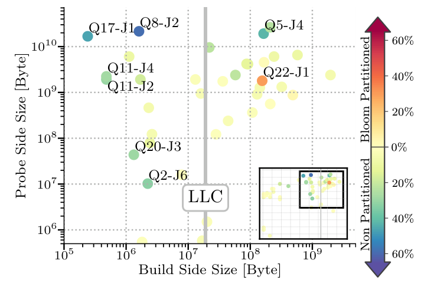

图 1：TPC-H SF 100 中，每个连接采用 Bloom 过滤的分区哈希连接与不分区哈希连接时的相对性能，标记为 Q⟨id⟩-J⟨order⟩。横轴和纵轴分别为构建端、探测端大小，单位为字节；图中标出末级缓存（LLC）的容量边界。

## 1 引言

现代处理器的架构变化激发了大量寻找最优连接实现的研究。多年来，研究界得出的结论是，哈希连接优于排序归并连接 [3,17]，并且通常应针对底层硬件调优算法实现，即采用硬件感知，而不是硬件无关的实现 [4,27,32,40]。

近期的综合研究建议，分区基数连接比不分区哈希连接性能更好 [4,40]。但尚不清楚，基数连接是否应完全替换哈希连接，成为数据库引擎的主要连接手段，还是只应当充当性能加速器。前者不太可能，因为只有构建端本来不能放进缓存时才需要基数分区阶段，否则额外扫描数据及必要的数据物化会带来不可忽略的开销。后者更难回答。把基数连接用作加速器意味着我们应该知道何时使用它。遗憾的是，现有研究仅用合成微基准评估两者的性能，这些微基准不能代表真实工作负载中的典型情况。

本研究考察如何把最先进的基数连接算法集成进编译型内存 DBMS，以及何时应使用它来代替不分区哈希连接。我们的基数连接性能与先前工作的独立实现相当，同时支持所有等值连接变体，包括外连接、标记连接、半连接和反连接 [33]。在所有查询计划中，都可用它直接替换原来使用的不分区哈希连接。本系统采用以数据为中心的查询编译 [32]，并应用松弛算子融合，实现基于软件的预取 [27]。这使我们能在比先前分析更广的工作负载与因素范围内，全面比较两种连接实现。具体而言，我们进行了以下工作。

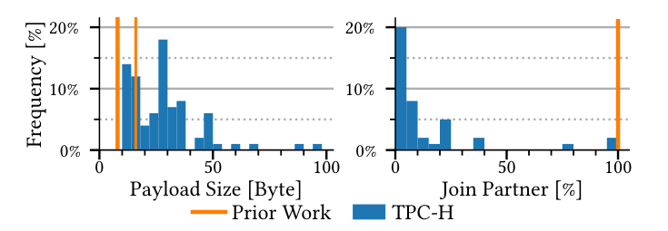

图 2：TPC-H 与先前工作中的元组大小和连接匹配比例。左图横轴为载荷大小（字节），右图为存在连接匹配方的比例（百分比），纵轴均为频率（百分比）。

**在系统级环境比较哈希连接。** 所有待测连接均集成进编译型内存 DBMS 并在其中测试。分区连接和不分区连接都采用最先进的硬件感知设计，使用软件预取、软件写合并和非临时存储等优化 [5]。

**评估连接对查询执行的整体影响。** 现有工作孤立地比较连接，依靠已经物化的输入数据，或者只统计匹配元组而省略结果物化，借此简化设置 [4,16,40]。这些简化并非总是适用，因为连接出现在查询执行的许多阶段。将连接集成到完整 DBMS 后，我们还考察它们对整个查询执行的隐含影响。

**采用有代表性的数据集。** 先前工作仅考虑窄元组（8–16 字节）[47] 和稠密的数据分布 [16,40]，我们则用 TPC-H 基准评估性能（见图 1）。图 2 表明，TPC-H 查询覆盖了更广泛的选择率和元组大小。

出乎意料的是，尽管先前微基准结果很鼓舞人心，经过优化的基数连接 [4,40] 在 TPC-H 中却缺乏竞争力。分析连接后我们注意到，对大多数查询而言，分区阶段被重分布的大部分元组甚至可能不出现在最终结果中（见图 2）。因此，我们在探测阶段引入过滤器，尽早丢弃元组，节省计算时间并减少不必要的物化开销。

这项优化提高了基数连接的竞争力，但在 TPC-H 的 59 个等值连接中，仅对一个连接产生可测量的收益（见图 1）。进一步通过一系列微基准研究，我们发现，只要某一工作负载特征，例如载荷大小、数据分布、物化策略或连接选择率偏离最优值，基数连接的收益就迅速缩小。实际上，对非最优情况，我们几乎得不到任何收益。

本文的主要贡献如下。

- 把基数连接完整集成到内存 DBMS。据我们所知，这是首次在采用以数据为中心的代码生成 [15] 的 DBMS 中实现基数连接。
- 嵌入采用 Bloom 过滤的半连接缩减器，显著减少具有中、高选择性的查询的物化开销。
- 使用 TPC-H，在 Umbra [13] 内比较基数连接及其 Bloom 过滤版本和最先进的哈希连接 [18,21,27]。
- 通过广泛的微基准，归纳出使用基数连接能够取得性能收益所需的工作负载特征取值范围。

基于全面评估得到的认识，我们对实现基数连接持严肃保留意见。它作为加速器只适用于很小一类工作负载，因此很少足以抵偿增加的代码和优化器复杂度。

## 2 相关工作

大部分论文同意，内存哈希连接比排序归并连接更快 [3,18]。对于硬件感知连接更优这一点，也存在共识 [5,27]。然而，究竟是分区，还是不分区连接所采用的预取，更能利用硬件资源，尚不明确。Balkesen 等和 Schuh 等认为基数分区连接更优 [3,5,40]，Lang 等则给出相反结论 [18]。

过去二十年，研究界十分关注内存基数连接的并行实现。这里简要回顾。1999 年，Boncz 等 [9,24,25] 提出多趟基数分区，解决 Shatdal 等 [42] 原始硬件感知连接中的 TLB 抖动问题（见 §3.1），并研究了优化的物化策略 [26]。Kim 等 [17] 和 Blanas 等 [7] 在多核系统上评估了基数连接。Balkesen 等 [3–5] 重新研究分区与不分区连接，并用写合并和流式指令优化 Blanas [7] 的实现 [3,39,46]。Fang 等和 Makreshanski 等 [12,23] 为两种哈希连接建立理论模型，确定元组大小是使内存带宽饱和的最关键性能因素。

Schuh 等 [40] 为基数连接引入 NUMA 感知，全面比较了其他 NUMA 优化连接 [2,18]，并提出把基数连接用作加速器。在其他贡献之外，他们还在独立的 TPC-H 查询 19 变体中评估基数连接，通过分区指向原始元组的引用，并把所有字符串截成一个字节，显著缩小关系大小。由于未完整集成到系统，他们的分析只基于孤立连接时间，没有计入元组重建成本，使结论产生偏差 [30]。

还有很多与连接处理和基数分区有关的研究。Polychroniou 等研究了 SIMD 分区 [36]，并概述了分区变体 [37]；Schuhknecht 等 [41] 和 Zhang 等 [47] 又针对基数分区重新研究。Richter 等 [38] 比较不同的哈希表实现，Barber 等 [6] 关注内存高效的哈希连接。Pirk 等 [34] 深入分析哈希连接，Shrinivas 等 [43] 和 Abadi 等 [1] 比较列存数据库系统中的物化策略。

分区也适用于不以 CPU 为中心的数据处理。例如，GPU [35] 或 FPGA [14] 加速方案目标相似，并采用可比较的算法来更好地分配工作负载。

## 3 分区基数连接

现有内存哈希连接算法可分为两类 [40]。一类是不分区变体，使用可并行访问的全局哈希表。当哈希表不能放入缓存时，它们依靠软件预取避免昂贵的缓存未命中和随机访存 [5,27]。另一类是基数连接，直接逐分区连接数据以减少缓存未命中，每个分区的大小使其哈希表能放入缓存 [42]。本节假设探测端与构建端均已物化，以便与先前工作 [4,40] 比较。

### 3.1 基本分区连接

从高层看，分区连接把两个输入关系拆成分区，再分别连接各个分区。

基本分区连接实现包括两个阶段。首先，在分区阶段，以连接条件的哈希值为键，对构建端和探测端分区。两端由此被拆成包含各自连接匹配方的分区。其次，逐个分区执行连接。所有分区结果的并集形成最终结果。

分区算法分三步 [47]。第一步扫描输入，构建直方图，统计各分区将包含多少元素。第二步用直方图计算元组总数和精确分区边界。我们分配足够容纳全部元组的输出缓冲区，并依据边界给每个分区划定区域。第三步再次扫描数据，把每个元组物化到输出缓冲区的正确位置。每个分区记录已经写入的元组数，以确定正确的输出位置。

### 3.2 Balkesen 等提出的并行基数连接

Balkesen 等 [4] 提供了高效、公开可用的基数连接实现[^1]，是对 Blanas 等 [7] 实现的改进。图 3a 概述其方法。

**两趟分区。** Boncz 等 [9] 观察到，单次切分的分区连接存在性能问题。当同时写入的分区数超过地址转换后备缓冲区（TLB）的表项数，就会造成 TLB 抖动。他们采用多趟分区，即连续执行多次切分的基数分区来缓解问题。每趟创建的分区数被限制为不超过 TLB 表项数。各趟使用哈希键的不同位子集。Balkesen 等采用图 3a 所示的两趟分区。

**并行分区。** 并行运行基本实现很困难，因为每个工作线程都写所有分区，造成严重拥塞。Kim 等 [17] 建议先切分输入关系，使各片能并行处理。所有等大小切片放入任务队列，每个工作线程从中取任务，执行 §3.1 的步骤。所有任务完成直方图后，合并全部直方图，计算前缀和（①）。基于前缀和，每个任务计算专用输出位置，无需同步便可把元组散写到各分区（②）。第二趟取第一趟的分区，再次切分（③）。

最后的连接并行执行，采用基于任务的并行方式，这也有助于处理倾斜。

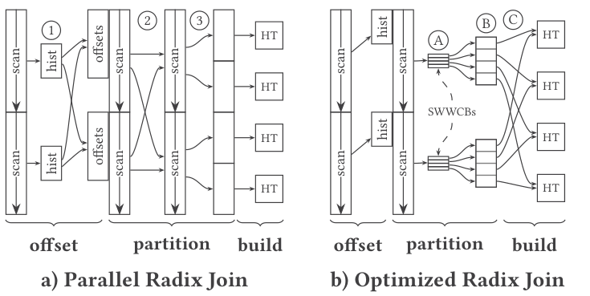

图 3：先前工作中的基数分区。a）并行基数连接；b）优化的基数连接。图中 hist 为直方图，offsets 为偏移量，HT 为哈希表，A、B、C 分别对应软件写合并、非临时流式写入和 NUMA 感知优化。

[^1]: https://www.systems.ethz.ch/node/334

### 3.3 优化的基数连接

Balkesen 等进一步用软件写合并缓冲区（SWWCB）和流式指令改进基数连接 [3]。§5.2 将我们的实现与他们优化后的基数连接比较。Schuh 等 [40] 通过增加 NUMA 感知进一步优化（见图 3b）。

**软件写合并缓冲区。** Wassenberg 等 [46] 提出 SWWCB 加速基数排序，它对基数分区同样有益 [3]。SWWCB 是驻留缓存、由软件管理并合并多次写入的数据缓冲区。每个缓冲区至少为一条缓存行，先保存已分区的元组，而不直接写到目的地（A）。缓冲区满时才刷新到目的地，有效降低 TLB 压力和内存写入次数。

**非临时流式写入。** SWWCB 可能使写入次数翻倍，非临时流式指令通过把填满的 SWWCB 直接写入 DRAM 来缓解这一问题。写入绕过所有缓存，避免污染缓存（B）。但此时数据必须按缓存行边界对齐，因此两项优化适合结合使用。SIMD 寄存器的最大宽度限制单条指令一次能写的数据量。2016 年，这个大小为半条缓存行，原文写作使用 AVX2 时为 256B。使用 AVX512 指令，现代 Intel 处理器可一次存储完整缓存行。

> 译注：原文此处确写为“256B”，同时称其为半条缓存行。AVX2 寄存器宽度通常以 256 位表示；这里保留原文字面单位，避免静默更改。

**NUMA 感知。** 到此为止，基数连接还不具备 NUMA 感知，因为每个任务写多个分区，而这些分区遍布输出缓冲区。因此，每个工作线程可能需要访问不同内存区域来存储元组。Schuh 等 [40] 给每个任务增加一个输出块，把元组存入本地分区，使写入保持本地性。但最终分区结果也由此不再位于一个连续内存区域，而是分散到各任务的块中。因此连接可能需要读取不同 NUMA 节点（C）。他们的实验表明，优势占上风，因为只有读操作可能跨 NUMA 节点。此外，NUMA 访问更加均衡，总体性能提高。

## 4 内存 DBMS 中的连接

在本文之前，关于分区连接的所有工作均使用孤立连接微基准评估。为从独立基数连接迈向真实数据库系统，我们把基数分区连接集成到 Umbra [13]，其性能与 HyPer 或 MonetDB 相当 [11]。

Umbra 采用以数据为中心的代码生成 [32]、松弛算子融合 [27]、任意查询去嵌套 [31] 和 morsel 驱动并行 [21]，并通过 SQL 前端接收查询。我们先介绍以数据为中心的代码生成的一般工作方式，再介绍它对两种哈希连接实现的作用，最后聚焦对两个输入数据流分区的新基数连接实现。

### 4.1 以数据为中心的代码生成

独立连接实现与集成到完整 RDBMS 的实现，主要区别在环境。前者整个系统围绕连接运行，后者连接是组织数据流的算子流水线的一部分（图 4）。首先，流水线源算子把物化状态中的元组加载到 CPU。随后，元组经过流水线中的算子，最终在下一个流水线阻断点物化 [29]。

Umbra 采用 produce/consume 模型 [32]，自底向上编译从源算子到物化点的数据流。每个算子对输入调用 produce，委托启动流水线的职责。最终到达不能进一步委托的流水线起始算子，它开始把元组向上推给消费者。到达流水线阻断算子后，生成物化所有输入元组的代码。我们用此抽象为任意 SQL 查询编译以数据为中心的代码。

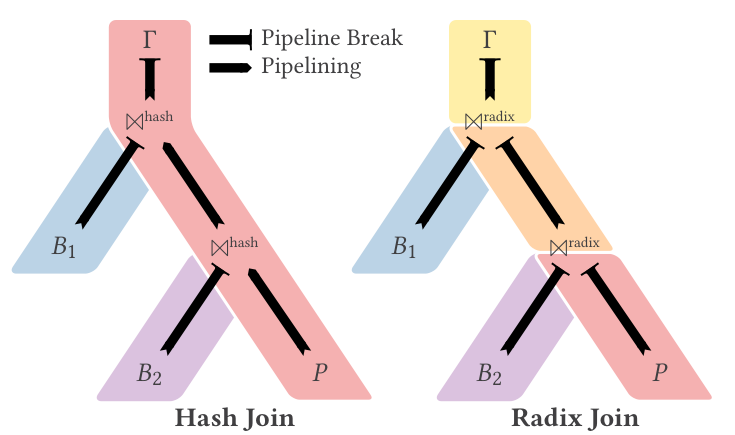

图 4：基数连接与哈希连接中的流水线。哈希连接可让探测元组连续通过多个连接；基数连接每次都必须物化两个输入。

### 4.2 物化策略

Umbra 在主存中以列式存储关系 [13]。我们采用提前物化，减少流水线求值时的随机访问。因此，表扫描只读取必需列，用 SIMD 指令过滤，再拼接成元组传给消费者。为了避免物化开销，我们使用横向信息传递 [43]。例如，哈希连接的构建端把所需元组信息告诉探测流水线，以便尽早过滤。

为比较所选物化策略的影响，我们集成了延迟物化（Late Materialization）。自顶向下遍历查询树，寻找每列的最早访问点。如果访问没有紧接表扫描发生，就引入延迟加载算子，在需要时依据元组 ID 取得该列。

### 4.3 不分区哈希连接

不分区哈希连接无需写出探测端（图 4）。每个哈希连接传递元组，在流水线中执行连接 [21]。这种所谓的算子融合尽可能长地把元组保存在寄存器中。但它可能因代码结构更复杂而妨碍元组间并行。松弛算子融合（ROF）为克服这一问题，放松以数据为中心的代码生成原始思想，允许中间物化。DBMS 可以在查询计划中引入分阶段处理点，把探测端缓存在缓存中，以缓存本地性换取流水线中的元组传递 [27]。从这些缓冲区读取，能够采用无分支原语等向量化优化，以及避免缓存未命中的软件预取。ROF 有效结合了以数据为中心的代码生成和向量化的优势。

### 4.4 分区哈希连接

基数连接建立在基数分区阶段之上，因此写入内存是必需操作。这些频繁写入放松了以数据为中心的代码生成的原始思想，也与之相抵触。多个基数连接连续执行时，每个连接都必须中断流水线。[^2]

算法 1：完整流水线阻断算子。

```text
Function Radixjoin::produce(requiredColumns):
    condition ← analyzeJoin(requiredColumns);
    build ← prepareBuild();
    left.produce(condition.left.requiredColumns);
    build.partition();
    probe ← prepareProbe();
    right.produce(condition.right.requiredColumns);
    probe.partition();
    joinTuples(build, probe);
```

因此，如图 4 所示，基数连接既是完整流水线阻断算子，也是流水线起始算子。算法 1 遵循 §3.1 的三个阶段，先对构建端分区，再对探测端分区。因为所有数据都物化了，这会中断两条流水线。两端分区后，启动执行元组连接的新流水线。

算法 2 的连接代码主要由紧凑循环组成，这是 produce/consume 模型的特点 [29]。紧凑循环尽可能长地把数据保留在 CPU 寄存器，最大化数据本地性，因而适合现代 CPU。算法遍历分区、构建哈希表并检查每个元组是否包含其中。所有匹配元组传给流水线中的消费者。

算法 2：启动新流水线。

```text
Function Radixjoin::joinTuples(build, probe):
    for p_build, p_probe ← {build, probe} do
        hashtable = buildHashtable(p_build);
        for t_probe ∈ p_probe do
            for t_build ∈ hashtable.probe(t_probe) do
                consumer.consume(t_build ◦ t_probe)
```

由于大部分工作发生在物化期间或之后，收集元组很简单。根据当前输入流水线，把元组分区到构建端或探测端。

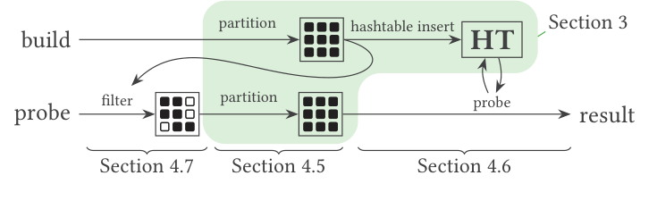

图 5：我们分区连接的示意总览。构建端经过分区与哈希表插入，探测端经过过滤、分区和探测后产生结果；各部分对应原文第 3、4.5、4.6 和 4.7 节。

[^2]: 两个连续连接采用相同分区键时，可以把它们合并到一条流水线，避免流水线中断及其带来的分区开销。

### 4.5 Morsel 驱动分区

流水线执行基于 morsel，把总工作负载拆成小块，实现工作窃取 [21]。每个源算子必须按 morsel 向流水线输出数据。图 6 详细展示用于构建端与探测端的分区步骤内部元组流。

第一趟不断从 morsel 流获取当前源流水线的 morsel，工作线程做完先前工作就领取下一个（①）。即使存在倾斜，这也能细粒度均衡负载。工作线程根据哈希值最低有效位确定输出分区，然后把哈希值和元组配对。首先将其物化到工作线程本地的一组 SWWCB（②）。缓冲区满后，通过非临时流式指令把元组转移到临时分区，避免污染缓存。

处理数据流输入的挑战在于，必须先物化输入，而不能依靠直方图，这也是采用两趟的原因。因此，每个临时分区实现为页链表。页满时，在链表头部添加更大的页，并改用新页。

之后，每个工作线程遍历链表，为下一趟分区构建本地直方图（③）。此时工作线程间无需通信。

交换阶段做两件事。首先，基于工作线程本地直方图的前缀和，计算输出分区精确大小（④）。其次，连接所有工作线程的链表，形成所谓的预分区（⑤）。第二趟中，每个工作包具有专用范围，数据库无需在工作包之间同步。

第二趟也按 morsel 执行。基数连接依据预分区生成 morsel（⑥）。我们用同一个工作线程处理一个预分区的整条链表。再次使用 SWWCB 合并写入，然后把元组缓冲区散写到最终位置（⑦）。进一步采用工作窃取，即使有倾斜也能使工作线程间负载均衡（⑧）。

整个分区过程中，所有工作线程始终写入本地或专用内存区域。因此，不需要同步或写入非工作线程本地内存区域，保证了在不同工作线程数和多 socket 系统上的可扩展性。

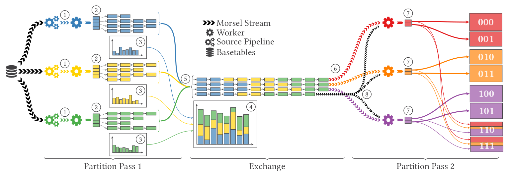

图 6：我们的两趟分区示意，使用 3 位进行八路切分。图中 ①–⑧ 对应正文步骤，包含分区第一趟、交换和分区第二趟。

### 4.6 最终连接阶段

每个 morsel 即时用 Robin Hood 哈希构建哈希表，它对线程本地工作负载提供最稳健的性能 [38]。由于移动元组成本高，我们只存指针。因为事先知道大小，可以避免昂贵的哈希表扩容。此外，重用哈希表内存段，避免昂贵的内存分配。因此，只有分区大小存在明显倾斜时才需要重新分配内存。

### 4.7 Bloom 过滤器

现在连接已能在驻留缓存的分区上执行，而分区成本主导基数连接的执行时间 [4,40]。带选择条件的查询中，物化探测端分区经常会产生不必要的高成本。一项优化是减少探测端存储的元组数。这是可行的，因为大多数查询在连接前对构建端施加选择 [10]。

模糊半连接缩减器是不分区哈希连接的成熟技术 [19]。它能改善带选择条件的连接，我们的不分区连接已用带标记指针实现它 [21]。优化器将缩减器下推到流水线，尽早裁剪元组（图 7）。

我们在基数连接中引入基于 Bloom 过滤器的缩减器，最小化物化成本。构建端第二趟分区时生成过滤器。探测端分区前，先在流水线中探测过滤器，并在可能时进一步下推。

按照 Lang 等 [20] 的指导，我们实现了寄存器分块 Bloom 过滤器，将过滤器划成寄存器大小的块。每次探测恰好访问一个块，每次检查最多产生一次缓存未命中。由于两个分区不会共享块，过滤器可以无同步地并行写入。在外键中有 5% 能找到连接匹配方时，Bloom 过滤基数连接大约快 40%（见 §5.4.1）。

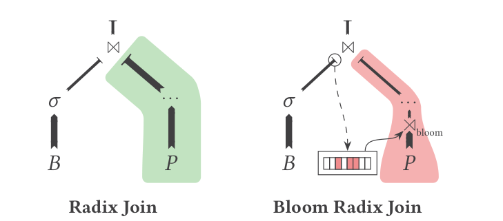

图 7：带选择条件的连接中的 Bloom 过滤器。没有连接匹配方的元组会提前被过滤，不进入物化。

## 5 评估

下面在完整 RDBMS Umbra 内，实验评估基数连接与不分区哈希连接，回答分区何时以及是否值得做。

### 5.1 实验设置

#### 5.1.1 待测连接

我们在 Umbra [13] 内比较以下三种连接。

**基数分区连接（RJ）**：采用 SWWCB、非临时流式写入、两趟分区和线程本地输出缓冲区，实现第 3 节全部优化。

**Bloom 基数分区连接（BRJ）**：采用 Bloom 过滤器的基数连接，通过过滤探测端减少物化开销（§4.7）。

**带缓冲的不分区哈希连接（BHJ）**：使用全局链式哈希表和松弛算子融合 [27]，具有基于带标记指针的半连接缩减器 [21]。

我们还用最先进的先前工作验证实现。

**Balkesen 等的连接（PRJ 与 NPJ）**：将上述实现和 Balkesen 等 [4] 以独立程序提供的分区连接 PRJ 与不分区连接 NPJ 比较。为公平起见，为 PRJ 启用 SWWCB 和非临时存储等全部优化，为 NPJ 启用软件预取。

表 1：先前工作中的工作负载。

| 工作负载 | 使用它的文献 | 键/载荷大小（B） | 构建元组数 | 探测元组数 | 构建大小（MiB） | 探测大小（MiB） |
| --- | --- | --- | --- | --- | --- | --- |
| A | [4,7] | 8/8 | $16\cdot2^{20}$ | $256\cdot2^{20}$ | 256 | 4096 |
| B | [3,4,17] | 4/4 | $128\cdot10^6$ | $128\cdot10^6$ | 977 | 977 |

#### 5.1.2 工作负载

评估的主要部分使用 TPC-H 基准 [44]，同时分析查询级和单连接级。它有 22 个工作负载特征不同的查询（图 2）。

为与相关工作比较，并隔离工作负载因素、细化 TPC-H 分析，我们还使用微基准，以 Balkesen 等 [4] 的工作负载为基础，其属性列于表 1。每个微基准修改工作负载，以隔离所关注的因素，如不同选择率或载荷大小。

在系统中，我们用以下 SQL 生成构建表和探测表以复现实验设置。数据未经预处理，尤其没有生成索引。

```sql
CREATE TABLE b (key BIGINT NOT NULL, pay BIGINT NOT NULL);
```

对工作负载 B，以 INT 代替 BIGINT，生成 4 B 大小的列。

#### 5.1.3 硬件

除非另有说明，使用 Intel i9-9900X（Skylake-X），10 核、64 GB RAM。默认使用所有可用线程，包括超线程。其他实验分别使用双 socket Intel E5-2660v2（原文标为 Sandy Bridge），每 socket 10 核、256 GB RAM，以及 AMD 3950X（Ryzen 9），16 核、64 GB RAM。详细规格见表 2。用 GCC 9 编译代码，通过 `march=native` 标志在可用时启用 AVX512 指令集。RDBMS 本身用 LLVM 和 clang 9 编译查询。

为了进行合理比较，没有计入查询编译时间[^3]，因为其他实现是手工编码、预先编译的。测量前预热系统，确保全部数据都在内存中。所有基准至少运行五次，报告性能中位数。

表 2：硬件平台。

| 项目 | Skylake-X | Ryzen 9 | Sandy Bridge |
| --- | --- | --- | --- |
| 厂商 | Intel | AMD | Intel |
| 型号 | i9-9900x | 3950X | E5-2660v2 |
| socket 数 | 1 | 1 | 2 |
| 核数（SMT） | 10（×2） | 16（×2） | 20（×2） |
| 频率（GHz） | 3.5–4.4 | 3.5–4.7 | 2.2–3.0 |
| L1 数据缓存（KiB） | 32 | 32 | 16 |
| L2 缓存（KiB） | 1024 | 512 | 256 |
| LLC 缓存（MiB） | 19 | 16（×4） | 25 |
| DRAM 速度（GiB/s） | 79.4 | 47.8 | 59.9 |

[^3]: 即使采用优化设置，查询编译时间也可忽略。

#### 5.1.4 关键问题

评估分为三部分。首先，验证连接实现与相关工作相比具有竞争力（§5.2），检查线程数扩展性（§5.2.1）和 NUMA 系统上的扩展性（§5.2.2），以及内存子系统利用效率（§5.2.3）。

其次，运行 TPC-H，检查基数连接能否完全替代引擎中的不分区哈希连接（§5.3.1）。由于假设答案是否定的，我们在单连接层面分析 TPC-H，评估基数连接能否用作性能加速器（§5.3.2）。

最后，通过广泛的微基准（§5.4），寻找能够凸显基数连接相对不分区哈希连接性能优势的工作负载属性的理想取值范围，例如选择率、载荷大小和流水线深度。

### 5.2 性能特征与相关工作比较

我们的目标是客观评估 DBMS 中分区的优缺点，但只有实现的性能合理，这种评估才有意义。

我们为 Balkesen 等的 PRJ 和 NPJ [4,5] 启用全部优化，和自己的连接实现比较。为匹配原论文工作负载，使用以下查询连接构建表和探测表，统计结果元组。

```sql
SELECT count(*) FROM probe r, build s WHERE r.k = s.k;
```

一个关键差别是，Balkesen 等直接用键分区，我们则生成同样大小的哈希值并随元组存储。我们没有存储计数所不需要的载荷，这抵消了上述差别。

#### 5.2.1 可扩展性

首先比较我们的实现与最先进实现的性能。图 8 显示，RJ、BHJ 与 PRJ、NPJ 都具有竞争力。我们的 RJ 在工作负载 A 上超过 PRJ，而 BHJ 在两个工作负载上都不如优化的 NPJ 快。

所有实现都随硬件上下文数量良好扩展，但基数连接的加速更大。10 线程下，RJ 在 A、B 上分别加速 7.5 倍和 9.5 倍。A 上 RJ 没有完全扩展到 10 线程，因为已达到内存带宽上限（见 §5.2.3）。B 中，较小的元组没有完全占满带宽，超线程可再提升约 10%。正如预期，两种不分区哈希连接从超线程获益更多，因为它能隐藏访存延迟。NPJ 针对给定工作负载优化，因此比 BHJ 更快，例如它预先知道精确哈希表大小和分布。

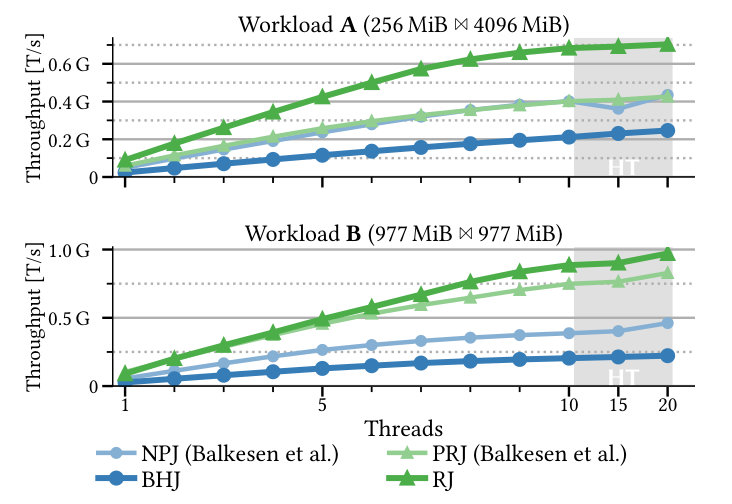

图 8：扩展性及与 Balkesen 等实现的比较。上图为工作负载 A（256 MiB → 4096 MiB），下图为 B（977 MiB → 977 MiB）；横轴为线程数，纵轴为吞吐量（元组/秒），HT 区域表示超线程。

#### 5.2.2 NUMA 影响

本实验从 1 核扩展到全部可用逻辑线程，评估算法利用硬件资源的能力。使用双 socket Intel Sandy Bridge 和具有四个 chiplet 的 AMD Ryzen 9（表 2），展示 NUMA 下的性能。

图 9 表明，RJ 在 Sandy Bridge 上扩展良好，根据工作负载不同，加速 10–16 倍。较小元组给带宽造成的压力更小，因此扩展性更好。与前面相同，超线程仅带来少量加速。

Ryzen 9 上则不同，RJ 超过某一点后不再线性扩展。相对较低的内存带宽是关键，其每核带宽为 Skylake-X 的 60%。RJ 起初扩展良好，但在 A 上更快到达带宽上限。进一步增加线程，因带宽争用而变慢。BHJ 与前面一样，在所有机器和工作负载上表现相似，扩展性对工作负载的依赖更小。

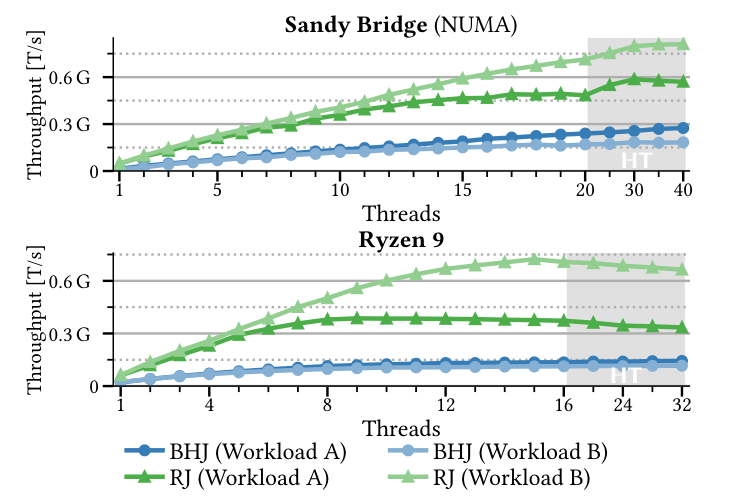

图 9：不同机器上的扩展性。上图为 Sandy Bridge NUMA 系统，下图为 Ryzen 9。分别比较 A、B 下的 BHJ 与 RJ；纵轴为元组/秒，横轴为线程数，HT 表示超线程。

#### 5.2.3 内存带宽使用

前两个实验表明，RJ 性能明显受内存子系统压力影响。无论增大载荷还是增加硬件上下文，接近带宽上限时，其性能收益都会缩小。因此本实验分析带宽使用情况。

图 10 展示执行 §5.4.2 SQL 时 RJ 的读、写和总内存带宽。横轴为耗时，强调每个连接阶段的成本。构建流水线仅占少量时间，因为它比探测端小 30 倍。探测流水线主导执行时间，主要归因于两趟分区中的物化。

我们特意选该查询以展示填充的影响。SWWCB 和非临时流式指令要求填充，但它们的收益超过填充的不利影响。两次分区和连接都受带宽限制，这说明增加硬件上下文无益，也解释了为什么增加载荷会降低性能。

前三个实验验证了实现的竞争力。它能充分使用内存带宽，并受带宽限制，进一步改善空间很小。

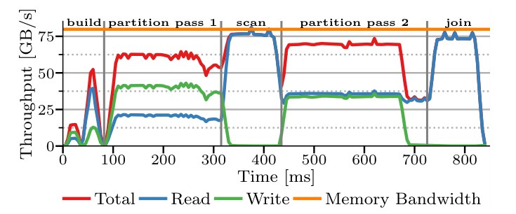

图 10：利用 PCM 工具[^4] 测量 RJ 各阶段在 24 B 宽元组下的读、写带宽。图中阶段依次为构建、分区第一趟、扫描、分区第二趟和连接。横轴为毫秒，纵轴为 GB/s。

[^4]: https://github.com/opcm/pcm

### 5.3 TPC-H 评估

TPC-H 在不同数据规模因子（SF）下，用字符串比较、大型基表扫描、不同选择率的连接等，给 RDBMS 的不同部分施压 [10]。为回答是否应把基数连接作为唯一主力连接算法，我们在不同 SF 下，把查询树中的所有连接替换成待测连接，比较实现性能。

图 11 展示相关 TPC-H 查询随数据集大小变化的实验结果。指标为每秒处理元组数，其中元组总数是所有流水线源算子统计的元组数之和。[^5] Q1、Q6、Q13 未纳入测量，因为它们没有使用连接。[^6]

主要观察如下。第一，BHJ 总体性能最好，在 SF 小于 30 时尤其明显。第二，BRJ 对所有查询都快于 RJ，因为外键连接主要采用过滤后的构建端（图 2，[10]）。第三，只有 Q22 在 SF 30、100 时，BRJ 超过 BHJ。第四，延迟物化似乎与是否分区正交。因此，如果系统只实现一种哈希连接，BHJ 显然是应选方案。

这个结论证实我们的假设：替换全部连接并不理想，因为基数连接最有希望改善特定工作负载 [4,5,40]。下面深入分析单个查询计划，解释 BRJ 和 RJ 为什么不能始终替换 BHJ 作为主要连接。

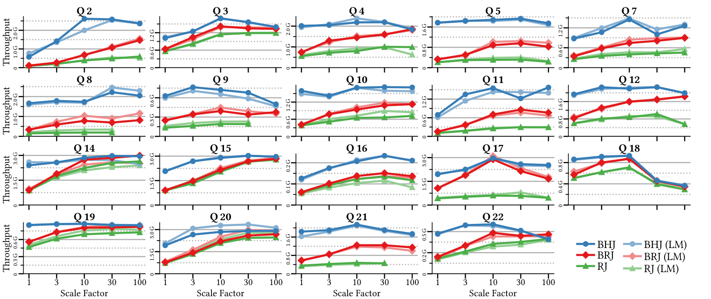

图 11：把每个连接都替换成待测实现时，所有含连接的 TPC-H 查询的吞吐量。横轴为 SF 1、3、10、30、100，纵轴为吞吐量；LM 表示延迟物化。[^8]

[^5]: 例如，`SELECT count(*) FROM a, b WHERE a.key = b.key;` 的元组数为表扫描 + 表扫描 + groupby 扫描，即 size(a) + size(b) + 1。
[^6]: 对 Q13，本系统采用 groupjoin，把连接和分组结合 [28]。

#### 5.3.1 端到端查询性能

这里根据查询计划分析选定的 TPC-H 查询。[^7] 由于查询特征各异，我们按 SF 100 下的连接大小分组，讨论 BHJ、BRJ 和 RJ 的性能差异。

**小构建端（Q2、Q11）。** 这些查询仅含构建端可放入缓存的小连接，对 BHJ 有利，因为没有缓存未命中。Q2 有九个连接，即便 SF 100，构建端也都小于 LLC。2 GB 探测端带来物化开销，RJ 比 BRJ 更明显。Q11 最大构建端为 480 KB，全局哈希表可放入 L2，分区多余。BRJ 在两者中都优于 RJ，因为预过滤元组避免了大部分分区开销。

**单连接查询（Q4、Q12、Q14、Q19）。** 这些查询的流水线数量较少，连接主要决定运行时间。Q4 包含 orders 与 lineitem 的一个连接，明显主导查询。由于构建端经过预过滤，Bloom 过滤器值得使用。对于选择率为 3% 的谓词，它能丢弃约 80% 不参与连接的元组，减少分区开销。尽管 SF 大于 10 后构建端不能放入 LLC，ROF 引入的缓冲仍使 BHJ 性能保持稳定。

Q12 大部分时间用于扫描 lineitem，把它作为构建端与 orders 连接。最底层选择再次丢掉绝大多数（99.5%）元组，但 SF 100 下构建端仍有 87 MB，是 LLC 的四倍。预取同样保持了 BHJ 性能的稳定，RJ 无法跟上 BRJ。Q14 将 lineitem 中的 1% 元组和 part 连接，两端分别为 209 MB、560 MB，大小接近，因此 SF 足够大时 BRJ、RJ 都表现良好。Q19 的时间分别用于过滤和连接 lineitem，构建端仅 2 MB，可放入 LLC。但 BHJ 无法明显超过 BRJ，因为 Bloom 过滤器在分区前丢弃了 90% 元组。

**由其他算子主导的查询（Q3、Q10、Q15、Q16、Q17、Q18）。** 连接占这些查询总时间不到 40%，限制了连接实现的总体影响。Q15、Q16、Q17、Q18 由分组主导。Q10 由基表扫描与选择主导，Q3 则由 group join 主导。因此大 SF 时连接性能差异很小，因为其他算子决定查询耗时。但在小 SF 时，BHJ 更优。

**复杂查询（Q5、Q7、Q8、Q9、Q21、Q22）。** 这些查询含有构建端和探测端大小不同的各种连接，仅依据计划和总时间无法解释连接性能的作用。接下来检查是否可逐个连接采用 BRJ 加速。

**物化策略。** 仅当在带选择条件的连接中大幅降低元组宽度时，延迟物化（LM）才有帮助。例如 Q8 中，七个连接有四个构建端缩小。Q20 的结果由两个只在输出中出现的文本列组成，延后物化它们有收益，把探测端缩小三分之二。但 Q14 中 LM 仅使构建元组减少 8 B，对所有构建元组的随机访问超过其正面收益。

[^7]: 所有生成计划都与 Umbra Web 界面 `umbra-db.com/interface` 报告的计划相似。

#### 5.3.2 单个连接比较

前节显示，TPC-H 大多数查询有多个连接，整条查询只用一种连接实现可能次优。但系统中所有连接都是流水线的一部分（§4.1），算子融合成紧凑循环，通过寄存器传递元组，因此分析计划中各连接的影响很困难。

于是我们在 TPC-H SF 100 上枚举连接计划中 BRJ、BHJ 的全部组合。评估某个连接（如第 2 个）时，固定其他连接的实现，只改变该连接的哈希连接算法，计算成对性能差。图 12 展示选定查询，横轴是计划内连接序号。图 1 以构建端、探测端大小展示 TPC-H 全部连接的总览。

一个关键观察是，多数连接对总执行时间并不重要。但对某些高成本连接，选择最优实现差异很大。例如，选择 BRJ 代替 BHJ，执行可能最多慢 60%，或最多快 30%。因此后续聚焦连接选择影响最大的多连接查询。

Q5 中，单个连接主导 BRJ、BHJ 的耗时差。它的探测端是未过滤的 lineitem，构建端则小得多。虽然构建端超过 LLC，但两端大小为 1:117，差距过大，BRJ 无法获益（图 12）。Q8 中，决定性能差异的连接也以未过滤的 lineitem 为探测端，大小 20 GB；构建端仅为 1 MB 的过滤后关系。哈希表能放入缓存，BHJ 的总执行性能快 60%。

Q7、Q9 中，最上面的两个连接主导时间差，每个连接的两端都很大。原文在此写“RJ 和 BRJ 仍无法超过 BRJ”，并解释构建元组超过 48 B，导致分区太昂贵，得不偿失；BHJ 中的预取也更有效地减少缓存未命中。

> 译注：该句的比较对象在原文确为“BRJ”，与句中包含的 BRJ 自我比较。结合本段讨论和图 12，可能意指 BHJ；这里保留原文并明确指出疑点。

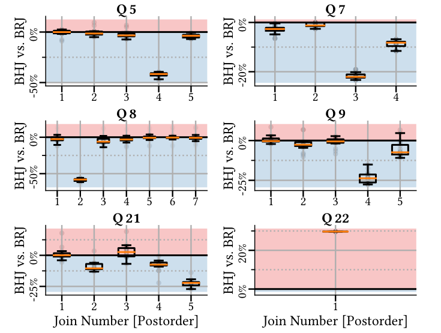

图 12：选定 TPC-H 查询中各连接的相对影响，未使用延迟物化。横轴为后序遍历的连接编号，纵轴为 BHJ 与 BRJ 的相对比较。

[^8]: 由于物化开销，RJ 无法在我们的内存预算内完成 SF 100 的 Q8、Q9 和 Q21。

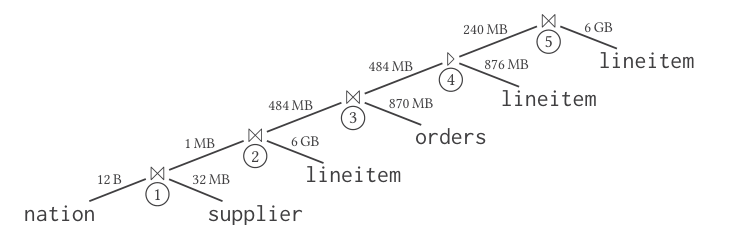

图 13：标注构建端和探测端大小的 Q21 连接树。

Q21 完全由连接主导，每个连接特征不同（图 13）。查询采用左深连接树，阻止了长流水线的形成。

连接 ① 很小，可忽略。② 的构建端适合 LLC；Bloom 过滤器能降低物化开销，因此 BHJ 仅快 10%。③ 的元组窄、两端大小相近，BRJ、BHJ 表现相当。④、⑤ 受多个因素影响而次优：构建元组大小 33 B，两端大小差也不理想。图 12 显示 ③ 平均采用 BRJ 更快，但所有连接均用 BHJ 才取得最快总时间。

Q22 含两个连接，其中一个为非等值连接，不能用哈希连接处理，因此未列入图 12。反连接以 155 MB 的 customer 为构建端，以 1.8 GB 未过滤 orders 为探测端，计算 `not exists` 谓词。每个探测元组包括哈希值在内只有 12 字节。窄元组适合 BRJ，因此该连接用 BRJ 可让总查询性能比 BHJ 提高 30%。

### 5.4 隔离不同因素的影响

到目前的分析集中于 TPC-H，其中多个因素同时影响连接性能。因素组合使 RJ 呈现与先前工作完全不同的表现（§5.2，[40]）。为确定各因素的独立影响，我们运行广泛的微基准，综合结果以界定 BRJ、RJ 优于不分区连接的情况。

#### 5.4.1 外键选择率的影响

所有查询的一个共同模式是，具有选择性的外键连接使 BRJ 胜过 RJ（图 2）。本实验分析选择率变化对各连接的影响。

工作负载基于 Balkesen 等 [4] 的 A，基数连接通常在其上表现良好（§5.2）。所有选择率下构建端保持不变。修改探测端外键选择率，但保持大小不变，确保处理的元组数恒定。

图 14 显示 BRJ、BHJ 都明显受选择率影响。低选择率下 BRJ 最多比 RJ 快 50%。但当超过 50% 外键有匹配方时，RJ 超过 BRJ，因为过滤器查找最多带来每次一次缓存未命中，其计算成本得不偿失。我们通过探测 Bloom 过滤器时对探测元组采样解决这一问题。如果几乎所有元组都通过，便自适应关闭过滤器。这仅增加少量开销，通常不到 10%。但 TPC-H 和真实查询通常选择率低于 25%（图 2，[10]）。本实验解释了 BRJ 在 TPC-H 上快于 RJ 的原因。还要指出，其他参数接近最优时，在低选择率下 RJ 比 BHJ 快 10%–40%。

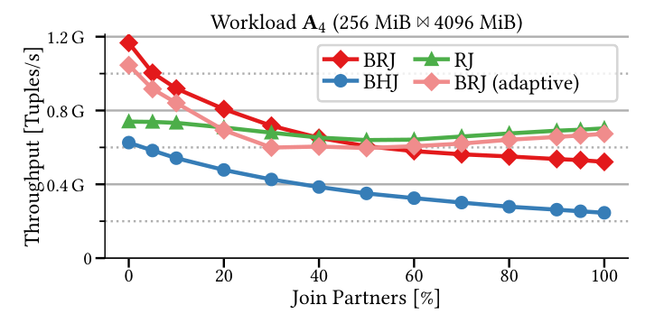

图 14：通过基于 Bloom 过滤器的提前探测，对探测端预过滤的影响。工作负载 A4，构建端 256 MiB、探测端 4096 MiB。横轴为有连接匹配方的比例，纵轴为元组/秒，另展示自适应 BRJ。

#### 5.4.2 载荷大小的影响

载荷大小也影响性能。有的连接载荷小，但列可能包含字符串，因此并非总是如此（图 2）。为隔离载荷对 RJ、BHJ 的影响，外键选择率设为 100%。

再次采用无倾斜的工作负载 A [4]，基数连接一般在其上表现良好（§5.4.5）。构建端不变，通过添加多个 8 B 随机整数列改变探测元组大小。最多使用 8 个载荷列，总载荷最大 64 B，加连接键和哈希值后元组最大 80 B。

一个载荷列时查询如下。

```sql
SELECT sum(s.p1) FROM build r, probe s WHERE r.k = s.k;
```

每个元组物化 32 B，分别为载荷 8 B、键 8 B、哈希值 8 B 和填充 8 B。图 15 表明 RJ 比 BHJ 更受载荷影响。RJ 性能下降 7 倍，BHJ 在元组增大五倍时仍基本稳定。SWWCB 的影响也清晰可见，元组大小会填充到下一个 2 的幂。超过 64 B 时不用缓冲，因为填充造成的损失超过非临时流式写入的收益。

LM 降低性能，因为选择率为 100%，额外存储元组 ID 后元组宽度为 24 B。RJ 总是更慢，连接后随机访问引入缓存未命中，可用 radix decluster 处理 [26]。BHJ 没有中间结果，不受 LM 影响。

BHJ 受内存限制，主要受随机访存延迟影响，所以元组大小影响不明显。RJ 则受带宽限制，分区阶段物化成本直接依赖载荷大小（§5.2.3）。窄元组时 RJ 最多比 BHJ 快三倍，但超过 32 B 后优势完全消失。

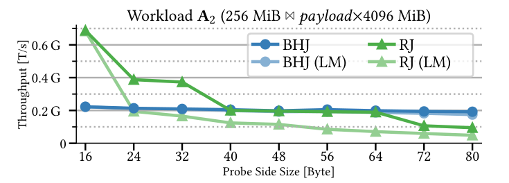

图 15：载荷大小对连接性能的影响。工作负载 A2，构建端 256 MiB，探测端随载荷增大；横轴为探测端元组字节数，纵轴为元组/秒，同时比较使用 LM 的版本。

#### 5.4.3 载荷大小与选择率的共同影响

前两个基准单独都不能展示 LM 的收益，但同时改变并分析选择率与载荷，就能看到其作用。将 §5.4.1 中 5% 选择率的工作负载，像 §5.4.2 一样给探测端增加列。使用四个 8 B 列，加哈希值共 40 B。采用 LM 后，只需事前物化 24 B，在连接后获取其余 24 B。

> 译注：第 5.4.2 节说明延迟物化需额外保存元组 ID；本段各大小数字按原文保留。

表 3 表明，LM 把必需物化量减半，让 RJ 性能翻倍。只有 5% 元组需要额外随机访问，因此它没有负面后果。但仍不及无 LM 的 BRJ，后者用横向信息传递 [43] 在分区前就裁掉大部分行。LM 同时明显提升 BRJ，进一步减少物化，使其比 BHJ 快近 50%。BHJ 不物化中间结果，因而没有收益。

表 3：使用和不使用延迟物化的吞吐量（元组/秒）。

| 连接 | LM | 无 LM | 收益 |
| --- | --- | --- | --- |
| BHJ | 452 M | 453 M | ±0% |
| BRJ | 656 M | 487 M | +35% |
| RJ | 341 M | 153 M | +122% |

#### 5.4.4 流水线的影响

把多个连接排入流水线时，选择率与载荷大小的影响会互相放大，对串联 RJ 尤其不利。每个 RJ 都要求物化，并给载荷增加自己的列，流水线越深，元组越宽。典型情况是星型模式查询，中心表连接不同事实表以取得额外信息。

我们沿用前面的工作负载，但不再求载荷之和，而把载荷用作事实表的键，形成星型模式基准。增加多个构建表副本，每个副本的行随机置换。因此选择率仍为 100%，可以独立考察流水线效果。由于中心表的键连接这些事实表，优化器每次必须使用中心表，最终产生单条长流水线计划（图 4 的 BHJ）。

图 16 展示每条流水线中每个连接的吞吐量。理想情况下，吞吐量不变，意味着流水线深度和连接执行时间不相关。BHJ 几乎如此。RJ 性能则随流水线长度成比例下降，物化开销和内存带宽限制逐渐累积，最终使连接变慢。

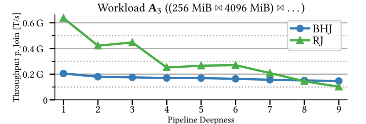

图 16：流水线深度的影响。横轴为流水线深度，纵轴为每连接吞吐量（元组/秒），比较 BHJ 和 RJ。

#### 5.4.5 倾斜的影响

为评估倾斜，用 Zipf 分布数据填充探测关系的外键列，Zipf 系数从均匀分布变化到代表高倾斜的 $z=2$。Balkesen 等也采用相同设置评估 PRJ（§3.2）和 NPJ，结果见图 17。

随着倾斜增加，NPJ、BHJ 都受益，因为时间缓存本地性改善，探测阶段随机访存减少。Blanas 等 [7] 也报告类似观察。但倾斜不利于两种基数连接：倾斜数据分区产生大小不一的分区，使调度复杂化。 $z\gt1$ 时尤为明显，这意味着超过 50% 元组的匹配方位于构建关系前 20% 中。

工作负载 A 上，倾斜超过 $z=1$ 后 BHJ 胜过 RJ， $z=2$ 时快五倍以上。B 上，NPJ 的交点更晚，BHJ 则没有交点，因为两关系大小相同、元组更窄，都更利于基数连接。PRJ 和 RJ 的时间特征相似，但我们的实现并行化更好（§5.2.1），最多快 50%。BHJ 因缓存本地性改善而受益；RJ 在 $z\geq1$ 时因分区大小和调度失衡而损失性能。

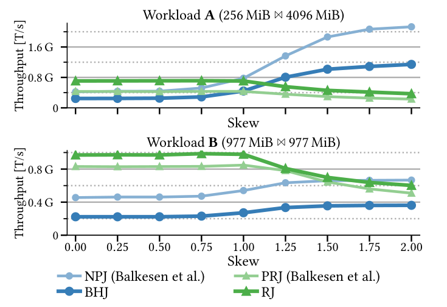

图 17：不同 Zipf 系数的影响，以及与 Balkesen 等原始代码的比较。上图为 A（256 MiB → 4096 MiB），下图为 B（977 MiB → 977 MiB）；横轴为倾斜系数，纵轴为元组/秒。

#### 5.4.6 构建端大小的影响

先前工作已广泛研究此因素 [3,4,7,40]。构建端适合 LLC 时，全局哈希表没有缓存未命中，分区无用。哈希表更大时，预取为 BHJ 减少缓存未命中，分区则体现 BRJ 的优势。

TPC-H 测量中也观察到此行为（图 11），BRJ 只有在较大 SF 时才开始值得使用。图 1 的单连接深入分析也表明 LLC 大小至关重要：构建端小于 LLC 时就无需分区。

#### 5.4.7 两端大小差异的影响

先前工作也分析过两端大小差，可从选用 A、B 数据集看出，大小差分别为 1:1 和 1:22。Schuh 等最大使用 1:10 [4,40]。原因在于，有限的差距保证构建端、探测端物化分区的成本处于同一数量级。

> 译注：此处两端比例按原文保留；表 1 的 A、B 大小与这里给出的对应顺序和 1:22 数值并不完全吻合。

TPC-H 中已观察到大小差过大的负面影响（图 1）。两端处于同一数量级时，RJ 表现良好，可能胜过 BHJ，具体取决于其他因素。BRJ 预过滤降低物化成本，适用范围更广。例如 Q22 大小差 1:11，BRJ 加速 30%；Q5 第 4 个连接差约 1:100，BHJ 则快 40%。

## 6 讨论与结论

本文回答了过去十年中最重要的连接问题之一：基数分区何时值得做？我们把最先进的基数分区哈希连接集成到内存 DBMS，与优化的不分区哈希连接比较。基于已有结果，我们原本期待用它加速 TPC-H 等昂贵分析查询。

出乎意料，经过 NUMA 感知、SWWCB 和非临时流式指令优化的基数连接，几乎未给 TPC-H 的任何连接带来明显收益。深入检查发现，对不出现在连接结果中的元组进行分区和物化，尤其在带选择条件的连接中，主导了执行时间。我们尝试延迟物化以减少元组宽度，它加速了部分微基准中的 RJ，却未明显改变 TPC-H。最后在探测端实现 Bloom 过滤器（BRJ）。虽然它让微基准中的连接稍慢，却显著加速了 TPC-H（图 18）。

但即便如此，对所有查询，BHJ 仍具有与 BRJ 相当的速度及更稳定的性能。SF 100 时，BRJ 只在 TPC-H 一个连接上快于 BHJ，且仅快 30%。这与先前只分析微基准所得到的认识有很大差异。

第二项主要贡献是广泛分析每个 TPC-H 连接的性能（图 1），并以微基准隔离不同因素，归纳工作负载关键属性中，采用基数连接和数据分区实际有益的取值范围。结果汇总于表 4。

表 4：分区连接的工作负载特征。

| 因素 | 可用范围 | 有益范围 |
| --- | --- | --- |
| 选择率 | 由 Bloom 过滤器处理 | 由 Bloom 过滤器处理 |
| 载荷大小[^9] | ≤32 B | ≤16 B |
| 流水线深度 | <8 个连接 | <2 个连接 |
| 倾斜（Zipf） | ≤1 | ≤0.5 |
| 构建大小 | >LLC | ≫LLC |
| 两端大小差 | <×50 | <×10 |

一个关键观察是，RJ 对任何偏离接近最优工作负载特征的情况都很敏感。BRJ 虽在广泛查询上具有竞争力（图 1），却很少能充分发挥潜力，超过不分区方案。理论上，选择基数连接可期待最高 300% 的改善。但实际上，载荷不够窄等条件不满足时，性能甚至下降。这使优化器很难可靠预测基数连接相对哈希连接的收益。

对照先前数据集和 TPC-H，可清楚看到，过去研究的数据范围较窄。我们扩展了 RJ 对不同载荷、选择率的适用性，让实践者更容易使用它，但这些实验认识能否迁移到他们的工作负载，仍难判断。TPC-H 虽是合成基准，查询及数据属性范围仍更广（表 5）。[^10] 真实数据存在不可忽略的倾斜，大量使用字符串和更宽载荷，更不适合基数连接。

我们展示了把优化基数连接集成到 RDBMS 并非简单过程，还需额外修改，才对带选择条件的查询有竞争力。即便如此，要获得性能优势，仍须满足很多参数条件，而且优化器要在运行时准确知道它们。因此，除非基数连接因工作集大于主存等其他原因有益，我们怀疑在通用生产系统中实现它能否抵偿新增复杂度。

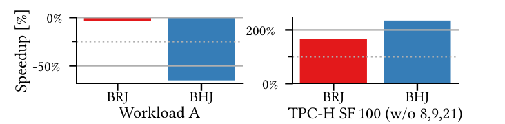

图 18：不同连接实现相对优化基数连接的加速比。左侧为工作负载 A，右侧为 TPC-H SF 100（不含 Q8、Q9、Q21）。

[^9]: 载荷较大但具有选择性时，延迟物化可以处理。
[^10]: TPC-DS 得到类似认识。Join Order Benchmark [22] 更偏重字符串处理，RJ 的表现更差。
[^11]: JCC-H [8] 提供带倾斜的、更真实的 TPC-H 直接替换版本，会给基数连接施加更大压力。

表 5：连接处理工作负载。

| 因素 | 先前工作 | TPC-H | 真实世界 [45] |
| --- | --- | --- | --- |
| 倾斜（Zipf） | 0–2 | 无[^11] | 有 |
| 载荷大小 | 8–16 B | 约 32 B | 大（字符串） |
| 流水线深度 | 1 个连接 | 1–5 个连接 | 各种情况 |
| 选择率 | 100% | 低选择率 | 低选择率 |
| 两端大小差 | 1–25 | 大多较高 | 大多较高 |
| 构建大小 | ≫LLC | 大多较小 | 大多较小 |

## 致谢

感谢 Stefan Schuh 和 Jens Dittrich 分享代码，也感谢 Cagri Balkesen 公开代码。

本项目得到欧盟 Horizon 2020 研究与创新计划下欧洲研究委员会（ERC）资助，资助协议编号 725286。

## 参考文献

[1] D. J. Abadi, D. S. Myers, D. J. DeWitt, and S. Madden. Materialization strategies in a column-oriented DBMS. In R. Chirkova, A. Dogac, M. T. Özsu, and T. K. Sellis, editors, Proceedings of the 23rd International Conference on Data Engineering, ICDE 2007, Istanbul, Turkey, pages 466–475. IEEE Computer Society, 2007.

[2] M. Albutiu, A. Kemper, and T. Neumann. Massively parallel sort-merge joins in main memory multi-core database systems. PVLDB, 5(10):1064–1075, 2012.

[3] C. Balkesen, G. Alonso, J. Teubner, and M. T. Özsu. Multi-core, main-memory joins: Sort vs. hash revisited. PVLDB, 7(1):85–96, 2013.

[4] C. Balkesen, J. Teubner, G. Alonso, and M. T. Özsu. Main-memory hash joins on multi-core cpus: Tuning to the underlying hardware. In 29th IEEE International Conference on Data Engineering, ICDE 2013, Brisbane, Australia, April 8-12, 2013, pages 362–373, 2013.

[5] C. Balkesen, J. Teubner, G. Alonso, and M. T. Özsu. Main-memory hash joins on modern processor architectures. IEEE Trans. Knowl. Data Eng., 27(7):1754–1766, 2015.

[6] R. Barber, G. M. Lohman, I. Pandis, V. Raman, R. Sidle, G. K. Attaluri, N. Chainani, S. Lightstone, and D. Sharpe. Memory-efficient hash joins. Proc. VLDB Endow., 8(4):353–364, 2014.

[7] S. Blanas, Y. Li, and J. M. Patel. Design and evaluation of main memory hash join algorithms for multi-core cpus. In Proceedings of the ACM SIGMOD International Conference on Management of Data, SIGMOD 2011, Athens, Greece, June 12-16, 2011, pages 37–48, 2011.

[8] P. A. Boncz, A. G. Anadiotis, and S. Kläbe. JCC-H: adding join crossing correlations with skew to TPC-H. In Performance Evaluation and Benchmarking for the Analytics Era - 9th TPC Technology Conference, TPCTC 2017, Munich, Germany, August 28, 2017, Revised Selected Papers, pages 103–119, 2017.

[9] P. A. Boncz, S. Manegold, and M. L. Kersten. Database architecture optimized for the new bottleneck: Memory access. In VLDB’99, Proceedings of 25th International Conference on Very Large Data Bases, September 7-10, 1999, Edinburgh, Scotland, UK, pages 54–65, 1999.

[10] P. A. Boncz, T. Neumann, and O. Erling. TPC-H analyzed: Hidden messages and lessons learned from an influential benchmark. In Performance Characterization and Benchmarking - 5th TPC Technology Conference, TPCTC 2013, Trento, Italy, August 26, 2013, Revised Selected Papers, pages 61–76, 2013.

[11] M. Dreseler, M. Boissier, T. Rabl, and M. Uflacker. Quantifying TPC-H choke points and their optimizations. Proc. VLDB Endow., 13(8):1206–1220, 2020.

[12] J. Fang, J. Lee, P. Hofstee, and J. Hidders. Analyzing in-memory hash joins: Granularity matters. In International Workshop on Accelerating Analytics and Data Management Systems Using Modern Processor and Storage Architectures, ADMS@VLDB 2017, Munich, Germany, September 1, 2017., pages 18–25, 2017.

[13] M. Freitag and T. Neumann. Umbra: A disk-based system with in-memory performance. In CIDR, 2020.

[14] K. Kara, J. Giceva, and G. Alonso. Fpga-based data partitioning. In Proceedings of the 2017 ACM International Conference on Management of Data, SIGMOD Conference 2017, Chicago, IL, USA, May 14-19, 2017, pages 433–445, 2017.

[15] T. Kersten, V. Leis, and T. Neumann. Tidy Tuples and Flying Start: Fast Compilation and Fast Execution of Relational Queries in Umbra. VLDB J., 30, 2021.

[16] O. Khattab, M. Hammoud, and O. Shekfeh. Polyhj: A polymorphic main-memory hash join paradigm for multi-core machines. In Proceedings of the 27th ACM International Conference on Information and Knowledge Management, CIKM 2018, Torino, Italy, October 22-26, 2018, pages 1323–1332, 2018.

[17] C. Kim, E. Sedlar, J. Chhugani, T. Kaldewey, A. D. Nguyen, A. D. Blas, V. W. Lee, N. Satish, and P. Dubey. Sort vs. hash revisited: Fast join implementation on modern multi-core cpus. PVLDB, 2(2):1378–1389, 2009.

[18] H. Lang, V. Leis, M. Albutiu, T. Neumann, and A. Kemper. Massively parallel numa-aware hash joins. In In Memory Data Management and Analysis - First and Second International Workshops, IMDM 2013, Riva del Garda, Italy, August 26, 2013, IMDM 2014, Hongzhou, China, September 1, 2014, Revised Selected Papers, pages 3–14, 2013.

[19] H. Lang, T. Mühlbauer, F. Funke, P. A. Boncz, T. Neumann, and A. Kemper. Data blocks: Hybrid OLTP and OLAP on compressed storage using both vectorization and compilation. In Proceedings of the 2016 International Conference on Management of Data, SIGMOD Conference 2016, San Francisco, CA, USA, June 26 - July 01, 2016, pages 311–326, 2016.

[20] H. Lang, T. Neumann, A. Kemper, and P. A. Boncz. Performance-optimal filtering: Bloom overtakes cuckoo at high-throughput. PVLDB, 12(5):502–515, 2019.

[21] V. Leis, P. A. Boncz, A. Kemper, and T. Neumann. Morsel-driven parallelism: a numa-aware query evaluation framework for the many-core age. In International Conference on Management of Data, SIGMOD 2014, Snowbird, UT, USA, June 22-27, 2014, pages 743–754, 2014.

[22] V. Leis, A. Gubichev, A. Mirchev, P. A. Boncz, A. Kemper, and T. Neumann. How good are query optimizers, really? Proc. VLDB Endow., 9(3):204–215, 2015.

[23] D. Makreshanski, G. Giannikis, G. Alonso, and D. Kossmann. Many-query join: efficient shared execution of relational joins on modern hardware. VLDB J., 27(5):669–692, 2018.

[24] S. Manegold, P. A. Boncz, and M. L. Kersten. What happens during a join? dissecting CPU and memory optimization effects. In VLDB 2000, Proceedings of 26th International Conference on Very Large Data Bases, September 10-14, 2000, Cairo, Egypt, pages 339–350, 2000.

[25] S. Manegold, P. A. Boncz, and M. L. Kersten. Optimizing main-memory join on modern hardware. IEEE Trans. Knowl. Data Eng., 14(4):709–730, 2002.

[26] S. Manegold, P. A. Boncz, and N. Nes. Cache-conscious radix-decluster projections. In (e)Proceedings of the Thirtieth International Conference on Very Large Data Bases, VLDB 2004, Toronto, Canada, August 31 - September 3 2004, pages 684–695, 2004.

[27] P. Menon, A. Pavlo, and T. C. Mowry. Relaxed operator fusion for in-memory databases: Making compilation, vectorization, and prefetching work together at last. Proc. VLDB Endow., 11(1):1–13, 2017.

[28] G. Moerkotte and T. Neumann. Accelerating queries with group-by and join by groupjoin. PVLDB, 4(11):843–851, 2011.

[29] T. Neumann. Engineering high-performance database engines. PVLDB, 7(13):1734–1741, 2014.

[30] T. Neumann. Comparing join implementations. http://databasearchitects.blogspot.com/2016/04/comparing-join-implementations.html, Apr 2016.

[31] T. Neumann and A. Kemper. Unnesting arbitrary queries. In BTW, Germany, pages 383–402, 2015.

[32] T. Neumann and V. Leis. Compiling database queries into machine code. IEEE Data Eng. Bull., 37(1):3–11, 2014.

[33] T. Neumann, V. Leis, and A. Kemper. The complete story of joins (in hyper). In BTW, Germany, pages 31–50, 2017.

[34] H. Pirk, O. R. Moll, M. Zaharia, and S. Madden. Voodoo - A vector algebra for portable database performance on modern hardware. Proc. VLDB Endow., 9(14):1707–1718, 2016.

[35] C. Pohl, K.-U. Sattler, and G. Graefe. Joins on high-bandwidth memory: a new level in the memory hierarchy. The VLDB Journal, 07 2019.

[36] O. Polychroniou, A. Raghavan, and K. A. Ross. Rethinking SIMD vectorization for in-memory databases. In Proceedings of the 2015 ACM SIGMOD International Conference on Management of Data, Melbourne, Victoria, Australia, May 31 - June 4, 2015, pages 1493–1508, 2015.

[37] O. Polychroniou and K. A. Ross. A comprehensive study of main-memory partitioning and its application to large-scale comparison- and radix-sort. In International Conference on Management of Data, SIGMOD 2014, Snowbird, UT, USA, June 22-27, 2014, pages 755–766, 2014.

[38] S. Richter, V. Alvarez, and J. Dittrich. A seven-dimensional analysis of hashing methods and its implications on query processing. PVLDB, 9(3):96–107, 2015.

[39] N. Satish, C. Kim, J. Chhugani, A. D. Nguyen, V. W. Lee, D. Kim, and P. Dubey. Fast sort on cpus and gpus: a case for bandwidth oblivious SIMD sort. In Proceedings of the ACM SIGMOD International Conference on Management of Data, SIGMOD 2010, Indianapolis, Indiana, USA, June 6-10, 2010, pages 351–362, 2010.

[40] S. Schuh, X. Chen, and J. Dittrich. An experimental comparison of thirteen relational equi-joins in main memory. In Proceedings of the 2016 International Conference on Management of Data, SIGMOD Conference 2016, San Francisco, CA, USA, June 26 - July 01, 2016, pages 1961–1976, 2016.

[41] F. M. Schuhknecht, P. Khanchandani, and J. Dittrich. On the surprising difficulty of simple things: the case of radix partitioning. PVLDB, 8(9):934–937, 2015.

[42] A. Shatdal, C. Kant, and J. F. Naughton. Cache conscious algorithms for relational query processing. In VLDB’94, Proceedings of 20th International Conference on Very Large Data Bases, September 12-15, 1994, Santiago de Chile, Chile, pages 510–521, 1994.

[43] L. Shrinivas, S. Bodagala, R. Varadarajan, A. Cary, V. Bharathan, and C. Bear. Materialization strategies in the vertica analytic database: Lessons learned. In C. S. Jensen, C. M. Jermaine, and X. Zhou, editors, 29th IEEE International Conference on Data Engineering, ICDE 2013, Brisbane, Australia, April 8-12, 2013, pages 1196–1207. IEEE Computer Society, 2013.

[44] Transaction Processing Performance Council (TPC). TPC BENCHMARK𝑇𝑀H (Decision Support) – Standard Specification Revision 2.18.0. 1993-2018.

[45] A. Vogelsgesang, M. Haubenschild, J. Finis, A. Kemper, V. Leis, T. Mühlbauer, T. Neumann, and M. Then. Get real: How benchmarks fail to represent the real world. In Proceedings of the 7th International Workshop on Testing Database Systems, DBTest@SIGMOD 2018, Houston, TX, USA, June 15, 2018, pages 1:1–1:6, 2018.

[46] J. Wassenberg and P. Sanders. Engineering a multi-core radix sort. In Euro-Par 2011 Parallel Processing - 17th International Conference, Euro-Par 2011, Bordeaux, France, August 29 - September 2, 2011, Proceedings, Part II, pages 160–169, 2011.

[47] Z. Zhang, H. Deshmukh, and J. M. Patel. Data partitioning for in-memory systems: Myths, challenges, and opportunities. In CIDR, 2019.
