# Real-time SQL Plan Management in Oracle（中文译文）

## 译者说明

本文依据同目录的 `source.pdf` 翻译。章节、图表、公式、算法、代码与参考文献按原文结构保留。

Sunil Chakkappen、Mohamed Ziauddin、Hong Su、Shreya Kunjibettu，Oracle America Inc.，美国加利福尼亚州 Redwood City。电子邮件分别为 sunil.chakkappen@oracle.com、mohamed.ziauddin@oracle.com、hong.su@oracle.com、shreya.kunjibettu@oracle.com。

Nigel Bayliss，Oracle Global Services Ltd.，英国 Berkshire 的 Thames Valley。电子邮件为 nigel.bayliss@oracle.com。

PVLDB 引用格式：Sunil Chakkappen, Mohamed Ziauddin, Hong Su, Shreya Kunjibettu, and Nigel Bayliss. Real-time SQL Plan Management in Oracle. PVLDB, 19(12): 4169–4181, 2026. doi:10.14778/3827998.3828024。

## 摘要

稳定一致的查询性能对关键任务数据库应用至关重要，但数据库升级、DML 变化、新增索引等因素可能改变 SQL 执行计划。存储 outline 等计划稳定机制通过冻结执行计划来防止性能退化，同时也会阻碍计划演进带来的性能提升。我们在 Oracle 11g 中引入 SQL 计划管理（SQL Plan Management，SPM），维护一组已接受的执行计划，仅在新计划被证明优于现有基线时才允许演进，以此处理这一取舍。然而，早期 SPM 实现主要依赖后台性能验证，导致退化发现和恢复延迟。在自治云数据库中，多种可能引起计划变化和性能退化的自动操作在客户控制有限的情况下执行，使这一问题更加突出。及时发现并缓解退化至关重要，但云上受限的后台资源可能无法跟上处理需求。

为克服这些局限，我们在 Oracle 26ai 中引入实时 SPM。它扩展了 SPM，在用户查询执行期间以前台方式验证新执行计划。实时 SPM 利用运行时会话上下文即时验证计划变化，迅速采用更优计划，同时及时发现并防止性能退化。本文介绍实时 SPM 的架构和设计，包括可靠比较历史计划性能等技术挑战，并将其与传统后台计划演进进行对比。实验展示了实时 SPM 的实际收益：在云原生和本地部署环境中保持计划稳定的同时立即改善性能。实时 SPM 已成功部署到 Oracle 生产环境，为企业级关系数据库平台中更具适应性、更及时响应用户的 SQL 计划管理奠定基础。

## 1 引言

Oracle 特有的 SQL 计划管理（SPM）[7] 是防止计划变化导致性能退化的多种措施之一。环境变化、软件更新中的缺陷或陈旧统计信息都可能导致退化。许多鲁棒及自适应查询优化方法 [18, 30, 32, 33] 将基数估计错误视为执行计划退化的主要原因 [21]，但与任何方法一样，它们也无法保证完全没有退化。一旦发现计划或其中某些部分性能下降，这些策略还会被动地尝试修正 [35]。退化一旦发生，就需要管理，这正是 SPM 的作用。SPM 主动处理计划退化 [35]，使关系数据库优化器能够自动管理执行计划，确保数据库只使用经验证更好的计划。它主要包括三个组件：

- 计划基线捕获——为一组 SQL 语句捕获并存储有关计划的信息，称为 SQL 计划基线。
- 计划基线演进——验证语句现有 SQL 计划基线的性能，如果比该语句其他计划更好，则标记为已接受。
- 计划基线选择——从已接受的计划基线中选取一个，避免潜在的性能退化。

SPM 在 Oracle RDBMS 11g 中引入 [12, 35]。最初整个管理周期大多由人工完成，用户先把 SQL 语句及其计划加载到 SPM 仓库。只有用户接受的计划才被考虑用于执行。基于代价的优化器（Cost Based Optimizer，CBO）产生全新计划时，将它以未接受状态加入 SPM 仓库。用户必须通过手工调用系统 API，将新计划与基线性能比较，验证并演进。新计划被接受后，CBO 会从下一次编译开始考虑它。

Oracle 12c 引入 Automatic SPM Evolve Advisor [17]，将既有计划基线的验证和演进自动化，作为自动数据库维护任务框架下、由现有 SQL Tuning Advisor [26] 客户端触发的后台任务。这样，既有基线的性能验证和演进由系统承担。但面对退化语句，用户仍须通过手工 API 将好计划捕获为 SQL 计划基线。

数据库升级、打补丁、数据修改或新增索引等访问路径结构，都可能带来计划变化和性能退化，数据库开发者和管理员因此面临艰巨任务。可控且完全自动化的计划管理系统在这些情况下非常有用。Oracle 19c 因而引入自动 SQL 计划管理（Auto SPM）[3]，目标是在自治 Exadata 环境中自动完成退化检测与修正。它依赖 RDBMS 19 中的另一项基础设施——自动 SQL 调优集（Automatic SQL Tuning Set，Auto STS）[8]。第 2.3 节将进一步介绍 Auto STS。它通过后台任务周期性捕获系统中执行的语句及其性能指标。Auto SPM 由一个周期运行、每次运行时长不超过内部规定值的后台任务实现，将 Auto STS 中的计划作为未验证计划捕获到 SPM 仓库。捕获包含以下步骤：

1. 查找 Auto STS 中同一 SQL 语句的多个计划。
2. 比较最好和最差计划的性能指标，指标是 CPU 时间和 Buffer Gets 的函数。
3. 如果最好计划的性能收益超过规定幅度（“退化阈值”），则将除最差计划之外的所有计划捕获为未接受的计划基线。

对于性能相较历史计划发生明显变化的查询，Auto SPM 会捕获其计划，随后验证未验证或未接受的计划，演进并形成新的已接受基线。

然而，依赖后台执行存在多种限制，第 2.4 节将详细讨论。对本地部署数据库而言后台验证是自然选择，但对云数据库并不充分。云托管服务通常会定期自动打补丁，客户往往不直接参与。自治数据库还会执行自动索引 [10]、自动优化器统计信息收集 [6] 等操作。这些操作可能造成计划退化，而后台验证来不及响应以阻止用户感知到性能影响，尤其在不同租户共享资源、资源预算受限时。无论本地还是云端，后台处理还会额外消耗资源，增加客户运营成本。在弹性云环境中，即使扩缩容策略理想，资源需求的快速波动仍会放大分析负载的成本和延迟不稳定性 [31]。由于后台验证与前台查询执行异步进行，退化检测和预防必然有延迟。因此，相较传统本地部署，这些局限在云数据库中更加突出。

我们引入实时 SPM，以减少系统资源使用，并在完全托管的云服务中有效实现自动 SQL 计划管理。尚未接受的 CBO 计划可以在前台执行，在用户执行过程中验证性能。新 CBO 计划通常优于历史计划，但如果查询出现性能退化，实时 SPM 会恢复一个先前已接受的计划，引导优化器在后续执行中避开退化计划。如果新计划表现更好，后续便使用该计划。这种方式更快发现并解决计划退化，让用户尽早获得高性能计划的收益，并利用实时查询执行收集的指标减少对后台处理的依赖。图 1 总结了 SPM 随 Oracle 版本的发展。

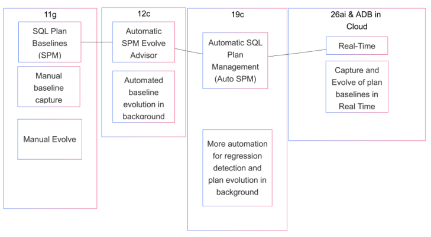

图 1：SPM 时间线。

第 2 节详细介绍 Oracle 19c 的 Auto SPM 及其局限，第 3 节介绍实时 SPM 方案，第 4 节给出实验及两者比较，第 5 节讨论相关工作，第 6 节总结。

## 2 Auto SPM

SPM 同时在前台和后台工作。如果某语句至少有一个计划基线被捕获到 SPM 仓库，则称该语句由 SPM 管理。前台为已受管理的语句捕获新计划基线；后台检测退化并发现需要纳入管理的新语句，为它们捕获和演进新基线。下面分别介绍各模块。

### 2.1 Auto SPM 的前台操作

前台 SPM 负责为受管理的语句捕获 CBO 产生的新计划。CBO 产生计划后，先快速检查一个内存位向量，判断当前语句是否由 SPM 管理。位向量根据 SQL 文本签名建立，受 SPM 管理或具有 SQL Management Objects（SMO）基线的语句会置位。若该位已置位，再将计划基线加载到缓存，检查语句是否确实存在基线。若语句未受 SPM 管理，就执行 CBO 计划，并保持不受 SPM 管理的状态。

通过位向量检查后，将当前 SQL 文本签名所关联全部计划的基本信息——计划哈希值和计划基线状态——载入缓存。若 CBO 计划匹配某个已接受计划，就执行它。

若 CBO 计划是新计划，或是以前出现但未验证为更优的未接受计划，则为所有已接受计划加载更多信息，包括 outline 数据。Outline 包含编码既有计划关键选择的一组优化器 hint。系统应用这些保存的 hint 重新编译 SQL，尝试生成相同计划结构，并在用户环境中用当前绑定值计算代价，从而重现每个已接受基线。执行所有可重现的已接受计划中优化器代价最低的计划。若没有任何已接受计划可重现，则执行 CBO 计划，并以未接受状态捕获到 SPM。图 2 给出前台处理流程。

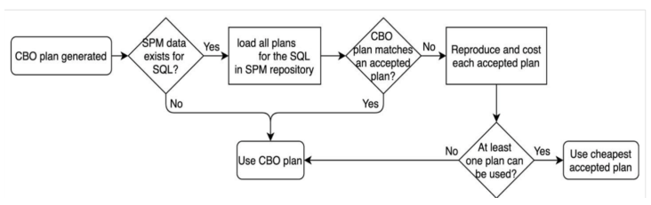

图 2：前台计划选择。

### 2.2 Auto SPM 的后台操作

后台 SPM 为当前未受管理的语句检测并修复退化，也验证、演进受管理语句的未接受计划。如图 3 所示，后台处理分为性能退化检测和计划基线演进两个子模块。

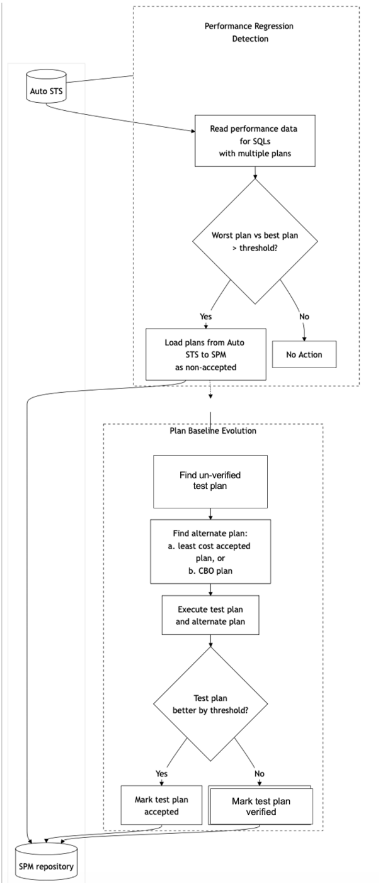

图 3：后台 SPM。

#### 2.2.1 性能退化检测

退化检测模块从 Auto STS 向 SPM 仓库加入潜在退化语句的备选计划。随后计划基线演进模块验证这些计划，按性能设置其已接受或未接受状态。只有仓库中尚不存在的计划才会被新捕获。

检测先读取 Auto STS 中历史上使用过多个计划的所有语句的性能数据，比较最差和最好计划的历史性能，即 CPU 时间与 Buffer Gets 的函数。如果最好计划明显更快，就将除最差计划之外的全部计划加入 SPM 仓库。如果最好和最差计划的历史性能差小于 Auto STS 内部阈值，说明这些计划历史表现接近，通过 SPM 改用某个计划不太可能带来显著收益。由于后台验证和演进会消耗宝贵的用户资源，过滤这种语句有助于有效分配资源。

#### 2.2.2 计划基线演进

如第 1 节所述，计划基线演进（evolve driver）自 11g 起就是 SPM 的组成部分。SPM 仓库中的计划有以下状态：

1. `ACCEPTED, VERIFIED`——优于其他某个计划，演进过程已接受它。
2. `NON-ACCEPTED, VERIFIED`——比其他某个计划更差或相似，演进过程未接受它。
3. `ACCEPTED, UNVERIFIED`——用户手工加入，因此已接受。
4. `NON-ACCEPTED, UNVERIFIED`——新捕获到 SPM 的 CBO 计划处于此状态。

演进驱动程序读取仓库中未接受且未验证的计划，以及已接受但上次验证距今超过内部天数阈值的计划。对于执行时间早于另一个内部保留期限的旧语句，它也避免捕获计划，因为期限过后可能没有 SQL 细节，而 SPM 尝试只识别当前或近期活动中的重要语句。它为每个未接受计划选择一个备选计划，测试执行两者并比较性能。备选计划是用未验证计划的设置与绑定值计算代价后，仓库中优化器代价最低的已接受计划。若没有可重现的已接受计划，则以 CBO 计划为备选计划，与未接受的测试计划一起执行。若未接受计划与 CBO 计划相同，则跳过验证。

测试执行完成后比较性能。如果未接受的测试计划好于备选计划，且超过内部规定幅度，则改为 `ACCEPTED, VERIFIED`；否则保持未接受，但标记为已验证。

### 2.3 Auto STS

Auto SPM 依赖 Auto STS 识别可重复执行的语句及其历史性能。SQL 调优集（STS）[8] 是一种通用的具名数据库对象，可保存一条或多条 SQL 及其计划、执行指标和执行上下文。每个 Oracle 数据库在创建时自动建立名为 Auto STS 的 STS，供包括自动 SPM 在内的多种自动调优功能使用。SQL 可从不同来源捕获到 STS；Auto STS 周期性地从共享游标缓存（缓存的执行计划）捕获用户负载。对于 STS 中已存在的语句，所有性能指标都会被共享游标缓存中的新值替换。超过保留期未执行的语句会被清除 [10]。

### 2.4 Auto SPM 的局限

尽管 SPM 已自动化，后台运行仍有以下不足，包括第 1 节提到的云环境问题以及与前台异步的性能验证：

- 可能无法重现计划及其实际性能。后台任务可能无法精确复制生成计划时的用户环境，因而难以验证。这可能源于没有捕获某些环境设置，或 outline 缺陷导致计划无法重现。虚拟专用数据库（VPD）谓词 [25] 进一步加重这一问题。VPD 是 Oracle 在编译时自动修改 SQL 以实施行级、列级安全性的功能，这些谓词可能在用户环境中生效，却未在后台任务环境中应用。
- 为减少资源消耗，它不会检查所有语句。
- Auto SPM 后台任务的 CPU、并行度、时间等资源受到严格限制，增加处理时间，延长退化发现和解决之间的窗口，使客户更晚获得新好计划的收益，或更晚避开退化计划。
- 无法验证长时间运行的语句。Auto SPM Evolve 任务只允许运行较短时间，例如 30 分钟，可能不足以验证长时间运行的测试和参考计划。后台任务资源受限会进一步提高无法在窗口内完成验证的概率。

## 3 实时 SPM

多数挑战来自后台验证。实时 SPM 将验证也放到前台，消除上述不足的来源。以下会频繁使用测试计划和参考计划两个术语。测试计划是 CBO 生成的、`NON-ACCEPTED, UNVERIFIED` 的计划。参考计划是从 SPM 仓库或 Auto STS 加载的另一个计划，用于性能比较。它可以是仓库中可重现、优化器代价最低的 `ACCEPTED, VERIFIED` 计划，或 Auto STS 中可重现、代价最低的计划。

我们增强了计划基线选择，能够识别新测试计划，执行一次并实时比较性能，还能选取相关的历史参考计划。计划基线演进也得到增强，并在用户会话中完成。测试计划执行结束时收集 CPU 时间、Buffer Gets 等指标，与参考计划的平均性能指标比较：

- 测试计划更好时，在 SPM 仓库中接受测试计划。
- 测试计划更差时，若参考计划尚未接受则接受它，后续避开测试计划。
- 性能相近时，不采取动作。

这样可以避开后台 Auto SPM 的局限，仅执行一次可能次优的测试计划，就能缓解性能退化。

全部实时执行也带来挑战。所有工作都在用户编译或执行语句时进行，前台查找和比较参考计划会有开销。参考计划的指标还是历史数据，需要有效处理历史性能无法代表其当前执行性能的情况。实时 SPM 最具创新性、也最具挑战的部分，是可靠地比较测试计划性能和参考计划历史性能。下面介绍解决方法及各方面细节。

### 3.1 前台计划选择与验证

实时 SPM 可以主动创建新基线，或通过执行测试计划而非仓库中的已接受计划来演进既有基线。它使用用户会话上下文主动、实时验证性能。当检测到 CBO 计划可作为测试计划，并从仓库或 Auto STS 选出参考计划时，就在用户会话中执行 CBO 计划进行前台验证。没有参考计划时，CBO 计划不能成为测试计划，按第 2.1 节的 Auto SPM 流程处理。

选择参考计划时，若没有可重现的已接受基线，就从 Auto STS 中按当前绑定值和优化器环境的代价选取最低者。旧后台 SPM（第 2.2 节）的测试计划是某个未验证计划，没有已接受计划时以 CBO 计划为参考；前台中测试计划本身就是 CBO 计划，所以需要最低代价 Auto STS 计划作为比较基准。

执行后，将收集的测试计划指标与保存的参考计划指标比较，接受性能较好的计划（若尚未接受）。已验证但未接受的测试计划会标记为需要反向验证；若后续编译 CBO 再次生成该计划，可按第 3.5 节反向验证。

实时 SPM 分为测试计划检测、参考计划检测、测试计划性能验证、反向验证四个模块。图 4 的虚线框分别表示各模块及其协作。第 3.6 节用示例说明该图。

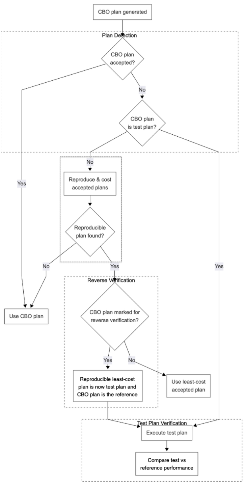

图 4：实时 SPM。

### 3.2 测试计划检测

优化器生成 CBO 计划后，实时 SPM 判断它是否应作为测试计划进行前台验证。只有同时满足以下条件才有资格：

1. 该计划尚未经过前台验证。
2. 至少存在一个不同的、可重现的历史计划作为参考。

第一项避免重复验证，第二项保证存在比较对象，使验证有意义。

检查第一项时，先判断语句是否已有基线。若没有，CBO 计划尚未验证；若有，从仓库载入缓存，并按图 2 检查其是否匹配既有已接受或已验证计划。

为了高效检查第二项，实时 SPM 使用从 Auto STS 派生的两个位向量。多数语句只有一个历史计划，若编译期间直接查询 Auto STS，开销会太大。第一个位向量标明语句在 Auto STS 中是否有多个计划。若已置位，就一定存在不同于当前 CBO 计划的计划，可进入测试候选。

若多计划位未置位，则该语句可能只有一个历史计划，也可能没有。此时检查第二个位向量，它记录当前 `(SQL ID, plan hash value [PHV])` 对是否存在于 Auto STS。若存在，CBO 计划就是唯一历史计划，没有不同的参考计划，跳过前台（FG）验证。否则，可能有不同计划，也可能语句刚进入 Auto STS，继续检测参考计划。

这样可避免常见单计划语句的不必要查询，同时发现能够进行前台验证的语句。图 5 给出检测方法。

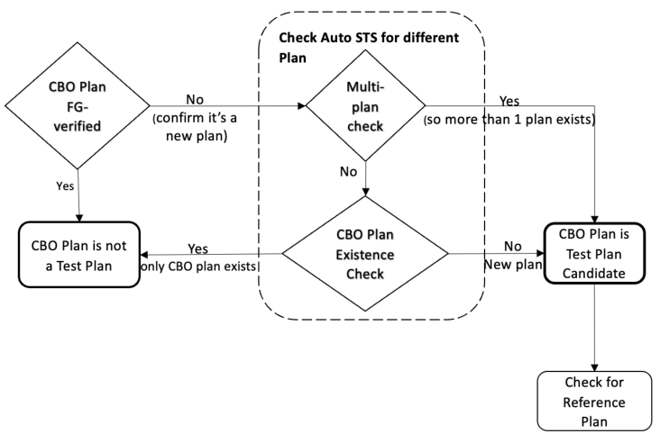

图 5：测试计划检测。

### 3.3 参考计划检测

确定测试候选后，前台验证识别比较用的参考计划。参考计划必须有执行指标且可以重现。

先在 SPM 仓库中查找可重现的已接受计划。若找到，从 Auto STS 取回相关优化器代价和执行统计，用于判断测试计划是否更好。对能找到指标的计划，CBO 重新编译、计算代价，选择代价最低者。

模式元数据或用户会话上下文变化，例如删除索引或引入新 VPD 谓词 [25]，可能使已接受计划无法重现。若仓库没有可重现且具有性能指标的已接受计划，就查找 Auto STS。除测试计划外，对所有未接受的 Auto STS 计划重新编译、计算代价，选出最低者。若它们也都不能重现，没有找到参考计划，便跳过验证。图 6 显示先查仓库、再查 Auto STS 的过程。

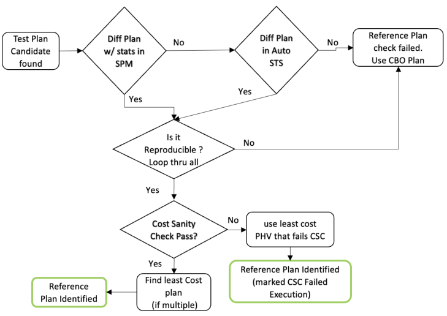

图 6：参考计划检测。

另一项挑战是同一计划的历史性能可能无法代表当前性能。为此我们引入代价合理性检查（cost-sanity check）。参考计划在当前绑定值和编译环境下重新计算的代价，应接近历史代价。绑定敏感选择见第 3.6.1 节。

合理性检查嵌入最低代价计划计算中。当前计划作为有效参考应符合以下检查：

1. 当前环境中的代价没有大幅上升或下降，例如某些表行数变化。新旧代价的比值或其倒数应低于内部阈值。
2. 新旧代价之差小于内部阈值。对于小代价计划，比值可能很高，但只要绝对差不大，仍可考虑为参考。阈值固定，源于第 2.2、3.4.2 节相同的内部改善幅度。

即使最佳可用参考计划未通过检查，也不能假定测试计划当前更好。若没有参考通过检查，仍用最低代价计划作为参考。在后续性能验证中，即使测试计划表现更好，也不会接受它，因为不完全信任参考的历史指标对当前环境的代表性。我们对接受全新计划更加保守。但若历史参考计划更好，就会接受它，并在后续执行中进行第 3.5 节的反向验证。

### 3.4 测试计划性能验证

本模块执行测试计划，与参考计划的历史平均指标比较，并接受胜者，以维持性能收益或避免后续退化。它分为测试计划执行和计划性能比较两部分。

#### 3.4.1 测试计划执行

选定参考计划后，CBO 执行测试计划。产品中实时 SPM 不为测试计划执行设置运行时截止时间，因为这可能造成用户可见的失败。设计目标是将坏计划的影响限制为最多一次前台执行，并不限制该次执行的最坏持续时间。收集测试计划指标后，比较子模块将其与参考计划历史平均指标对比。

#### 3.4.2 计划性能比较

可能出现以下情况：

- **测试计划更好。** 若好于参考历史平均值且超过内部幅度，则只要测试执行未中断，或第 3.3 节参考代价合理性检查未失败，将其改为 `ACCEPTED, VERIFIED`。若因资源管理器超时或客户中断而未完整执行，就不知道完整指标，因此不能接受。
- **两者性能相近。** 将测试计划标记为已验证。
- **测试计划更差。** 若比参考历史平均值差且超过内部幅度，则在必要时接受参考计划，并将测试计划标为已验证。即使测试中断，也可这样处理，因为部分执行的指标已经更差。若参考被接受，按第 3.5 节将测试计划标为需要反向验证。SPM 不会因一次退化就永久拒绝计划或将其列入黑名单，因为其他执行上下文中它仍可能有益。在常规或反向验证证明更优之前，系统会避开未接受的测试计划。

译注：本节首条原文条件使用 “NOT interrupted or … NOT failed”，而紧接的解释与第 3.3 节分别要求执行完整、参考代价检查通过。此处保留原文的“或”，并指出它与相邻解释之间的逻辑差异。

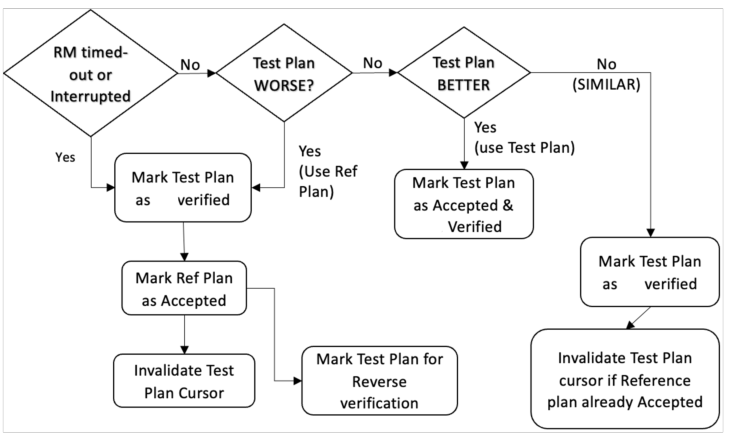

图 7：测试计划验证。

实时验证避免反复执行坏测试计划；传统 Auto SPM 必须等后台性能验证完成前，可能重复执行坏计划。

如果性能与参考相近或更差，还会使测试计划的游标失效。Oracle 将优化器决策和执行计划存储在游标结构中 [10]，并在共享内存的游标缓存中缓存，使重复执行能复用编译结果。参考计划相似或更好时，使测试游标失效；否则下次可复用。即使性能相近，实时 SPM 也保守地偏好先前已接受的计划，只有明显改善才采用新计划。游标失效迫使下一次重新选计划，从而可退回可重现的已接受计划。

### 3.5 反向验证

实时 SPM 结合代价合理性检查和反向验证，可靠比较测试与参考。只有测试性能更差且参考已接受时，才把测试标记为需要反向验证。代价检查失败情形中被标记的测试计划，也会在后续执行中进行反向验证。第 3.6 节解释其直觉。

若参考历史平均性能优于测试，且参考原为未接受计划，就接受参考。测试计划标记为前台已验证并需要反向验证。以后编译时，如果 CBO 产生该已验证、未接受的旧测试计划，就选已接受计划执行。将已接受的旧参考作为新测试计划，将 CBO 计划作为参考。这一验证已接受计划的过程称为反向验证。如果先前测试计划当前优于旧参考，它就又有一次被接受的机会。

初次验证中，未接受且未验证的测试计划可能慢于参考历史平均值，或发生执行超时。但在测试计划的绑定值和环境中，参考实际可能更差。反向验证在后续编译或执行中解决此问题，为仓库中的旧测试计划设置合适状态。初次验证漏掉好计划时，反向验证模块会识别这种情况。若先前“更差”的测试计划现在更好，就接受它。此后，优化器从已接受计划中选择代价最低者。

### 3.6 示例场景

下面用绑定敏感计划选择、升级后真实退化两个常见场景说明实时 SPM。

#### 3.6.1 绑定敏感计划选择

某语句有一个先前出现、未接受的 P1，适合高选择性的绑定值。后来用低选择性绑定值编译，优化器产生 P2。实时 SPM 执行 P2 为测试，用 P1 作参考。若 P1 的历史指标仍显得更好，接受 P1，将 P2 标为需要反向验证，避免永久拒绝。若以后低选择性绑定再次生成 P2，反向验证在当前绑定值下执行 P1，以 P2 为参考。若此时 P2 更好，也接受它。此后，可按当前绑定值和环境在 P1、P2 之间选择。若另一绑定又产生 P3，则通过代价合理性检查和最低代价选择找出最相关的参考，重复常规流程。

#### 3.6.2 升级后的退化预防

某语句升级前用 P1，升级后优化器生成 P2。实时 SPM 执行 P2 并以 P1 为参考。若 P1 未通过代价检查、P2 又显得优于 P1 的历史指标，仍不立即接受 P2；比较不确定时保守偏好旧计划，将 P2 标为需要反向验证。下次若 CBO 再生成 P2，就反向验证，在当前环境执行 P1，以 P2 为参考。若此时 P2 更差，则接受尚未接受的 P1，P2 保持未接受。后续回到 P1，避免反复执行升级后退化的 P2。

译注：本例称 P2 在参考代价检查失败、且测试指标更好的情况下被标记为需要反向验证；第 3.5 节则说仅在测试更差、参考已接受时标记。原文两处条件不一致，此处保留各自表述。

## 4 实验结果

我们在自治数据库（ADB）云数据库群和客户 OLTP 负载上评估实时 SPM，并在客户数据仓库负载中测量其相对 Auto SPM 的改善。下面介绍实验及结果。

### 4.1 ADB 上的实时 SPM

实时 SQL 计划管理将计划哈希值、Buffer Gets 等诊断和性能数据直接记录到数据字典。我们分析了五天内 Oracle 自治数据库中 20,015 个生产及测试数据库的数据，涵盖多种负载。这期间未安装数据库补丁，因此观察到的退化可能来自 DML、访问路径变化及其他环境因素。

#### 4.1.1 总体结果

我们观察到 463,395 条不同 SQL 的 959,911 次验证事件。同一 SQL 多次验证有两个原因：某些语句经历多次计划变化；某些语句的计划在反向验证时重新验证。

验证分为“常规”和“反向”。计划变化后首次与实时 SPM 交互发生的是常规验证；后续反向验证会在诊断数据中标为 reverse。

921,820 次常规验证中，731,232 次确认新计划相近或更好。190,588 次潜在退化中，36,017 次后来 CBO 再次生成相同计划，进入反向验证，其中 1,380 次接受旧测试计划，推翻原先决定。因此，我们可以说总计防止了 190,588 − 1,380 = 189,208 条 SQL 的退化。表 1 给出分类结果。

表 1：结果汇总。

| 数据项 | 值 |
| --- | ---: |
| 不同 SQL 语句数 | 463,395 |
| 常规验证：性能相近 | 426,912 |
| 常规验证：性能更好 | 304,320 |
| 常规验证：性能更差 | 190,588 |
| 常规验证总数 | 921,820 |
| 反向验证数 | 36,017 |
| 反向验证改变决定 | 1,380 |
| 防止的 SQL 性能退化 | 189,208 |
| 验证总数（常规及反向） | 959,911 |

译注：原文表 1 的常规、反向验证相加为 957,837，与原文给出的总数 959,911 不一致；本译文保留原值。正文把验证事件数量表述为防止退化的 SQL 条数，也依原文保留，不能据此推断这些事件都对应不同语句。

为衡量避免退化的幅度，我们将每次验证的“退化因子”定义为测试计划 Buffer Gets 与参考计划 Buffer Gets 的比值。Buffer Gets 是实时 SPM 衡量 SQL 性能的主要指标之一，但它也跟踪 CPU，识别虽然 Buffer Gets 减少、CPU 却大幅升高的退化。

图 8 展示标记为“更差”的测试计划的退化因子分布。峰值位于 3，说明多数测试计划的 Buffer Gets 相较参考增加二至三倍。直方图中有 1,153 个“更差”测试计划的 Buffer Gets 反而更少，对应图中的“1”，即因子低于一。这说明评估同时考虑 CPU。某些语句的 Buffer Gets 退化超过 20 倍，最大超过 670 万倍。表 2 的极大值和大标准差说明退化幅度变化很大，若无实时 SPM，一些 SQL 将严重退化。这也体现在均值相较中位数很大，而中位数接近图 8 峰值。

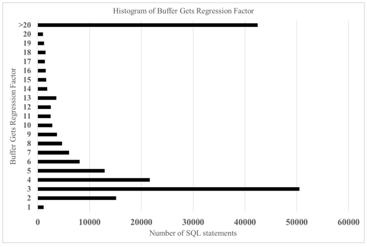

图 8：实时 SPM 的 Buffer Gets 直方图。

表 2：退化因子汇总。

| 统计量 | 值 |
| --- | ---: |
| 均值 | 1,800.34 |
| 中位数 | 3.84 |
| 标准差 | 38,263.02 |
| 最大值 | 6,718,453 |

### 4.2 实时 SPM 与 Auto SPM

我们设计实验测量两者的效果，展示实时 SPM 的进步。测试使用一个客户数据仓库负载，含 25 张表，其中 4 张分区表、2,117 条语句，没有索引和 DML。Auto SPM 运行负载三次，实时 SPM 运行四次，各轮之间执行指定动作。平台为 Oracle Database 26ai release 23.26，Oracle Enterprise Linux，AMD EPYC 处理器，60 个 CPU。性能指标使用 Buffer Gets 和 CPU 时间（分钟）。同一计划多次执行的耗时、延迟等指标波动很大；CPU 时间综合了解析、执行及其他性能因素，与 Buffer Gets 结合是最稳定的指标。

表 3 列出各轮及之前的动作。第一个实验为 Auto SPM，第二个为实时 SPM。OFE 指 Optimizer Features Enable，让数据库表现为指定版本 X 的优化器。

两个实验均从 OFE 18.1 开始，第二轮改为 OFE 23.1，以受控方式模拟软件升级带来的计划变化，其中有些可能退化。Auto SPM 在后台任务创建并接受基线后运行第三轮；实时 SPM 第三轮继续开启，以反向验证（RV）第二轮已验证但未接受的计划，第四轮测量常规及反向验证生效后的性能。

表 3：负载运行轮次。

| 先行动作 | 轮次 | 实验 | SPM 设置 |
| --- | --- | --- | --- |
| OFE 18.1 | 1 | Auto SPM | SPM 关闭 |
| OFE 23.1 | 2 | Auto SPM | Auto 开启，实时关闭 |
| OFE 23.1 | — | Auto SPM | 后台 SPM 任务开启 |
| OFE 23.1 | 3 | Auto SPM | 无 SPM 活动 |
| OFE 18.1 | 1 | 实时 SPM | SPM 关闭 |
| OFE 23.1 | 2 | 实时 SPM | 实时开启，Auto 关闭 |
| OFE 23.1 | 3（RV） | 实时 SPM | 实时开启，Auto 关闭 |
| OFE 23.1 | 4 | 实时 SPM | 无 SPM 活动 |

两个实验均将 2,117 条语句分为五批并发执行。表 4 展示任务持续时间和各轮接受的基线数。

表 4：SPM 任务细节。

| 任务 | 时长（小时） | 计划基线数 |
| --- | ---: | ---: |
| Auto SPM 第 2 轮 | 2.35 | 不适用 |
| Auto SPM 后台任务 | 8 | 63 |
| 实时 SPM 第 2 轮 | 2.28 | 153 |
| 实时 SPM 第 3 轮（RV） | 2.1 | 64 |

在该配置下，Auto SPM 后台任务用八小时接受 63 个基线；实时 SPM 第二轮接受 153 个，第三轮再接受 64 个，约四小时二十分钟合计 217 个。这说明实时 SPM 处理了更多语句，速度也明显更快，缓解了第 2.4 节的后台资源限制。

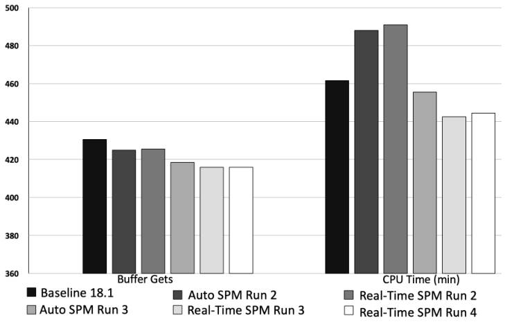

图 9：负载性能比较。

图 9 汇总两个实验开启和关闭 SPM 的归一化性能，即基线与 Auto SPM 第三轮、实时 SPM 第三及第四轮的对比。Auto SPM 将 CPU 时间从 462 分钟降至 455 分钟；实时 SPM 更明显，降至约 443 分钟。实时第三、第四轮的 Buffer Gets 也较基线减少。第三、第四轮相近，说明第三轮反向验证捕获的基线没有显著影响性能。第二轮执行所有前台验证，CPU 时间如预期从 462 增至约 490 分钟。两种方案第二轮执行时间增加，均因为新测试计划有些劣于基线计划。

我们也试图量化编译开销。第二至第四轮编译 CPU 和 Buffer Gets 都比第一轮低，但它们同时发生了 OFE 升级，含优化器及编译期改进，因此跨 OFE 比较会混入无关优化。

为隔离实时 SPM 的增量开销，我们比较两种方案的第二轮，它们均使用 OFE 23.1。由于 Auto SPM 在后台运行，其第二轮实质上是无前台 SPM 的 OFE 23.1 基线，适合衡量实时 SPM 的额外开销。图 10 为归一化观察结果。

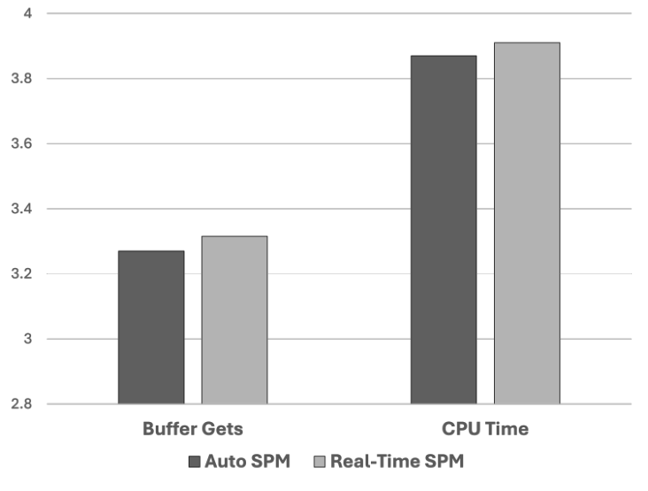

图 10：实时 SPM 编译开销。

实时 SPM 的编译 Buffer Gets 约增加 2 KB，约为 110 KB，对比 Auto SPM 的 108 KB。相较图 9 归一化前超过 1200 MB 的全负载执行 Buffer Gets，这一增加可忽略，但符合加载历史基线、必要时更新仓库计划状态等额外编译工作。编译 CPU 从 3.87 分钟略增至 3.91 分钟，相较超过 400 分钟的总执行时间也不显著。查找参考并计算代价需要工作，因此这种开销符合预期。高效位向量逻辑让编译开销保持很小。

### 4.3 自动索引下的实时 SPM

我们为同一客户数据仓库负载引入索引，进一步评估实时 SPM。先让自动索引 [10] 创建 204 个新索引，然后开启实时 SPM，验证使用索引的计划。在与第 4.2 节相同的平台上，测量开启和关闭实时 SPM 的性能。图 11 给出 CPU 时间（分钟）和归一化 Buffer Gets。

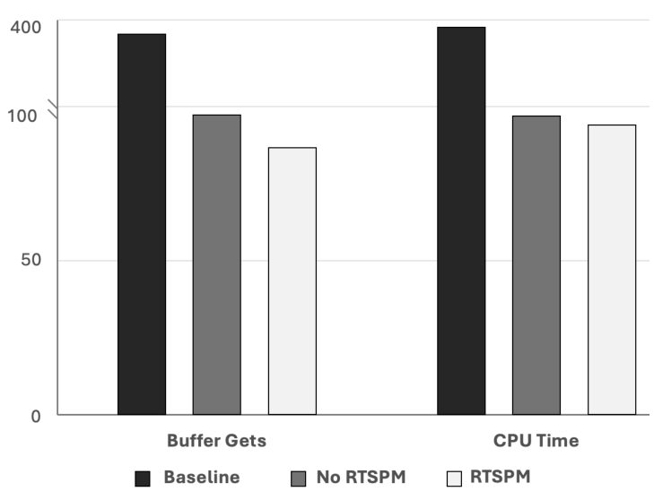

图 11：带索引的实时 SPM。

基线是自动索引创建索引之前、无任何 SPM 活动的相同负载。无论是否开启实时 SPM，索引运行相较基线均有四倍改善，说明新索引显著提高整体性能。同时某些单独语句仍退化，未在图中展示；最大观察退化约为 Buffer Gets 的 100 倍、CPU 时间的 3 倍。相较关闭实时 SPM，开启后全负载 Buffer Gets 约减少 11%，CPU 约减少 3%。它缓解了索引引发的计划退化，同时保留新访问路径的收益。

### 4.4 OLTP 中的实时 SPM

我们还在 39,000 条查询的 OLTP 负载上验证。此次将较高 OFE 降至较低 OFE，使退化更可能发生。表 5 给出配置。

表 5：OLTP 负载轮次。

| 先行动作 | 轮次 | SPM 设置 |
| --- | ---: | --- |
| OFE 22.1 | 1 | 无 SPM |
| OFE 18.1 | 2 | 实时开启 |
| OFE 18.1 | 3 | 实时开启（反向验证） |
| OFE 18.1 | 4 | 无 SPM |

表 6 汇总结果。分别分析总体及编译阶段的 Buffer Gets（MB）和 CPU 时间（分钟），衡量实时 SPM 可辨识的开销。

表 6：OLTP 负载性能。

| 轮次 | BG（总体） | BG（编译） | CPU（总体） | CPU（编译） |
| --- | ---: | ---: | ---: | ---: |
| 1 | 280 | 2.68 | 170.37 | 35.50 |
| 2 | 307 | 2.64 | 206.83 | 31.28 |
| 3 | 276 | 2.60 | 171.72 | 29.08 |
| 4 | 274 | 2.60 | 167.95 | 28.98 |

第二轮因 OFE 降级、计划退化，总体 BG 和 CPU 按预期上升。实时 SPM 开启时编译指标反而下降，我们将其归因于 OFE 变化的混杂效应，即依赖 OFE 的编译行为改进，而非实时 SPM 降低编译成本。第三、第四轮展示其实效：BG 与 CPU 恢复第一轮基线，并有小幅额外改善。总体说明实时 SPM 可结合历史基线和新计划，保持稳定同时允许演进，以很小编译开销在后续执行中持续获益。

## 5 相关工作

计划变化引发的查询性能退化，是 OLTP、分析及混合负载反复遇到的运维痛点。本节将实时 SPM 与主要云及企业数据库的生产机制和研究方案比较。

多种生产系统具有计划稳定功能，但范围和保证差异很大。AWS Aurora PostgreSQL [27] 提供计划 hint 和有限的计划固定，捕获并强制好计划，但主要靠人工，缺少自动运行时退化检测和回退。Google Cloud Spanner [11] 允许固定计划和优化器版本，在升级间冻结行为，但粒度粗、偏被动，不能在运行时适应负载和数据演进，限制从新访问路径获益的空间。Microsoft SQL Server Query Store [19] 将智能计划强制与自动计划修正结合。强制计划变差时可撤销强制，让优化器在计划未达到质量阈值时选择更优者，但只检测强制计划的退化，更依赖人工或离线分析。IBM Db2 [16] 可在目录中持久化动态 SQL 的准备态运行时结构，后续重新加载以保持原访问路径，无需完全重新准备、冒险选择新路径。它侧重保持上次准备路径，不维护多个已接受计划的目录，也没有实时 SPM 这种经过验证的退化保证，仍需人工识别和稳定计划。PingCAP TiDB 的 SQL binding [15] 可将查询绑定到特定计划或 hint，提供确定控制，但需人工指定并持续维护。

相比之下，Oracle 实时 SPM 将自动检测退化、历史基线、运行时确定性验证与选择结合，保守管理整个负载，无需用户干预或事先固定计划，同时允许改善。

近期稳定性研究尝试防范基数估计错误。ROME [30] 通过运行时多计划执行处理退化，修改优化器特性生成少量备选计划，并发执行，在第一个完成时终止。其考虑代价的概率模型限制计划搜索空间、降低预期成本，为严重误优化提供统计保证。但它不跨执行保留知识，每次重新生成候选，之后丢弃，保证也具有概率性质。Oracle 实时 SPM 则累积历史执行证据，让性能随时间稳定，确保不劣于经验证基线。ROME 可以在查询首次执行时找到好计划，防范极端基数错误；SPM 的目标更普遍。因此两者最好视为正交方法。

其他方案包括参数化查询优化（PQO）[22, 23, 32] 和 Databricks 等系统的自适应查询执行（AQE）[28, 33]，第 1 节也已提及。PQO 解决同一 SQL 模板在不同参数下重复优化的问题。Oracle 通过自适应游标共享，自动判断既有计划是否可能适合新绑定值 [20]。早期学习式 PQO 将参数空间分区，为每区关联固定缓存计划集，限制了分布变化或需新计划时的适应性。近期方法 [23] 将执行代价建模为参数和候选计划的函数，即使缓存动态增长仍能比较，支持变化负载下细粒度逐次选择，并保留回到基础优化器的安全路径。它对低维参数有效，多数成本在编译期，运行期开销很少或没有；但谓词和绑定增多时会参数爆炸，区域与候选计划指数增长。

AQE 则根据执行中收集的统计重新优化，修正运行时错误 [24]。它执行一部分查询，收集真实统计，重优化剩余阶段，再按新计划继续。反馈可用于调整连接策略、重排算子或在倾斜及估计不准时重新平衡，提高单次查询的鲁棒性。

PQO、AQE 与实时 SPM 位于不同层次。PQO 面向绑定敏感语句细粒度适应，AQE 面向查询内部执行修正；实时 SPM 在整个负载层面检测退化、恢复验证过的计划，保守管理计划。PQO、AQE 还会迭代寻找新计划。Oracle 也有自适应统计处理基数问题 [9]，以及查询内的自适应处理 [4, 13]、查询后的统计反馈 [5, 20]。新计划找到后，实时 SPM 在多次执行之间判断历史质量，防止持续计划变化带来的退化。它们互补，前者提高单查询适应性和韧性，实时 SPM 在负载、分布和系统演进中保持稳定。

Microsoft Research 的 Plan Stitch [14] 同样利用历史执行实现稳定、低风险改善。它把多次历史执行中的高效子计划重新组合，利用算子级统计，超出保留、恢复历史整计划的方式。它构建等价子计划组的 AND-OR 图，用动态规划在历史算子组成的空间里选取最小代价组合。新计划可能从未执行，但全部由历史算子组成，在安全和优化机会间取舍。其代价来自历史算子成本的组合，对数据变化后的反馈陈旧较敏感。实时 SPM 则在当前环境以前台实测验证后接纳新计划，大体不依赖可能对特定查询失准、并正是退化原因的代价模型。两者互补，实时 SPM 提供生产中安全接纳变化的框架，Plan Stitch 扩大可安全考虑的候选空间。

机器学习也被用来引导优化器。近期学习式优化器（LQO）更强调通过约束搜索空间来增强传统优化器 [1, 2, 29, 34]。方法从改善计划发现与选择 [2]，到学习子计划 hint、引导更有希望的区域 [29]。单看执行时间，它们可能超过传统优化器，但近期评估显示推断开销大、端到端不稳定 [1]。LQO 还容易受冷启动影响，训练或历史不足会令早期决策不可靠，也缺少逐查询或全负载防退化的形式化机制。这些局限说明轻量、生产级实时 SPM 机制的重要性。

## 6 结论

SQL 执行计划显著影响数据库总体性能。统计刷新、数据演进、优化器变化等都会带来新计划，多数有益或无害，少数则严重退化、威胁系统稳定。Oracle 实时 SPM 在优化器和执行闭环中，于语句执行时检测计划变化导致的退化。证据充分说明历史计划更好时，通过 SQL 基线恢复它；新计划明确更优时，验证并保留。通过基线决定计划可接受性，并在运行时可靠防止退化，实时 SPM 处理了生产环境长期稳定和可预测性这一关键维度，自适应或生成式学习优化尚未充分解决它。

本文详述其新架构，对比前台和后台验证。实验说明前台验证在查询初次执行时立即检测和解决退化，为云原生和本地环境更快、更可靠地保证性能。

## 致谢

感谢 Çetin Özbütün 为实时 SPM 的新想法和算法设计作出贡献。感谢 Oracle 优化器团队现任及前任成员 Zhan Li、Palash Sharma、Iris Zhang，以及 Auto Task 和 SQL Tuning Set 团队，在产品生命周期各方面的贡献。也感谢 Oracle 系统测试团队执行实验，帮助测量实时 SPM 的效果及鲁棒性。

## 参考文献

[1] Remmelt Ammerlaan, Gilbert Antonius, Marc Friedman, H MSajjad Hossain, Alekh Jindal, Peter Orenberg, Hiren Patel, Shi Qiao, Vijay Ramani, Lucas Rosenblatt, Abhishek Roy, Irene Shaffer, Soundarajan Srinivasan, and Markus Weimer. 2021. PerfGuard: Deploying ML-for-Systems without Performance Regressions, Almost!. In PVLDB, 14(13). 3362 – 3375. https://doi.org/doi:10.14778/3484224.3484233

[2] Christoph Anneser, Nesime Tatbul, David Cohen, Zhenggang Xu, Prithviraj Pandian, Nikolay Laptev, and Ryan Marcus. 2023. AutoSteer: Learned Query Optimization for Any SQL Database. In PVLDB, 16(12). 3515 – 3527. https://doi.org/10.14778/3611540.3611544

[3] Nigel Bayliss. 2019. SQL Plan Management in Oracle Database 19c. Oracle Corporation. Retrieved January 2, 2026 from https://www.oracle.com/technetwork/database/bi-datawarehousing/twp-sql-plan-mgmt-19c-5324207.pdf

[4] Nigel Bayliss. 2023. Optimizer Adaptive Features in Oracle Database 12c Release 2. Oracle Optimizer. Retrieved February 23, 2026 from https://blogs.oracle.com/optimizer/optimizer-adaptive-features-in-oracle-database-12c-release-2

[5] Nigel Bayliss. 2023. Statistics Feedback (Formerly Cardinality Feedback). Oracle Optimizer. Retrieved February 23, 2026 from https://blogs.oracle.com/optimizer/statistics-feedback-formerly-cardinality-feedback

[6] Nigel Bayliss. 2025. How to Use High-frequency Statistics Gathering. Oracle Optimizer. Retrieved March 1, 2026 from https://blogs.oracle.com/optimizer/how-to-use-highfrequency-statistics-gathering

[7] Nigel Bayliss. 2025. SQL Plan Management. Oracle Optimizer. Retrieved February 18, 2026 from https://blogs.oracle.com/optimizer/category/opt-sql-plan-management

[8] Nigel Bayliss. 2025. What is the automatic SQL tuning set? Oracle Optimizer Blogs. Retrieved January 2, 2026 from https://blogs.oracle.com/optimizer/what-is-the-automatic-sql-tuning-set

[9] Sunil Chakkappen, Suratna Budalakoti, Ramarajan Krishnamachari, Satya Valluri, Alan Wood, and Mohamed Zait. 2017. Adaptive Statistics in Oracle 12c. In Proc. VLDB Endow (10, 12, 1813-1824). https://doi.org/pvldb/vol10/p1813-zait.pdf

[10] Sunil Chakkappen, Shreya Kunjibettu, Daniel McGreer, Masoomeh Javidi Kishi, Hong Su, Mohamed Ziauddin, Mohamed Zait, Zhan Li, and Yuying Zhang. 2025. Automatic Indexing in Oracle. In PVLDB (18(12):4924-4937). https://doi.org/10.14778/3750601.3750616

[11] Google Cloud. 2026. Query execution plans. Google. Retrieved January 31, 2026 from https://docs.cloud.google.com/spanner/docs/query-execution-plans

[12] Maria Colgan. 2010. SQL Plan Management in Oracle Database 11g. Oracle Corporation. Retrieved February 18, 2026 from https://www.oracle.com/technetwork/database/bi-datawarehousing/twp-sql-plan-management-11gr2-133099.pdf

[13] Oracle Database. 2026. About Adaptive Query Optimization. Oracle. Retrieved February 23, 2026 from https://docs.oracle.com/en/database/oracle/oracle-database/26/tgsql/query-optimizer-concepts.html#GUID-06129ACE-36B2-4534-AE68-EDFCAEBB3B5D

[14] Bailu Ding, Sudipto Das, Wentao Wu, Surajit Chaudhuri, and Vivek Narasayya. 2018. Plan Stitch: Harnessing the Best of Many Plans. In PVLDB, 11(10). 1123 – 1136. https://doi.org/10.14778/3231751.3231761

[15] TiDB Docs. 2026. SQL Plan Management (SPM). PingCAP. Retrieved February 5, 2026 from https://docs.pingcap.com/tidb/stable/sql-plan-management/

[16] IBM Documentation. 2026. Dynamic SQL plan stability. IBM. Retrieved January 31, 2026 from https://www.ibm.com/docs/en/db2-for-zos/13.0.0?topic=change-dynamic-sql-plan-stability7

[17] Tim Hall. 2015. Adaptive SQL Plan Management (SPM) in Oracle Database 12c Release 1 (12.1). Oracle-Base. Retrieved Jannuary 2, 2026 from https://oracle-base.com/articles/12c/adaptive-sql-plan-management-12cr1

[18] David Justen, Daniel Ritter, Campbell Fraser, Andrew Lamb, Nga Tran, Allison Lee, Thomas Bodner, Mhd Yamen Haddad, Steffen Zeuch, Volker Markl, and Matthias Boehm. 2024. POLAR: Adaptive and Non-invasive Join Order Selection via Plans of Least Resistance. In PVLDB (17). https://doi.org/doi:10.14778/3648160.3648175

[19] Microsoft Learn. 2025. Monitor performance by using the Query Store. Microsoft. Retrieved January 31, 2026 from https://learn.microsoft.com/en-us/sql/relational-databases/performance/monitoring-performance-by-using-the-query-store?view=sql-server-ver17

[20] Allison W. Lee and Mohamed Zait. 2008. Closing The Query Procesing Loop in Oracle 11g. In Proc. VLDB Endow (1368-1378). https://doi.org/pvldb/vol1/1454178.pdf

[21] Viktor Leis, Andrey Gubichev, Atanas Mirchev, Peter A. Boncz, Alfons Kemper, and Thomas Neumann. 2015. How Good Are Query Optimizers, Really?. In Proc. VLDB Endow (9, 3, 204-215). https://doi.org/10.14778/2850583.2850594

[22] Sijia Li, Peng Cai, Yiqi Shen, Rong Zhang Huiqi Hu, Xuan Zhou, Xuquan Qing, and Ri Zhao. 2024. SPQO: Learning to Safely Reuse Cached Plans for Dynamic Workloads. In Onizuka, M., et al. Database Systems for Advanced Applications (29:315-330). https://doi.org/10.1007/978-981-97-5552-3_21

[23] Sijia Li, Peng Cai, Zhifan Zhang, Huiqi Hu, Rong Zhang, Xuan Zhou, Quanqing Xu, and Chuanhui Yang. 2025. APQO: An Adaptive Framework for Parametric Query Optimization. In SIGMOD (Proc. ACM Manag. Data, Vol. 3, No. 6). https://doi.org/10.1145/3769761

[24] Databricks on AWS. 2023. Adaptive query execution. Databricks. Retrieved February 5, 2026 from https://docs.databricks.com/aws/en/optimizations/aqe

[25] Oracle. 2019. Using Oracle Virtual Private Database to Control Data Access. Oracle database. Retrieved January 30, 2026 from https://docs.oracle.com/en/database/oracle/oracle-database/19/dbseg/using-oracle-vpd-to-control-data-access.html#GUID-06022729-9210-4895-BF04-6177713C65A7

[26] Oracle. 2025. SQL Tuning Guide. Oracle database. Retrieved January 5, 2026 from https://docs.oracle.com/en/database/oracle/oracle-database/19/tgsql/sql-tuning-advisor.html#GUID-8E1A39CB-A491-4254-8B31-9B1DF7B52AA1

[27] Aurora PostgreSQL. 2026. Overview of Aurora PostgreSQL query plan management. AWS. Retrieved January 31, 2026 from https://docs.aws.amazon.com/AmazonRDS/latest/AuroraUserGuide/AuroraPostgreSQL.Optimize.overview.html

[28] Haoze Song, Wenchao Zhou, Feifei Li, Xiang Peng, and Heming Cui. 2023. Rethink Query Optimization in HTAP Databases. In Proc. ACM Manag. Data 1, 4 (SIGMOD) (Article 256). https://doi.org/10.1145/3626750

[29] Pavel Sulimov, Claude Lehmann, and Kurt Stockinger. 2026. GenJoin: Conditional Generative Plan-to-Plan Query Optimizer that Learns from Subplan Hints. In International Conference on Management of Data (SIGMOD).

[30] Ziyun Wei and Immanuel Trummer. 2024. ROME: Robust Query Optimization via Parallel Multi-Plan Execution. In Proc. ACM Manag. Data (2, 3 (SIGMOD), Article 170). https://doi.org/10.1145/3654973

[31] Haibo Xiu, Yang Li, Qianyu Yang, Pankaj K. Agarwal, and Jun Yang. 2023. Cackle: Analytical Workload Cost and Performance Stability With Elastic Pools. In Proceedings of the ACM on Management of Data, Volume 1, Issue 4 (Article No.: 233). https://doi.org/10.1145/3626720

[32] Haibo Xiu, Yang Li, Qianyu Yang, Pankaj K. Agarwal, and Jun Yang. 2025. PAR2QO: Parametric Penalty-Aware Robust Query Optimization. In PVLDB, 18. 11. https://doi.org/doi:10.14778/3749646.3749711

[33] Maryann Xue, Yingyi Bu, Abhishek Somani, Wenchen Fan, Ziqi Liu, Steven Chen, Herman van Hovell, Bart Samwel, Mostafa Mokhtar, RK Korlapati, Andy Lam, Yunxiao Ma, Vuk Ercegovac, Jiexing Li, Alexander Behm, Yuanjian Li, Xiao Li, Sriram Krishnamurthy, Amit Shukla, Michalis Petropoulos, Sameer Paranjpye, Reynold Xin, and Matei Zaharia. 2024. Adaptive and Robust Query Execution for Lakehouses at Scale. In PVLDB, 17. 12. https://doi.org/doi:10.14778/3685800.3685818

[34] Rong Zhu, Lianggui Weng, Wenqing Wei, Di Wu, Jiazhen Peng, Yifan Wang, Bolin Ding, Defu Lian, Bolong Zheng, and Jingren Zhou. 2024. PilotScope: Steering Databases with Machine Learning Drivers. In PVLDB, 17(5). 980 – 993. https://doi.org/doi:10.14778/3641204.3641209

[35] Mohamed Ziauddin, Dinesh Das, Hong Su, Yali Zhu, and Khaled Yagoub. 2007. Optimizer Plan Change Management: Improved Stability and Performance in Oracle 11g. Commun. ACM 50, 1 (Jan. 2007), 36–44. https://doi.org/10.1145/1188913.1188915
