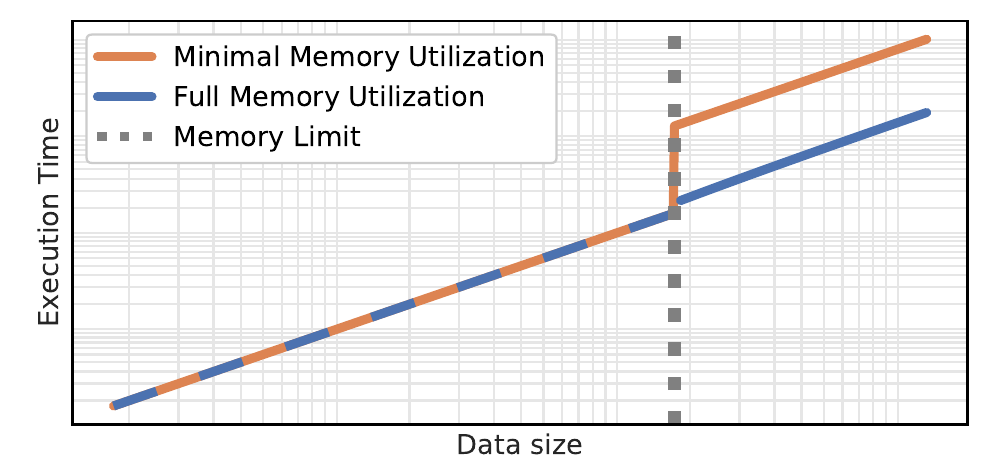
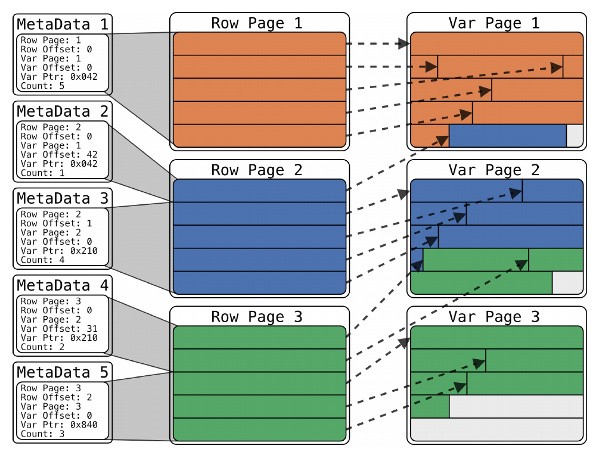
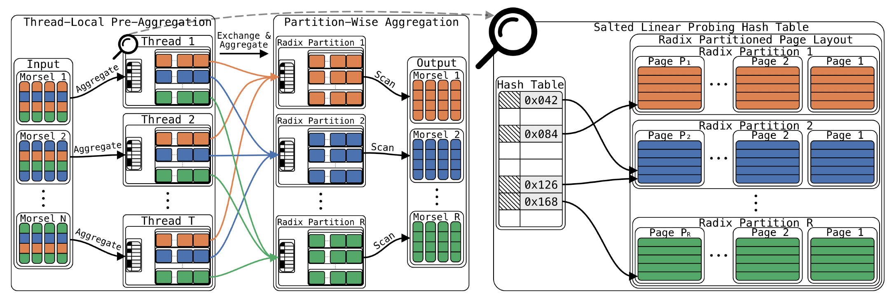
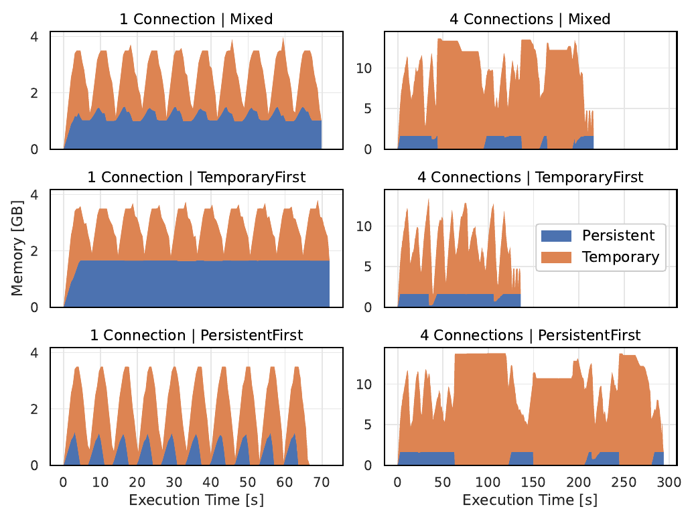
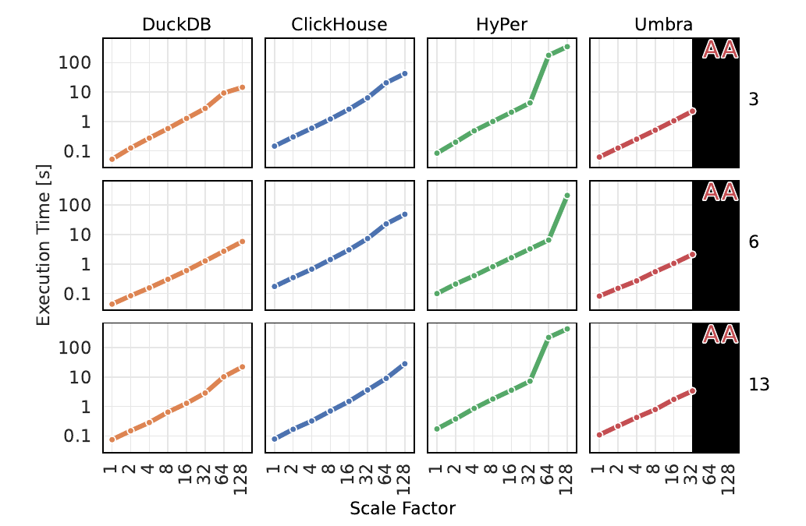
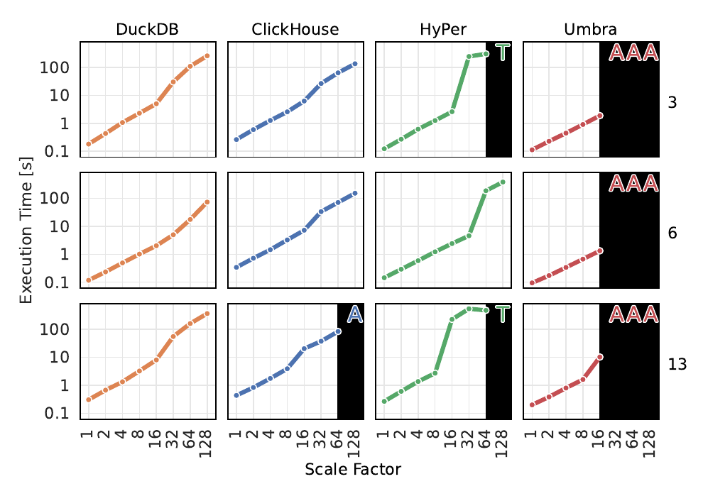

# Robust External Hash Aggregation in the Solid State Age（中文译文）

## 译者说明

本文依据同目录的 `source.pdf` 翻译。章节、图表、公式、算法、代码与参考文献按原文结构保留。

Laurens Kuiper；Peter Boncz；Hannes Mühleisen。三位作者均来自荷兰阿姆斯特丹的 CWI。

联系邮箱分别为：laurens.kuiper@cwi.nl；peter.boncz@cwi.nl；hannes.muehleisen@cwi.nl。

## 摘要

分析型数据库系统提供高性能的内存聚合。如果存在大量不同的分组，临时查询中间结果可能无法装入 RAM，需要使用外部存储。然而，从内存算法切换到外存算法可能使性能急剧下降。

我们重新研究现代硬件上的外存哈希聚合，目标是获得稳健的性能，避免内存耗尽时出现“性能悬崖”。

为此，我们引入了两项处理临时查询中间结果的技术。首先，我们提出统一管理临时数据与持久数据的内存。其次，我们提出一种页面布局：虽然针对内存性能进行了优化，但仍可溢写到磁盘。这两项技术使算子实现只需少量修改，就能处理大于内存的查询中间结果。

我们将它们集成到 DuckDB 的并行哈希聚合中。实验结果表明，当查询中间结果超过可用内存上限时，我们的实现能够使性能平缓下降；同时，其内存性能仍能与其他分析型数据库系统竞争。

**索引词：**关系数据库、数据库查询处理、聚合。

## I. 引言

直到 20 世纪后期，主存仍十分昂贵，因此，传统数据库管理系统（DBMS）针对磁盘访问进行优化，因为那是主要瓶颈。B 树 [1] 等“可溢写”的数据结构既用于加速持久数据访问，也用于查询算子内部。因此，这些系统能够处理超出当时少量可用内存的工作负载。

2000 年前后，RAM 价格下降，数据库系统开始针对主存进行优化 [2]，既包括持久数据，也包括临时查询中间结果 [3]。在这些系统中，主存访问成为瓶颈，于是人们设计了更充分利用 CPU 缓存的技术 [4]。DBMS 如今已发展成大型单体数据库服务器，通常可以使用大量 RAM。

然而，纯内存系统并不经济。高效利用二级存储，例如通过缓存，是以低成本提供良好性能的关键 [5]。近年来，缓冲管理重新受到关注，尤其是针对固态存储的缓冲管理；与磁盘相比，固态存储的带宽更高、延迟更低 [6]–[8]。数据管理系统正重新转向基于磁盘的设计，同时不牺牲内存性能 [9]。



图 1. 聚合性能与数据量关系的概念示意（双对数坐标）。从内存策略切换到尽量减少内存用量的外存策略时，性能下降剧烈而突然，即出现“性能悬崖”。统一的内存与外存聚合策略利用全部可用内存，性能下降更为平缓，即性能更稳健。

这些研究一直着眼于用存储保存持久数据，却大多忽略了临时查询中间结果。分析型（OLAP）系统经常处理大量数据，也常有很大的查询中间结果；它们是在 DBMS 开始针对主存优化之后才成为主流的。当系统能够查询任意大小的持久表时，中间结果也可能随查询而增长到任意大小。在这些情况下，许多现代 OLAP 系统要么中止查询，要么切换到慢几个数量级的传统磁盘算法，从而产生图 1 所示的“性能悬崖”。

鉴于过去二十年 OLAP 系统的进展 [10]–[12]，以及针对现代硬件的缓冲管理研究 [6]、[8]，当中间结果超过主存时，OLAP 系统理应表现得更加稳健。然而，传统缓冲管理器采用固定大小的页和静态分配的缓冲池。这种不灵活性使其不适合中间结果，因此临时数据采用不同的分配方式。以协作方式管理整个内存池，即同时管理持久数据和临时数据，可能帮助系统更充分地利用可用内存 [13]。

本文超越协作式内存管理，对持久数据与临时数据采用统一的内存管理方式。为支持这一点，我们开发了专用于临时数据的页面布局，并将其集成到进程内分析型数据库系统 DuckDB 的哈希聚合算子中。这使我们能够高效利用二级存储，对包含大量不同分组的输入执行大于内存的聚合。

我们的主要贡献如下：

1. 一种统一的内存管理方式，允许可变大小的页，将临时查询中间结果页与持久数据存放在同一个池中，使缓冲管理器可按需将两者逐出到存储。
2. 一种在缓冲页上存储临时查询中间结果的新页面布局，针对内存性能优化，并可在没有序列化开销的情况下溢写到存储。
3. 将上述两项技术集成到并行哈希聚合算法中，使其在超过内存上限时性能平缓下降。

本文其余部分安排如下。第 II 节介绍临时查询中间结果的问题并讨论相关工作。第 III 节介绍统一内存管理，第 IV 节介绍我们的缓冲页布局。第 V 节介绍集成两者的 DuckDB 哈希聚合。第 VI 节描述实验设置，第 VII 节进一步考察统一内存管理如何运行。第 VIII 节通过实验评估我们的聚合实现，并与其他实现比较。最后，第 IX 节总结全文并讨论未来研究。

## II. 临时查询中间结果

本节讨论临时查询中间结果的管理问题及相关工作。

**存储层次。**计算机存储按层次组织：顶层容量较小、访问较快，包括 CPU 寄存器和缓存；底层容量较大、访问较慢，包括主存和存储。倾向于更多访问顶层、较少访问底层的数据访问模式更有利，因为访问较高层次的延迟更低。

直到 20 世纪后期，主存仍十分昂贵，按今天的标准来看，数据库系统只有极少的内存。磁盘速度也远低于今天，而且由于可用内存少，需要频繁访问存储。磁盘访问是瓶颈，因此数据库系统针对存储访问进行优化。2000 年前后，RAM 价格下降，数据库系统开始针对主存中的数据处理进行优化 [2]。在这些系统中，内存访问成为瓶颈 [4]。

**流式查询执行。**常见的“Volcano”查询执行范式 [14] 具有有利的内存访问模式：数据以一次一个元组的方式流动，而不是按算子逐个处理查询计划，使元组能够在存储层次的顶层停留更久。大多数现代 OLAP 系统都实现了流式查询执行，其执行引擎通常基于 VectorWise 首创的向量化 [10]，或 HyPer 首创的以数据为中心的代码生成 [11]。向量化每次处理由驻留缓存的向量构成的小型纵向数据块。以数据为中心的代码生成则以使元组尽可能长时间停留在 CPU 寄存器中的方式处理数据。与传统磁盘系统相比，今天的系统显著提高了查询处理速度，其中一个原因就是让数据在存储层次顶层停留更久。

**阻塞算子。**然而，一些关系算子，例如聚合，是阻塞的，在读完全部输入之前无法输出数据。数据无法流式穿过这些算子，因此必须物化查询中间结果，即临时保存在算子内部。随着中间结果增大，它们会向存储层次的下层移动。如果增大到无法再装入内存，就会被“溢写”，即写入存储以完成查询。

传统磁盘数据库系统针对当时的低内存环境实现关系算子。其算子必须准备好进行溢写，因此常使用 B 树 [1] 等可溢写的数据结构。存储访问的代价显著高于主存访问，因此会降低查询性能。随着可用内存增加，人们重新审视算子设计。完全在主存中运行的哈希算法比基于磁盘的算法性能更好 [3]。与 B 树不同，哈希表并不是很容易溢写的数据结构。

**稳健性。**实现哈希算子的系统可能回退到磁盘算法，以完成具有大于内存的中间结果的查询。该选择可在查询优化期间作出，例如依据基数估计，但这些估计往往不准确 [15]。另一种方式是，在运行时中间结果超过内存上限后重启查询。无论采用哪种方式，都可能出现这样的情形：仅向表中添加一行，就可能导致系统选择磁盘算法。算法切换会使性能突然下降，因为哈希算法在内存中运行，查找复杂度为 $O(1)$，而磁盘算法需要访问磁盘，若使用 B 树，其查找复杂度为 $O(\log n)$。

在运行时适应大于内存的中间结果的算子实现，能提供更加稳健的查询运行时间 [16]。混合哈希连接 [17] 等混合算法采用单一、高效的算法实现这一点，无论中间结果能否装入内存，该算法都能工作。混合算法的输入规模必须小于“内存的平方”[17]，这对许多使用场景已足够。

**内存管理。**传统上，数据库系统实现缓冲管理器，在主存与存储之间移动分页数据。算子只需指定需要哪些页、需要多久，缓冲管理器便会从内存或磁盘获取它们。常见做法是使用固定页大小、固定池大小的缓冲管理器，池的大小由用户配置。固定大小使它不适合临时查询中间结果，因为哈希表等大型对象无法存放在一个页中。将大型对象分散到多个页，会使其使用效率下降、复杂度增加 [9]。因此，临时查询中间结果通常采用不同的分配方式 [13]。

这实际上形成了两个内存池：一个在固定大小的页上保存持久数据，另一个允许可变大小分配，用于临时数据。当中间结果需要更多内存时，固定大小的缓冲池不能收缩，因此必须根据工作负载调整池大小。协作式内存管理 [13] 对此提出挑战，但据我们所知，尚没有系统实现它。从不同的池分配，也意味着缓冲管理器不负责卸载中间结果，算子必须显式读写临时文件。

当查询中间结果从内存溢写到存储时，随机访问时间会大幅增加。在存储中，数据不再按字节寻址，而是按块寻址。可按字节寻址的存储、持久内存等新技术未来可能改变这一点，但它们尚未普遍可用。从按字节寻址转变为按块寻址，需要改变算子算法设计：块必须先加载到内存，才能例如由哈希表对其进行随机访问。

**MMAP。**绕过这个问题的一种选择是使用内存映射（MMAP）文件。这项操作系统（OS）功能将二级存储中文件的内容映射到程序地址空间，使存储中的数据可按字节寻址。MMAP 实际上将页加载和逐出的责任交给 OS，使数据库系统可以继续使用假定所有数据都能装入内存的同一算法。采用这种方式，缓冲区可以超过可用内存上限，因而例如哈希表探测也能随机访问存储中的数据。

MMAP 要求并不了解工作负载的 OS 负责逐出和加载页。随机访问存储比随机访问内存慢几个数量级，不太可能提供稳健的查询性能。此外，研究发现，在高带宽二级存储设备上处理大于内存的 DBMS 工作负载时，OS 的页面逐出机制在线程数超过几个之后便无法继续扩展 [7]。这实际上也排除了在多核架构上使用“内存重接线”（memory rewiring）[18] 处理大于内存的数据，因为它使用 MMAP。

**SSD。**数据库系统开始针对主存优化后不久，固态硬盘（SSD）便因延迟更低、吞吐量更高而成为主流。数据库文献很快认识到 SSD 的潜在性能收益 [19]。硬件的进步以及针对 SSD 的优化进展，最终带来了 LeanStore [6] 等针对 SSD 优化的现代存储管理器。然而，这些进展主要着眼于用 SSD 保存持久数据，而不是临时查询中间结果。部分原因是许多数据管理系统已经发展为运行在大内存环境中的大型单体服务器。

**OLAP 的外存处理。**在更加经济的环境中开展分析型数据管理，显然是有必要的 [20]。本节讨论的许多发展发生在 OLAP 普及之前。OLAP 是在 20 世纪 90 年代末和 21 世纪初、主存数据库系统已经成为主流之后才流行起来的。因此，OLAP 系统不像事务型（OLTP）系统那样，有处理大于内存的中间结果的悠久历史。大多数工作负载可以装入主存，但如果装不下，用户体验往往令人沮丧。当 OLAP 系统没有足够内存完成查询时，它要么中止查询，要么切换到慢得多的传统磁盘算法。前者使用户无法完成查询，后者则使查询运行时间不可预测。

我们认为，分析型数据库系统不应采取非此即彼的内存使用方式，而应能够高效利用全部可用资源完成查询，以提供稳健的查询运行时间，并在超过内存上限时使性能平缓下降。我们应优先使用存储层次的顶层：尽可能使用内存，仅在必要时使用存储。为此，我们提出统一内存管理。

## III. 统一内存管理

本节介绍统一内存管理：一种将持久数据和临时数据的内存管理统一起来、并允许可变大小分配的缓冲管理器。

**持久数据。**DuckDB 不为持久数据分配固定大小的缓冲池，原因有二：

1. 如上一节所述，固定大小的池占据了本可用于临时查询中间结果的内存。
2. DuckDB 是进程内 DBMS，而不是服务器。其分配的内存与宿主进程位于同一地址空间。为避免干扰宿主进程，DuckDB 在空闲时必须保持较低的资源消耗，因此必须释放内存。

出于上一节所述原因和可移植性考虑，DuckDB 也不使用 MMAP。每个缓冲区单独分配。

为避免碎片，DuckDB 在存储上采用 $2^{18} = 262{,}144$ 字节（256 KiB）的固定页大小，因此所有持久数据页都是这一大小。该页大小是为 DuckDB 的主要使用场景 OLAP 工作负载选择的。256 KiB 是协作式内存管理和大多数 OLTP 系统采用的 4 KiB 默认页大小的 64 倍。

不再需要的页会加入逐出队列。这是一个采用最近最少使用（LRU）策略的无锁并发优先队列。当新请求的内存会导致超出内存上限时，逐出队列中的缓冲区会被逐出。如果可用内存充足，持久数据便继续缓存在内存中。如果新请求的分配与队列中可逐出的某页大小相同，就重用该缓冲区。

**临时数据。**临时数据的分配更加灵活。DuckDB 的缓冲管理器区分三种临时分配：1）非分页分配；2）分页固定大小分配；3）分页可变大小分配。非分页分配是不可溢写、大小任意的分配。虽然不分页，这类分配仍经过缓冲管理器，以便当分配将导致超出内存上限时，它可以决定逐出其他页，协作式内存管理也是如此。不再需要这块分配时，将其释放。分页固定大小分配与持久页同样大（256 KiB），必要时可在内存与存储中的临时文件之间高效换入换出。注意，临时文件与存储持久数据的数据库文件完全分离，若有需要，还可放在不同的存储设备上。临时页与持久页大小相同，使缓冲区得以重用。分页可变大小分配也可写入存储，但由于大小可变，每块分配都写入一个单独的临时文件。

非分页分配与分页可变大小分配仅在高效查询处理确有需要时才少量使用，例如用于哈希表桶，或大于 256 KiB 的字符串。分页固定大小分配最为常见，几乎所有临时查询中间结果都存放在其中，即使可用内存充足也是如此。在算子实现中，我们尝试在不再需要临时页时立即销毁它：若页已加载，就释放内存；若页已溢写，就释放磁盘空间。这防止中间结果使用的总空间（内存加磁盘）超过必要空间。

由于分配性能可能影响查询性能 [21]，我们谨慎考虑缓冲管理器设计对分配性能的影响。第 VII 节给出一个微基准实验。

**协作式内存管理。**所提出的缓冲管理器与协作式内存管理 [13] 一样，允许持久数据和临时数据使用全部可用内存，而不是分别预留和管理。不过，关键区别在于：协作式内存管理没有分页临时内存，而统一内存管理有。由于统一内存管理为临时数据提供分页分配，加载持久数据或进一步分配临时数据，都可能不仅逐出持久数据，也逐出临时数据。注意，逐出仅在内存已满时发生。另一个重要区别是，为持久数据分配的页可重用于临时数据，反之亦然。

**兼容性。**所提出的缓冲管理器具有熟悉的 API，提供与其他系统类似的页面固定和解除固定方法。然而，它不支持脏页这一概念，因为 DuckDB 使用轻量压缩 [22] 压缩其列式存储。因此，一般无法执行原地更新，而是始终完整重写页。故所提出的缓冲管理器只需少量修改即可兼容其他系统。

## IV. 页面布局

本节先讨论设计 DuckDB 临时数据页面布局时的考虑，再概述实现。

**DSM 与 NSM。**在固定大小的页上布置关系数据有许多方法。PostgreSQL 等传统数据库系统采用行优先格式在页上存储数据，也称 N 元存储模型（NSM）。其优势是将元组集中存放在内存中，提高访问元组的局部性。PAX [23] 等页面布局以列优先格式存储数据，也称分解存储模型（DSM）。其优势是将属性集中存放在内存中，提高访问列的局部性。两种布局都用于持久数据，但理论上也可用于临时数据。

对于中间结果，研究已经表明，即使在列优先系统中，连接与聚合哈希表 [24] 以及排序 [25] 采用行优先布局也是最优的。将一个元组的各属性集中存放在内存中，提高了在比较时接连访问同一行各属性的局部性，减少缓存未命中。使用固定大小行而非可变大小行，可以通过偏移量高效访问这些属性，进一步提高比较性能 [24]。我们的目标是获得良好的内存性能，因为大多数工作负载都能装入主存；因此，我们选择在页面布局中使用固定大小行。

**可变大小数据。**然而，固定大小行意味着字符串等在现实数据集中普遍存在的可变大小类型 [26]，以及数组，无法放在行内。可变大小类型存放在其他位置，可以通过偏移量等方式隐式寻址，也可以通过存放在固定大小行内的指针显式寻址。隐式寻址需要额外信息，例如存储可变大小数据的页 ID，才能定位相关数据。这增加了间接访问，效率低于显式寻址。此外，隐式寻址使存储在不同页上的行之间的任意跳转更为复杂，例如在桶链式哈希表中，因为各行的可变大小数据的页 ID 可能不同。因此，我们只考虑显式寻址，因为它不会牺牲内存性能。

实际的可变大小数据存放在行外。如果放在一个驻留内存的全局池中，该池本身就可能超过可用内存上限，导致查询中止。MMAP 可允许这样的全局池溢写到存储，但出于前述原因，我们不使用它。因此，可变大小数据也应分页存储，以便溢写。它们可以与行放在同一页，也可以放在不同页。如果存放在同一页，固定大小行可以从顶部向下增长，而可变大小数据从底部向上增长。但这可能导致页面利用率低下：如果某页还能容纳更多固定大小行，却容纳不了这些行的长字符串，我们便转向下一页，留下前一页中未占用的空间。因此，我们将固定大小行与可变大小数据放在不同页中。

**序列化与反序列化。**将可变大小数据的显式寻址与缓冲池分页存储结合，会产生无效引用问题：如果存储可变大小数据的页被逐出后重新加载到内存，其地址可能改变，使固定大小行内指向这些数据的显式地址失效。解决这类问题的常见办法是，在写入存储时序列化数据，在读回 RAM 时反序列化。然而，若实现不够高效，序列化与反序列化很容易主导查询执行时间 [27]。考虑到当前 SSD 的速度，任何序列化和反序列化方法都会使溢写受限于 CPU，而非 I/O。

Arrow Flight [28] 是一种高效的数据序列化与反序列化格式，它通过仅在写入时进行序列化、读取时只需很少甚至不需反序列化来解决该问题。然而，Arrow Flight 以列优先格式存储数据，因此使用它作为我们的布局会牺牲阻塞算子的内存性能 [24]。Arrow Flight 还为每个批次设置头部，而我们并不需要，因为查询中间结果的列和类型已经已知。目前还没有用于行优先数据的类似 Arrow Flight 的格式。

写入前序列化除了本身可能代价高昂，还要求算子在解除页面固定时显式序列化页，因为缓冲管理器随时可能将页逐出。如果页最终没有卸载，这可能导致不必要的序列化与反序列化。另一种方式是让缓冲管理器知道页中存放的内容，以便在逐出前序列化。其好处是，仅在绝对必要时、即数据确实写入存储时才序列化。然而，这要求缓冲管理器了解页面内容，使设计和实现更加复杂。

**要求。**上述讨论清楚表明，将现有页面布局用于查询中间结果会牺牲内存性能。这并不可取，因为大多数工作负载都能装入内存。对内存页和存储页使用不同布局，则会因序列化与反序列化代价高而导致性能不平缓地下降。因此，需要一种既能在内存中高效工作、又能溢写到存储的页面布局。我们确定了如下要求。页面布局必须：

1. 采用固定大小行的行优先数据表示；
2. 将可变大小数据存放在独立的页上；
3. 对可变大小数据采用显式寻址；
4. 无需额外序列化即可溢写到存储。

本节其余部分介绍 DuckDB 临时数据页面布局的设计。每个元组表示为一个固定大小行，在生成查询计划时，各属性的类型及相应宽度与偏移量已经已知。这些信息在全局只存储一次，而不是每页存储一次。固定大小数据与可变大小数据存放在独立的页中，满足要求 1 和 2。下面解释如何满足要求 3 和 4。

**可变大小行。**DuckDB 采用 Umbra [9] 提出的字符串类型，其大小为 16 字节。前 4 字节保存字符串长度。长度不超过 12 个字符的短字符串内联存放在剩余字节中。对超过 12 个字符、不能内联的字符串，则保存 4 字节前缀和一个指针。如前所述，行优先格式将元组的各属性集中存放在内存中，改善连续比较属性时的缓存效率。然而，对非内联字符串，我们必须跟随指针访问，可能产生缓存未命中。为提高局部性，我们也将一行中接连出现的非内联字符串顺序存储。换言之，每个固定大小行都有一个对应的可变大小行。



图 2. DuckDB 固定大小行及其对应可变大小行的页面布局。由于采用固定页大小，行页与可变数据页之间并非一一对应，需要少量元数据描述它们如何对齐。元数据总是描述那些将数据存储在相同行页与可变数据页上的元组。如果行页或可变数据页已满，就创建另一个元数据段。这保证一个元数据段内的所有可变大小数据具有相同基指针，从而可以按段重新计算指针。

**指针重算。**如前所述，如果存储可变大小数据的页溢写到磁盘，重新加载时会放在不同的内存位置，而固定大小行内的指针仍指向此前的位置。如果保存了页面原来的基指针，就可以重新计算这些指针。例如，设字符串位于基指针为 `0x42` 的页面中，地址为 `0x48`，即在页内的偏移量为 6。该页随后溢写并重新加载到内存，此时基指针变成 `0x500`。用所存指针减去旧基指针，再加上新基指针，即可得到新指针：`0x48 - 0x42 + 0x500 = 0x506`。这可以原地、惰性地进行，即只在检测到可变大小数据页确实写过磁盘后才进行，而不是预先处理。

重新计算固定大小行内的指针，需要知道存储其对应可变大小行的页面的旧基指针。然而，每行都存储该指针会引入 8 字节开销。我们可以利用这样一个事实：许多连续的固定大小行，其对应可变大小行都位于同一个可变大小数据页中。我们甚至可以为每个固定大小数据页分配一个可变大小数据页，但这要求分配非标准页大小来保存可变大小数据，而我们希望避免这样做。只要可能，我们更愿意分配标准页大小。

采用标准页大小意味着固定大小行页与可变大小行页不会对齐。图 2 右侧展示了这一点：许多连续的固定大小行，其对应可变大小行都位于同一个可变大小数据页中，所以每行存储一个指针会造成浪费。我们改为保存少量内存元数据，如图 2 左侧所示，描述不同页上的固定大小行与可变大小行如何对齐。这使我们能够重新计算指针，而不引入每行 8 字节的开销。仅当页溢写到磁盘时才重算显式地址；通过比较保存的指针与当前页面指针即可检测这一情况，因此 RAM 中的性能不受影响。

所提出的页面布局可以在任何采用显式分页 I/O 的系统中实现，因为它只是在页之上增加一层元数据。

## V. 稳健的外存哈希聚合

本节先讨论 DuckDB 哈希聚合设计中的考虑，再介绍实现。

聚合是 OLAP 工作负载的关键算子，因此 TPC-H [29] 等分析基准特别强调其性能。如果输入数据已按分组键预排序，就可流式执行聚合 [30]；否则，聚合是阻塞算子。分组聚合可通过排序输入数据来解决，但若数据能装入内存，基于哈希的算法性能更好 [2]。哈希还具有理论时间复杂度优势，为 $O(n)$ 而非 $O(n\log n)$。因此，大多数 OLAP 系统实现哈希聚合。由于我们的目标是不损害主存性能，我们也实现哈希聚合。

**并行性。**现代硬件具有许多可用 CPU 核。充分利用它们对聚合性能至关重要。计划驱动并行（plan-driven parallelism）[31] 在规划查询时决定静态线程数，然后让各线程执行查询计划片段。片段通过感知并行性的 exchange 算子连接，该算子将元组重新路由到不同的计划片段。其他算子基本不感知并行性，因此这种方式简化了算子设计。然而，重新路由元组会产生开销，并且当数据分布倾斜时，无法平衡工作负载 [12]。Morsel 驱动并行（morsel-driven parallelism）[12] 通过一个并行框架解决该问题，该框架在小块输入数据上调度细粒度任务。元组无需重新路由，线程之间的工作负载也更加均衡。但算子必须感知并行性，使设计变得复杂。由于其显著的性能收益，DuckDB 实现了 morsel 驱动并行。

在 morsel 驱动并行中，数据以流水线方式处理。在一条流水线内，数据从表扫描等输入端出发，穿过投影等流式算子，抵达“流水线阻断点”，即哈希聚合等阻塞算子。流水线本身是并行的：多个线程同时处理同一条流水线。算子可以具有每线程的本地状态，以及所有线程共享的一个状态。跨线程通信，甚至 NUMA 下的跨插槽通信，都会产生开销，因此应尽量减少对共享状态的访问。

**低基数聚合。**许多聚合将输入缩减到仅几行。典型例子是 TPC-H 查询 1，无论规模因子如何，它都将输入缩减为四行。在 morsel 驱动并行中，并行执行低基数聚合很容易，无分组聚合则是一个极端例子。各线程并行执行本地预聚合，将输入缩减到每线程几行；若为无分组聚合，则每线程只有一行。读完全部输入数据后，再合并各线程的数据。即使线程很多，与可能聚合了数百万行的线程本地预聚合相比，合并每线程例如四行数据的代价也可以忽略。因此，可以由单个线程完成合并，而不影响性能。

**高基数聚合。**聚合不限于低基数输出。大型数据集的输出可能具有大量不同的分组，形成高基数聚合。例如，在数据格式不强制主键约束时检查某列是否为主键、删除机器学习数据集中的重复行、带有 `DISTINCT` 的查询，或对庞大客户群按不同客户分组，都是这样的场景。

当输出有很多行时，并行聚合并不简单。在线程本地预聚合之后，各线程已积累大量数据。极端情况下，输入中的每个分组都恰好只出现一次，数据完全没有被缩减，仍可能有数百万行。与低基数聚合相比，此时合并所有线程本地数据具有显著代价，若由单线程处理，就会损害性能。

Morsel 驱动并行的作者采用了与 IBM DB2 BLU [32] 类似的方法，在一个小型、固定大小的哈希表中执行线程本地预聚合。哈希表填满后，对数据分区。全部数据都完成预聚合和分区后，进入第二阶段：在线程之间交换分区，然后独立地并行聚合。线程完成一个分区的聚合后，立即将其元组推入下一条流水线，再处理其他分区。让线程本地哈希表保持小型、固定大小，可减少缓存未命中，并避免代价高昂的哈希表扩容。

**数据分布。**这种聚合方式能够高效缩减倾斜分布中的高频值，并利用真实数据中有利的顺序 [33]，例如许多相同的分组键连续出现。由于先缩减再分区，与先跨线程分区再缩减、从而产生不均衡工作负载的 exchange 并行方式相比，这种并行聚合对倾斜分布更加稳健。

不过，其缺点是：若某分组出现的间隔超过固定大小哈希表所能容纳的范围，例如具有许多不同分组的随机均匀分布，该分组可能多次加入线程本地哈希表。这使内存消耗随输入大小而非输出大小线性增长。调整哈希表大小可避免这一问题，但会增加缓存未命中，从而损害更常见的非均匀真实数据的性能。计划驱动并行没有该问题，因为 exchange 算子总是将相同分组路由到相同线程；但如前所述，面对真实数据集中常见的倾斜 [26]，计划驱动并行表现并不好。



图 3. DuckDB 的哈希聚合。Morsel 持续分配给线程，直到读完全部输入。第一阶段，每个线程在一个小型、固定大小、具有一层间接访问的线性探测哈希表中预聚合数据，即根据哈希值取得的偏移量访问指针数组，数组中的指针再指向元组。元组按基数分区，并采用 DuckDB 可溢写的页面布局存储，从而支持大于内存的聚合。预聚合后，交换分区并按分区并行聚合。完成全部聚合的分区会立即被扫描，实际上成为下一条流水线中的 morsel。

**外存聚合。**在硬件受限或数据集非常庞大时，高基数聚合可能无法装入 RAM，因此必须将中间结果溢写到存储才能完成聚合。如上一节所述，这可能使使用 OLAP 系统的体验令人沮丧，因为它们往往只在中间结果能装入内存时表现良好。若中间结果无法装入内存，查询性能就不稳健，有些查询甚至完全无法完成，第 VIII 节将展示这一点。

下面介绍 DuckDB 极易支持外存处理的哈希聚合，它集成了所提出的页面布局。该聚合方法受 HyPer [12] 和 IBM DB2 BLU 聚合 [32] 的启发，并包含关键性能优化。我们描述一种分区聚合方式：如后文所示，它无需显式将数据写入存储，就能轻松处理大于内存的中间结果，而将溢写责任留给缓冲管理器，从而简化算子设计。图 3 展示了我们的设计。

在第一阶段，即**线程本地预聚合**中，我们持续向线程分配 morsel，直到读完所有输入数据。通常 morsel 数远多于线程数。数据从 morsel 中按最多 2,048 个元组的批次扫描出来。线程在一个小型、固定大小（ $2^{17} = 131{,}072$ ）的哈希表中执行预聚合。哈希表本身由两部分构成：1）64 位条目数组，每个条目的低 48 位包含一个指针，指向相应条目；2）用于保存哈希表条目的临时页，条目由分组和聚合值组成，以及对应的变长值页面。

**Salt。**在 64 位 CPU 架构上，指针宽度为 64 位，但仅使用低 48 位，因为这已允许约 281 TB 的地址空间。我们用指针剩余的 16 位存储对应元组哈希值的高 16 位，称为 salt；图 3 右侧“带 salt 的线性探测哈希表”中的“哈希表”展示了这一点。对哈希表采用间接访问，即存储指向元组的条目而非直接存储元组，可以让被随机访问的区域保持较小，并支持本节将解释的一些特定优化；否则无法实现这些优化。

**冲突处理。**与通常做法一样，从哈希值的低位获取 64 位条目数组中的偏移量。冲突通过线性探测解决。在跟随指针访问元组并比较分组键之前，我们先比较 salt。只有 salt 相等时，才跟随指针比较分组键。对于均匀哈希函数，salt 实际上将比较不匹配元组的分组键的概率降低了 $2^{16} = 65{,}536$ 倍。这在线性探测中最为有效。在桶链式哈希表中，salt 要么需要按位 OR，从而设置更多位、增加假阳性的可能性，要么需要使用仅取哈希值 4 位的 16 位 Bloom 过滤器。通常，随着哈希表被填满，冲突增多，产生更多分组键比较和随机访问，使性能下降。这项优化使几乎所有冲突都能更高效地解决。

**分区。**与 IBM DB2 BLU [32] 和 HyPer [12] 在重置哈希表时对元组分区不同，我们的实现直接将元组物化到采用所提出页面布局的分区中。通过直接物化到分区，我们避免了多次复制元组。注意，分区数据采用行优先表示，而输入数据采用列优先表示；从列优先到行优先的转换与数据分区同时发生。这项优化之所以可行，是因为哈希表间接访问元组，如图 3 右侧带 salt 的线性探测哈希表中的“基数分区页面布局”所示。

分区由基数确定，即使用哈希值中间的若干位，这些位此前既未用于 salt（高位），也未用于哈希表偏移量（低位）。所使用的各组位不能重叠，这一点很重要，否则将增加冲突、降低 salt 的有效性，或两者兼有。用于分区的位数取决于活跃线程数，以及中间结果大小是否超过内存，后文将解释。由于先预聚合再分区，而不是相反，各分区的大小大致相等。

**RAM 无关。**当哈希表填充至三分之二时，我们将其重置。这一阈值通过实验确定。重置的只有 64 位条目数组，元组保持原位，因此重置是一项廉价操作。此时可解除存储这些元组的页面的固定，因为元组已经不再活跃于哈希表中。采用这种方式，聚合算子从不显式将分区写入存储，而 IBM DB2 BLU 的聚合 [32] 等实现会在内存不足时这样做。相反，缓冲管理器在必要时将单个页而非整个分区写入存储。第 VII 节将深入分析本实现的溢写行为。

这简化了算子设计，因为聚合算子基本不知道哪些页在内存中、哪些在磁盘上。类似于缓存无关算法 [34] 不感知 CPU 缓存大小，我们的算法在线程本地预聚合阶段几乎是 RAM 无关的：算法行为不依赖内存上限。唯一要求是那个小型固定大小哈希表能够装入内存。

在第二阶段，即**按分区聚合**中，内存上限就很重要，因为问题变成了：每个线程一个完全聚合后的分区是否能装入内存。通过过度分区，即创建远多于线程数的分区，可以实现这一点。这也使第二阶段的内存压力保持较低。某分区完成全部聚合后，其结果立即推给流水线中的下一个算子，释放使用的页。

DuckDB 哈希聚合算子的设计应当在临时查询中间结果超过可用内存上限时使性能平缓下降，并且只将装不进内存的页溢写到存储。我们的聚合实现自 DuckDB 0.9.0 版起包含于每个发布版本中，并已得到广泛使用。[^1]

[^1]: DuckDB 源代码见 https://github.com/duckdb/duckdb。

## VI. 实验设置

本节描述实验设置。所有实验均在 AWS EC2 上使用 Ubuntu 22 运行。

**硬件。**我们选择 `c6id.4xlarge` 实例，因为其配置与笔记本电脑等价格可负担的硬件相近。该实例具有 Intel Xeon 8375C CPU，8 核（16 线程）、32 GB DDR4 RAM 和 1 TB NVMe 存储。我们将实例的租用方式设为专用，使整个节点被保留，但不使用节点的其余容量。我们还使用可用的实例存储（Instance Storage），它物理连接在宿主机上，不同于 EC2 通常采用的弹性块存储（Elastic Block Storage）。这一设置消除了云环境中可能存在的邻居干扰问题，使结果更加一致。

**数据。**我们使用集成在 DuckDB `tpch` 扩展中的 TPC-H 数据生成器，创建分组基准。生成规模因子为 1、2、4、8、16、32、64 和 128 的 `lineitem` 表。在这些规模下，行数从 6,001,204 到 768,046,921，生成的 CSV 大小从 0.72 GB 到 96.72 GB。

**查询。**虽然聚合很容易主导查询运行时间，但在基准中隔离任何一个关系算子的性能都很困难，因为我们往往只能可靠观察端到端查询运行时间。即使系统具有查询分析器也是如此，因为流式查询引擎会交错执行多个算子。测量端到端运行时间会引入不需要且不相关的开销，例如解析和优化、扫描基表等小开销，以及通过客户端协议传输结果集的开销。后者对高基数聚合等大型结果集尤其昂贵，很容易主导查询执行时间 [27]。

与其通过客户端协议传输结果集，我们可以将结果写入表，即 `CREATE TABLE ... AS`。这稍好一些，但也会引入大量批量插入开销，而不同系统在这方面的性能差异可能很大。在想要测量的昂贵聚合之上添加一个廉价的无分组聚合会更好，但某些情况下，这使查询优化器可以删除未使用的列，可能导致不同系统的计划不等价。因此，我们设计了如下基准查询：

```sql
SELECT group_key1, group_key2,
       ..., group_keyG,
       ANY_VALUE(col1), ANY_VALUE(col2),
       ..., ANY_VALUE(colC)
FROM lineitem
GROUP BY group_key1, group_key2,
         ..., group_keyG
OFFSET N - 1;
```

这里，`N` 是查询中不同分组的数量，已针对每种分组预先计算。该查询恰好产生一行结果。从技术上说，该查询的定义不充分，因此输入中的任意一行都满足查询。然而，系统并不知道不同分组的数量，因此必须完整处理并丢弃前 `N - 1` 个分组，才能输出一行。除分组键之外的其他列通过 `ANY_VALUE` 聚合函数选取，以增加内存压力，同时不改变不同分组的数量。

表 I. 按不同列组合对 `lineitem` 分组后的输出大小。25.00% 的输出大小意味着输出行数等于输入行数的 0.25 倍。

| 编号 | 分组列 | 大小 |
| --- | --- | --- |
| 1 | `l_returnflag, l_linestatus` | 4 行 |
| 2 | `l_partkey` | 3.33% |
| 3 | `l_partkey, l_returnflag, l_linestatus` | 10.58% |
| 4 | `l_suppkey, l_partkey` | 13.33% |
| 5 | `l_orderkey` | 25.00% |
| 6 | `l_orderkey, l_returnflag, l_linestatus` | 34.87% |
| 7 | `l_suppkey, l_partkey, l_returnflag, l_linestatus` | 36.17% |
| 8 | `l_suppkey, l_partkey, l_shipinstruct` | 45.34% |
| 9 | `l_suppkey, l_partkey, l_shipmode` | 61.83% |
| 10 | `l_suppkey, l_partkey, l_shipinstruct, l_shipmode` | 88.56% |
| 11 | `l_orderkey, l_partkey` | 99.99% |
| 12 | `l_orderkey, l_suppkey` | 99.99% |
| 13 | `l_suppkey, l_partkey, l_orderkey` | 100.00% |

**分组。**我们按表 I 所示的不同列组合对 `lineitem` 表分组。每种分组都有两种变体。窄变体（thin）仅选择分组列；宽变体（wide）使用 `ANY_VALUE` 聚合函数选择所有其他列。

这些分组、窄宽两种变体以及不同规模因子，使该基准涵盖了从低内存压力到高内存压力的多种聚合。例如，内存压力最低的是按 `l_returnflag, l_linestatus` 分组的窄变体，它仅物化四行两列。内存压力最高的是按 `l_suppkey, l_partkey, l_orderkey` 分组的宽变体，它实际上物化了整个 `lineitem` 表。所有实验均已在 GitHub 上公开。[^2]

[^2]: 实验：https://github.com/lnkuiper/experiments/tree/master/oocha。

## VII. 加载、溢写与分配

本节进一步考察所提出的统一内存管理如何运行。

**加载与溢写。**我们首先研究运行聚合工作负载时，DuckDB 的缓冲管理器如何决定加载和溢写页。实验选取的工作负载是规模因子 128 下的窄分组 4，因为它需要物化相当数量的中间数据，但还不至于使整个聚合受限于 I/O。该分组只选择 `l_orderkey`，在采用轻量压缩技术 [22] 的 DuckDB 文件格式中，其大小略超 1.5 GB。

> 译注：本段原文写作“thin grouping 4”，并称只选择 `l_orderkey`；而表 I 中仅以 `l_orderkey` 分组的是第 5 组，第 4 组为 `l_suppkey, l_partkey`。图 4 的原图注也写分组 4。此处保留原文的编号与列名，不据此推断实验实际采用哪一组。

我们考虑两种场景。第一种场景中，单个连接连续运行该分组 10 次，DuckDB 配置为 4 个线程，内存上限为 3.5 GB。DuckDB 很少作为服务器使用；单个连接是本地数据集分析的常见用法。选择 3.5 GB 的内存上限，是因为它大致等于此分组所需中间结果的总大小，因此必须逐出页。与较高或较低的内存上限相比，这个上限能产生更有意思的结果：理论上完成查询不需太多 I/O，但缓冲管理器的错误决策可能导致不必要的 I/O。第二种场景中，四个连接各自连续运行该分组 10 次，且同时执行；DuckDB 配置为 $4\times4 = 16$ 个线程，内存上限为 $4\times3.5 = 14$ GB。

如第 III 节所述，DuckDB 的逐出策略采用并发 LRU 队列逐出页。所有类型的页都加入同一个队列：持久页、临时页、固定大小页和可变大小页，不区分页的类型。在只存储持久数据的传统缓冲池背景下，逐出策略已有深入研究，但在临时数据背景下尚非如此。这些策略试图将常用持久数据保留在内存中，以加快访问。临时数据生命周期很短，因此，对这些页采用不同策略可能有益。我们将 DuckDB 的默认逐出策略称为 **Mixed**。本实验另实现两种逐出策略，将持久页和临时页存放在两个独立的 LRU 队列中。**TemporaryFirst** 先逐出临时页，再逐出持久页；**PersistentFirst** 先逐出持久页，再逐出临时页。图 4 给出实验结果。

在只有一个活跃连接时，Mixed、TemporaryFirst 和 PersistentFirst 的执行时间相近，分别为 69.8 秒、72.1 秒和 66.8 秒。观察到的临时文件大小，在 PersistentFirst 下始终低于 500 MB，在 TemporaryFirst 和 Mixed 下始终低于 2 GB。每次查询开始时，在线程本地预聚合期间读取持久数据。全部数据物化后，按分区聚合期间仅需要临时数据。逐出持久数据无需写入存储，因为它已保存在数据库文件中。相反，逐出临时数据需要写入存储，因此代价更高。可见，这使 PersistentFirst 成为单活跃连接场景下最高效的策略。



图 4. 在单连接和多连接场景下，采用不同缓冲逐出策略，反复执行规模因子 128 的窄分组 4 时，DuckDB 内存使用情况的可视化。

在四个活跃连接时，Mixed、TemporaryFirst 和 PersistentFirst 的执行时间差异较大，分别为 216.4 秒、135.9 秒和 293.5 秒，与前一场景的顺序相反。观察到三种策略下的临时文件大小始终低于 8 GB。图中似乎有些时刻全部持久数据都被逐出了，但实际上始终有部分持久数据加载在内存中，只是数量太少，无法在图中看见。当大多数持久数据被逐出时，线程本地预聚合会变慢，因为每次读取都需要访问存储。这种行为使内存塞满临时数据，并因过度抖动，即反复加载和溢写页，而损害整体查询吞吐量。在其余实验中，DuckDB 使用 Mixed 逐出策略，作为 PersistentFirst 与 TemporaryFirst 之间的合理折中。

**分配性能。**分配延迟可能显著影响查询性能 [21]，因此，我们进行一个微基准，研究所提出的缓冲管理器如何影响分配，类似于协作式内存管理 [13] 所做的实验。我们测量分配 262,144 字节小区域和 268,435,456 字节大区域所需的时间。前者是 DuckDB 的固定页大小，后者是其 1,024 倍。时间对 1,024 次分配取平均。直接使用 DuckDB 内部分配器 jemalloc [35] 分配时，小区域耗时 1.5 微秒，大区域耗时 1.7 微秒。在可用内存充足时，让这些分配经过 DuckDB 缓冲管理器，耗时分别为 1.7 微秒和 2.0 微秒。开销可以忽略，可由增加当前内存用量原子计数器等簿记操作解释。

当通过加载持久数据填满内存后，这些分配会导致逐出页。在该场景下，小区域分配反而耗时更短，仅为 0.9 微秒。只需逐出一个持久页，因为持久页在存储上有副本，这项逐出不产生代价，随后立即重用分配。

然而，大区域分配此时耗时 0.9 毫秒，因为它会导致逐出 1,024 个持久页。与上一种情况不同，这些页不能被重用，因此必须释放。释放会产生显著开销，协作式内存管理 [13] 中也观察到了这一点。如果采用 4 KiB 页而非 DuckDB 默认的 256 KiB 页，大区域分配将导致 65,536 次释放，开销会更大。

考虑到释放开销仅在内存已满时出现，并且只影响 DuckDB 中极少使用的可变大小分配，我们认为这一开销可以接受。

## VIII. 评估

本节通过实验评估我们的实现，并与其他实现比较。我们将 DuckDB [20]（版本 0.9.2），一个面向 OLAP 工作负载、具有向量化查询执行引擎的进程内开源 DBMS，与另外三个聚合性能强劲的系统进行比较：

- **ClickHouse** [36]（版本 23.11.1）：面向 OLAP 工作负载的开源列式 DBMS。
- **HyPer** [11]（版本 2023.3）：面向混合 OLTP 和 OLAP 工作负载、基于主存的关系 DBMS，采用以数据为中心的代码生成，由慕尼黑工业大学（TUM）开发，目前是 Tableau 的数据引擎。
- **Umbra** [9]（v0.1 2023-11-21）：HyPer 的后继系统，一个具有内存性能的磁盘型 DBMS，同样采用以数据为中心的代码生成，也由 TUM 开发。

我们不与 PostgreSQL、MySQL 等传统数据库系统比较，因为由于大量逐元组开销 [10] 等多种原因，它们在聚合上比现代 OLAP 系统慢几个数量级。

我们已验证，第 VI 节描述的聚合查询在基准中的所有系统上生成相同的查询执行计划。每条查询运行五次，报告执行时间中位数。若查询未在 10 分钟内完成，则记为超时。

**窄分组。**表 II 给出所有分组窄变体的结果。由于更宽的表放不下，我们只展示规模因子 2、8、32 和 128。按规模因子汇总执行时间时，先按 DuckDB 的执行时间归一化，即除以 DuckDB 的执行时间，再取几何平均，因为这使每条查询获得公平权重 [37]。

表 II. 所有分组的窄变体在规模因子 2、8、32 和 128 下的执行时间，单位为秒，越低越好。最低执行时间以粗体标出。A 表示查询中止。汇总方式为先按 DuckDB 归一化，再取几何平均。原表按规模因子分列，下面保持同一表号分块呈现。Du、Cl、Hy、Um 分别表示 DuckDB、ClickHouse、HyPer、Umbra。

**规模因子 2**

| 分组 | Du | Cl | Hy | Um |
| --- | --- | --- | --- | --- |
| 1 | **0.01** | 0.08 | **0.01** | 0.02 |
| 2 | 0.08 | **0.04** | 0.13 | **0.04** |
| 3 | **0.13** | 0.30 | 0.20 | **0.13** |
| 4 | 0.12 | 0.08 | 0.16 | **0.07** |
| 5 | **0.05** | 0.08 | 0.07 | **0.05** |
| 6 | **0.08** | 0.35 | 0.21 | 0.15 |
| 7 | **0.17** | 0.37 | 0.28 | 0.23 |
| 8 | 0.23 | 0.36 | 0.27 | **0.20** |
| 9 | **0.16** | 0.37 | 0.30 | 0.21 |
| 10 | **0.25** | 0.50 | 0.41 | 0.38 |
| 11 | **0.13** | **0.13** | 0.37 | 0.18 |
| 12 | **0.13** | **0.13** | 0.36 | 0.18 |
| 13 | **0.15** | 0.17 | 0.38 | 0.22 |
| 几何平均（按 DuckDB 归一化） | **1.00** | 1.69 | 1.80 | 1.13 |

**规模因子 8**

| 分组 | Du | Cl | Hy | Um |
| --- | --- | --- | --- | --- |
| 1 | **0.03** | 0.27 | 0.05 | 0.04 |
| 2 | 0.44 | **0.16** | 0.66 | 0.19 |
| 3 | 0.58 | 1.21 | 1.00 | **0.51** |
| 4 | 0.58 | 0.29 | 0.83 | **0.28** |
| 5 | 0.18 | 0.29 | 0.36 | **0.16** |
| 6 | **0.30** | 1.42 | 0.81 | 0.55 |
| 7 | **0.72** | 1.56 | 1.36 | 0.87 |
| 8 | 0.97 | 1.51 | 1.39 | **0.78** |
| 9 | **0.74** | 1.53 | 1.58 | 0.78 |
| 10 | **1.10** | 2.06 | 1.96 | 1.50 |
| 11 | 0.59 | **0.51** | 1.71 | 0.65 |
| 12 | 0.59 | **0.52** | 1.73 | 0.65 |
| 13 | **0.64** | 0.70 | 1.80 | 0.79 |
| 几何平均（按 DuckDB 归一化） | 1.00 | 1.53 | 1.98 | **0.98** |

**规模因子 32**

| 分组 | Du | Cl | Hy | Um |
| --- | --- | --- | --- | --- |
| 1 | **0.14** | 1.10 | **0.14** | 0.16 |
| 2 | 2.03 | 0.75 | 2.86 | **0.68** |
| 3 | 2.78 | 6.35 | 4.28 | **2.24** |
| 4 | 2.86 | 1.63 | 3.38 | **1.22** |
| 5 | 0.74 | 1.57 | 1.66 | **0.54** |
| 6 | **1.27** | 7.32 | 3.27 | 2.12 |
| 7 | **3.42** | 8.32 | 5.61 | 4.32 |
| 8 | 5.25 | 8.11 | 5.72 | **3.44** |
| 9 | 3.59 | 8.01 | 6.42 | **3.47** |
| 10 | **5.78** | 11.34 | 169.63 | 14.98 |
| 11 | 2.72 | **2.59** | 6.94 | 2.86 |
| 12 | 2.65 | **2.59** | 6.80 | 2.84 |
| 13 | **2.87** | 3.64 | 7.24 | 3.39 |
| 几何平均（按 DuckDB 归一化） | 1.00 | 1.69 | 2.17 | **0.94** |

**规模因子 128**

| 分组 | Du | Cl | Hy | Um |
| --- | --- | --- | --- | --- |
| 1 | **0.54** | 4.06 | **0.54** | A |
| 2 | 10.80 | **4.04** | 12.83 | A |
| 3 | **14.49** | 42.47 | 348.10 | A |
| 4 | 22.06 | **9.80** | 231.86 | A |
| 5 | **3.17** | 9.41 | 6.86 | A |
| 6 | **5.80** | 48.79 | 213.41 | A |
| 7 | **24.62** | 51.57 | 457.52 | A |
| 8 | 65.97 | **49.49** | 412.86 | A |
| 9 | **32.77** | 46.51 | 444.50 | A |
| 10 | 89.27 | **77.27** | 576.68 | A |
| 11 | 21.38 | **18.43** | 413.54 | A |
| 12 | 21.89 | **18.22** | 411.58 | A |
| 13 | **22.20** | 28.31 | 432.33 | A |
| 几何平均（按 DuckDB 归一化） | **1.00** | 1.48 | 8.74 | A |


在规模因子 2、8 和 32 下，数据完全装入内存，各系统的执行时间和归一化几何平均相近，其中 DuckDB 和 Umbra 最快。一个例外是规模因子 32 下分组 10 的 HyPer，其耗时比其他三个系统高一个数量级。在这一分组上，HyPer 已切换到外存聚合实现。我们观察到 HyPer 的外存聚合只使用极少量内存，在可用的 32 GB 中使用不足 2 GB。

在规模因子 128 下，一些较大的分组不再能装入内存。注意，发生这一情况的确切位置因系统而异。在这一规模因子下的几乎所有分组中，HyPer 都采用外存聚合，远慢于其内存聚合。因此，HyPer 有些查询只能勉强在 600 秒超时限制内完成，使归一化几何平均显著上升。Umbra 尚没有外存聚合实现，在这一规模因子下必须中止查询。DuckDB 和 ClickHouse 都能在明显低于 600 秒的时间内完成全部分组。

现在进一步考察特定窄分组的扩展行为。图 5 展示规模因子 1 至 128 下分组 3、6 和 13 的窄变体执行时间。注意，横纵坐标均为对数刻度。直至规模因子 32，数据都能装入内存，四个系统都呈线性扩展，符合对哈希聚合的预期。在规模因子 128 下，HyPer 对三个分组都切换到外存聚合。令人意外的是，虽然分组 3 的结果比分组 6 和 13 更小，HyPer 却在规模因子 64 时就对分组 3 使用外存聚合。这一切换导致显著的性能悬崖：数据量仅增长 2 倍，执行时间却增长超过 10 倍。DuckDB 和 ClickHouse 的性能“颠簸”不那么明显，执行时间仅增长约 3 倍。Umbra 耗尽内存，在规模因子 64 和 128 下无法完成查询。



图 5. 规模因子 1 至 128 下分组 3、6 和 13 的窄变体执行时间（双对数坐标）。越低越好。A 表示查询中止。

该图表明，从内存算法切换到外存算法并不稳健，因为它会造成性能悬崖：巨大且有时难以预测的性能突变。DuckDB 的哈希聚合则稳健得多。

**宽分组。**表 III 给出规模因子 2、8、32 和 128 下所有分组宽变体的结果。与表 II 相比，存在明显差异：由于需要扫描和物化额外选择的列，所有执行时间都更高。与之前一样，在较低的规模因子 2 和 8 下，四个系统的执行时间相近；从执行时间和归一化几何平均可以看出，Umbra 明显胜出。在这四个系统中，出于可移植性考虑，DuckDB 是唯一不对聚合函数使用即时（JIT）编译的系统。已知 JIT 编译能够显著提高聚合性能 [38]，这解释了为什么 DuckDB 的执行时间稍高。
表 III. 所有分组的宽变体在规模因子 2、8、32 和 128 下的执行时间，单位为秒，越低越好。最低执行时间以粗体标出。A 表示查询中止，T 表示查询在 600 秒后超时。汇总方式为先按 DuckDB 归一化，再取几何平均。原表按规模因子分列，下面保持同一表号分块呈现。Du、Cl、Hy、Um 分别表示 DuckDB、ClickHouse、HyPer、Umbra。

**规模因子 2**

| 分组 | Du | Cl | Hy | Um |
| --- | --- | --- | --- | --- |
| 1 | 0.04 | 0.19 | 0.03 | **0.02** |
| 2 | 0.42 | 0.34 | 0.23 | **0.22** |
| 3 | 0.43 | 0.59 | 0.27 | **0.23** |
| 4 | 0.53 | 0.51 | 0.27 | **0.23** |
| 5 | 0.25 | 0.58 | 0.23 | **0.13** |
| 6 | 0.23 | 0.72 | 0.29 | **0.17** |
| 7 | 0.51 | 0.75 | 0.35 | **0.29** |
| 8 | 0.87 | 1.01 | 0.42 | **0.36** |
| 9 | 0.59 | 0.88 | 0.47 | **0.32** |
| 10 | 0.75 | 1.00 | 0.61 | **0.42** |
| 11 | 0.64 | 0.83 | 0.61 | **0.38** |
| 12 | 0.62 | 0.79 | 0.62 | **0.38** |
| 13 | 0.66 | 0.83 | 0.60 | **0.38** |
| 几何平均（按 DuckDB 归一化） | 1.00 | 1.53 | 0.77 | **0.54** |

**规模因子 8**

| 分组 | Du | Cl | Hy | Um |
| --- | --- | --- | --- | --- |
| 1 | 0.16 | 0.67 | 0.10 | **0.06** |
| 2 | 2.25 | 1.45 | 1.07 | **0.77** |
| 3 | 2.30 | 2.56 | 1.25 | **0.91** |
| 4 | 2.77 | 2.43 | 1.28 | **0.91** |
| 5 | 0.80 | 2.96 | 0.89 | **0.44** |
| 6 | 1.01 | 3.24 | 1.22 | **0.67** |
| 7 | 2.56 | 3.34 | 1.76 | **1.22** |
| 8 | 3.94 | 4.57 | 1.96 | **1.47** |
| 9 | 3.22 | 4.24 | 2.18 | **1.41** |
| 10 | 3.69 | 4.91 | 2.69 | **1.74** |
| 11 | 3.22 | 3.75 | 2.71 | **1.60** |
| 12 | 3.32 | 3.76 | 2.70 | **1.58** |
| 13 | 3.20 | 3.85 | 2.67 | **1.59** |
| 几何平均（按 DuckDB 归一化） | 1.00 | 1.45 | 0.70 | **0.45** |

**规模因子 32**

| 分组 | Du | Cl | Hy | Um |
| --- | --- | --- | --- | --- |
| 1 | 0.63 | 2.57 | **0.38** | A |
| 2 | 52.79 | **18.41** | 211.11 | A |
| 3 | 30.00 | **26.39** | 243.30 | A |
| 4 | 53.46 | **26.19** | 255.55 | A |
| 5 | 4.63 | 30.16 | **3.13** | A |
| 6 | 4.96 | 33.20 | **4.56** | A |
| 7 | **30.61** | 31.85 | 382.80 | A |
| 8 | 68.49 | **38.79** | 487.08 | A |
| 9 | 46.12 | **36.37** | 451.81 | A |
| 10 | 64.84 | **43.70** | 585.54 | A |
| 11 | 60.04 | **36.41** | 530.67 | A |
| 12 | 60.73 | **36.00** | 533.54 | A |
| 13 | 54.55 | **37.00** | 534.56 | A |
| 几何平均（按 DuckDB 归一化） | **1.00** | 1.06 | 4.54 | A |

**规模因子 128**

| 分组 | Du | Cl | Hy | Um |
| --- | --- | --- | --- | --- |
| 1 | 2.57 | 9.91 | **1.52** | A |
| 2 | 347.28 | **111.66** | 499.04 | A |
| 3 | 256.29 | **133.50** | T | A |
| 4 | 350.96 | **122.97** | T | A |
| 5 | **67.56** | A | 287.87 | A |
| 6 | **72.69** | 150.75 | 378.23 | A |
| 7 | **260.12** | A | T | A |
| 8 | **407.26** | A | T | A |
| 9 | **331.08** | A | T | T |
| 10 | **399.46** | A | T | A |
| 11 | **396.53** | A | T | A |
| 12 | **382.09** | A | T | A |
| 13 | **359.95** | A | T | A |
| 几何平均（按 DuckDB 归一化） | **1.00** | A | T | A |


在规模因子 32 下，执行时间已经出现显著差异。由于选择额外列增加了内存压力，HyPer 对大多数查询切换到外存聚合。因此，HyPer 比 ClickHouse 和 DuckDB 慢一个数量级。Umbra 在这一规模因子及更大规模下无法完成任何分组。

ClickHouse 在规模因子 32 下表现良好，大多数查询的执行时间最低；如果不是分组 5 和 6，其归一化几何平均也几乎最低。然而，实现这一性能的策略未能持续奏效，因为在规模因子 128 下，ClickHouse 必须中止大多数查询。在规模因子 128 下，DuckDB 是唯一能在 600 秒时间限制和 32 GB 可用主存内完成整个基准的系统。

我们再次考察此前的分组 3、6 和 13 的扩展行为，但这次是图 6 中的宽变体。在最初几个规模因子下，所有系统都表现为线性。然而，性能下降更早开始，大约在规模因子 32 附近，具体取决于分组产生的行数。对三个分组，HyPer 都在较高规模因子下切换到外存聚合；对分组 3、6 和 13，切换分别发生于规模因子 32、64 和 16。与内存聚合相比，外存聚合使性能急剧下降，最终在规模因子 128 下使 HyPer 在三个分组中的两个上超时。Umbra 在规模因子 32 及以上无法完成任何一个分组。

ClickHouse 扩展良好，尤其在较高规模因子下。虽然其聚合策略能够利用存储来处理大于内存的中间结果，但在规模因子 128 下最大的分组，即分组 13 上，仍然耗尽内存。DuckDB 没有这一问题。虽然 DuckDB 在规模因子 32/64 附近再次出现轻微的性能颠簸，但它仍能在最高规模因子下顺利完成所有分组，并且距离 600 秒超时还有三分钟以上的余量。



图 6. 规模因子 1 至 128 下分组 3、6 和 13 的宽变体执行时间（双对数坐标）。越低越好。T 表示查询在 600 秒后超时。A 表示查询中止。

## IX. 结论与未来工作

本文讨论了临时查询中间结果，尤其是 OLAP 系统中的中间结果。我们发现，目前处理中间结果的方法存在限制，妨碍内存利用和高效溢写。为解决这些问题，我们提出统一内存管理，将临时数据与持久数据的内存管理统一起来；同时提出一种无需序列化开销即可惰性溢写的页面布局。这些技术共同使阻塞算子能够利用全部可用内存存放中间结果，并高效、惰性地溢写它们。因此，需要处理大于内存的中间结果的算子实现，可以在不牺牲内存性能的情况下完成处理。

我们将两项技术集成到了 DuckDB 的并行哈希聚合中。通过一个聚合工作负载多样、不同分组数量各异的基准，我们对实现进行实验评估，并与三个聚合性能强劲的系统比较。结果表明，DuckDB 可以聚合大于内存的中间结果，而不会跌落性能悬崖。这归功于所提出的技术以及现代 SSD 的高 I/O 吞吐量。结果还表明，当中间结果可以装入主存时，DuckDB 的聚合具有很强的竞争力，说明稳健的外存聚合性能确实可以在不牺牲内存性能的情况下实现。

**未来工作。**所提出的技术是针对 OLAP 实现和评估的。还需进一步研究，才能确定其在 OLTP 中的可行性；在 OLTP 中，更小的页、脏页和大量并发写入者都很常见。

实验结果表明，逐出策略的效率依赖工作负载。此前这方面的研究没有考虑临时数据的逐出。需要进一步研究统一内存管理的逐出策略，以确定高效策略。

如第 V 节所述，在线程本地预聚合期间，同一分组可能被多次物化；由于 morsel 驱动并行，还可能跨多个线程。这些额外物化可能使临时查询中间结果变大，进而造成不必要的 I/O。若不采取措施就会超过内存上限，可以在第一阶段更早地自适应交换并聚合分区，从而缩小中间结果，缓解这一问题。

除哈希聚合外，连接、排序和窗口算子等其他阻塞算子也能受益于本文提出的技术。我们相信，通过集成这里介绍的技术，这些算子同样能够以性能稳健的方式处理大于内存的临时查询中间结果。

最后，例如在同一条流水线中探测两个大型哈希表，或在大型连接之上执行高基数聚合时，多个内存密集型算子会同时活跃。此时需要协调，确保所有活跃算子的内存用量之和不超过内存上限。与静态方法相比，在查询执行期间适应这些内存需求的方法，能够更加公平地分配内存，从而更加高效地利用内存。

## 参考文献

[1] D. Comer, “Ubiquitous B-Tree,” ACM Comput. Surv., vol. 11, no. 2, p. 121–137, jun 1979. [Online]. Available: https://doi.org/10.1145/356770.356776

[2] H. Garcia-Molina and K. Salem, “Main Memory Database Systems: An Overview,” IEEE Trans. on Knowl. and Data Eng., vol. 4, no. 6, p. 509–516, dec 1992. [Online]. Available: https://doi.org/10.1109/69.180602

[3] D. J. DeWitt, R. H. Katz, F. Olken, L. D. Shapiro, M. R. Stonebraker, and D. A. Wood, “Implementation Techniques for Main Memory Database Systems,” in Proceedings of the 1984 ACM SIGMOD International Conference on Management of Data, ser. SIGMOD ’84. New York, NY, USA: Association for Computing Machinery, 1984, p. 1–8. [Online]. Available: https://doi.org/10.1145/602259.602261

[4] P. A. Boncz, S. Manegold, and M. L. Kersten, “Database Architecture Optimized for the New Bottleneck: Memory Access,” in Proceedings of the 25th International Conference on Very Large Data Bases, ser. VLDB ’99. San Francisco, CA, USA: Morgan Kaufmann Publishers Inc., 1999, p. 54–65. [Online]. Available: https://doi.org/10.5555/645925.671364

[5] D. Lomet, “Cost/Performance in Modern Data Stores: How Data Caching Systems Succeed,” in Proceedings of the 14th International Workshop on Data Management on New Hardware, ser. DAMON ’18. New York, NY, USA: Association for Computing Machinery, 2018. [Online]. Available: https://doi.org/10.1145/3211922.3211927

[6] V. Leis, M. Haubenschild, A. Kemper, and T. Neumann, “LeanStore: In-Memory Data Management beyond Main Memory,” in 34th IEEE International Conference on Data Engineering, ICDE 2018, Paris, France, April 16-19, 2018. IEEE Computer Society, 2018, pp. 185–196. [Online]. Available: https://doi.org/10.1109/ICDE.2018.00026

[7] A. Crotty, V. Leis, and A. Pavlo, “Are You Sure You Want to Use MMAP in Your Database Management System,” in CIDR 2022, Conference on Innovative Data Systems Research., 2022. [Online]. Available: https://db.cs.cmu.edu/papers/2022/p13-crotty.pdf

[8] V. Leis, A. Alhomssi, T. Ziegler, Y. Loeck, and C. Dietrich, “Virtual-Memory Assisted Buffer Management,” Proc. ACM Manag. Data, vol. 1, no. 1, may 2023. [Online]. Available: https://doi.org/10.1145/3588687

[9] T. Neumann and M. J. Freitag, “Umbra: A Disk-Based System with In-Memory Performance,” in 10th Conference on Innovative Data Systems Research, CIDR 2020, Amsterdam, The Netherlands, January 12-15, 2020, Online Proceedings. Amsterdam, Netherlands: www.cidrdb.org, 2020. [Online]. Available: http://cidrdb.org/cidr2020/papers/p29-neumann-cidr20.pdf

[10] P. A. Boncz, M. Zukowski, and N. Nes, “MonetDB/X100: Hyper-Pipelining Query Execution,” in Second Biennial Conference on Innovative Data Systems Research, CIDR, Online Proceedings. Asilomar, CA, USA: www.cidrdb.org, 2005, pp. 225–237. [Online]. Available: http://cidrdb.org/cidr2005/papers/P19.pdf

[11] T. Neumann, “Efficiently Compiling Efficient Query Plans for Modern Hardware,” Proc. VLDB Endow., vol. 4, no. 9, p. 539–550, jun 2011. [Online]. Available: https://doi.org/10.14778/2002938.2002940

[12] V. Leis, P. A. Boncz, A. Kemper, and T. Neumann, “Morsel-Driven Parallelism: a NUMA-Aware Query Evaluation Framework for the Many-Core Age,” in International Conference on Management of Data, SIGMOD 2014, Snowbird, UT, USA, June 22-27, 2014, C. E. Dyreson, F. Li, and M. T. Özsu, Eds. ACM, 2014, pp. 743–754. [Online]. Available: http://dl.acm.org/citation.cfm?id=2588555

[13] R. Lasch, T. Legler, N. May, B. Scheirle, and K.-U. Sattler, “Cooperative Memory Management for Table and Temporary Data,” in Proceedings of the 1st Workshop on Simplicity in Management of Data, ser. SiMoD ’23. New York, NY, USA: Association for Computing Machinery, 2023. [Online]. Available: https://doi.org/10.1145/3596225.3596230

[14] G. Graefe, “Volcano— An Extensible and Parallel Query Evaluation System,” IEEE Trans. on Knowl. and Data Eng., vol. 6, no. 1, p. 120–135, feb 1994. [Online]. Available: https://doi.org/10.1109/69.273032

[15] V. Leis, A. Gubichev, A. Mirchev, P. Boncz, A. Kemper, and T. Neumann, “How Good Are Query Optimizers, Really?” Proc. VLDB Endow., vol. 9, no. 3, p. 204–215, nov 2015. [Online]. Available: https://doi.org/10.14778/2850583.2850594

[16] G. Graefe, W. Guy, H. A. Kuno, and G. Paullley, “Robust Query Processing (Dagstuhl Seminar 12321),” Dagstuhl Reports, vol. 2, no. 8, pp. 1–15, 2012. [Online]. Available: http://drops.dagstuhl.de/opus/volltexte/2012/3754

[17] L. D. Shapiro, “Join Processing in Database Systems with Large Main Memories,” ACM Trans. Database Syst., vol. 11, no. 3, p. 239–264, aug 1986. [Online]. Available: https://doi.org/10.1145/6314.6315

[18] F. M. Schuhknecht, J. Dittrich, and A. Sharma, “RUMA Has It: Rewired User-Space Memory Access is Possible!” Proc. VLDB Endow., vol. 9, no. 10, p. 768–779, jun 2016. [Online]. Available: https://doi.org/10.14778/2977797.2977803

[19] S.-W. Lee, B. Moon, C. Park, J.-M. Kim, and S.-W. Kim, “A Case for Flash Memory SSD in Enterprise Database Applications,” in Proceedings of the 2008 ACM SIGMOD International Conference on Management of Data, ser. SIGMOD ’08. New York, NY, USA: Association for Computing Machinery, 2008, p. 1075–1086. [Online]. Available: https://doi.org/10.1145/1376616.1376723

[20] M. Raasveldt and H. Mühleisen, “DuckDB: An Embeddable Analytical Database,” in Proceedings of the 2019 International Conference on Management of Data, ser. SIGMOD ’19. New York, NY, USA: Association for Computing Machinery, 2019, pp. 1981–1984. [Online]. Available: https://doi.org/10.1145/3299869.3320212

[21] D. Durner, V. Leis, and T. Neumann, “On the Impact of Memory Allocation on High-Performance Query Processing,” in Proceedings of the 15th International Workshop on Data Management on New Hardware, ser. DaMoN’19. New York, NY, USA: Association for Computing Machinery, 2019. [Online]. Available: https://doi.org/10.1145/3329785.3329918

[22] M. Zukowski, S. Heman, N. Nes, and P. Boncz, “Super-Scalar RAM-CPU Cache Compression,” in Proceedings of the 22nd International Conference on Data Engineering, ser. ICDE ’06. USA: IEEE Computer Society, 2006, p. 59. [Online]. Available: https://doi.org/10.1109/ICDE.2006.150

[23] A. Ailamaki, D. J. DeWitt, and M. D. Hill, “Data Page Layouts for Relational Databases on Deep Memory Hierarchies,” The VLDB Journal, vol. 11, no. 3, p. 198–215, nov 2002. [Online]. Available: https://doi.org/10.1007/s00778-002-0074-9

[24] M. Zukowski, N. Nes, and P. Boncz, “DSM vs. NSM: CPU Performance Tradeoffs in Block-Oriented Query Processing,” in Proceedings of the 4th International Workshop on Data Management on New Hardware, ser. DaMoN ’08. New York, NY, USA: Association for Computing Machinery, 2008, pp. 47–54. [Online]. Available: https://doi.org/10.1145/1457150.1457160

[25] L. Kuiper and H. Mühleisen, “These Rows Are Made for Sorting and That’s Just What We’ll Do,” in 2023 IEEE 39th International Conference on Data Engineering (ICDE). New York, NY, USA: IEEE, 2023, pp. 2050–2062. [Online]. Available: https://doi.org/10.1109/ICDE55515.2023.00159

[26] A. Vogelsgesang, M. Haubenschild, J. Finis, A. Kemper, V. Leis, T. Muehlbauer, T. Neumann, and M. Then, “Get Real: How Benchmarks Fail to Represent the Real World,” in Proceedings of the Workshop on Testing Database Systems, ser. DBTest’18. New York, NY, USA: Association for Computing Machinery, 2018. [Online]. Available: https://doi.org/10.1145/3209950.3209952

[27] M. Raasveldt and H. Mühleisen, “Don’t Hold My Data Hostage: A Case for Client Protocol Redesign,” Proc. VLDB Endow., vol. 10, no. 10, pp. 1022–1033, Jun. 2017. [Online]. Available: https://doi.org/10.14778/3115404.3115408

[28] W. McKinney, “Introducing Apache Arrow Flight: A Framework for Fast Data Transport,” 2019. [Online]. Available: https://web.archive.org/web/20230324080635/https://arrow.apache.org/blog/2019/10/13/introducing-arrow-flight

[29] P. Boncz, T. Neumann, and O. Erling, “TPC-H Analyzed: Hidden Messages and Lessons Learned from an Influential Benchmark,” in Revised Selected Papers of the 5th TPC Technology Conference on Performance Characterization and Benchmarking - Volume 8391. Berlin, Heidelberg: Springer-Verlag, 2013, p. 61–76. [Online]. Available: https://doi.org/10.1007/978-3-319-04936-6_5

[30] T. Do, G. Graefe, and J. Naughton, “Efficient Sorting, Duplicate Removal, Grouping, and Aggregation,” ACM Trans. Database Syst., vol. 47, no. 4, jan 2023. [Online]. Available: https://doi.org/10.1145/3568027

[31] G. Graefe, “Encapsulation of Parallelism in the Volcano Query Processing System,” in Proceedings of the 1990 ACM SIGMOD International Conference on Management of Data, ser. SIGMOD ’90. New York, NY, USA: Association for Computing Machinery, 1990, p. 102–111. [Online]. Available: https://doi.org/10.1145/93597.98720

[32] V. Raman, G. Attaluri, R. Barber, N. Chainani, D. Kalmuk, V. KulandaiSamy, J. Leenstra, S. Lightstone, S. Liu, G. M. Lohman, T. Malkemus, R. Mueller, I. Pandis, B. Schiefer, D. Sharpe, R. Sidle, A. Storm, and L. Zhang, “DB2 with BLU Acceleration: So Much More than Just a Column Store,” Proc. VLDB Endow., vol. 6, no. 11, p. 1080–1091, aug 2013. [Online]. Available: https://doi.org/10.14778/2536222.2536233

[33] P. G. Selinger, M. M. Astrahan, D. D. Chamberlin, R. A. Lorie, and T. G. Price, “Access path selection in a relational database management system,” in Proceedings of the 1979 ACM SIGMOD International Conference on Management of Data, ser. SIGMOD ’79. New York, NY, USA: Association for Computing Machinery, 1979, p. 23–34. [Online]. Available: https://doi.org/10.1145/582095.582099

[34] M. Frigo, C. E. Leiserson, H. Prokop, and S. Ramachandran, “Cache-Oblivious Algorithms,” ACM Trans. Algorithms, vol. 8, no. 1, jan 2012. [Online]. Available: https://doi.org/10.1145/2071379.2071383

[35] J. Evans, “A scalable concurrent malloc (3) implementation for FreeBSD,” in Proc. of the bsdcan conference, ottawa, canada, 2006.

[36] B. Imasheva, A. Nakispekov, A. Sidelkovskaya, and A. Sidelkovskiy, “The Practice of Moving to Big Data on the Case of the NoSQL Database, ClickHouse,” in Optimization of Complex Systems: Theory, Models, Algorithms and Applications, WCGO 2019, World Congress on Global Optimization, Metz, France, 8-10 July, 2019, ser. Advances in Intelligent Systems and Computing, vol. 991. Springer, 2019, pp. 820–828. [Online]. Available: https://doi.org/10.1007/978-3-030-21803-4_82

[37] P. J. Fleming and J. J. Wallace, “How Not to Lie with Statistics: The Correct Way to Summarize Benchmark Results,” Commun. ACM, vol. 29, no. 3, p. 218–221, mar 1986. [Online]. Available: https://doi.org/10.1145/5666.5673

[38] T. Kersten, V. Leis, A. Kemper, T. Neumann, A. Pavlo, and P. Boncz, “Everything You Always Wanted to Know about Compiled and Vectorized Queries but Were Afraid to Ask,” Proc. VLDB Endow., vol. 11, no. 13, p. 2209–2222, sep 2018. [Online]. Available: https://doi.org/10.14778/3275366.3284966
