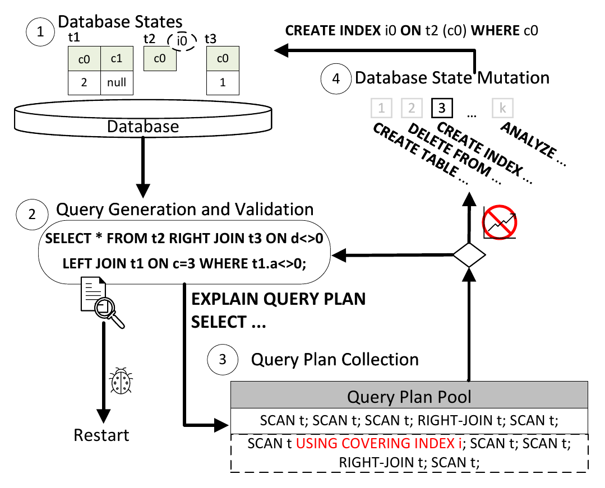
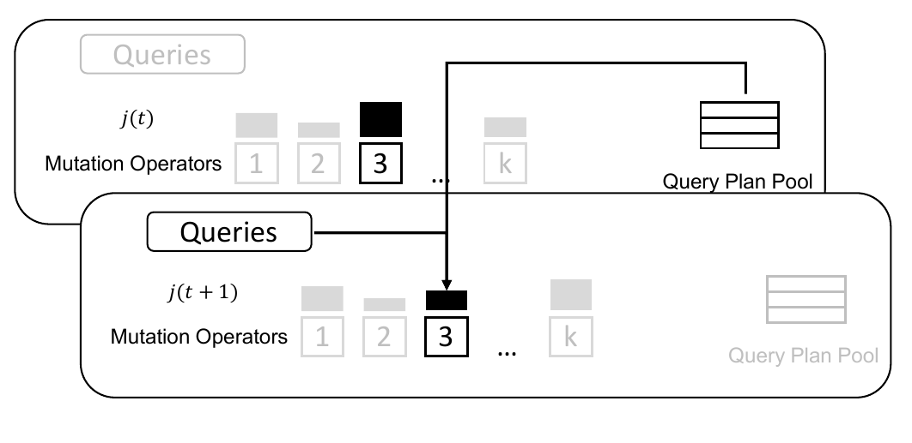
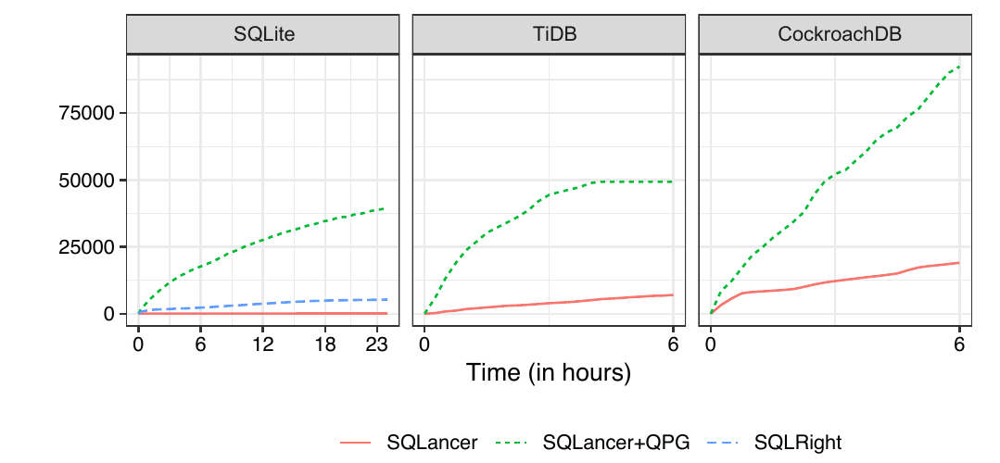
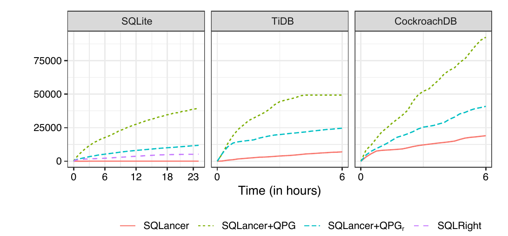
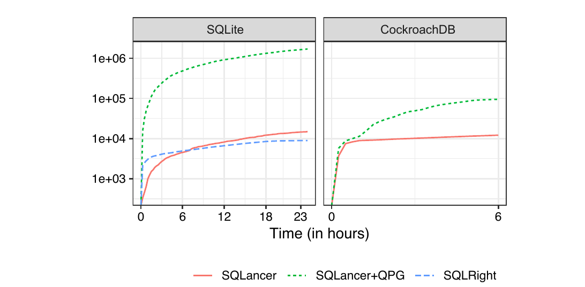
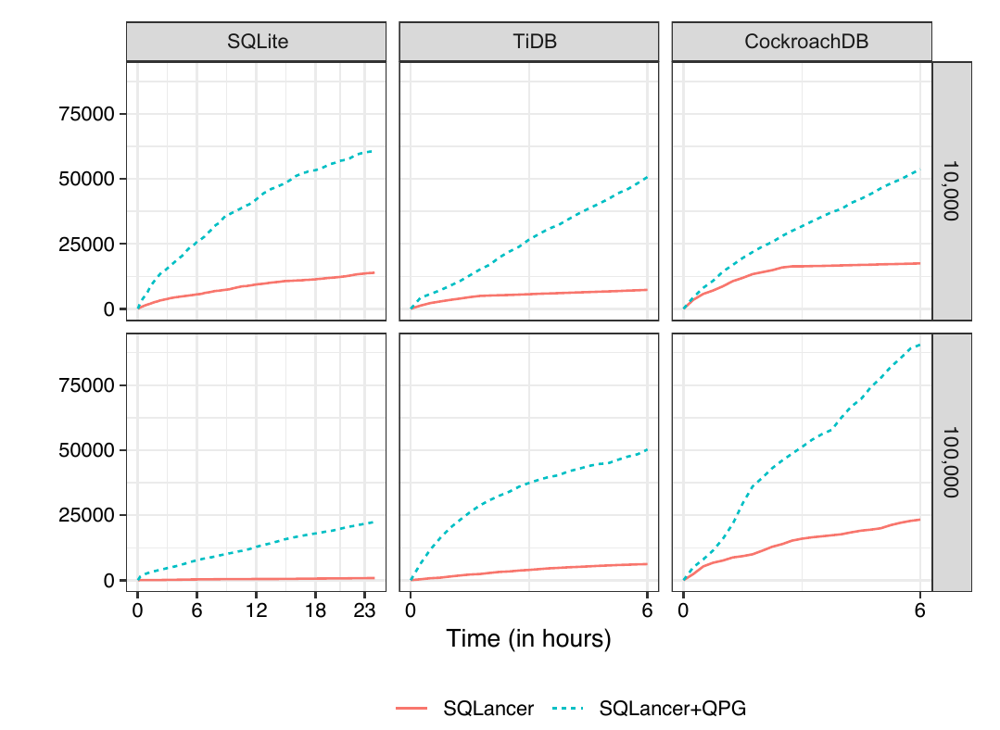
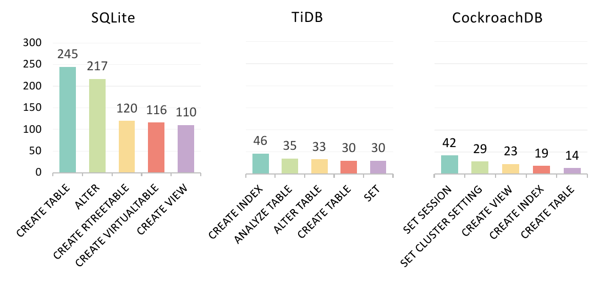

# Testing Database Engines via Query Plan Guidance（中文译文）

## 译者说明

本文依据同目录的 `source.pdf` 翻译。章节、图表、公式、算法、代码与参考文献按原文结构保留。

**Jinsheng Ba**，新加坡国立大学<br>
**Manuel Rigger**，新加坡国立大学

## 摘要

数据库系统广泛用于存储和查询数据。已有研究提出了测试判据（test oracle），用于发现这类系统中的逻辑缺陷，即导致数据库系统计算出错误结果的缺陷。要实现全自动测试，还需将测试判据与测试用例生成技术配合使用。这里的测试用例由一个数据库状态和一条可应用测试判据的查询组成。本文提出查询计划引导（Query Plan Guidance，QPG）的概念，将自动化测试引向“有意思”的测试用例。SQL 等查询语言是声明式的。为执行查询，数据库系统会把源语言中的每个算子转换为可执行的物理算子，且可能有多种物理算子可选。这些物理算子构成的树称为查询计划。我们的直觉是，引导测试探索多种不同的查询计划，也就能探索到更多有意思的行为，其中有些可能是错误的。为此，我们提出一种变异技术，逐步对数据库状态应用有潜力的变异，使 DBMS 在执行后续查询时可能生成此前未见的查询计划。我们将此方法应用于三个成熟、广泛使用且经过大量测试的数据库系统 SQLite、TiDB 和 CockroachDB，发现了 53 个此前未知且互不重复的缺陷。与朴素随机生成方法相比，本方法覆盖的不同查询计划数量是其 4.85–408.48 倍，与代码覆盖率引导方法相比是其 7.46 倍。由于多数数据库系统（包括商用系统）会向用户提供查询计划，我们认为 QPG 是一种普遍适用的黑盒方法，其核心思想也可能用于其他场合，例如衡量测试套件的质量。

**索引词**：自动化测试、测试用例生成。

## I. 引言

数据库管理系统（DBMS）是存储、检索数据并对数据运行查询的基础软件系统。几乎所有计算设备中都有它们 [1]–[3]，因此任何缺陷都可能造成严重后果。逻辑缺陷指 DBMS 返回错误结果，是一类特别难以发现的问题。它会悄无声息地计算出错误结果，而崩溃类缺陷 [4]、[5] 等问题会造成进程终止。例如，清单 1 中的 `SELECT` 语句触发了一个逻辑缺陷，导致本应为空的结果意外包含了一条记录。要发现此类缺陷，需要使用所谓的测试判据来验证 DBMS 的结果。近期提出的一些有效测试判据 [6]–[8] 使得验证这类查询的结果成为可能。

自动发现逻辑缺陷，除了测试判据，还需要能够生成测试用例的方法。对于 DBMS 逻辑缺陷检测，测试用例由一个数据库状态和一条可应用测试判据的查询组成。测试用例生成技术面临两大挑战。首先，应该生成“有意思”的测试用例，以覆盖和检验 DBMS 的各个部分，增加在其中发现缺陷的机会。因为事先不知道 DBMS 受到哪些逻辑缺陷的影响，所以并没有明确的定义或指标来界定什么样的测试用例算有意思。其次，测试用例在语法和语义上均应有效，且应遵循测试判据所要求的结构。例如，NoREC 测试判据要求查询包含 `WHERE` 子句，不能包含更复杂的子句（例如 `HAVING`）[7]，也禁止使用一些函数和关键字（例如聚合函数）。

已有研究提出了基于生成和基于变异的两类方法，以配合上述测试判据 [6]–[8]。SQLancer 采用基于生成的方法，生成的测试用例遵循相应 SQL 方言的语法以及测试判据给出的约束。总体而言，此方法生成的测试用例很可能是有效的。我们观察到，SQLancer 针对 SQLite 生成的查询中约有 90% 是有效的。不过，生成过程缺少能引导其产生有意思的测试用例的反馈。近期，SQLRight [9] 被提出用以弥补这一缺点。SQLRight 对测试用例实施变异，旨在尽可能覆盖更多 DBMS 代码，借鉴了灰盒模糊测试 [10]、[11] 的成功经验。尽管 SQLRight 在多项指标上改进了 SQLancer 的测试用例生成，但已有研究表明，仅以代码覆盖率充当 DBMS [12] 乃至一般有状态系统 [13] 的代理指标并不完善，因为它无法准确刻画数据库的状态。尽管 SQLRight 使用了旨在尽量保证查询有效性的变异算子，但有效查询比例反而较低，为 40% [9]。其他已经提出的测试用例生成方法着眼于寻找崩溃类缺陷，因此不考虑测试判据规定的约束，我们也不进一步讨论。这些方法包括 Squirrel [5] 或 DynSQL [14] 等基于变异的方法，以及 SQLsmith [15] 或 RAGS [16] 等基于生成的方法。

本文提出查询计划引导（QPG），利用查询计划引导生成过程，得到有意思的测试用例。查询计划是一棵由操作组成的树，描述 DBMS 如何执行一条 SQL 语句。DBMS 能直接提供查询计划，用户通常可以用 `EXPLAIN` SQL 语句获得其文本表示，并常通过查看它来调优查询。我们的认识是，查询计划给出了查询执行方式的精简、高层表示，因此覆盖更多不同的查询计划，可以提高发现逻辑缺陷的可能性。

**清单 1.** QPG 在 SQLite 中发现的一个缺陷，原因是索引与 JOIN 联用时，索引使用不正确。对于同一条 SELECT 语句，无索引时产生左侧查询计划，使用索引时产生右侧查询计划。原文用红色突出显示第 6 行和错误结果。

```text
 1 CREATE TABLE t1(a INT, b INT);
 2 INSERT INTO t1(a) VALUES(2);
 3 CREATE TABLE t2(c INT);
 4 CREATE TABLE t3(d INT);
 5 INSERT INTO t3 VALUES(1);
 6 CREATE INDEX i0 ON t2(c) WHERE c=3;
 7
 8 SELECT * FROM t2 RIGHT JOIN t3 ON d<>0 LEFT JOIN
       t1 ON c=3 WHERE t1.a<>0; -- {} ✓ {|1|2|} 🐛
 9 --------------------------------------------------
10 QUERY PLAN
11 WITHOUT INDEX i0:             WITH INDEX i0:
12 |--SCAN t2                    |--SCAN t2 USING
13                                     COVERING INDEX i0
14 |--SCAN t3                    |--SCAN t3
15 |--SCAN t1                    |--SCAN t1
16 `--RIGHT-JOIN t3               `--RIGHT-JOIN t3
17      `--SCAN t3                     `--SCAN t3
```

清单 1 展示了在 SQLite 中执行测试用例的两种情形。第一种情形省略了红色标记的 `CREATE INDEX` 语句，因此 `SELECT` 语句返回空结果。这符合预期，因为表 `t2` 的列 `c` 没有数据，连接条件 `c=3` 为假。第二种情形执行了 `CREATE INDEX` 语句，使得 SQLite 意外取回行 `{|1|2|}`。索引是供查询使用的一种辅助数据结构 [17]，应当不影响查询语义。两种情形执行的是同一个查询，但测试用例下方显示的查询计划因数据库状态不同而异。左侧为正确执行时使用的查询计划，表明系统会顺序读取表 `t2` 中的记录（`SCAN t2`）。右侧查询计划则表明 DBMS 使用索引读取数据（`SCAN t2 USING COVERING INDEX i0`），其执行是错误的。除索引外，还有其他多种因素可能影响查询计划，例如数据的特征。

为生成满足测试判据约束的有效查询，我们提出对数据库状态而非查询进行变异。具体来说，我们复用 SQLancer [6] 中已有的基于语法的随机生成方法来生成查询，同时记录给定数据库状态下见过的全部查询计划。当观察不到新查询计划时，说明当前状态产生未见过的查询计划的潜力已经用尽，此时便对该状态进行变异。我们将选择最有潜力的变异（即修改数据库状态的 SQL 语句）的决策过程建模为多臂老虎机问题，并对所有执行中产生最多新查询计划的 SQL 语句赋予较高优先级。多臂老虎机问题是一种决策模型，需要在若干相互竞争的选项之间分配固定且有限的资源，以最大化期望收益 [18]。

我们在 SQLancer 中实现了 QPG，并在 SQLite、TiDB 和 CockroachDB 上对其进行了评估。我们发现了 53 个此前未知且互不重复的缺陷，开发者均已确认，其中 35 个已经修复。尽管 SQLancer 和 SQLRight 的作者已进行了大量测试，SQLite 中仍有三个缺陷潜藏了六年多才被我们发现，这也体现了实际工作对更高效的测试用例生成方法的需求。要触发其中许多缺陷，需要复杂的查询计划。其查询计划的平均长度是先前发现的缺陷的 2.47 倍。就效率而言，24 小时内，基于 QPG 的实现所覆盖的不同查询计划数是 SQLancer 和 SQLRight 的 4.85–408.48 倍。

本文的主要贡献如下。

- 我们研究了先前发现的缺陷所涉及查询的查询计划，以考察这一思路的潜力。
- 我们提出查询计划引导，作为利用查询计划开展测试的一种一般思路。
- 我们提出了一种具体的测试方法，通过变异数据库状态来兼容既有的测试判据，查询仍按原有方法生成。
- 我们实现并评估了此方法，在广泛使用的 DBMS 中发现了 53 个此前未知且互不重复的缺陷。

## II. 背景

**数据库管理系统。** 数据库管理系统（DBMS）充当应用程序与后端数据之间的接口，帮助用户依据抽象的数据模型来存储、操作和查询数据。关系数据模型 [19] 是最常见的模型，为现代 DBMS 广泛采用。本文主要讨论如何测试这类关系型 DBMS。

**结构化查询语言。** 与关系型 DBMS 交互时，最常用的语言是结构化查询语言（SQL）[20]，其标准为 ISO/IEC 9075。SQL 包括多种类型的语句 [21]，主要可分为以下三种子语言。

1. 数据查询语言（DQL），提供查询数据的 `SELECT` 语句。
2. 数据定义语言（DDL），用于创建及修改数据对象的模式，例如 `CREATE`、`DROP` 和 `ALERT`。<br>
   译注：原文此处写作 `ALERT`。
3. 数据操作语言（DML），用于修改数据对象中的内容，例如 `INSERT` 和 `UPDATE`。

DDL 和 DML 语句可以影响数据库状态，而查询（即 DQL 语句）通常不会。我们的测试用例由 DQL、DDL 和 DML 语句组成。

**查询计划。** 查询计划是一棵由操作组成的树，描述特定 DBMS 如何执行一条 SQL 语句。虽然标准并未规定这一点，多数成熟的关系型 DBMS（包括 DB-Engines 排名中最流行的十种关系型 DBMS）[^1] 都允许用户在查询前加上 `EXPLAIN` 以获取查询计划的文本表示。DBMS 无法总是找出最高效的查询计划 [22]、[23]，因此用户需要根据查询计划理解并优化对性能有关键影响的查询，例如给 DBMS 提供提示（hint）。为了便于调试，提供给用户的查询计划可能包含额外信息，例如估算代价或谓词表达式（例如用于 `WHERE` 子句的表达式）。数据库文献区分逻辑查询计划与物理查询计划 [24]，DBMS 通常提供后者。逻辑查询计划与原始声明式查询紧密对应，而物理查询计划将每个逻辑算子映射成 DBMS 可以执行的物理算子。例如，为了转换对一张表的读取操作，DBMS 可能在多个物理访问方法（例如全表扫描或用索引进行局部扫描）中选择其一。同样，为了连接两张表，DBMS 可能在多种连接算法（例如哈希连接或嵌套循环连接）之间作出选择 [24]。DBMS 为给定查询推导出怎样的查询计划，受到多种因素影响，例如数据库中存储的数据的特征 [25]、辅助数据结构（例如索引）是否存在 [26]、数据库中有哪些表和视图，以及配置选项。本文将查询计划用于黑盒测试，引导测试时不考虑算子的语义。

[^1]: <https://db-engines.com/en/ranking/relational+dbms>

**逻辑缺陷。** 逻辑缺陷是指导致系统计算出错误结果的缺陷。近年来，Rigger 等人提出了若干测试判据 [6]–[8]，在广泛使用的 DBMS 中发现了数百个互不重复的缺陷。我们在本研究中使用其中最新的两种测试判据，代表了当前最先进的方法。三值逻辑划分（Ternary Logic Partitioning，TLP）接收一个查询，然后派生多个更复杂的查询，每个派生查询计算结果的一个分区，最后检查结果是否等价。例如，给定查询与随机谓词 `t0.c0>0`：

```sql
SELECT * FROM t0
```

TLP 派生如下查询，合并它们返回的记录应与第一条查询等价。

```sql
SELECT * FROM t0 WHERE (t0.c0>0)
SELECT * FROM t0 WHERE NOT (t0.c0>0)
SELECT * FROM t0 WHERE (t0.c0>0)ISNULL
```

非优化参考引擎构造（Non-optimizing Reference Engine Construction，NoREC）[7] 检查同一谓词在两种查询中得出的结果是否不一致，一种查询可能被 DBMS 优化，另一种较难被优化。例如，对于谓词 `t0.c0>0`，NoREC 检查下方第一条查询返回的行数是否等于第二条查询返回结果中 `TRUE` 出现的次数。

```sql
SELECT * FROM t0 WHERE (t0.c0>0)
SELECT (t0.c0>0)FROM t0
```

两种测试判据均对查询格式有限制。例如，NoREC 要求有 `WHERE` 子句，但禁止使用聚合函数和其他更复杂的子句。原则上，我们的方法可以与任何测试判据配合使用。


## III. 查询计划研究

为了考察使用查询计划作为引导信号的潜力，我们分析了先前发现的缺陷中所涉及查询的查询计划，考察其独特性和复杂性。我们的假设是会看到各式各样的查询计划。若果真如此，以探索更多不同的查询计划为目标来优化缺陷检测技术，可能是有效的。

**表 I.** 查询计划研究的对象。

| DBMS | 版本 | 代码行数 | EXPLAIN 语句 |
| --- | --- | ---: | --- |
| CockroachDB | 19.2.12 | 1.1M | `EXPLAIN (OPT)...` |
| DuckDB | 0.19 | 59K | `EXPLAIN...` |
| H2 | 2.0.202 | 0.3M | `EXPLAIN...` |
| MariaDB | 10.4.25 | 3.6M | `EXPLAIN FORMAT='JSON'...` |
| MySQL | 5.7.33 | 3.8M | `EXPLAIN FORMAT='JSON'...` |
| PostgreSQL | 11.16 | 1.4M | `EXPLAIN (COSTS FALSE)...` |
| SQLite | 3.30.0 | 0.3M | `EXPLAIN QUERY PLAN...` |
| TiDB | 3.0.12 | 0.8M | `EXPLAIN...` |

**表 II.** 先前发现的缺陷中所涉及查询的查询计划。长度表示一个查询计划中操作的平均数量。

| DBMS | 缺陷数 | 查询计划总数 | 不同查询计划数 | 长度 |
| --- | ---: | ---: | ---: | ---: |
| CockroachDB | 68 | 37 | 32 | 3.43 |
| DuckDB | 75 | 59 | 18 | 2.00 |
| H2 | 19 | 10 | 7 | 3.70 |
| MariaDB | 7 | 5 | 5 | 1.00 |
| MySQL | 40 | 35 | 22 | 1.03 |
| PostgreSQL | 31 | 9 | 3 | 2.33 |
| SQLite | 193 | 118 | 62 | 2.14 |
| TiDB | 62 | 43 | 32 | 5.07 |
| 平均 | | | | 2.59 |

**研究对象。** 我们选择 SQLancer 的公开缺陷报告作为研究对象。SQLancer 提供一个公开列表，[^2] 包含跨 9 种 DBMS 的 499 份缺陷报告所记录的所有已发现缺陷及相应测试用例。我们排除了在 TDengine 中发现的 4 个缺陷，因为该 DBMS 不提供查询计划。给定查询的查询计划可能随版本变化。为获得准确的查询计划，我们选用与发现相应缺陷时最接近的发行版本。表 I 列出了所选 DBMS 的细节。

[^2]: <https://github.com/sqlancer/bugs>

**获取查询计划。** 对所有 495 个会触发缺陷的测试用例，我们用表 I 所列的 `EXPLAIN` 语句对其中的全部查询（即 `SELECT` 语句）进行插桩。不同 DBMS 的查询计划可能会包含各种辅助信息。我们识别出其中三种。一种是估算代价（例如 PostgreSQL 的估算代价），对几乎每条查询，它都有所不同。第二种是 `WHERE` 子句中的表达式，有些 DBMS（例如 CockroachDB）会把它包含在计划中。第三种是用于区分查询计划中各项操作的随机标识符（例如 MariaDB 和 MySQL 中的标识符）。为排除这些辅助信息，我们相应调整了 `EXPLAIN` 语句的参数，见表 I。最后，我们从获得的查询计划中移除了表名、视图名和索引名，以便仅根据结构区分查询计划。这基于以下直觉：执行逻辑相同而表名不同的两份查询计划（例如 `SCAN t1` 和 `SCAN t2`），DBMS 处理它们的方式应该相似。

**独特性分析。** 表 II 给出了查询计划的分布。我们共获得 316 份查询计划，其中 57.28% 互不重复。查询计划数少于测试用例数，原因有二。第一，有些测试用例不含查询。第二，有些以前曾触发缺陷的查询会被后续版本的 DBMS 拒绝。不同计划所占比例最低的是 DuckDB，为 30.51%；最高的是 MariaDB，为 100.00%，原因是测试用例少。总体而言，先前发现的缺陷所涉及查询的计划多种多样，说明覆盖更多样的查询计划可能会提高发现缺陷的概率。

> 先前发现的缺陷中所涉及查询的查询计划差异显著，其中 57.28% 互不重复。

**复杂性分析。** 我们考察了先前发现的缺陷中所涉及查询的计划复杂性。数据库状态或查询复杂时，查询计划会包含许多操作。例如，在 SQLite 中，从两张表检索数据的查询计划至少需要三项操作：扫描表 `t0`、扫描表 `t1`、合并结果。这比只扫描表 `t0` 更复杂。表 II 的长度一列显示，一个查询计划平均包含 2.59 项操作，说明与缺陷相关的查询计划大多很短。我们还发现，8 种 DBMS 中最常见的查询计划是扫描表 `t0`，即对单表进行不使用索引的顺序扫描。例如，在 SQLite 中，118 份查询计划中有 26 份只包含一次表扫描。这表明，先前发现的缺陷的查询计划比较简单。一种可能的解释是，小范围假说 [27] 所指的那样，短小、简单的查询计划已足以触发这些先前发现的缺陷；也可能是现有方法集中测试了简单的查询和数据库状态。我们推测，覆盖更复杂的查询计划可能会提高发现缺陷的概率。

> 先前发现的缺陷中所涉及查询的查询计划短小而简单，平均每份查询计划仅有 2.59 项操作。

## IV. 方法

为了高效发现 DBMS 中的逻辑缺陷，我们提出以查询计划引导（QPG）对数据库实施变异，探索更多不同、更加复杂的数据库状态。我们的认识是，给定查询的查询计划反映了 DBMS 的内部执行逻辑，因此覆盖更多不同的查询计划可以提高发现逻辑缺陷的概率。与朴素随机生成相比，我们的方法逐步变异数据库状态，使后续查询可以覆盖更多不同且更复杂的查询计划。我们选择变异数据库状态而非查询，因为测试判据对查询有多种约束，基于变异的方法很难满足它们 [9]。Squirrel [5] 和 SQLRight [9] 等其他基于覆盖率的 DBMS 测试工具采用灰盒测试。QPG 无需 DBMS 源代码，只使用成熟 DBMS 直接提供的信息，因此我们将其视为黑盒测试。这一技术也可应用于商用闭源 DBMS。



**图 1.** QPG 概览。虚线表示步骤 ④ 在下一轮迭代中影响的数据。

译注：图 1 中的索引语句在原文中写作 `CREATE INDEX i0 ON t2 (c0) WHERE c0`。清单 1 和第 IV.D 节的示例使用列 `c` 和条件 `WHERE c=3`。

**系统概览。** 图 1 基于清单 1 展示了我们实现 QPG 的整体流程。在步骤 ① 给定初始的数据库状态后，QPG 在步骤 ② 随机生成一条 SQL 查询并在数据库上执行，再用测试判据验证查询结果。如果测试判据表明存在缺陷，QPG 就输出缺陷报告并重启测试过程。否则，QPG 在步骤 ③ 记录查询计划，将其追加至查询计划池。通常，流程会沿用同一数据库状态，返回步骤 ②。但如果经过固定次数的迭代仍未观察到新的查询计划，QPG 就在步骤 ④ 对当前数据库状态应用变异算子以构造新的状态，假设在新状态下，后续可以探索到新的查询计划。

### A. 数据库状态（①）

初始数据库状态可以随机生成，也可以手动给定。在我们的实现中，通过随机执行 DDL 和 DML 语句生成初始状态。为避免数据库状态为空，我们先执行 `CREATE TABLE` 语句。例如，构造图 1 的初始数据库状态时，我们执行清单 1 的第 1–5 行。我们不直接修改数据库文件，因为这类文件高度结构化 [28]，任何非预期的字节都可能引发错误，阻碍测试过程。

### B. 生成和验证查询（②）

**生成查询。** 我们生成查询，然后自动验证它们的结果来发现缺陷。生成的查询必须符合两项主要约束。第一，查询对于当前数据库状态在语义上必须有效。例如，查询只能引用已经存在的表和视图。第二，查询必须符合测试判据规定的约束。例如，NoREC 测试判据要求有 `WHERE` 子句，却禁止其他子句（如 `HAVING` 或 `GROUP BY`）。为此，我们沿用 SQLancer 基于规则的随机生成方法，该方法根据相应 SQL 方言的语法生成查询，使其符合相关约束。已有许多生成查询的方法 [12]、[29]–[34]。原则上，我们的方法可以与其中任意一种配合使用。

**验证。** 我们采用当前先进的逻辑缺陷测试判据 NoREC [7] 和 TLP [6] 验证查询结果。两者都是蜕变测试方法 [35]。给定一个查询，它们会派生另一个查询，用后者的结果集来验证原始查询的结果。在图 1 中，给定三个表和测试判据，我们生成如下查询：

```sql
SELECT * FROM t2 RIGHT JOIN t3 ON d<>0 LEFT JOIN t1 ON c=3 WHERE t1.a<>0
```

测试判据表明返回的空结果正确，流程因此继续到步骤 ③。若测试判据报告存在缺陷，我们就输出缺陷报告，重启测试过程。

### C. 收集查询计划（③）

我们如第 III 节所述，使用 `EXPLAIN` 语句对查询进行插桩，从而收集查询计划。图 1 中，用于获取查询计划的语句是：

```sql
EXPLAIN QUERY PLAN SELECT * FROM t2 RIGHT JOIN t3
ON d<>0 LEFT JOIN t1 ON c=3 WHERE t1.a<>0
```

我们得到查询计划（见清单 1 的第 12–17 行左半部分），并移除其中的表名和索引名。

我们将查询计划加入查询计划池，该池只存储互不重复的计划。查询计划池用哈希表实现，键是查询计划，值是相应的查询字符串。给定一份查询计划，先检查池中是否已有这份计划，若没有就插入。图 1 中，查询计划池起初为空，因此我们插入这份计划（步骤 ③ 中的第一行）。如果经过固定数量的查询后仍无新查询计划进入池中，我们就调用步骤 ④，以促使 DBMS 探索更多不同的查询计划。否则，我们在步骤 ② 继续使用同一数据库状态测试 DBMS。阈值越高，在单一数据库状态下用来测试 DBMS 的查询就越多；阈值较低时，用于测试 DBMS 的数据库状态就更多。默认值为 1,000，我们通过经验判断此值效果良好。

### D. 数据库状态变异（④）

如果经过固定数量的查询仍没有观察到新查询计划，我们便调用数据库状态变异步骤 ④。此步骤修改数据库状态，旨在使 DBMS 针对后续查询探索不同的查询计划。

作为变异算子，我们考虑与生成初始数据库状态时相同的 DDL 和 DML 语句，例如 `CREATE TABLE`、`CREATE INDEX` 和 `ANALYZE`。一个关键挑战是应用有潜力的变异，使查询有较大概率触发新的查询计划。我们把这一任务建模为多臂老虎机（Multi-Armed Bandit，MAB）问题 [18]、[36]。这是一种常见而高效的方法，已被多项模糊测试研究采用 [37]–[40]。在 MAB 中，需要在相互竞争的选项间分配固定且有限的资源，以使期望收益最大化。对于我们的场景，给定有限的计算资源，我们要选取 SQL 语句（选项）来变异数据库状态，使覆盖的不同查询计划数（收益）最大化。

为了最大化期望收益，自动化代理尝试获取新的知识（称为“探索”），也会依据已有知识优化决策（称为“利用”）。在此场景中，已知只有部分变异算子的收益经过观察，下一次既可以选择已探索的算子，也可以选择尚未探索的算子。根据已探索的变异算子作出决策（利用）往往会提高收益，但也可能错过尚未探索的变异算子带来的更高收益。已有多种算法用于平衡探索与利用。我们采用经典的 $\epsilon$-贪心算法 [41]，以一定概率选择已知收益最高的算子，否则就随机选择一个算子。原文将此算法写为“episode greedy”，式（1）给出了 $\epsilon$ 控制选择概率的规则。

算法如下。第 $t$ 次调用数据库状态变异步骤 ④ 时，按式（1）选择一个变异算子。 $k$ 为候选变异算子数， $\hat{\mu} _ {i(t)}$ 为时刻 $t$ 变异算子 $i$ 的已知收益。 $\epsilon$ 为 0 到 1 之间的固定概率。默认值为 0.7，由经验确定，效果良好。我们以 $1-\epsilon$ 的概率选择已知收益最高的算子，否则随机选一个。

$$
j(t)=
\begin{cases}
\arg\max _ {i=1\ldots k}\left(\hat{\mu} _ {i(t)}\right) & (1-\epsilon)\\
\mathit{random}(k) & (\epsilon)
\end{cases}
\qquad \text{(1)}
$$

**表示已知收益 $\hat{\mu} _ {i}$ 。** 对所有选过 $i$ 的迭代， $\hat{\mu} _ {i}$ 取收益的加权平均，而标准算法使用不加权的平均值。DBMS 是有状态的系统。数据库状态既取决于最后应用的变异算子，也取决于上一个数据库状态。对不断变化的数据库状态应用同样的变异算子，会得到不同的数据库状态。因此一个变异算子在各次迭代中的收益并非独立同分布。对同一变异算子，上一次得到的收益更接近该算子在最新数据库状态上的实际收益。为了近似已知收益，我们采用加权平均值，为较晚的收益分配比较早的收益更高的权重。式（2）给出每次迭代更新 $\hat{\mu} _ {i}$ 的公式。 $Q$ 是上一次选择 $i$ 时的收益， $w$ 是 $Q$ 的权重，是介于 0 到 1 之间的常量，默认值为 0.25，由经验确定，效果良好。无论经过了多少次迭代，更早的收益在 $\hat{\mu} _ {i}$ 中的权重总共只占 $1-w$ 。例如，给定 $w=0.1$ 、 $\hat{\mu} _ {i(999)}=0.1$ ，第 1,000 次迭代的 $Q=2$ ，则 $\hat{\mu} _ {i(1000)}=0.1+(2-0.1)\ast 0.1=0.29$ ，比不加权的平均值 $0.1+(2-0.1)/1000=0.1019$ 高得多，也更接近 $Q$ 。出于效率考虑，所有并行测试进程共享同一个 $\hat{\mu} _ {i}$ 。

$$
\hat{\mu} _ {i(t+1)}=\hat{\mu} _ {i(t)}+(Q-\hat{\mu} _ {i(t)})\ast w
\qquad \text{(2)}
$$



**图 2.** 步骤 ④ 衡量已知收益的工作流程。

**表示即时收益 $Q$ 。** $Q$ 根据在最新数据库状态上执行时能探索到新查询计划的查询所占比例来度量。所用查询包括查询计划池中的查询，以及基于最新数据库状态生成的一组新查询。计划池包含所有不重复的查询计划及相应的查询，我们重新执行这些查询，以评估同样的查询能探索到多少新计划。为确保查询计划池中的查询始终有效，我们会移除因数据库状态变化而失效的查询。我们观察到，实际中这能把池的大小控制在合理范围（少于 8,000 条）。但对于某些变异算子（例如 `CREATE TABLE`），这些查询均与新建的表无关，因此观察不到新计划。若据此判定其收益为零并不公允，所以我们还会生成一组新查询，并考察探索到多少新查询计划。例如，应用变异算子 $i$ 后，查询计划池里的查询有 $2/50$ 探索到了未见过的查询计划，新生成的查询集合有 $10/20$ 探索到了未见过的计划。此时，我们将即时收益计算为 $Q=2/50+10/20=0.54$ 。

图 2 展示了步骤 ④ 中衡量已知收益 $\hat{\mu} _ {i}$ 的工作流程。假设变异算子 3 在第 $t$ 轮因其最高的 $j(t)$ 而被选中，我们在下一轮 $t+1$ 中，使用第 $t$ 轮之后所生成的查询和第 $t$ 轮查询计划池中的查询来更新 $\hat{\mu} _ {3}$ 。随后计算 $j(t+1)$ 并选择变异算子 $k$ 。译注：原文写“最高的 $j(t)$ ”，但按式（1）， $j(t)$ 本身是选中的算子编号，择优时比较的是已知收益。

在图 1 中，我们应用以下语句，在步骤 ① 创建索引 `i0`：

```sql
CREATE INDEX i0 ON t2 (c)WHERE c=3
```

假如在步骤 ② 生成的是同一个查询，就会观察到清单 1 的第 12–17 行右侧所示的新查询计划，并将它加入查询计划池。这样，在步骤 ② 就会暴露该缺陷。

最后，为了最大化覆盖的不同查询计划数，我们每测试固定数量的查询就清除数据库状态。一般来说，逐步变异同一数据库状态可以探索更多不同且更加复杂的数据库状态。然而，当前数据库状态可能限制通过变异可到达的状态空间。所以在测试固定数量的查询后，我们清除数据库状态，然后重启测试流程。这个数量可配置。默认值取合理的 1,000,000，我们在实验中发现这一取值效果良好（见第 V 节）。

### E. 实现

我们在 SQLancer [^3] 中实现了上述 QPG 方法，下文将原型称为 SQLancer+QPG。此外，我们更新了 SQLancer，使其支持最新版本的 SQLite，其中有三项新特性，即 `RIGHT JOIN`、`FULL OUTER JOIN` 和 `STRICT`。实现我们的方法用了约 1,000 行 Java 代码，每个 DBMS 专用组件的适配另需约 100 行 Java 代码，例如要定义收集查询计划所用的专用语句。

[^3]: <https://github.com/sqlancer/sqlancer>

我们将该方法设计为可与现有测试工具兼容。因此，在数据库状态步骤 ① 和生成及验证查询步骤 ② 中，我们沿用 SQLancer 的实现。我们将数据库状态变异步骤 ④ 中描述的算法实现为跨 DBMS 复用的独立模块。我们使用 SQLancer 支持的、可能有助于覆盖更多不同查询计划的 DDL 和 DML 语句作为变异算子（SQLite 有 23 种，TiDB 有 13 种，CockroachDB 有 17 种），详细清单可在我们的实验制品中找到。为了避免大量表和索引拉低测试吞吐量，我们设置了一个自行选定的合理上限，最多 10 个表和 20 个索引。


## V. 评估

为评估 QPG 在发现 DBMS 缺陷方面的有效性和效率，我们基于原型 SQLancer+QPG，尝试回答以下问题。

- **Q.1 新缺陷。** QPG 是否有助于发现新缺陷？发现这些缺陷是否需要复杂的查询计划？
- **Q.2 覆盖不同的查询计划。** 与朴素随机生成及代码覆盖率引导方法相比，QPG 能否覆盖更多不同的查询计划？
- **Q.3 缺陷检测效率。** 与朴素随机生成及代码覆盖率引导方法相比，QPG 能否更高效地发现缺陷？
- **Q.4 敏感性分析。** QPG 的每个组件分别有何贡献？QPG 在不同配置下表现如何？

**受测 DBMS。** 我们测试了 SQLite、TiDB 和 CockroachDB。SQLite 是最流行的嵌入式 DBMS，嵌入式 DBMS 与应用程序一起构建，并在同一进程中运行。每台 iOS 和 Android 智能手机都使用 SQLite [1]。TiDB 和 CockroachDB 是流行的企业级 DBMS，其 GitHub 上的开放版本非常流行，星标数分别超过 31.9k 和 25.2k。它们应用广泛，因此也用于其他 DBMS 测试研究 [5]、[6]、[8]、[9]。我们没有考虑其他流行 DBMS，原因各异。例如，对于 MySQL 和闭源 DBMS，只有新版本发布后才能验证缺陷修复。在此之前，已知缺陷可能被反复触发，很难识别新的缺陷。此外，一些 DBMS（例如 MySQL）中许多先前报告的缺陷仍未修复，阻碍了测试过程，先前研究 [6] 也指出过这一点。作为黑盒方法，QPG 支持任何 DBMS，不受其实现语言限制。SQLite 以 C 编写，TiDB 和 CockroachDB 以 Go 编写。对于 Q.1、Q.2 和 Q.4，我们使用最新可获得的开发版本（SQLite 3.39.0、TiDB 6.3.0、CockroachDB 23.1）。对于 Q.3，为公平比较，我们选用所有工具均已测试、且都能在其中找到缺陷的历史版本（SQLite 3.36.0、TiDB 4.0.15、CockroachDB 21.2.2）。

**基线。** 我们比较了 SQLancer+QPG、SQLancer 和 SQLRight。后两者都为发现逻辑缺陷而设计，但测试用例生成技术不同。SQLancer 实现了朴素随机生成方法，是 SQLancer+QPG 的基础基线。它在 GitHub 上有超过 1,000 个星标，为许多公司采用。SQLRight 是当前先进的工具，采用代码覆盖率引导。通过比较，我们得以了解 QPG 相对于朴素随机生成及代码覆盖率引导方法在发现逻辑缺陷方面的优势。

**实验设施。** 全部实验都在 Intel(R) Xeon(R) Gold 6230 处理器上进行，实验配置有 40 个物理核心、80 个逻辑核心，时钟频率为 2.10 GHz。测试机使用 Ubuntu 20.04，配备 768 GB 内存，最多使用 40 个核心。为获得有统计显著性的结果，我们重复了每项实验 10 次。

### Q.1 新缺陷

我们运行了大约两个月的 SQLancer+QPG 以发现缺陷，同期也在实现这一方法。为更清楚地展示每个新发现缺陷的根本问题，我们既使用 C-Reduce [42] 也手动最小化测试用例。向开发者报告某个缺陷后，我们暂停测试，直到缺陷修复，尽可能避免重复报告。如果几周内未修复，我们就报告多个推测互不重复的缺陷。SQLite 的缺陷通常会在 24 小时内修复，TiDB 和 CockroachDB 的缺陷通常在几周内修复，因此我们主要测试 SQLite。测试使用 NoREC [7] 和 TLP [6]，两者都是 SQLancer 和 SQLRight 共同支持的先进测试判据。

**表 III.** SQLancer+QPG 发现的新缺陷数量。

| DBMS | 崩溃 | 错误 | 逻辑 | 全部 |
| --- | ---: | ---: | ---: | ---: |
| SQLite | 0 | 5 | 23 | 28 |
| TiDB | 2 | 4 | 3 | 9 |
| CockroachDB | 3 | 11 | 2 | 16 |
| 合计 | 5 | 20 | 28 | 53 |

**缺陷概览。** 表 III 给出了 SQLancer+QPG 发现的此前未知且互不重复的缺陷数。我们共发现 53 个缺陷，均已得到确认，其中 35 个已修复。尽管这些 DBMS 已广泛接受过 SQLancer 的测试，我们还是借助 QPG 发现了这些缺陷。53 个缺陷中，28 个是由 TLP 和 NoREC 测试判据发现的逻辑缺陷，25 个与崩溃或内部错误有关。这表明 QPG 生成的复杂数据库状态既有助于找到逻辑缺陷，也有助于发现其他类型的缺陷。尽管 CockroachDB 在持续集成（Continuous Integration，CI）中使用了 TLP 测试判据，[^4] 我们仍用 QPG 发现了 16 个此前未知的缺陷。就 SQLite 的新特性而言，QPG 在 `RIGHT JOIN` 中发现了 13 个缺陷，在 `FULL JOIN` 中发现了 2 个，在 `STRICT` 中没有发现缺陷。下面给出找到的两个缺陷作为示例。

[^4]: <https://github.com/cockroachdb/cockroach/commit/777382e6>

**清单 2.** SQLite 的 RIGHT JOIN 特性中的一个缺陷。原文用红色突出显示 RIGHT OUTER JOIN 部分。

```sql
1 CREATE TABLE t1(a CHAR);
2 CREATE TABLE t2(b CHAR);
3 INSERT INTO t2 VALUES('x');
4 CREATE TABLE t3(c CHAR NOT NULL);
5 INSERT INTO t3 VALUES('y');
6 CREATE TABLE t4(d CHAR);
7
8 SELECT * FROM t4 LEFT OUTER JOIN t3 ON TRUE
      INNER JOIN t1 ON t3.c='' RIGHT OUTER
      JOIN t2 ON t3.c='' WHERE t3.c ISNULL; --
      {} 🐛, {|||x} ✓
```

**示例 1：RIGHT JOIN 特性中的缺陷。** 清单 2 展示了一个测试用例，暴露出我们在 SQLite 中发现的一个逻辑缺陷。由于 `ISNULL` 与 `RIGHT JOIN` 一同使用时优化有误，`SELECT` 语句错误地返回了空结果。`SELECT` 语句的查询计划长度为六项操作，其中四项各扫描一张表一次，另两项将表 `t2` 与对 `t2` 的另一次扫描结果作连接。查询计划相对较长，因为表连接通常涉及多项操作。SQLite 有 13 个缺陷出现在 `RIGHT JOIN` 特性中，QPG 为发现这些缺陷生成了更复杂的数据库状态。

**清单 3.** SQLite 的 json_quote 函数中的一个缺陷。原文以红色标出该函数调用。

```sql
1 CREATE TABLE t1 (a CHAR);
2 CREATE VIEW v1(b) AS SELECT json(TRUE);
3 INSERT INTO t1 VALUES ('x');
4
5 SELECT * FROM v1, t1 WHERE NOT json_quote(b); --
      {} 🐛, {1|x} ✓
```

**示例 2：JSON 特性中的缺陷。** 清单 3 是另一个逻辑缺陷，从 2016 年 7 月 23 日起就存在于 SQLite 中。`SELECT` 语句错误地返回空结果，因为系统在视图（`VIEW`）上下文中错误地优化了 `json_quote` 函数。这个视图上下文是发现该缺陷的必要条件。如果用以下语句替换第二行，就不能找到该缺陷：

```sql
CREATE TABLE v1(b)AS SELECT json(1)
```

在 SQLite 中，我们共找到三个潜藏了六年多的缺陷。尽管 SQLancer 和 SQLRight 的作者已进行了大量测试，SQLancer+QPG 仍是首个找到它们的工具。

**表 IV.** 新发现缺陷中所涉及查询的查询计划。

| DBMS | 总数 | 不同查询计划数 | 长度 |
| --- | ---: | ---: | ---: |
| SQLite | 51 | 29 | 5.55 |
| TiDB | 12 | 9 | 5.67 |
| CockroachDB | 6 | 6 | 7.83 |
| 平均 | | | 6.35 |

**查询计划的独特性与复杂性。** 为更好地了解 QPG 是否以及如何让测试探索多种不同的查询计划，我们分析了表 III 所列缺陷中查询的查询计划，共获得 69 份计划，其中 63.77% 互不重复。这进一步说明了查询计划的多样性。查询的计划长度平均为 6.35。表 II 中，一份查询计划平均有 2.59 项操作。相比之下，暴露这些新发现的缺陷需要更复杂的查询计划，QPG 成功促使 DBMS 生成了这些计划。

> 借助 QPG，我们发现了 53 个此前未知且互不重复的缺陷，其中所涉及查询的计划平均长度为 6.35。

### Q.2 覆盖不同的查询计划

我们评估了 SQLancer+QPG 在 24 小时内能否覆盖比 SQLancer 和 SQLRight 更多的不同查询计划。第 III 节研究表明，先前发现的缺陷涉及的查询计划多种多样，因此覆盖更多不同的查询计划很可能增加发现缺陷的概率。我们设计 SQLancer+QPG 来探索比 SQLancer 更多样且更复杂的查询计划。实验使用 TLP 测试判据，这是我们考察的所有 DBMS 唯一共同支持的测试判据。



**图 3.** 24 小时内 10 次运行的不同查询计划平均数量。由于崩溃，TiDB 和 CockroachDB 只能运行 6 小时。

**测量。** 图 3 展示了所有工具在 24 小时内运行 10 次所覆盖的不同查询计划的平均数量。我们每 15 分钟记录一次查询计划，并按照第 III 节的做法移除表名、视图名和索引名。对于 TiDB 和 CockroachDB，SQLancer+QPG 最多运行 6 小时，因为它找到了几个崩溃缺陷，在我们的评估期间始终未修复。SQLRight 不支持 TiDB 和 CockroachDB，因此只能在 SQLite 上运行。表 V 展示了 24 小时内 10 次运行所执行查询的计划长度均值和中位数。

**表 V.** 24 小时内 10 次运行的查询计划长度均值和中位数。因崩溃，TiDB 和 CockroachDB 仅报告 6 小时的结果。

| DBMS | SQLancer 均值 | SQLancer 中位数 | SQLRight 均值 | SQLRight 中位数 | SQLancer+QPG 均值 | SQLancer+QPG 中位数 |
| --- | ---: | ---: | ---: | ---: | ---: | ---: |
| SQLite | 2.95 | 2.00 | 2.17 | 1.00 | 4.69 | 4.00 |
| TiDB | 3.97 | 2.00 | - | - | 15.04 | 8.20 |
| CockroachDB | 4.55 | 4.00 | - | - | 8.87 | 6.90 |
| 平均 | 3.82 | 2.67 | 2.17 | 1.00 | 9.53 | 6.37 |

**结果。** 在不同查询计划数量及其复杂性这两项指标上，SQLancer+QPG 都明显优于 SQLancer 和 SQLRight。它覆盖的不同查询计划数量是 SQLancer 的 4.85–408.48 倍，是 SQLRight 的 7.46 倍。CockroachDB 提供细粒度的查询计划，因此 SQLancer+QPG 在这个 DBMS 上最明显地胜过 SQLancer。在 TiDB 中，SQLancer+QPG 的增长大约在 5 小时时停滞，因为有一个崩溃缺陷令 TiDB 服务端进程终止。表 V 显示，SQLancer+QPG 的查询计划平均长度是 SQLancer 的 1.59–3.79 倍，是 SQLRight 的 2.16 倍。为减轻随机性影响，我们使用 Vargha–Delaney [43]（ $\hat{A} _ {12}$ ）及 Wilcoxon 秩和检验 [44]（ $U$ ）来衡量 SQLancer+QPG 相对于 SQLancer 的表现。 $\hat{A} _ {12}$ 度量效应量，给出随机选取的 SQLancer+QPG 测试运行优于随机选取的 SQLancer 测试运行的概率，即 $\hat{A} _ {12}\gt 0.5$ 表示 SQLancer+QPG 表现更好。Wilcoxon 秩和检验 $U$ 是一种非参数统计假设检验，用于判断两种工具的结果是否有差异。若 $U\lt 0.05$ ，我们拒绝零假设，即 SQLancer+QPG 显著优于 SQLancer。对于上述两项指标，SQLancer+QPG 与 SQLancer 相比，在所有 DBMS 上均有 $\hat{A} _ {12}=1$ 且 $U\lt 0.05$ 。结果表明，我们的算法在测试中持续生成显著更多样且更复杂的数据库状态。

> 与朴素随机生成方法相比，QPG 覆盖的不同查询计划数量是其 4.85–408.48 倍；与代码覆盖率引导方法相比，是其 7.46 倍。

**表 VI.** 24 小时内 10 次运行的行覆盖率和分支覆盖率。

| DBMS | SQLancer 行 | SQLancer 分支 | SQLRight 行 | SQLRight 分支 | SQLancer+QPG 行 | SQLancer+QPG 分支 |
| --- | ---: | ---: | ---: | ---: | ---: | ---: |
| SQLite | 30.3% | 22.7% | 48.1% | 38.9% | 32.6% | 24.4% |

**代码覆盖率。** 我们主要关心能否覆盖更多不同的查询计划，但代码覆盖率也是常用指标，可以一定程度上反映系统受测范围。为此，我们评估了三种工具的行覆盖率和分支覆盖率。由于 TiDB 和 CockroachDB 用 Go 编写，而 SQLRight 不支持 Go，我们只测量 SQLite 的代码覆盖率。表 VI 显示了 24 小时内 10 次运行的平均行覆盖率及分支覆盖率。尽管 SQLancer+QPG 的目标并非最大化代码覆盖率，但由于覆盖了更多不同的查询计划，其行覆盖率和分支覆盖率均优于 SQLancer。SQLRight 达到的覆盖率显然最高，原因有三。第一，SQLRight 的设计目标就是提高代码覆盖率。第二，SQLancer 和 SQLancer+QPG 只生成针对 DBMS 核心逻辑的 SQL 语句，而 SQLRight 通过解析 DBMS 的语法文件生成各种 SQL 语句。第三，SQLRight 提供高质量的种子，其已有的行覆盖率为 34.1%，分支覆盖率为 26.4%，即使不进行变异也超过其他工具。鉴于 SQLite 的内部测试达到 100% 的分支覆盖率，[^5] 我们认为，更高的代码覆盖率对发现逻辑缺陷的贡献有限。

[^5]: <https://www.sqlite.org/testing.html#mcdc>

### Q.3 缺陷检测效率

我们评估 SQLancer+QPG 查找缺陷的速度是否优于 SQLancer 和 SQLRight。为此，我们使用 TLP 测试判据，让 SQLancer+QPG、SQLancer 和 SQLRight 各运行 24 小时。我们尽可能区分不同的缺陷，判断的依据是：（1）堆栈跟踪是否相同（崩溃类缺陷）；（2）错误消息是否相同（错误类缺陷）；（3）SQL 子句结构是否相同（逻辑缺陷）。例如，如果两个缺陷对应的查询都只有 `RIGHT JOIN` 和 `GROUP BY` 子句，就视为同一个缺陷。

**表 VII.** 10 次运行发现的全部缺陷数与去重后的缺陷数。

| DBMS | SQLancer 全部 | SQLancer 去重 | SQLRight 全部 | SQLRight 去重 | SQLancer+QPG 全部 | SQLancer+QPG 去重 |
| --- | ---: | ---: | ---: | ---: | ---: | ---: |
| SQLite | 2 | 1 | 2 | 1 | 4 | 2 |
| TiDB | 56 | 10 | - | - | 118 | 12 |
| CockroachDB | 4 | 2 | - | - | 8 | 3 |
| 合计 | 62 | 13 | 2 | 1 | 130 | 17 |

表 VII 给出了每种工具在 24 小时内 10 次运行发现的全部缺陷数，以及推定互不重复的缺陷数。由于崩溃缺陷会终止整个进程，全部实验均在不到 24 小时时因首次观察到崩溃而结束（SQLite 9 小时、TiDB 1 小时、CockroachDB 16 小时）。我们没有重启测试过程，因为这会使 SQLancer+QPG 丢失数据库状态，从而使其处于不利地位。总体上，SQLancer+QPG 发现的缺陷总数是 SQLancer 的 2 倍，去重后的缺陷数是其 1.4 倍。相对于 SQLRight，两项数字分别为 65 倍和 17 倍。译注：这里保留正文的 1.4 倍，表 VII 对应的去重数分别是 17 和 13。重复缺陷会显著拖慢测试过程并妨碍发现其他缺陷，因此去重后的缺陷数远小于全部缺陷数。在 TiDB 中，我们发现了一些容易触发的连接缺陷，它们不需要复杂的数据库状态，所以在该系统上发现的全部缺陷数量远高于其他系统。上述结果进一步表明，多探索不同的查询计划有助于提高缺陷检测效率。

> QPG 发现既有缺陷的速度是朴素随机生成方法的 1.4 倍，是代码覆盖率引导方法的 17 倍。

### Q.4 敏感性分析

为评估 SQLancer+QPG 各个组件的贡献，我们进行了敏感性分析。

**算法组件的贡献。** 我们的主要贡献是图 1 中的查询计划收集步骤 ③ 及数据库状态变异步骤 ④。为评估它们的贡献，我们派生出一项新配置 $\mathrm{SQLancer+QPG} _ {r}$ ，只开启查询计划收集步骤 ③，并在步骤 ④ 中随机应用变异。图 4 显示了使用 TLP 测试判据时，24 小时内 10 次运行所覆盖的不同查询计划的平均数量。SQLancer+QPG 优于 $\mathrm{SQLancer+QPG} _ {r}$ ，表明步骤 ④ 有贡献。 $\mathrm{SQLancer+QPG} _ {r}$ 优于 SQLancer，表明步骤 ③ 有贡献。SQLancer+QPG 的增长速度高于 $\mathrm{SQLancer+QPG} _ {r}$ ，因为步骤 ④ 逐步学到哪些变异算子更有潜力。由于崩溃缺陷，我们只在 TiDB 和 CockroachDB 上运行了 6 小时。



**图 4.** 用于评估算法组件贡献的不同查询计划平均覆盖数量，统计 24 小时内的 10 次运行。

**对测试判据的敏感性。** 我们也用另一种先进的测试判据 NoREC 评估了 SQLancer+QPG。图 5 展示了使用 NoREC 测试判据时，24 小时内 10 次运行所覆盖的不同查询计划的平均数量。由于 SQLancer 没有适用于 TiDB 的 NoREC 测试判据，本实验未纳入 TiDB。由于 NoREC 和 TLP 对查询施加的约束不同，所有工具在使用 NoREC 时覆盖的不同查询计划均多于使用 TLP 时。而且和使用 TLP 时一样，使用 NoREC 时，SQLancer+QPG 也显著优于 SQLancer 和 SQLRight。



**图 5.** 使用 NoREC 测试判据时，24 小时内 10 次运行所覆盖的不同查询计划的平均数量。纵轴采用对数刻度。

**对单个数据库的最大查询数的敏感性。** SQLancer+QPG 和 SQLancer 都可配置在清除数据库状态、启动新的测试实例之前测试多少条查询，两者的默认值都是 1,000,000。一般来说，在步骤 ① 启动新的测试实例有可能覆盖更多不同的查询计划。为了评估 SQLancer+QPG 在更频繁地重置数据库状态的情况下能否继续取得良好表现，我们将该值调整为 10,000 和 100,000，评估它们覆盖的不同查询计划数量。图 6 给出了在单个数据库状态的最大查询数取不同值时，所覆盖的不同查询计划的平均数量。在所有实验中，SQLancer+QPG 都显著优于 SQLancer。可以清楚地看到，随着时间推移，SQLancer 发现新查询计划的速度趋于停滞，而 SQLancer+QPG 的速度持续增加。这个参数的配置存在取舍：提高单个数据库状态的最大查询数，SQLancer+QPG 会生成更复杂的查询计划；降低该值则会生成更多不同的查询计划。用户可根据测试目标调整该参数。



**图 6.** 改变单个数据库状态下的最大查询数时，24 小时内 10 次运行所覆盖的不同查询计划的平均数量。

**对不同变异的敏感性。** 为评估每种变异的贡献，我们考察了每种变异（即 SQL 语句）在 24 小时内 10 次运行中执行的频次。图 7 给出了每个 DBMS 中执行最频繁的五种变异。在 SQLite 中，执行最频繁的变异是 `CREATE TABLE`。其他经常执行的变异会创建 SQLite 特有类型的表，或通过 `ALTER` 更改现有表的模式。这符合预期，因为更多类型的表随后会使 SQLite 探索更多查询计划。尽管频繁创建额外的表，我们没有观察到执行时间过长，因为已经限制了表和索引的数目上限。TiDB 和 CockroachDB 只能运行最多 6 小时，因此它们的变异次数远少于 SQLite。对于 TiDB，QPG 更常选择 `CREATE INDEX`，因为索引使 TiDB 读取数据时能使用更高效的物理算子。对于 CockroachDB，QPG 更常选择 `SET SESSION`，因为它可以更改可能影响查询计划的系统选项。QPG 偏向在 SQLite 中创建表，因为 SQLite 支持各种表类型。总体上，不同的 DBMS 有共同的高频变异（例如 `CREATE TABLE`），也各有其高频变异（例如 `SET`），这些取决于 DBMS 的不同特征。



**图 7.** SQLite、TiDB 和 CockroachDB 的 10 次运行中各自执行最频繁的五种变异的执行次数。

上述三项分析里，对于所有 DBMS，SQLancer+QPG 相较于 SQLancer 都有 $\hat{A} _ {12}=1$ 且 $U\lt 0.05$ ，表明结果具有统计显著性。


## VI. 相关工作

**模糊测试。** 模糊测试是一种自动化软件测试技术，通过为目标程序生成输入或变异输入来查找崩溃类缺陷 [45]。近年来，采用覆盖率引导的灰盒模糊测试工具（如 AFL [10]、[11]）取得成功，为模糊测试带来了更多关注。这类工具对目标程序进行插桩，记录代码覆盖率，然后以最大化代码覆盖率为目标变异输入。已有大量工作 [46] 从各个方面改进模糊测试。QPG 与灰盒模糊测试相关，我们专注的是 DBMS 上的逻辑缺陷，并用查询计划引导测试用例生成，而非代码覆盖率。

**发现逻辑缺陷。** 已有多种技术用于发现 DBMS 中的逻辑缺陷。差分测试 [47] 是一种通用方法，比较多个系统对同一输入的输出来检测可能表明存在缺陷的差异。各种方法把差分测试用作测试判据，通过不同的 DBMS [16]、[48]、[49] 或同一 DBMS 的不同版本 [4]、[50] 来查找逻辑缺陷。尽管这些方法已成功发现缺陷，由于 SQL 方言不同，或版本间存在预期的差异，它们容易误报。随后，研究者提出了三种测试判据，并在 SQLancer [6]–[8] 中实现。我们用先进的测试判据 NoREC 和 TLP 评估本方法，但它可以与任意测试判据兼容。

**生成查询。** 查询生成主要有定向生成与随机生成两个方向。在定向查询生成方面，Bati 等人 [29] 提出利用执行反馈（例如代码覆盖率）引导查询生成，使其到达特定的代码位置。Khalek 等人 [51] 用求解器生成语法和语义均正确的查询。生成满足基数约束的查询已被证明在计算上很难，为此研究人员提出了启发式算法 [52]、[53]。在随机查询生成方面，SQLsmith [15] 使用预定义语法随机生成语义有效的查询，并在广泛使用的 DBMS 中发现了 100 多个缺陷。APOLLO [12] 也使用预定义语法生成查询，以查找性能退化问题。相似地，我们采用基于语法的随机生成方法构造有效查询。Squirrel [5] 和 SQLRight [9] 采用基于变异的方法生成新查询，但这类方法容易产生语义无效的查询。

**生成数据库状态。** 类似地，数据库状态生成的两大方向也是定向生成和随机生成。在定向生成数据库状态方面，QAGen [54] 使用符号执行指定约束，并生成满足约束的查询。SPQR [55] 根据给定查询和预期结果来生成数据库状态。在随机生成数据库状态方面，Gray 等人 [56] 提出使用并行算法快速生成包含数十亿条记录的数据库。基于覆盖率的方法 [5]、[9] 则对用于创建数据库状态的给定 SQL 语句进行变异，从而产生新状态。相比之下，我们使用查询计划作引导，生成更多样的数据库状态，以高效发现逻辑缺陷。

**查询计划在测试中的应用。** 数十年来，数据库研究人员致力于提高 DBMS 的性能，通常通过提升生成的查询计划或其所用算子的性能来实现 [17]、[57]–[60]。全面综述这些工作超出了本文的范围。在测试方面，Gu 等人 [23] 提出了一种衡量查询优化器准确性的方法：对每个测试用例强制生成多个备选查询计划，测量所有备选计划的执行时间，再按实际代价为其排序，以便与估算代价的排序比较。Leis 等人 [22] 衡量了推导高效查询计划所用的代价模型和基数估计器各自的影响。我们的工作用查询计划来引导测试用例生成，目标有别于改进、研究或测试查询计划的准确性。

## VII. 结论

本文提出了查询计划引导（QPG）的概念，以高效发现 DBMS 中的逻辑缺陷。其核心认识是，给定一条查询，其查询计划反映了 DBMS 的内部执行逻辑，因此覆盖更多不同的查询计划可能提高发现逻辑缺陷的概率。我们的研究显示，先前发现的缺陷所涉及查询的查询计划差异很大，但都较为简单。因此，我们设计了一种算法，逐步对数据库状态实施变异，探索更多不同且复杂的查询计划。QPG 使我们在 SQLite、TiDB 和 CockroachDB 这三个广泛使用且经过大量测试的数据库系统中发现了 53 个此前未知且互不重复的缺陷。实验表明，QPG 产生的不同查询计划数量是随机生成方法的 4.85–408.48 倍，是代码覆盖率引导方法的 7.46 倍。QPG 还使逻辑缺陷检测效率达到原来的 2 倍。总体而言，本文表明 QPG 是一种普遍适用的黑盒方法，能提高缺陷检测效率并发现难以触发的缺陷。本文在自动化测试中展示了 QPG，我们认为其核心思想也可以用于其他场合，例如衡量测试套件的质量。

## VIII. 数据可用性

我们的实现和实验数据已公开，见 <https://zenodo.org/record/7553013>。

## 参考文献


- [1] Website, “Most widely deployed and used database engine,” <https://www.sqlite.org/mostdeployed.html>, 2022, accessed: 2022-06-08.
- [2] ——, “Tidb customers,” <https://en.pingcap.com/customers>, 2022, accessed: 2022-06-08.
- [3] ——, “Cockroachdb customers,” <https://www.cockroachlabs.com/customers>, 2022, accessed: 2022-06-08.
- [4] J. Yan, Q. Jin, S. Jain, S. D. Viglas, and A. Lee, “Snowtrail: Testing with production queries on a cloud database,” in Proceedings of the Workshop on Testing Database Systems, 2018, pp. 1–6.
- [5] R. Zhong, Y. Chen, H. Hu, H. Zhang, W. Lee, and D. Wu, “Squirrel: Testing database management systems with language validity and coverage feedback,” in Proceedings of the 2020 ACM SIGSAC Conference on Computer and Communications Security, 2020, pp. 955–970.
- [6] M. Rigger and Z. Su, “Finding bugs in database systems via query partitioning,” Proc. ACM Program. Lang., vol. 4, no. OOPSLA, 2020.
- [7] ——, “Detecting Optimization Bugs in Database Engines via Non-Optimizing Reference Engine Construction,” in Proceedings of the 2020 28th ACM Joint Meeting on European Software Engineering Conference and Symposium on the Foundations of Software Engineering, ser. ESEC/FSE 2020, 2020.
- [8] ——, “Testing database engines via pivoted query synthesis,” in 14th USENIX Symposium on Operating Systems Design and Implementation (OSDI 20). Banff, Alberta: USENIX Association, Nov. 2020.
- [9] Y. Liang, S. Liu, and H. Hu, “Detecting logical bugs of DBMS with coverage-based guidance,” in 31st USENIX Security Symposium (USENIX Security 22). USENIX Association, Aug. 2022.
- [10] Website, “American fuzzy lop (afl) fuzzer,” <http://lcamtuf.coredump.cx/afl/technical_details.txt>, 2013, accessed: 2022-06-08.
- [11] ——, “libfuzzer – a library for coverage-guided fuzz testing.” <https://llvm.org/docs/LibFuzzer.html>, 2013, accessed: 2022-06-08.
- [12] J. Jung, H. Hu, J. Arulraj, T. Kim, and W. Kang, “Apollo: Automatic detection and diagnosis of performance regressions in database systems,” Proc. VLDB Endow., vol. 13, no. 1, p. 57–70, Sep. 2019. [Online]. Available: <https://doi.org/10.14778/3357377.3357382>
- [13] J. Ba, M. Böhme, Z. Mirzamomen, and A. Roychoudhury, “Stateful greybox fuzzing,” in 31st USENIX Security Symposium (USENIX Security 22). USENIX Association, Aug. 2022.
- [14] Z.-M. Jiang, J.-J. Bai, and Z. Su, “Dynsql: Stateful fuzzing for database management systems with complex and valid sql query generation,” Aug. 2023.
- [15] Website, “Sqlsmith,” <https://github.com/anse1/sqlsmith>, 2015, accessed: 2022-06-08.
- [16] D. R. Slutz, “Massive stochastic testing of sql,” Tech. Rep. MSR-TR-98-21, August 1998. [Online]. Available: <https://www.microsoft.com/en-us/research/publication/massive-stochastic-testing-of-sql/>
- [17] G. Graefe, “Query evaluation techniques for large databases,” ACM Computing Surveys (CSUR), vol. 25, no. 2, pp. 73–169, 1993.
- [18] D. A. Berry and B. Fristedt, “Bandit problems: sequential allocation of experiments (monographs on statistics and applied probability),” London: Chapman and Hall, vol. 5, no. 71-87, pp. 7–7, 1985.
- [19] E. E, F. Codd, “Derivability, redundancy and consistency of relations stored in large data banks,” ACM SIGMOD Record, vol. 38, no. 1, pp. 17–36, 2009.
- [20] D. D. Chamberlin and R. F. Boyce, “Sequel: A structured english query language,” in Proceedings of the 1974 ACM SIGFIDET (now SIGMOD) workshop on Data description, access and control, 1974, pp. 249–264.
- [21] Website, “Iso/iec 9075:1992, database language sql- july 30, 1992,” <https://www.contrib.andrew.cmu.edu/~shadow/sql/sql1992.txt>, 1992, accessed: 2022-06-08.
- [22] V. Leis, A. Gubichev, A. Mirchev, P. Boncz, A. Kemper, and T. Neumann, “How good are query optimizers, really?” Proceedings of the VLDB Endowment, vol. 9, no. 3, pp. 204–215, 2015.
- [23] Z. Gu, M. A. Soliman, and F. M. Waas, “Testing the accuracy of query optimizers,” in Proceedings of the Fifth International Workshop on Testing Database Systems, 2012, pp. 1–6.
- [24] A. Silberschatz, H. F. Korth, S. Sudarshan et al., Database system concepts. McGraw-Hill New York, 2002, vol. 1, ch. 15.
- [25] V. Poosala, Histogram-based estimation techniques in database systems. The University of Wisconsin-Madison, 1997.
- [26] G. Graefe et al., “Modern b-tree techniques,” Foundations and Trends® in Databases, vol. 3, no. 4, pp. 203–402, 2011.
- [27] A. Andoni, D. Daniliuc, S. Khurshid, and D. Marinov, “Evaluating the “small scope hypothesis”,” in In Popl, vol. 2, 2003.
- [28] S. Jeon, J. Bang, K. Byun, and S. Lee, “A recovery method of deleted record for sqlite database,” Personal and Ubiquitous Computing, vol. 16, no. 6, pp. 707–715, 2012.
- [29] H. Bati, L. Giakoumakis, S. Herbert, and A. Surna, “A genetic approach for random testing of database systems,” in Proceedings of the 33rd International Conference on Very Large Data Bases, ser. VLDB ’07. VLDB Endowment, 2007, pp. 1243–1251.
- [30] N. Bruno, S. Chaudhuri, and D. Thomas, “Generating queries with cardinality constraints for dbms testing,” IEEE Trans. on Knowl. and Data Eng., vol. 18, no. 12, pp. 1721–1725, Dec. 2006.
- [31] C. Mishra, N. Koudas, and C. Zuzarte, “Generating targeted queries for database testing,” in Proceedings of the 2008 ACM SIGMOD International Conference on Management of Data, ser. SIGMOD ’08. New York, NY, USA: ACM, 2008, pp. 499–510. [Online]. Available: <http://doi.acm.org/10.1145/1376616.1376668>
- [32] M. Poess and J. M. Stephens, Jr., “Generating thousand benchmark queries in seconds,” in Proceedings of the Thirtieth International Conference on Very Large Data Bases - Volume 30, ser. VLDB ’04. VLDB Endowment, 2004, pp. 1045–1053.
- [33] P. G. Selinger, M. M. Astrahan, D. D. Chamberlin, R. A. Lorie, and T. G. Price, “Access path selection in a relational database management system,” in Proceedings of the 1979 ACM SIGMOD International Conference on Management of Data, ser. SIGMOD ’79. New York, NY, USA: Association for Computing Machinery, 1979, p. 23–34. [Online]. Available: <https://doi.org/10.1145/582095.582099>
- [34] R. Taft, I. Sharif, A. Matei, N. VanBenschoten, J. Lewis, T. Grieger, K. Niemi, A. Woods, A. Birzin, R. Poss, P. Bardea, A. Ranade, B. Darnell, B. Gruneir, J. Jaffray, L. Zhang, and P. Mattis, “Cockroachdb: The resilient geo-distributed sql database,” in Proceedings of the 2020 ACM SIGMOD International Conference on Management of Data, ser. SIGMOD ’20. Richland, SC: International Foundation for Autonomous Agents and Multiagent Systems, 2020.
- [35] T. Y. Chen, F.-C. Kuo, H. Liu, P.-L. Poon, D. Towey, T. Tse, and Z. Q. Zhou, “Metamorphic testing: A review of challenges and opportunities,” ACM Computing Surveys (CSUR), vol. 51, no. 1, pp. 1–27, 2018.
- [36] J. Gittins, K. Glazebrook, and R. Weber, Multi-armed bandit allocation indices. John Wiley & Sons, 2011.
- [37] T. Yue, P. Wang, Y. Tang, E. Wang, B. Yu, K. Lu, and X. Zhou, “{EcoFuzz}: Adaptive {Energy-Saving} greybox fuzzing as a variant of the adversarial {Multi-Armed} bandit,” in 29th USENIX Security Symposium (USENIX Security 20), 2020, pp. 2307–2324.
- [38] D. Wang, Z. Zhang, H. Zhang, Z. Qian, S. V. Krishnamurthy, and N. Abu-Ghazaleh, “{SyzVegas}: Beating kernel fuzzing odds with reinforcement learning,” in 30th USENIX Security Symposium (USENIX Security 21), 2021, pp. 2741–2758.
- [39] M. Wu, L. Jiang, J. Xiang, Y. Huang, H. Cui, L. Zhang, and Y. Zhang, “One fuzzing strategy to rule them all,” in Proceedings of the International Conference on Software Engineering, 2022.
- [40] A. Rebert, S. K. Cha, T. Avgerinos, J. Foote, D. Warren, G. Grieco, and D. Brumley, “Optimizing seed selection for fuzzing,” in 23rd USENIX Security Symposium (USENIX Security 14), 2014, pp. 861–875.
- [41] V. Kuleshov and D. Precup, “Algorithms for multi-armed bandit problems,” arXiv preprint arXiv:1402.6028, 2014.
- [42] J. Regehr, Y. Chen, P. Cuoq, E. Eide, C. Ellison, and X. Yang, “Test-case reduction for c compiler bugs,” in Proceedings of the 33rd ACM SIGPLAN Conference on Programming Language Design and Implementation, ser. PLDI ’12. New York, NY, USA: Association for Computing Machinery, 2012, p. 335–346. [Online]. Available: <https://doi.org/10.1145/2254064.2254104>
- [43] A. Vargha and H. D. Delaney, “A critique and improvement of the cl common language effect size statistics of mcgraw and wong,” Journal of Educational and Behavioral Statistics, vol. 25, no. 2, pp. 101–132, 2000.
- [44] H. B. Mann and D. R. Whitney, “On a test of whether one of two random variables is stochastically larger than the other,” The annals of mathematical statistics, pp. 50–60, 1947.
- [45] B. P. Miller, L. Fredriksen, and B. So, “An empirical study of the reliability of unix utilities,” Communications of the ACM, vol. 33, no. 12, pp. 32–44, 1990.
- [46] Website, “Recent papers related to fuzzing,” <https://wcventure.github.io/FuzzingPaper/>, 2018, accessed: 2022-06-08.
- [47] W. M. McKeeman, “Differential testing for software,” Digital Technical Journal, vol. 10, no. 1, pp. 100–107, 1998.
- [48] B. Ghit, N. Poggi, J. Rosen, R. Xin, and P. Boncz, “Sparkfuzz: searching correctness regressions in modern query engines,” in Proceedings of the workshop on Testing Database Systems, 2020, pp. 1–6.
- [49] Website, “Sqllogictest document,” <https://www.sqlite.org/sqllogictest/doc/trunk/about.wiki>, 2022, accessed: 2022-06-08.
- [50] K. Yagoub, P. Belknap, B. Dageville, K. Dias, S. Joshi, and H. Yu, “Oracle’s sql performance analyzer.” IEEE Data Eng. Bull., vol. 31, no. 1, pp. 51–58, 2008.
- [51] S. Abdul Khalek and S. Khurshid, “Automated sql query generation for systematic testing of database engines,” in Proceedings of the IEEE/ACM international conference on Automated software engineering, 2010, pp. 329–332.
- [52] N. Bruno, S. Chaudhuri, and D. Thomas, “Generating queries with cardinality constraints for dbms testing,” IEEE Transactions on Knowledge and Data Engineering, vol. 18, no. 12, pp. 1721–1725, 2006.
- [53] C. Mishra, N. Koudas, and C. Zuzarte, “Generating targeted queries for database testing,” in Proceedings of the 2008 ACM SIGMOD international conference on Management of data, 2008, pp. 499–510.
- [54] C. Binnig, D. Kossmann, E. Lo, and M. T. Özsu, “Qagen: Generating query-aware test databases,” in Proceedings of the 2007 ACM SIGMOD International Conference on Management of Data, ser. SIGMOD ’07. New York, NY, USA: Association for Computing Machinery, 2007, p. 341–352.
- [55] C. Binnig, D. Kossmann, and E. Lo, “Reverse query processing,” in 2007 IEEE 23rd International Conference on Data Engineering. IEEE, 2006, pp. 506–515.
- [56] J. Gray, P. Sundaresan, S. Englert, K. Baclawski, and P. J. Weinberger, “Quickly generating billion-record synthetic databases,” in Proceedings of the 1994 ACM SIGMOD international conference on Management of data, 1994, pp. 243–252.
- [57] W. Wu, Y. Chi, S. Zhu, J. Tatemura, H. Hacigümüs, and J. F. Naughton, “Predicting query execution time: Are optimizer cost models really unusable?” in 2013 IEEE 29th International Conference on Data Engineering (ICDE). IEEE, 2013, pp. 1081–1092.
- [58] J. McHugh and J. Widom, “Query optimization for xml,” Stanford InfoLab, Tech. Rep., 1999.
- [59] J. Paul, J. He, and B. He, “Gpl: A gpu-based pipelined query processing engine,” in Proceedings of the 2016 International Conference on Management of Data, 2016, pp. 1935–1950.
- [60] J. Giceva, G. Alonso, T. Roscoe, and T. Harris, “Deployment of query plans on multicores,” Proceedings of the VLDB Endowment, vol. 8, no. 3, pp. 233–244, 2014.
