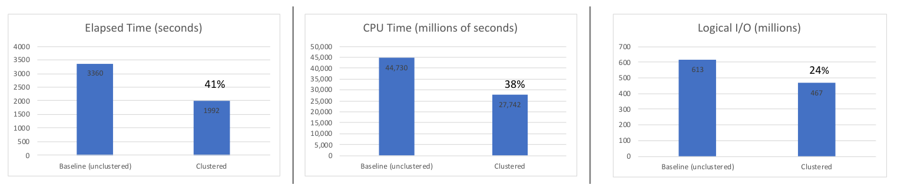
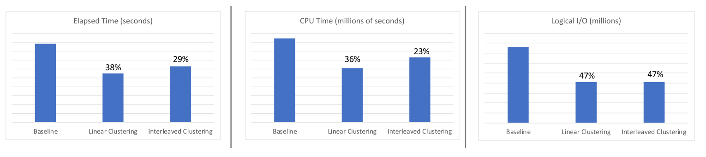
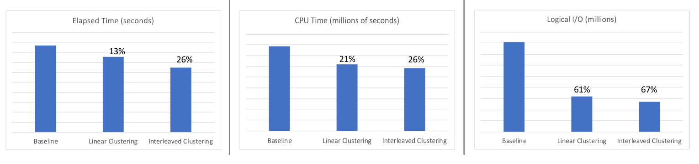

# Automated Clustering Recommendation With Database Zone Maps（中文译文）

## 译者说明

本文依据同目录的 `source.pdf` 翻译。章节、图表、公式、算法、代码与参考文献按原文结构保留。

Suratna Budalakoti，Oracle Corporation，suratna.budalakoti@oracle.com。<br>
Mohamed Ziauddin，Oracle Corporation，mohamed.ziauddin@oracle.com。<br>
Andrew Witkowski，Oracle Corporation，andrew.witkowski@oracle.com。<br>
You Jung Kim，Oracle Corporation，you.jung.kim@oracle.com。<br>
Ramarajan Krishnamachari，Oracle Corporation，ramarajan.krishnamachari@oracle.com。<br>
Alan Wood，Oracle Labs，alanw@ieee.org。<br>
所在地均为美国加利福尼亚州 Redwood Shores。

## 摘要

Zone Map 是多种数据仓库产品 [1,3,5,14,20] 提供的数据访问结构，通过提前裁剪不相关数据块，降低查询的数据访问成本。其方法是把表划成若干 zone，并为每个 zone 保存选定列的最小值和最大值。存储这些值的结构称为 Zone Map。如果数据按查询过滤所涉及的列排序或聚簇，并在该列上建立了 Zone Map，效果最佳。选择性更高的过滤条件更可能带来性能改善。但不同查询的过滤谓词不同，找出一个对整个工作负载都有效的聚簇方式并不简单。本文描述一种新方法，自动分析工作负载，推荐聚簇方案及应建立的 Zone Map，以改善性能。它适用于最常见的线性聚簇和交错聚簇（Z-order）。在 TPCH 和客户数据集上的实验中，该方法相对基线带来显著改善。据我们所知，这是首次研究自动聚簇问题的工作。本文方法已经实现，将在即将发布的 Oracle Autonomous Database 版本中提供。

**CCS 分类**：计算理论 → 数据库查询处理与优化（理论）。

**关键词**：自动聚簇，聚簇，数据库，Zone Map，Z-order。

**ACM 引用格式**：Suratna Budalakoti, Mohamed Ziauddin, Andrew Witkowski, You Jung Kim, Ramarajan Krishnamachari, and Alan Wood. 2024. Automated Clustering Recommendation With Database Zone Maps. Companion of the 2024 International Conference on Management of Data（SIGMOD-Companion ’24），2024 年 6 月 9–15 日，Santiago, AA, Chile。ACM，New York, NY, USA，12 页。https://doi.org/10.1145/3626246.3653397

## 1 引言

Zone Map 利用预先提取并保存的聚合信息，具体为最小值、最大值，裁剪包含与查询谓词无关行的数据块。执行查询时无需访问被裁剪块，因此查询更快。构建时，先把整表划分为等大小的块组，称为 zone，再为每个感兴趣的列或表达式保存各 zone 的最小值和最大值。对于等值或范围谓词，如果谓词值和 zone 的最小到最大范围没有重叠，便可跳过该 zone。保存各 zone 最小、最大值的结构就是 Zone Map。

当一个 zone 的值集中在该列取值范围的很小子集内，例如数据按该列排序时，Zone Map 对等值和范围谓词查询最有效。考虑表中存储美国州名的列。按该列排序后，第一个 zone 的最小、最大值可能分别为 ‘AK’ 和 ‘AZ’。有该列的 Zone Map 时，查询 `State = 'AK'` 只需访问第一个 zone，其他块都能裁剪。若不按此列排序，各 zone 的范围都可能包含 ‘AK’，数据库就可能访问所有 zone。因此，找到正确的排序列是使用 Zone Map 的关键挑战。

Zone Map 并非唯一能从数据聚簇获益的结构。例如 Oracle Exadata 为列维护存储索引 [13]，为每个 1 MB 区域存储最小、最大值，裁剪不必要块。聚簇还能改善数据压缩。配合恰当聚簇，这些因素共同带来显著性能改善的可能。

数据不必完全有序。只要 zone 内的值处于特定范围，就无需在 zone 内排序。为区分这一点，Zone Map 场景通常使用“聚簇”一词，表示某列各 zone 的值均落在一定最小、最大值之间。但目前多数数据库用排序实现聚簇，两者在实践中没有区别。本文交替使用“聚簇”和“排序”。

大多数表有多个对查询重要的列，单列聚簇通常不够。数据库可能把多个列组合到一次聚簇中，常见的两种是线性聚簇 [6,20] 和交错聚簇 [11,15,20]，后者也称 Z-order 聚簇。Oracle 和其他数据库产品都支持两者，第 2 节将介绍。

在常用 Zone Map 的数据仓库中，事实表最大，快速访问尤为重要；同时维度列经常有大量过滤谓词，通常先按连接列把事实表和维度表连接，再应用过滤。因此最有效的用法可能是在维度表列上构建 Zone Map。为此，有时先临时连接事实表和维度表，再把相关维度列的最小、最大值保存到数据结构中。

本文给出一种高效方法，根据工作负载自动识别聚簇列和需要维护 Zone Map 的列。效率依赖两项关键技术。首先，提取列在查询中出现频率等相关特征，建立查询工作负载的概率模型。再把该模型作为另一个概率模型的输入，依据数据库表的行样本性能外推整个工作负载的性能。搜索算法利用概率模型的性能估计，搜索可能解空间。本文方法已经在 Oracle RDBMS 中实现，准备发布。

第 2 节介绍问题背景、线性和交错聚簇，并解释良好方案应具有的性质；第 3 节介绍相关工作；第 4、5 节给出架构，包含查询工作负载建模器、聚簇质量评估器、方案搜索算法、Zone Map 推荐器四组件及其关系；第 6–10 节详细介绍各组件；第 11 节讨论在客户数据库实施前验证性能的步骤；第 12 节展示 TPCH 和两个客户工作负载实验；第 13 节总结。

## 2 背景和问题描述

本文针对数据库工作负载，即已装载数据的数据库实例及一组代表性查询，识别应按哪些列聚簇，以及应在哪些列建立 Zone Map。首先选出最佳聚簇列，再识别除聚簇列以外，其他能从 Zone Map 获益的列。算法适用于线性与交错聚簇，并对两者进行评估。下面分别介绍，再于 §2.3 讨论良好聚簇的直觉。

### 2.1 线性聚簇

数据库对给定多个列执行 order-by 排序，实现线性聚簇。给定表 T 的 A、B、C 列上的 `Linear(T.A,T.B,T.C)`，先按 A 排整表，在 A 相同的键中按 B 排，再在 A、B 相同者中按 C 排。因此，对 A 有谓词的查询预计表现最好，其次为 B，再其次为 C。例如，表中 State、Zip Code 两列有三行 `(TX,78712)`、`(CA,94404)`、`(CA,94401)`，线性排序结果为 `(CA,94401)`、`(CA,94404)`、`(TX,78712)`，因为先按州，再对两行 CA 按邮编排序。

像州与邮编这样的层级或多对一关系，通常适合线性聚簇，因为按州聚簇也在很大程度上使邮编聚簇。没有这种关系时，第二列及之后的收益远小于首列，但只要增量收益足够，仍可能值得做。如果特定列对工作负载至关重要，把它和其他列交错会降低性能，线性聚簇也是好选择。

### 2.2 交错聚簇

对 T 的 A、B 列执行 `Interleaved(T.A,T.B)` 时，RDBMS 先创建临时虚拟列，对每行的 A、B 值逐位交错，再按该临时列排序。逐位交错，也称 Z-order 曲线 [17,18]，把多维数据排列到一维并保持一定本地性。在数据库中，各交错列的每种唯一值组合的全部出现，会在一个位置彼此相邻。这里“位置”指连续的数据块序列。这提供了 Zone Map 能利用的高度本地性。各单列也有一定本地性，尽管同一键的所有行不一定在一个位置。

例如，零售商的客户订单表按 Month、Item_Id 交错聚簇。如果多数查询寻找某些月份中特定 Item_Id 的信息，效率很高，因为特定 `(Item_Id,Month)` 组合都在一个相邻位置。数据库利用 Zone Map 只访问这些块。但查询特定商品（如 Item_Id 100）的所有行时，它们不再全在一个位置，最多需访问十二处，即 `(100,January)`、`(100,February)` 等。只是这是最坏情况。如果商品只在少数月份出售，例如圣诞树只在十二月出售，位置会远少于十二处。也可能一部分查询在 Item_Id 上有高选择性过滤，其他查询在 Month 上有选择性过滤。交错聚簇可能为两类查询都提供合理性能。

在多对一映射等特殊情况下，交错聚簇可能与单列线性聚簇一样有效。例如按 Zip Code、State 交错时，邮编到州是多对一，某一邮编的全部行仍聚在一个位置。但各州如 CA 的键会分布到多个位置。

总的说，交错聚簇更灵活，面对不相关、弱相关乃至层级关系等多种列间相关性，均能提供合理性能。在复杂工作负载中，不同查询子集在不同列集上有选择性过滤，交错聚簇也更能平衡它们。

### 2.3 聚簇直觉

除线性与交错差别外，还需考虑以下因素。

1. **列的重要性和选择率。** 只应考虑在相当比例查询过滤谓词中出现的列。查询选择性高的列更适合聚簇；若该列查询通常选中大部分行，不论有没有 Zone Map 都需要访问所有 zone。
2. **列的异质性。** 我们把某列 OR 过滤谓词的项数分布称为该列的异质性。例如 `State = 'CA' OR State = 'TX'` 的异质性为 2。一个查询中的 OR 项越多，或 IN 列表越长[^1]，异质性越高。只要一个 IN 列表值在 zone 中，就需访问该 zone，因此异质性高会降低 Zone Map 性能。
3. **与其他列的关系。** 列间关系对聚簇质量至关重要。例如：
    - 美国邮编和州并非统计独立。由于它们在美国的组织方式，一个州的邮编都以相同数字开头，按邮编聚簇便会自动按州聚簇。只聚簇邮编，就能获得邮编和州两列有用的 Zone Map，无需按州聚簇，使邮编成为好候选。
    - 考虑相互独立的 State、Employee Name。只按一个列线性聚簇不够，因为按 State 聚簇后建立的姓名 Zone Map，不大可能只包含 A–Z 中很小范围的名字，需要两列聚簇。姓名接近唯一，按 `Employee Name,State` 排基本上不会使 State 聚簇，因为同名很少。按 `State,Employee Name` 则可能更好。另一个选择是交错聚簇，因为它对首列选择更稳健。

不过，跨列依赖很复杂，本方法不显式建模，而是在样本上为不同候选聚簇方案建立 Zone Map，用样本最小、最大值估计性能。每个样本 zone 的极值隐含了这些交互作用。

[^1]: https://docs.oracle.com/cd/B19306_01/server.102/b14200/conditions013.htm

## 3 相关工作

据我们所知，本文首次研究针对 Zone Map 的自动聚簇或排序顺序推荐。最接近的是实例优化数据布局 [4]，根据具体工作负载的精确过滤谓词等信息定制布局。例如构建 qd-tree [19] 二叉决策树，把每行分配到某个块，并在查询执行时用同一树确定访问哪些块。由于针对过滤条件专门设计，这些方法在多数工作负载上可能优于直接排序或聚簇。但在我们的场景中，自动聚簇的其他优势超过这些性能收益。

除减轻数据或工作负载变化等通常的过拟合风险外，自动聚簇更直观，用户更容易理解，因为 DBA 习惯按列排序以提高性能，因此更可能接受。多数数据库已有高效排序，聚簇方案的开发和资源成本也低。基于这些原因，我们研究自动聚簇。

工业界中，Oracle 及其他数据库目前通常靠人工选择聚簇列和 Zone Map。有些系统按启发式推荐，例如仓库常按时间间隔加载，日期列就常被推荐。Snowflake[^2] 采用另一思路。它没有自动聚簇推荐[^3]，而是向用户提供重叠度、聚簇深度 [8] 等启发式质量指标，供人工比较。但这些指标不考虑列重要性、选择率和异质性（§6.2）等工作负载属性，也不清楚能否扩展来考虑。评估这些方面的责任交给用户。为此，Snowflake 提供详细文档，建议选择“在选择性过滤中最常使用的列”[9]。我们采用统计基础更充分的质量模型与查询模型结合，自动比较时同时考虑数据和查询，因而无需用户输入即可推荐。

另一种重组数据以对齐过滤条件的方法是数据库裂解（Database Cracking）[10]。它与聚簇一样，通过部分排序使列内数据排列符合负载特征，但目标和方法不同。裂解识别需要有序的区域，只排列常用键，其余数据不动以节省成本。它也不处理列间关系，为绕开关系的影响，各列独立存储和重排，因此更适合列存数据库。裂解不显式建模工作负载或预先组织数据，而是响应每个查询实时调整；不过这是设计选择，也许能消除此限制。

[^2]: Snowflake 不使用 Zone Map，而是把表划成大量微分区，保存各微分区最小、最大值等摘要，以类似 Zone Map 的方式裁剪。因此选对聚簇列对其性能同样关键。
[^3]: Snowflake 的“automatic clustering”[7] 是在插入、更新等 DML 使列不再聚簇后，自动重新聚簇。它假定用户已定义聚簇列。

## 4 方法架构

理论上，可以按不同候选列集排序数据集，执行查询工作负载以寻找好方案。但对大数据集，单次排序就可能耗费数小时。我们引入聚簇质量评估器，对样本按候选列排序，比全量排序快得多，再把样本性能外推全量。但对大量候选，在样本上执行整个工作负载仍很贵，因此又引入查询工作负载建模器。用样本替换全量数据，用查询模型替换查询，可把比较候选的时间从数小时缩短为数秒。

更正式地，本方法根据工作负载，寻找事实表中用于线性聚簇的列集和建立 Zone Map 的列集。主要组件如下。

1. **查询工作负载建模器。** 分析并描述查询，用模型代替昂贵的实际执行，评估不同聚簇的查询性能。
2. **聚簇质量评估器。** 为数据集建样本，以此评估任意候选。样本可以很快按不同列排序，比较候选不需显著时间和资源。它与建模器协作，以低成本模型替代查询。
3. **方案搜索算法。** 利用评估器搜索聚簇方案空间，找出好方案。聚簇方案指用于线性或交错聚簇的列集。
4. **Zone Map 推荐器。** 识别聚簇列之外，还应建立 Zone Map 的列。

为简单起见，假设数据库模式只有一张需要聚簇的事实表，如常见星型模式。多事实表负载，例如雪花模式，对每张事实表独立执行此过程。

## 5 方法细节

输入包括：

1. 已有事实表、维度表和数据的数据库实例，以及一组代表查询。
2. 需聚簇和建立 Zone Map 的事实表列表；对每张事实表，给出与之连接的维度表列表和连接条件 J，说明事实表哪列与各维度表哪列连接。

提供事实表和维度表列表并不一定需要人工干预。例如 Oracle RDBMS 可以自动识别工作负载中的事实表和维度表。给定输入后，过程如下。

1. **查询工作负载建模。** 建模器先执行两步：
    - 列裁剪。识别查询频繁使用的列，启发式排除较差候选，留下可能适合聚簇的列，并分配代表其重要性的启发式权重。
    - 建立工作负载模型。利用第一步信息构建概率模型，描述列重要性以及各列过滤谓词的选择率和异质性。
2. **建立样本。** 从事实表与维度表的候选列取样，需要将事实表随机样本与维度表全表连接。
3. **初始化聚簇质量评估器。** 输入已按特定列线性或交错聚簇的样本，数值估计聚簇效果，供下一步使用。
4. **方案搜索。** 用贪心算法搜索可能聚簇空间，借助第 3 步评估器比较方案。
5. **Zone Map 推荐。** 对选定方案，识别聚簇列以外应建立 Zone Map 的列。

接下来五节依次介绍这些步骤。

## 6 查询工作负载建模

先初步裁剪以减少工作量，再根据裁剪后的数据建模。

### 6.1 列裁剪

移除没有在相当比例查询中充当过滤列的列。目前，不在至少 10% 查询中出现的列都不再考虑。10% 是根据初步实验选的启发式值，既有一定选择性，又避免排除多数列。对留下的列，权重设为含该列过滤子句的查询数，再对所有列归一化，使和为 1。

### 6.2 工作负载模型建立

上一步得到带重要性权重的候选列表。权重和为 1，因此可以当作概率分布。

对至少有一个等值过滤谓词的列，还考虑异质性，即该列等值谓词中过滤项个数的频率分布。例如 `WHERE State = 'CA' OR State = 'TX' OR State = 'WA'` 有三项；IN 谓词则使用列表大小。异质性是查询谓词项数的分布，属于查询特征而非数据特征，通常可从查询文本或计划的 Predicate Information 部分提取。

形式上，列 c 的异质性表示为二元组集合 $h _ c=\lbrace d _ c^i,f _ c^i\rbrace$，其中 $f _ c^i$ 是在该列谓词中观察到 $d _ c^i$ 个过滤项的归一化频率。例如两条查询分别有上述三项谓词及 `WHERE State = 'CA'` 单项谓词，模型为 $\lbrace (3,0.5),(1,0.5)\rbrace$。

高平均异质性的谓词可能使聚簇无效，因为大量不同过滤值意味着无论是否聚簇、是否有 Zone Map，都可能访问许多 zone，每个 zone 都可能至少包含其中一个值。

结合权重与异质性得到工作负载模型，表示为三元组集合：

$$
Q=\lbrace (m _ c,w _ c,h _ c)\rbrace ,\qquad c=1\ldots n _ C.
$$

其中 $n _ C$ 是关注列数， $m _ c$ 为第 c 列名， $w _ c$ 为权重， $h _ c$ 是其过滤谓词的异质性集合。

该模型简化了查询生成过程。每步以概率 $w _ c$ 选择列 c，再生成具有一定过滤项数的谓词；假设每条查询恰有一个过滤谓词。项数服从 $h _ c$，生成 $d _ c^i$ 项的概率为 $f _ c^i$。各不同值独立抽取，每次抽取时所有值成为过滤项的可能性相等。

异质性不适合范围查询。等值谓词模型独立随机抽取每个值，例如州列的三项谓词被建模为从 50 个可能值中独立同分布抽三次。范围查询的过滤项往往连续，不独立同分布。§8.1.1 将介绍另一模型。

## 7 建立样本

选出候选列后，创建物化样本，用来评估其他聚簇选项，稍后再确定 Zone Map 列。给定候选集 $C=\lbrace c _ 1,\ldots,c _ i,\ldots,c _ {n _ C}\rbrace$、事实表 F、维度表集 D、连接条件 J，用如下查询建样本：

```sql
Create table clustering_sample as
Select rowid row_id,C
From F Sample($sampling_percentage),D
Where J;
```

J 使用左外连接，而不是事实表与维度表通常默认的等值连接。原因是，不希望一行因为不能连接某一维度表就被排除，只要它还能连接其他表。实验中，0.1%–0.2% 的采样通常足够。目标是在样本中每个 zone 至少有 20 行，经验表明这大约足以合理估计极值。这里随机采样行；许多数据库提供更快的块采样，但块内行的相关性可能影响方案质量，所以没有采用。

样本保留行 ID，是因为按行 ID 聚簇能分析没有其他聚簇时原事实表的默认组织。寻找列之前先按行 ID 聚簇样本，建立不施加聚簇的基线。应用聚簇很昂贵，只有预测性能相对默认布局至少改善一定比例，才聚簇整表，默认改善门槛为 10%。

## 8 聚簇质量评估器模型

评估器把样本与概率模型结合，评估给定方案。本节描述该模型。

质量定义为从工作负载随机选择一条查询时访问 zone 数的期望，即平均值。查询生成模型每次只生成一个谓词，因此本节为行文方便交替使用查询、谓词。沿用 §6.2，每个聚簇或 Zone Map 候选列有三元组 $Q=\lbrace (m _ c,w _ c,h _ c)\rbrace$，其中 $c=1\ldots n _ C$，分别记录列名、权重、异质性集合。

先解决较简单的问题：已知完整表而非样本时估计质量，再用简化假设推广。考虑事实表已经按一组列聚簇，并在某些列建立了 Zone Map。如何估计从 Q 随机生成的查询预计访问多少 zone？

### 8.1 已知整表时的聚簇质量

令 $A _ Q$ 为执行工作负载 Q 时表访问数的随机变量，求随机生成一条查询的期望 $E[A _ Q]$。Q 建模为列的概率分布，查询某列的概率与其权重 $w _ c$ 成正比，所以：

$$
E[A _ Q]=\sum _ {c\in Q}w _ cE[A _ c]\qquad\text{(1)}
$$

$E[A _ c]$ 是查询列 c 时 zone 访问数的期望。计算它需要分析异质性的影响。

令 Z 为事实表 zone 集，暂假设所有候选列都有 Zone Map。对 zone $z _ j\in Z$，指示函数 $1 _ {jc}$ 表示随机查询列 c 时是否访问该 zone。欲求 $E[A _ c]=E[\sum _ {z _ j\in Z}1 _ {jc}]$。利用期望线性性，求和的期望等于期望之和，因此：

$$
E[A _ c]=\sum _ {z _ j\in Z}E[1 _ {jc}]\qquad\text{(2)}
$$

对所有 zone 的单 zone 访问期望求和，得到总访问数。注意 $E[1 _ {jc}]$ 总小于 1，因而本质上是访问概率。

考虑单个 zone，其 c 列最小、最大值已知，分别记为 $\min(z _ c^j)$、 $\max(z _ c^j)$。定义 NDV 距离函数 $V^c(x,y)$，返回 c 列按序位于 x、y 之间、含两端的不同值数（NDV）。例如包含全部 50 个州的 S 列， $V^c(\text{CA},\text{FL})=5$，因为包含 CA、CO、CT、DE、FL。它只返回不同值数，不受出现频率影响。样本 NDV 距离 $V _ s^c(x,y)$ 则返回样本中两键间不同值数，是对真实距离的样本估计，供 §8.2 使用。

于是 $E[1 _ {jc}]=P[1 _ {jc}=1]$ 可计算为：

$$
E[1 _ {jc}]=\sum _ {(d _ c^i,f _ c^i)\in h _ c}f _ c^i\left[1-\left(1-\frac{V^c(\min(z _ c^j),\max(z _ c^j))}{\mathrm{NDV} _ c}\right)^{d _ c^i}\right]\qquad\text{(3)}
$$

$\mathrm{NDV} _ c$ 为数据集中 c 列不同值总数。右侧对所有可能过滤项个数 $d _ c^i$ 求和，权重为各自概率 $f _ c^i$。访问某 zone 的概率是 1 减去查询所有键都不在该 zone 的概率。随机键不在该 zone 范围的概率为 $1-V^c(\min(z _ c^j),\max(z _ c^j))/\mathrm{NDV} _ c$；假设独立等概率抽取，升至 $d _ c^i$ 次幂，就得到所有键均未出现的概率。

式（3）给出随机列上的随机查询对单 zone 的访问期望。先为每列每 zone 用式（3），再通过式（2）跨 zone 求和得到各列 $E[A _ c]$，最后通过式（1）按列权重求和，得到随机工作负载查询的访问期望。

#### 8.1.1 范围谓词的 zone 访问

异质性模型适合等值谓词，较不适合范围谓词。可以简单地将有 k 个不同值的范围建模为异质性 k，但如果表按范围列聚簇，这通常会严重高估访问数，因为范围内的值常连续而非独立选择。下面给出替代模型。**该模型尚不属于现有实现，计划作为未来增强。**

给定某列的范围谓词集，可计算平均范围大小 $r _ \mu$，即工作负载中各范围谓词观察到的不同值数之和，除以该列范围谓词总数。用此值代表范围大小，访问 zone 的概率为：

$$
P[1 _ {jc}=1]=\min\left(\frac{r _ \mu+V^c(\min(z _ c^j),\max(z _ c^j))}{\mathrm{NDV} _ C},1\right)\qquad\text{(4)}
$$

其理由如下。考虑 `WHERE c >= r_min AND c <= r_max`，范围大小为 $r _ \mu$。若下界 $r _ {min}$ 位于 zone 极值之间，或最多比 zone 最小值小 $r _ \mu$，就需访问。前一类可能下界数为 $V^c(\min(z _ c^j),\max(z _ c^j))$，后一类为 $r _ \mu$。相加后归一化，得到概率；min 函数保证结果介于 0 和 1。

同时有等值和范围谓词的列，可按两类查询各自占比，对式（3）、（4）的访问概率加权平均。

如上所述，范围模型计划未来才加入。当前为避免高估所需访问数，所有范围查询的异质性直接设为 1。

### 8.2 推广到已知样本的聚簇质量

为基于样本估计 $E[A _ Q]$，按照采样概率缩小 zone。原 zone 大小为 $S _ Z$ 行、采样概率为 p（即对数据的 p/100% 采样）时，样本 zone 大小设为 $p\ast S _ Z$。这样可得到属于该 zone 的随机键样本。式（3）中其他项已知，只需估计以下统计量：

$$
R _ c=\frac{V^c(\min(z _ c^j),\max(z _ c^j))}{\mathrm{NDV} _ c}\qquad\text{(5)}
$$

分子是 zone 内不同值数，分母是整列不同值数。由样本估计总体不同值数是统计学经典问题，Charikar 等 [2] 给出算法。但我们基于简化假设采用另一方法。原因有二：其算法是迭代算法，为每个 zone 执行可能昂贵；可能由于每个 zone 样本很小，该算法相对我们方法的精度提升不足以影响最终聚簇方案。

先估计每个 zone 的端点。样本最小值可能高估真实最小值，最大值可能低估真实最大值。利用端点估计：

$$
\widehat R _ c=\frac{V _ s^c(\widehat{\min}(z _ c^j),\widehat{\max}(z _ c^j))}{\widehat{\mathrm{NDV}} _ c}\qquad\text{(6)}
$$

带帽的 min、max 是样本观察到的极值， $\widehat{\mathrm{NDV}} _ c$ 是样本不同值总数。式（6）使用样本 NDV 距离函数 $V _ s^c$。下面用简化假设说明它可合理近似 $R _ c$。

假设样本仅观察到 $\widehat{\mathrm{NDV}} _ c=k\cdot\mathrm{NDV} _ c$ 个不同键，其中 k 是比例，并假设 k 在所有 zone 相同，则：

$$
\widehat R _ c=\frac{k\cdot V^c(\min(z _ c^j),\max(z _ c^j))}{k\cdot\mathrm{NDV} _ c}=R _ c\qquad\text{(7)}
$$

这意味着样本遗漏键按各 zone 的样本 NDV 成比例分布。假设似乎合理。例如某列两个 zone，一个只有 2–3 个不同键，另一个有 20–30 个，那么前者键在表内出现频率可能更高，从而比后者遗漏更少。

有了这些假设，可用式（3）、（2）、（1）在样本上估计质量。当前实验进一步将异质性分布替换为平均过滤项数 $\bar d _ c$。若异质性集中在单一值，例如几乎所有针对某列的查询都恰有一个过滤谓词，只有少数例外，这一假设合理。于是三式合并为一式。简化必然会影响结果，但实验仍相对基线得到明显改善。

$$
E[A _ Q]=\sum _ {c\in Q}w _ cE[A _ c]\qquad\text{(8)}
$$

近似各列访问期望为：

$$
\widehat E[A _ c]\approx\sum _ {z _ j\in Z}\left(1-\left(1-\frac{V _ s^c(\widehat{\min}(z _ c^j),\widehat{\max}(z _ c^j))}{\widehat{\mathrm{NDV}} _ c}\right)^{\bar d _ c}\right)\qquad\text{(9)}
$$

于是式（8）可写为：

$$
\Rightarrow\widehat E[A _ Q]\approx\sum _ {c\in Q}w _ c\cdot\left[\sum _ {z _ j\in Z}\left(1-\left(1-\frac{V _ s^c(\widehat{\min}(z _ c^j),\widehat{\max}(z _ c^j))}{\widehat{\mathrm{NDV}} _ c}\right)^{\bar d _ c}\right)\right]\qquad\text{(10)}
$$

与式（3）的关键差别是，不再对所有可能的过滤项数求和，而只用平均异质性 $\bar d _ c$。

> 译注：式（4）分母中的大写 C 按原式保留，其他相关公式使用小写 c。

## 9 方案搜索算法

算法 1 用贪心方式寻找最佳聚簇方案。每一步选取期望访问数最少的方案，加入一个尚未包含的候选列继续扩展。候选列指列裁剪后仍可加入方案的列。算法假设有两个函数。

1. `Sort_Linear_or_Interleave(S,new_cand_cols,sort_type_flag)`：按标志对样本线性或交错排序。交错时先把列列表逐位交错成临时虚拟列，再据此排序。假定 RDBMS 提供该函数。
2. `Expected_Num_Accesses(Clustered_Sample)`：由第 8 节评估器实现，输入聚簇样本，用式（10）返回工作负载访问 zone 数的期望。

后一个函数除输入外，还能取得各列权重 $w _ c$ 和平均不同过滤项数 $\bar d _ c$。

算法完成后得到聚簇列及随机查询的期望 zone 访问数。时间复杂度为 $O(n\log n)$，n 为样本行数。线性聚簇的主成本是样本排序，交错聚簇还需考虑逐位交错的明显成本。但实践中采用样本和简化查询模型，执行成本并不显著。

算法 1：识别聚簇列的贪心算法。

```text
input: S: A sample with columns C = {c_1, ..., N_C}
       τ: Maximum number of clustering columns allowed (default = 4)
       Δ: Minimum percentage improvement required for column inclusion
          (default = 5%)
       sort_type_flag: Linear/Interleaved
output: A 2-tuple soln, where soln._1 is the list of clustering columns
        and soln._2 is the clustering quality.
Initialization:
 1 Set candidate solution queue U ← ϕ
 2 Set S_clus ← Sort_Linear_Or_Interleave(S,rowid,sort_type_flag)
 3 Set baseline_soln ← Expected_Num_Accesses(S_clus)
 4 Add 2-tuple (ϕ,baseline_soln) to U
Loop:
 5 do
 6     Set cur_soln ← u ∈ U with smallest value of u._2
 7     Set cur_quality ← cur_soln._2
 8     Set cur_clus_cols ← cur_soln._1
 9     Set new_soln_found ← False
10     for c ∈ C − cur_clus_cols do
11         Set new_cand_cols ← cur_clus_cols.append(c)
12         Set S_clus ←
               Sort_Linear_Or_Interleave(S,new_cand_cols,sort_type_flag)
13         Set new_clus_quality ← Expected_Num_Accesses(S_clus)
14         Set impr ← (cur_quality−new_clus_quality)/(cur_quality)
15         if impr > Δ then
16             Add (new_cand_cols,new_clus_quality) to U
17             Set new_soln_found ← True
18 while len(cur_soln.cols) < τ and new_soln_found
Result:
19 Set soln ← u ∈ U with smallest value of u._2
20 return soln
```

## 10 Zone Map 列识别

第 9 节结束后，有一个聚簇方案及质量估计 $E[A _ Q]$（式 8），但它假定所有候选列均有 Zone Map。理论上可维护所有列，实践中维护开销太高，因此要去除对质量没有明显影响的候选列。

若 c 列有 Zone Map，式（9）估计随机谓词的 $E[A _ c]$；若没有，则必须访问所有 zone，即 $E[A _ c]=N _ Z$，N_Z 是表中 zone 数，这是比较基线。`Expected_Num_Accesses` 内部本来就估计各列访问数，很容易修改以单独返回。

假定它返回向量 $\vec A _ C$，第 c 元素为 $\widehat E[A _ c]$，即仅查询 c 列的随机谓词的期望访问数。该向量是式（8）的输入。把其中 c 列期望替换成 $N _ Z$，重新用式（8）计算，记为 $E[A _ Q\mid\neg c]$。该列 Zone Map 的影响为：

$$
\mathrm{Impact} _ c=\frac{E[A _ Q\mid\neg c]-E[A _ Q]}{E[A _ Q]}\ast 100\qquad\text{(11)}
$$

它表示不为 c 建立 Zone Map 时，总访问期望增长百分比。只有影响超过阈值才建立。目前设为 5%，用户可改。聚簇门槛为 10%，Zone Map 的门槛更低，因为聚簇比创建 Zone Map 更昂贵。

**但当前 Oracle 数据库尚不支持识别额外 Zone Map 列，只为已选聚簇列创建 Zone Map。** 原因之一是 Exadata [12] 的存储索引 [13] 等已有结构，能够识别应维护最小、最大值的重要列，使此功能可能有些重复，不过非 Exadata 机器没有该能力。第 12 节将在数据库系统外做额外分析，测量按本节方法增加列的影响。

## 11 数据库验证

本节描述 RDBMS 如何使用自动聚簇推荐。系统目前不能在采样前预知哪种聚簇更合适，因此用同一样本同时寻找线性、交错方案，再决定用哪个。搜索算法提供质量估计（见图 1），理论上可以直接比较。但聚簇昂贵，难以重做或撤销，RDBMS 不依赖这个估计作决定。

系统会克隆原工作负载，包括全部表及辅助结构，在克隆上实施两种聚簇，以多个指标验证。只有逻辑 I/O 至少改善 10%，且相对基线退化的查询数低于某阈值，才接受。如果两者都合格，选逻辑 I/O 更好者。后台验证在空闲资源充足时运行，可多次停止并恢复。虽然昂贵，但保证实施结果可被用户接受。RDBMS 也提供手工接口调用推荐与验证，用户可以自行分配资源，可能不必暂停和恢复。

也许可以通过在样本上执行负载、外推性能来降低验证成本，这是未来计划研究的问题。

## 12 实验结果

我们在公开 TPCH [16] 和两个内部客户基准工作负载（G、H）上实验。比较基线为数据未聚簇的默认布局，且没有 Zone Map。我们认为该基线能准确衡量自动聚簇与 Zone Map 联合带来的影响。

### 12.1 TPCH（1 TB）基准

工作负载规模因子 1000，数据大小 1 TB，每个 TPCH 查询模板生成一条查询，共 22 条。算法针对最大的两张表 LineItem、Orders，考察线性和交错聚簇。但交错方案在验证时被拒绝，因此未展示。

对 LineItem，推荐 `Linear(L_Shipdate,L_Quantity)`，验证后被接受。直觉上合理，因为多个模板都过滤 L_Shipdate。它与 L_Quantity 没有层级关系，但后者为查询子集提供增量改善，所以加入。算法也为 Orders 识别出方案，但验证拒绝它。当前只为聚簇列建 Zone Map。我们另在数据库代码之外按第 10 节分析额外列，TPCH 没有推荐额外列。

所有性能实验使用标准 Oracle Exadata，DOP 为 16，每种设置报告三次独立运行的平均值。图 1 对比自动聚簇方案与未聚簇基线，指标为总耗时（整个负载运行时间）、CPU 时间（CPU 操作所花时间）和查询逻辑 I/O 量。逻辑 I/O 减少 24%，总耗时及 CPU 时间减少约 40%。后两者改善更大，是因为 Zone Map 裁剪进一步改善缓存、内存利用和数据分布流量。



图 1：TPCH 1 TB 基准上线性自动聚簇相对基线的性能。总耗时从 3360 秒降到 1992 秒，图示改善 41%；CPU 时间图标题为“百万秒”，柱上原始值 44,730、27,742，图示改善 38%；逻辑 I/O 从 613 百万降至 467 百万，改善 24%。

> 译注：CPU 时间的单位“millions of seconds”按原图标题保留，图示数值也原样保留；本文不据此重新换算单位。

### 12.2 客户工作负载

两种客户数据集上线性、交错方案在验证时都未被拒绝，因此两者结果都展示。表 1 简述数据，因法律限制仅给近似描述。H 是单事实表星型模式，G 是多事实表雪花模式。图 2、3 与未聚簇、无 Zone Map 的基线比较。

法律限制使我们不能给出统计值绝对数，柱上标的是相对基线的改善比例。所有三个指标都显著优于基线。聚簇目标是减少 I/O，直接改善逻辑 I/O 47%–67%；也像 TPCH 一样，间接减少 CPU 处理数据量和总执行时间。

表 1：客户数据集描述。原文第二列表头为“Table Name”，数据项给出模式类型。

| 数据集名称 | 表名（原文列名） | 数据集大小 | 表数 | 查询数 |
| --- | --- | --- | --- | --- |
| Workload G | Snowflake | 100–500 GB | 50 | 500–1000 |
| Workload H | Star | 50–200 GB | 20 | 50–150 |

H 的线性、交错方案所选两列相同，彼此没有明显的层级或其他关系，但交错方案的质量估计更高。据此，可以合理认为算法尝试平衡两个分别过滤不同列的查询子集。TPCH 的选择主要基于找出一个重要列，这里则识别出两竞争列交错才最佳。我们也按第 10 节寻找能超过 5% 质量改善门槛的额外列，但没有找到。

G 虽有多事实表，却只推荐一表聚簇。线性方案对无关的 X、Y 两列聚簇，交错方案则采用 X、Y、Z 三列，差一列。线性方案的额外库外分析建议为 K 列建立 Zone Map，估计总体质量略超 5% 改善。额外建立该列后，相对只为聚簇列建 Zone Map 的标准方案，实验显示 CPU 时间和 DB 时间改善 3%，逻辑 I/O 改善 2%。图中展示的是当前已实现的标准方案。交错方案未建议额外列。

有趣的是，线性聚簇的总耗时、CPU 时间优于交错，而逻辑 I/O 相近。我们认为交错较慢可能是表解压成本更高。这凸显第 11 节数据库验证的重要性，因为许多因素影响工作负载性能，数学模型无法全部考虑。但两者仍显著优于基线。



图 2：客户工作负载 G 上线性、交错自动聚簇与基线比较。总耗时分别改善 38%、29%，CPU 时间分别改善 36%、23%，逻辑 I/O 两者均改善 47%。



图 3：客户工作负载 H 上线性、交错自动聚簇与基线比较。总耗时分别改善 13%、26%，CPU 时间分别改善 21%、26%，逻辑 I/O 分别改善 61%、67%。

## 13 结论与未来工作

Zone Map 常用于数据仓库，结合适当聚簇时效果最佳。据我们所知，此前没有自动识别适合工作负载的聚簇方案的方法。本文填补这一空缺，TPCH 和两个客户负载的结果表明，自动聚簇可带来明显性能收益，也说明 Zone Map 的重要性及良好聚簇的必要性。

未来计划去除为提高搜索性能所作的部分假设与近似。例如，更精细的查询工作负载模型，更复杂的异质性建模，可能改善结果。我们也计划探索比直接贪心更复杂的搜索算法，同时考虑选择某列的即时和长期后果，可能找到更好的方案。还计划探索混合聚簇，例如把多个线性聚簇方案交错组合。

## 参考文献

[1] Nigel Bayliss. 2014. Optimizing Table Scans with Zone Maps. https://blogs.oracle.com/datawarehousing/optimizing-table-scans-with-zone-maps [Online].

[2] Moses Charikar, Surajit Chaudhuri, Rajeev Motwani, and Vivek Narasayya. 2000. Towards Estimation Error Guarantees for Distinct Values. In Proceedings of the Nineteenth ACM SIGMOD-SIGACT-SIGART Symposium on Principles of Database Systems (Dallas, Texas, USA) (PODS ’00). Association for Computing Machinery, New York, NY, USA, 268–279. https://doi.org/10.1145/335168.335230

[3] Jef Claes. [n. d.]. Amazon Redshift - Fundamentals. https://s3-eu-west-1.amazonaws.com/cdn.jefclaes.be/amazon-redshift-fundamentals/aws-redshift-fundamentals.html [Online].

[4] Jialin Ding, Umar Farooq Minhas, Badrish Chandramouli, Chi Wang, Yinan Li, Ying Li, Donald Kossmann, Johannes Gehrke, and Tim Kraska. 2021. Instance-Optimized Data Layouts for Cloud Analytics Workloads. In Proceedings of the 2021 International Conference on Management of Data (Virtual Event, China) (SIGMOD ’21). Association for Computing Machinery, New York, NY, USA, 418–431. https://doi.org/10.1145/3448016.3457270

[5] IBM Documentation. 2016. IBM PureData System for Analytics. https://www.ibm.com/support/knowledgecenter/SSULQD_7.2.1/com.ibm.nz.adm.doc/c_sysadm_zone_maps.html [Online].

[6] Oracle Documentation. 2021. Oracle Data Warehousing Guide: Attribute Clustering. https://docs.oracle.com/en/database/oracle/oracle-database/21/dwhsg/attribute-clustering.html#GUID-7B007A3C-53C2-4437-9E71-9ECECF8B4FAB [Online].

[7] Snowflake Database Public Documentation. 2006. Automatic Clustering. https://docs.snowflake.com/en/user-guide/tables-auto-reclustering.html [Online].

[8] Snowflake Database Public Documentation. 2023. Clustering Information Maintained for Micro-partitions. https://docs.snowflake.com/en/user-guide/tables-clustering-micropartitions.html#clustering-information-maintained-for-micro-partitions [Online].

[9] Snowflake Database Public Documentation. 2023. Strategies for Selecting Clustering Keys. https://docs.snowflake.com/en/user-guide/tables-clustering-keys.html#strategies-for-selecting-clustering-keys [Online].

[10] Stratos Idreos, Martin L Kersten, and Stefan Manegold. 2007. Database Cracking.. In CIDR, Vol. 7. 68–78. https://stratos.seas.harvard.edu/files/IKM_CIDR07.pdf

[11] G. M. Morton. 1966. A Computer Oriented Geodetic Data Base; and a New Technique in File Sequencing. Technical Report. IBM, Ottawa, Ontario, Canada.

[12] Oracle. 2024. Oracle Exadata. https://www.oracle.com/engineered-systems/exadata [Online].

[13] Oracle. 2024. Storage Indexes on Oracle Exadata. https://www.oracle.com/database/technologies/exadata/software/storageindexes [Online].

[14] Chapter 13 Oracle 12c Data Warehousing Guide. 2017. About Zone Maps. https://docs.oracle.com/database/121/DWHSG/zone_maps.htm#DWHSG8935 [Online].

[15] Zack Slayton. 2017. Z-Order Indexing for Multifaceted Queries in Amazon DynamoDB. https://aws.amazon.com/blogs/database/z-order-indexing-for-multifaceted-queries-in-amazon-dynamodb-part-1/.

[16] TPC. 2023. The TPCH Homepage. https://www.tpc.org/tpch/.

[17] Wikipedia. 2024. Space Filling Curve. https://en.wikipedia.org/wiki/Space-filling_curve [Online].

[18] Wikipedia. 2024. Z-order Curve. https://en.wikipedia.org/wiki/Z-order_curve [Online].

[19] Zongheng Yang, Badrish Chandramouli, Chi Wang, Johannes Gehrke, Yinan Li, Umar Farooq Minhas, Per-Åke Larson, Donald Kossmann, and Rajeev Acharya. 2020. Qd-Tree: Learning Data Layouts for Big Data Analytics. In Proceedings of the 2020 ACM SIGMOD International Conference on Management of Data (Portland, OR, USA) (SIGMOD ’20). Association for Computing Machinery, New York, NY, USA, 193–208. https://doi.org/10.1145/3318464.3389770

[20] Mohamed Ziauddin, Andrew Witkowski, You Jung Kim, Dmitry Potapov, Janaki Lahorani, and Murali Krishna. 2017. Dimensions Based Data Clustering and Zone Maps. Proc. VLDB Endow. 10, 12 (Aug. 2017), 1622–1633. https://doi.org/10.14778/3137765.3137769
