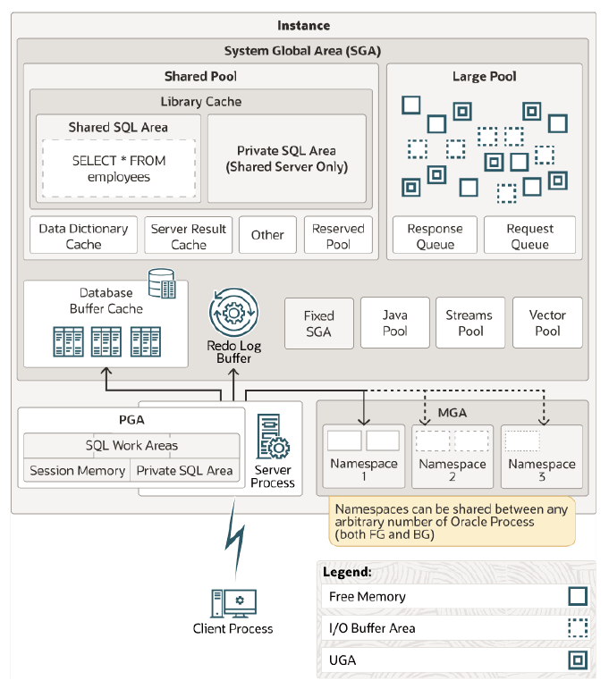
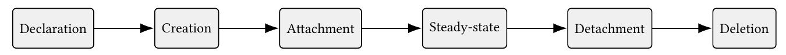
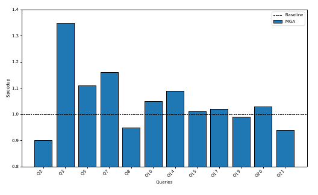
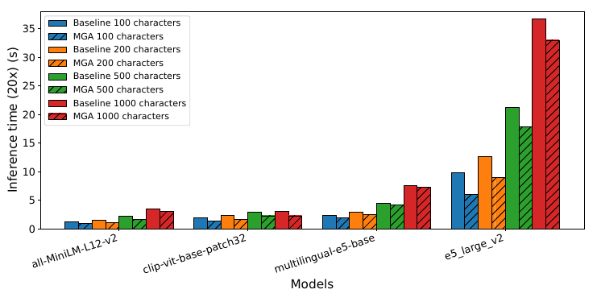
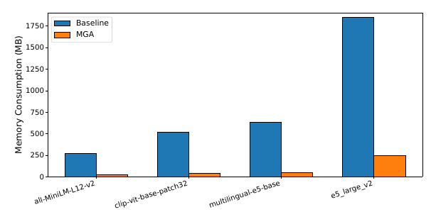

# Why We Created Yet Another Memory Framework: Understanding MGA’s Role in Next-Gen Database Systems（中文译文）

## 译者说明

本文依据同目录的 `source.pdf` 翻译。章节、图表、公式、算法、代码与参考文献按原文结构保留。

| 作者 | 机构与所在地 | 电子邮箱 |
| --- | --- | --- |
| Vikramraj Sitpal* | Oracle America Inc.，美国加利福尼亚州 Redwood Shores | vikramraj.sitpal@oracle.com |
| Pei Li* | Oracle America Inc.，美国加利福尼亚州 Redwood Shores | peili.io@oracle.com |
| Shubham Kumar* | Oracle America Inc.，美国加利福尼亚州 Redwood Shores | shubham.ac.kumar@oracle.com |
| Somansh Reddy Satish† | Oracle America Inc.，美国加利福尼亚州 Redwood Shores | somanshreddy@gmail.com |
| Ravi Thammaiah | Oracle America Inc.，美国加利福尼亚州 Redwood Shores | ravi.thammaiah@oracle.com |
| Nagarajan Muthukrishnan | Oracle America Inc.，美国加利福尼亚州 Redwood Shores | nagarajan.muthukrishnan@oracle.com |

\* 这些作者对本工作作出了同等贡献。

† 该作者在论文准备期间任职于 Oracle America Inc.。

## 摘要

尽管现代数据库系统已具有多种内存区域，在生产约束下支持一种高效的内存形式仍然是挑战。在企业级数据系统中，现有抽象要求在粗粒度全局共享与严格进程隔离之间作出取舍，造成数据复制、内存碎片，以及对受控共享支持有限。随着工作负载更加多样，且系统必须在容忍进程故障的同时保持可预测性能，这些挑战愈加突出。

本文介绍 Oracle AI Database 中的托管全局区（Managed Global Area，MGA），这是一种有作用域的共享内存抽象，用来解决上述局限。MGA 允许组件显式定义分配来源、成员资格，以及选定进程间的协调语义，同时集成到生产数据库引擎中。与 Oracle 中系统全局区（System Global Area，SGA）等完全共享的内存区域不同，MGA 支持动态进程成员和模块化内存使用，而不要求全系统可见。

我们使用对共享内存执行施加压力的分析和 AI 工作负载评估 MGA，包括 TPC-H 哈希连接与 ONNX Runtime 推理。在并发执行下，MGA 将连接密集型 TPC-H 查询的延迟最多降低 35%。对基于 ONNX 的推理，借助 MGA 共享模型将内存占用最多减少 90%，将大型模型推理延迟最多降低 37%。这些结果表明，具有动态作用域的共享内存能够同时改善生产数据库系统的效率与可预测性。

**PVLDB 引用格式**

Vikramraj Sitpal, Pei Li, Shubham Kumar, Somansh Reddy Satish, Ravi Thammaiah, and Nagarajan Muthukrishnan. Why We Created Yet Another Memory Framework: Understanding MGA’s Role in Next-Gen Database Systems. PVLDB, 19(12): 4413–4425, 2026. doi:10.14778/3827998.3828042。

## 1 引言

在现代数据库系统中，内存是直接决定生产工作负载下性能、可扩展性与可预测性的关键资源。在 Oracle 这类融合数据库中，这一挑战尤其突出，因为单一统一引擎原生支持多种数据类型、工作负载和开发范式。随着数据库引擎扩展到数百个 CPU 核，并支持 OLTP/OLAP、向量化执行、多租户并发等日益多样的执行模型，传统内存抽象往往成为制约因素 [2, 13]。

Oracle AI Database 历来依赖两个主要内存区域，即系统全局区 SGA 与程序全局区（Program Global Area，PGA）[17]。如图 1 所示，SGA 是所有服务器进程均可访问的完全共享内存区域，支持全局协调和进程间通信。PGA 则为各个服务器执行实体私有，针对快速、隔离的执行进行优化。几十年来，这种二分法很好地服务了 Oracle，但对于需要选择性动态共享、以及内存压力下性能可预测性的现代工作负载，它存在根本局限。数据库除了分配一片共享内存，还必须支持该区域采用何种后备内存，以便在异构内存类型与层次间灵活放置数据 [9]。



图 1：Oracle AI Database 内存体系结构 [17]。

在生产环境中，这些局限表现为具体且反复出现的挑战。需要在部分进程间受控共享的数据库组件，无法高效利用 SGA 或 PGA 语义。使用 SGA 会强制采用粗粒度共享和静态结构，增加争用，并使生命周期管理复杂化 [11]。依靠 PGA 则无法直接共享，导致过多的数据复制、间接协调机制与碎片化的内存使用 [5, 18]。核数增长、工作负载倾斜加剧时，这些低效现象愈发明显 [1]，最终在严格的服务级别目标下表现为尾延迟退化和吞吐量降低 [12]。

融合数据库中，这个问题进一步加剧 [3]。生命周期和隔离要求不同的异构组件，依赖多个执行实体，并需要在不向 SGA 暴露状态、也不采用代价高且内存后备语义固定的 PGA 方案的前提下，选择性共享状态。

现有学术研究与开源内存管理技术 [5, 10, 20, 21] 着重重新设计引擎内部，或引入专用内存抽象。其他研究主张数据库与操作系统（OS）更紧密地协同设计，以突破通用 OS 抽象的局限 [6, 7, 25]。然而，在 Oracle AI Database 这样的规模化生产系统中，要求重构数据库引擎或修改内核通常不现实。内存抽象必须融入成熟且高度优化的代码库，保持向后兼容，完全在用户态运行，同时维持可预测的延迟行为 [8, 15, 22]。

现代数据库系统面对日益复杂的查询和越来越异构的硬件，暴露出传统内存管理模型的局限 [9]。为解决这些挑战，我们在 Oracle AI Database 中引入新的内存抽象 MGA。

MGA 同时是一种执行级内存框架和有作用域的共享内存区域。作为框架，它提供低层接口，允许数据库组件显式定义内存来源、分配、共享，以及选定可信进程间的协调策略。作为内存区域，它表示实例作用域的共享区，物理保存共享数据结构。其作用域可以从单个进程覆盖到数据库实例内的全部进程。进程可动态挂接和脱离 MGA，支持模块化、弹性、按需的内存使用，且不强制采用全局语义。

与传统内存系统不同，MGA 对内存分配和进程挂接提供细粒度控制。内存区域可选择性挂接到特定进程，而非全局可见。这种选择性挂接模型减少共享结构上不必要的争用，限制非预期访问，从而缓解共享内存环境中意外数据损坏等常见风险。

MGA 的主要优势之一是提供连续内存分配，通过尽量减少内存碎片相关开销，改善性能与效率。这对哈希连接和内存分析等性能关键操作尤其重要，因为连续内存对快速数据处理和低延迟至关重要。MGA 还减少了传统 PGA 方案所需的数据复制，后者往往在查询执行时要进行昂贵的内存传输。减少复制需求节约 CPU 周期和内存带宽，直接有助于缩短查询响应时间。

MGA 还提供增强且可配置的内存记账，以及更好的可观测性，这些对监控和优化数据库内存使用至关重要。管理员可更清楚地了解内存消耗模式，并微调资源分配，以满足不同工作负载的具体需求。MGA 也缓解了内存碎片这一长期困扰传统内存管理系统、并可能使性能随时间下降的问题。通过更高效的内存复用与回收，即使在长期运行的重负载下，MGA 也能确保内存资源得到最优利用。

除了对传统内存体系结构的直接收益，MGA 的框架化设计也为扩展至持久内存及其他非易失内存等新兴技术提供了面向未来的方案。尽管 Oracle AI Database 中的 MGA 主要针对本地 DRAM（过去也针对 PMEM）设计，其基本原则可自然扩展至其他后备内存，包括远端解耦内存和基于 Compute Express Link（CXL）的内存，近期分布式共享内存数据库体系结构研究已探索了这些方向 [9, 24]。这些能力使 MGA 既是现代数据库系统的关键组件，也是未来数据库体系结构的基础构件，使之能适应新硬件，并在日益异构的内存系统上高效运行。随着内存技术发展，MGA 集成和管理不同内存类型的能力，有助于继续满足下一代数据库应用的性能、可扩展性和可靠性要求。

我们用 AI 推理与分析工作负载评估 MGA，并确认共享内存执行是主要瓶颈。MGA 显著改善这两类工作负载的延迟，在 TPC-H 连接查询上最多带来 35% 的加速，在基于 ONNX 的推理上最多带来 37% 的加速。

本文作出以下贡献。

- 识别并刻画 Oracle AI Database 现有内存区域，在生产约束下支持现代大规模分析及多进程工作负载时的根本局限。
- 描述 MGA 的设计与实现，重点介绍在成熟生产数据库中集成新内存抽象所需的关键工程决策和取舍。
- 讨论 Oracle AI Database 使用 MGA 的经验与教训，指出其对未来数据库内存管理设计的启示。
- 使用代表性的分析与 AI 工作负载评估 MGA，展示其在保持稳定性与可观测性的同时具有的有效性。

余文组织如下。第 2 节介绍现代 Oracle AI Database 中已有的内存区域，并引出 MGA 的设计理由。第 3 节给出动机、系统体系结构概述及 MGA 生命周期。第 4 节详述 MGA 实现，包括内存布局、同步和恢复机制。第 5 节给出使用场景，以及现实运行条件下的实验评估，包括 MGA 支持的 TPC-H 哈希连接执行，还有 ONNX 模型共享的运行时间与内存效率。第 6 节讨论相关工作，第 7 节总结并给出未来方向。

## 2 背景

关系数据库管理系统是高度并发的平台，与操作系统共享物理资源。OS 分配和复用处理器核、内存及 I/O，以服务不同工作负载，而数据库必须为特定执行模型提供可预测延迟、高吞吐量与强隔离。因此，数据库往往将内核视为调度、虚拟内存和 I/O 原语等基础机制的提供者，同时自己保留需要工作负载感知的策略决策责任 [25]。内存管理是这一矛盾的核心方面，通用 OS 行为可能通过换页、缓存交互及分配粒度引入波动。因此，本节余下部分考察 Oracle AI Database 如何组织和管理内存，以协调 OS 的介入与数据库级性能及正确性要求。

Oracle 内存按逻辑区域组织，规定分配如何共享，以及有效期有多长。每个区域具有作用域与持续时间，前者决定对 Oracle 执行实体的可见性，后者决定数据库语义下的生命周期。依部署模型，Oracle 执行实体可能对应 OS 进程、OS 线程或用户级线程。选择恰当的作用域与持续时间，是高效复用和确定性回收的基础，也是在并发下保持隔离与可预测性的基础。

表 1 描述 Oracle AI Database 的内存层次，包括主要内存区域的作用域与持续时间。

表 1：Oracle AI Database 中内存区域的特征。

| 名称 | 作用域／可见性 | 生命周期 |
| --- | --- | --- |
| SGA | 共享 | 实例生命周期 |
| PGA | 私有 | Oracle 进程生命周期 |
| DGA | OS 线程间共享 | OS 进程生命周期 |
| UGA | 见表 2 | 用户会话生命周期 |
| CGA | 私有 | 数据库调用生命周期 |
| MGA | 客户端定义 | 客户端定义 |

### 2.1 内存分配与管理

Oracle AI Database 使用内部堆分配器和元数据管理层，统一数据库在进程私有域和共享域中获取、组织及回收动态内存的方式。它为创建堆、子堆、划出分配、在压力下扩容及使用检测提供一致模型，让上层组件能够在性能和治理可预测的前提下理解内存行为。

堆是由区段（extent）构成的逻辑分配区，区段又划分成块（chunk）。区段是为堆保留、按策略对齐的连续地址空间，其后备内存可以来自 SGA、PGA、动态全局区 DGA，或任何其他能提供地址空间的内存类型。子堆是较大堆的一部分，有自己的区段和空闲链表，有助于减少碎片。为提高性能，堆管理器使用子池及按 latch 组织的结构，在 CPU 间扩展，并在可能时将区段放在请求所在 NUMA 节点附近。

### 2.2 系统全局区

系统全局区 SGA 是 Oracle AI Database 的共享内存，映射到全部服务器进程，以保存公共状态和高价值缓存。它提供单一且一致的协调地址空间，使会话和后台进程无须进程间复制就能查看并更新共享结构。

SGA 初始化时带有明确布局和版本元数据，每个进程维护映射状态，以安全地挂接和脱离。并发由组件专属 latch 和恢复策略协调，使共享结构在负载与故障下保持一致。

SGA 的核心组件包括存储数据库块的缓冲区缓存、共享池，以及大池、Java 池和 Streams 池等专用池。共享池包含字典缓存，保存 SQL 解析时频繁使用的元数据，并支持共享分配。字典缓存也称行缓存，用于快速 SQL 解析。这些组件建立在堆管理器之上，后者提供区段、空闲链表、子堆与记账等分配器语义，SGA 则提供共享且感知 NUMA 的地址空间及保护。

多租户在共享区域内增加每租户隔离和治理。在含可插拔数据库（PDB）的容器数据库（CDB）中，SGA 在实例级组件之外维护每 PDB 堆和池，将分配及统计归属到正确 PDB，并执行 PDB 级最低值之和等限制。生命周期通知器在 PDB 打开与关闭时创建和撤销相应 SGA 结构，而资源管理器在压力下查阅每 PDB 统计作出决策。NUMA 放置和 latch 同样按作用域管理，以减少租户间干扰。

### 2.3 程序全局区

程序全局区 PGA 是服务器进程的私有内存，为数据库执行期间的计算和控制提供私有区域。其中保存进程栈及运行时控制块。在专用服务器配置中，每个用户进程由一个服务器进程服务。PGA 还携带会话状态，排序和哈希工作区等大型临时结构从其中划出，超出内存限制时溢写到临时存储。其作用域限制在单个 OS 线程内，生命周期与该线程一致，内容对其他进程从不可见。分配遵循内核堆框架，各组件从每进程堆获取变长块，具有可预测性能、进程退出时的批量销毁，以及用于诊断和资源治理的丰富归属信息。实例内存管理协调 PGA 私有工作与 SGA 共享缓存之间的平衡，在压力下收紧或放宽私有工作区策略，使系统在维持吞吐量的同时保持稳定。

表 2：就 UGA 而言，PGA 与 SGA 的比较。

| 内存区域 | 专用模式 | 共享模式 |
| --- | --- | --- |
| 固定区域的位置 | PGA | SGA |
| DML 和 DDL 运行时区域的位置 | PGA | PGA |
| 会话内存的作用域 | 私有 | 共享 |

### 2.4 动态全局区

动态全局区 DGA 是进程全局、线程共享的内存区域，支持需要快速进程内共享、但无需实例级共享内存的可见性和协调成本的组件。它每 OS 进程映射一次，进程内全部线程均可访问，生命周期绑定到进程，而非某个会话或调用。在该区域内，数据库为需要跨线程共享的缓存、协调元数据、传输缓冲区等结构初始化基于分配器的堆，避免进程间同步和挂接开销。

### 2.5 用户全局区

用户全局区 UGA 是会话作用域的内存区域，跨调用持续存在，封装会话的运行时状态。它是逻辑区域，保存必须跨越解析、执行、获取边界而存活的控制块与元数据，包括会话及事务状态、游标和游标缓存结构、PL/SQL 包状态、安全与国家语言支持（NLS）上下文，以及对临时对象和大对象（LOB）定位器等会话持续期资源的引用。UGA 生命周期与会话一致，登录时创建，随状态的分配和释放扩张与收缩，注销时确定性回收。表 2 总结不同服务器进程模式下 UGA 的后备内存区域，包括专用模式（每会话一进程）和共享模式（多个会话复用单个服务器进程）。

### 2.6 从内存区域看多租户

Oracle 的多租户体系结构划分 SGA，使每个 PDB 获得可跟踪的份额。PDB 打开时，根容器预留所需容量，设置容器专属的固定内存描述符，并把分配记录到记账表。

PGA 采用同样的双账本原则。每次分配同时更新实例总量与所属 PDB 总量，使调控器能先处理局部压力，再升级为全局干预。负载下，补救首先针对所属租户已超配额的会话，防止任何单个数据库占满主机。后台活动可按策略记入全局或租户总量，但前台会话工作始终归属于发起请求的 PDB。

结果形成了兼具租户隔离与集中控制的内存层次，这是在单个 Oracle 实例内运行许多独立数据库的必要条件。

### 2.7 具有复杂内存需求的工作负载

现代数据库工作负载已从以关系查询处理为主，转向分析、机器学习、高吞吐事件处理与低延迟通信的异构混合。这一演变增大了内存使用模式的规模与多样性，并暴露 SGA、PGA、DGA 等传统 Oracle 内存区域的局限。这些趋势促使设计适合此类工作负载、具有以下特征的新内存区域。

这些工作负载的特征包括大工作集、突发且依赖阶段的分配模式、多个执行上下文的并发访问、对硬件局部性的高度敏感（尤其在 NUMA 系统上），以及从每算子到跨阶段或跨请求复用的不同生命周期。它们往往还出现在多租户或多服务并发执行的环境，因此资源归属和隔离在运行管理上很重要。

### 2.8 Oracle 内存区域的保证

Oracle AI Database 的 SGA、PGA、DGA、UGA 等内存区域，必须满足严格的可恢复性与可用性标准。它们维护恢复结构，捕获在途操作的精确状态，包括事务进度，以及相关进程和 latch 状态，使执行在错误、进程终止或实例故障后可重建。异常终止时，恢复组件查阅这些结构，驱动清理，确保事务正确完成或回滚。这些机制对保持正确性保证、数据完整性与一致性，以及通过快速可靠的故障恢复支持企业服务级别目标，均至关重要。

## 3 概述

本节介绍 MGA。MGA 既是 Oracle AI Database 的新内存区域，也是一种框架。作为框架，它提供公共低层接口，让数据库模块决定如何及在何处分配内存，以及如何在选定可信进程间共享与协调。作为内存区域，MGA 是 Oracle AI Database 实例内有作用域的共享区域，物理存储共享数据结构和元数据。进程动态挂接和脱离 MGA，支持可配置、弹性、模块化、按需和可复用的内存使用。

### 3.1 动机

Oracle AI Database 的现有内存区域针对明确且长期确立的使用模式优化，但无法充分支持进程子集间的选择性动态共享。SGA 提供实例级共享内存以支持全局协调，但强制采用粗粒度可见性与静态生命周期，对于需要有作用域共享的组件，这增加了争用，也使生命周期管理复杂。PGA 则为单个进程私有，阻止直接共享，当多个进程须操作同一工作集时，就必须复制数据或间接协调。

其他内存区域解决的是正交需求，对此用途仍不充分。DGA 支持单进程内跨线程共享，但无法跨越多进程部署中的进程边界。UGA、CGA 等会话及调用作用域区域，绑定到 Oracle 执行上下文，其生命周期与所有权模型和算子作用域或组件自定义的共享内存不匹配。因此，依赖现有内存区域时，需要大块连续内存、显式挂接和脱离语义、以及进程故障下可预测行为的数据库组件，只能采用低效或脆弱的设计。

这些局限促使我们构建新的抽象，在不施加任何限制的同时支持受控共享，并兼容生产所需的稳健性与可扩展性要求。

### 3.2 使用场景

#### 3.2.1 并行哈希连接

并行哈希连接在 MGA 中分配共享算子状态，使全部参与的并行服务器进程可挂接到同一份原位的构建与探测结构。算子打开时，为查询和算子提供一个命名 MGA 区域。并行构建者与探测者挂接到该区域，直接构造和访问哈希分区、桶数组、溢出链及协调元数据。构建者只在 MGA 中物化一次哈希表，探测者直接读取。启用基数分区时，扇出缓冲区、分区头和溢写记账也放在同一区域。这样，生产者和消费者可以共享分区状态、协调阶段转换，无须在私有内存间传输数据。

#### 3.2.2 开放神经网络交换（ONNX）

ONNX 定义开放且与框架无关的模型格式，包含有版本的算子集合，支持工具链间可靠交换。ONNX Runtime 在 CPU、GPU 和加速器上优化并执行计算图，提供可移植且低延迟的推理。数据库内推理使用 MGA，把模型图、初始化器与预优化权重存储在实例作用域共享内存中。持久制品与临时工作集都在功能作用域配额约束下从 MGA 分配，提供治理、隔离与确定性回收。

#### 3.2.3 分层可导航小世界（HNSW）图索引

在整个 HNSW 栈中，MGA 为图的构建、重载和维护提供共享且独立于进程的内存。创建和重新填充索引时，协调者在 MGA 中提供实例作用域向量池。并行工作进程挂接到池，原位分配向量、逐层结构、邻接表及标识符映射。池级配额与增长控制按索引或快照限制消耗。释放的资源归还共享池，减少反复分配释放与碎片。MGA 的存续超过任何单个进程的生命周期，因此部分完成的工作可在故障后继续，也能在阶段边界确定性销毁。

#### 3.2.4 跨远端实例的进程间通信（IPC）

IPC RDMA 子系统通过为每个 NUMA 插槽使用一片大型区域，将内存注册为网络可直接访问，提供高吞吐、低延迟消息传递。该区域预先向网络接口注册，使服务器进程可从其中细分分配缓冲区，无须重新注册。

IPC 使用 MGA 提供单个实例作用域段，并由 IPC0 协调者只注册一次，以简化 RDMA。全部进程挂接到此段，并在共享空间内分配缓冲区。MGA 支持大型、对齐的内存区域，以改善 DMA 和缓存效率。段可使用大页和预取提示以减少 TLB 压力。治理机制确保隔离，集中注册与清理则增强稳定性、降低延迟、提高 RDMA 吞吐量。

#### 3.2.5 共享服务器的会话堆

共享服务器体系结构中，每个会话有一个持久工作集，必须能由任何工作进程访问。把每会话堆 UGA 存在 MGA 中，使其成为实例作用域、可挂接的区域。分派器和工作进程按需挂接、执行并脱离。生命周期管理、记账与回收在会话终止时统一治理，而非由单个工作进程负责。这避免进程切换时搬移或复制会话状态，并使内存所有权与临时工作进程解耦。

通过卸载会话数据，使用 MGA 减少缓存争用与碎片，同时通过命名空间、配额及租户级记账支持治理。MGA 提供大型对齐区域，可选用大页作为后备并保持 NUMA 局部性，为密集工作负载会话改善缓存与 TLB 效率。集中分配和销毁确保确定性清理、高效的工作进程更替和重配置，以及统一可观测性。这些收益降低共享服务器环境的延迟并提高吞吐量。

#### 3.2.6 游标持续期临时表

存储内存内容的游标持续期临时表（Cursor Duration Temporary Tables，CDT），利用 MGA 作为租户作用域工作空间，在一次游标执行期间创建，并由全部参与进程共享。每次执行都会按 PDB 和游标分配专用 MGA 区域，配以所有权、记账和协调的轻量元数据。并行装载者和扫描者通过挂接与脱离动作加入，CDT 行原位物化。执行后全部参与者脱离，一次性回收区域，实现确定性销毁，消除清理不一致。内存压力下，CDT 自动溢写到临时空间以释放 MGA 容量，同时保持正确性。

#### 3.2.7 基于 OTLP 的可观测性

使用 OpenTelemetry 协议（OTLP）[16] 的分布式跟踪子系统，利用 MGA 将操作元数据和跟踪数据保存在实例作用域共享内存中，无须复制即可支持并发生产者与归档消费者。MGA 命名空间可为局部性而分片，让进程在生成或排空跟踪数据时动态挂接与脱离。各命名空间管理池化跟踪缓冲区，实现零复制导出和高效后台归档。基于命名空间、配额与记账的治理机制，保证可预测内存限制，以及进程加入和离开时的安全重配置。跟踪桶服务从 MGA 分配池，确保用量有界、溢出行为受控，每进程默认值提供统一策略与可见性。

### 3.3 设计目标

MGA 通过引入具有显式生命周期及成员语义的作用域共享内存抽象，填补上述缺口。其设计遵循以下目标。

- **选择性共享**。定义精确的挂接和成员语义，使内存仅在预期的可信进程子集间共享，并有显式授权和撤销行为。
- **弹性内存**。支持共享区域随时间在线增长和收缩，适应工作负载变化，无须通过重启重新配置。
- **解耦生命周期**。共享内存的生命周期独立于单个进程，也不刚性绑定到数据库实例运行时间，以实现受控复用与确定性销毁。
- **可插拔内存后端**。将共享内存管理策略与提供物理内存的机制分离，在无须重复核心生命周期、保护和记账逻辑的情况下支持多个后端。
- **低协调开销**。尽量减少稳态快速路径上的全局争用和协调，使性能随进程数增长而扩展。
- **容错**。为崩溃或终止等局部故障提供明确的一致性与恢复语义，防止泄漏、损坏或永久不可访问。
- **可观测性**。公开统计与归属信息，用于生产监控、调试和治理，例如按工作负载／命名空间以及生命周期状态展示用量。

MGA 通过一组抽象实现这些目标，定义如何创建共享内存、将其挂接到进程，以及在故障下恢复。本节余下部分介绍命名空间和段等抽象，并说明它们如何通过显式生命周期与成员语义提供选择性共享。

### 3.4 设计

#### 3.4.1 命名空间

命名空间是 MGA 的顶层组织抽象，在数据库实例内定义一个命名共享内存域。每个命名空间是逻辑容器，将一个或多个称为“段”的内存区域组织在一起，它们共同构成向参与进程公开的共享地址空间。进程必须显式挂接到命名空间才能访问其内存，不再需要访问时便脱离。

#### 3.4.2 段

段是从命名空间预留地址范围中划出的连续虚拟地址空间，是实际承载共享数据的具体单元。命名空间中某个段的后备内存，例如 POSIX `/dev/shm`、持久内存等，根据命名空间类型选择。段可以动态加入命名空间或从其中移除，全部已挂接进程均可发现变化，并与修改后的布局同步。

#### 3.4.3 命名空间生命周期

图 3 从参与进程视角展示 MGA 命名空间的生命周期。命名空间经历一系列明确阶段，期间多个进程可以挂接和脱离。

译注：原文此处写“Figure 3”；生命周期状态图的实际图注为图 2，图 3 展示客户端用法。两幅图的编号按各自图注保留。



图 2：命名空间生命周期状态。依次为声明、创建、挂接、稳态、脱离、删除。

1. **声明**。命名空间在编译时、实例化前声明。声明时注册名称、后备内存类型、管理方法、同步策略及其他属性。
2. **创建**。运行时可创建一个或多个已声明命名空间的实例。创建会分配命名空间共享状态，其中保存命名空间级元数据，并向调用者返回不透明共享句柄，同时使命名空间可被进程发现以进行挂接。
3. **挂接**。进程挂接命名空间以取得访问权。挂接将进程加入命名空间、构建其进程本地的私有状态，并返回不透明私有句柄。
4. **稳态运行**。命名空间活动期间，已挂接进程可以查询命名空间属性，创建或删除段。这些操作更新共享状态，并允许进程按照命名空间同步策略协调各自私有状态。
5. **脱离**。进程可随时脱离命名空间。脱离撤销其访问权、销毁私有状态并释放进程本地资源，不影响其他已挂接进程。
6. **删除**。命名空间不再需要时予以删除。删除阻止新挂接，确保没有已挂接进程残留，回收全部关联段并释放共享元数据。删除完成后，命名空间实例不再存在，但其声明仍可供将来创建使用。

图 3：客户端用法。

```text
Process A:
  shared_handle = CreateNamespace(namespace_id,
                                 name, policy)
  private_handle = Attach(shared_handle)

  seg_addr = CreateSegment(private_handle, size)
  ... use segment(s) ...
  DeleteSegment(private_handle, seg_addr)

  Detach(private_handle)
  DeleteNamespace(namespace_id)

Process B:
  private_handle2 = Attach(shared_handle)
  seg_addr2 = QuerySegment(private_handle2, seg_id)
  ... use segment(s) ...
  Detach(private_handle2)
```

#### 3.4.4 可插拔内存后端

MGA 将提供物理内存的机制从命名空间和段管理中抽象出来，定义可插拔内存后端。每个命名空间绑定一个后端，其中全部段操作都依赖选定后端。

此抽象反映了有意的职责分离。命名空间与段的生命周期、同步及恢复只在 MGA 实现一次，不依赖内存如何分配、映射或释放。内存专属行为限制在清晰边界内，因此增删后端无须修改核心算法或元数据结构。

结果，MGA 既是共享内存区域，也是内存框架。它提供稳定且可复用的基础，使多个命名空间能在同一数据库实例内共存，每个命名空间可以采用不同后备内存。

## 4 实现

本节描述 MGA 如何在生产数据库中实现，包括保留虚拟地址空间、跨进程同步段以保持一致视图、低开销访问共享状态，以及在故障下确保正确性。

### 4.1 地址空间预留（ASR）

MGA 使用地址空间预留设施，确保映射任何共享段之前，大块对齐的虚拟区域已经可用。该设施操作一段系统启动时指定供 MGA 使用的专用虚拟内存区间。此时平台提供三个输入，包括允许地址区间的上下界、预留单元大小（通常由 OS 支持的页大小导出），以及集群部署所需的每实例偏移，使不同实例使用互不相交的虚拟范围。区间以位图表示，每一位对应一个预留单元。零表示该片地址空间空闲，一表示已被占用。

预留地址空间按确定性的五阶段状态机推进。

1. **规范化请求**。将调用者请求长度向上取整到预留单元的整数倍，使全部分配遵守预定粒度。
2. **选择页大小**。若调用者倾向于某一系统页大小，服务从平台页大小表筛选出预留单元的整数倍。若存在该页大小，则让本次预留按其对齐，否则使用默认单元大小。
3. **寻找容量**。扫描位图，寻找长度符合规范化请求的连续零位串。搜索完全限制于 MGA 区间，因此不会与无关分配冲突。
4. **提交预留**。找到适合位串后，持有短时 latch 以串行化并发预留，并原子设置相应位。虚拟起始地址根据 MGA 区间基址和第一个预留单元的索引计算。
5. **返回地址**。将对齐地址返回调用者，调用者即可实例化段，并保证该虚拟范围在显式释放前不会被其他分配占用。

释放按反向过程进行。调用者提供起始地址和长度，服务将其转回单元索引，获取同一 latch，清除关联位图项，并将范围归还空闲池。位图是判断哪些区域在使用的唯一权威，因此释放即时且确定。

该设计主要有两个好处。首先，需要严格对齐的命名空间，例如用于持久内存、直接 I/O 段或大页堆的命名空间，可在提交物理资源前取得保证可用的地址范围。其次，在集群配置中，所有实例应用相同过程，但操作 MGA 区间的不同切片，确保跨节点交换的虚拟地址不会重叠。因此，地址空间预留把原本机会式的地址获取，变为 MGA 生命周期中受控且可重现的步骤。

### 4.2 命名空间

#### 4.2.1 共享状态与私有状态

为保持进程间一致性，MGA 将命名空间状态分成共享状态和每进程状态。共享状态是命名空间的权威记录，保存名称、类型、段数组、统计和同步原语。全部命名空间级决策都以此共享状态为依据。每个已挂接进程维护一份私有状态，镜像共享状态中的相关部分，同时跟踪进程本地状态。私有状态记录当前映射了哪些段，以及脱离时需要哪些清理动作等。这种分离允许 MGA 仅更新一次共享状态，各进程独立更新本地状态。

#### 4.2.2 进程成员

每个命名空间在共享状态中维护已挂接进程列表。为避免全局串行化，共享状态将其保存为分桶链表数组，而非单个链表。桶数可配置，系统提供可覆盖的默认值。每个桶含一个锚定进程描述符双向链表的头，并由自身 latch 保护。进程挂接时，MGA 分配进程描述符并链接进某个桶，共享状态由此维护所有已挂接进程的权威视图。将成员分散到多个由独立 latch 保护的桶，使访问不同桶的挂接和脱离操作能够并行进行。

### 4.3 段

#### 4.3.1 共享段与私有段

MGA 为每个段保留共享段和私有段两种视图。此划分保持单一权威状态，同时让各进程只携带维持一致所需的本地状态。

共享段存储于命名空间共享状态，是权威表示，定义段的生命周期状态、地址范围、后备存储及代际计数器。全部关于创建、删除和可见性的命名空间级决策，都以共享段为依据。

每个已挂接进程在私有状态中维护对应私有段。私有段数组镜像共享段表，但只记录进程本地状态，包括是否未映射或已映射、进程本地映射地址与大小、后端特有的挂接状态、本地映射所需 NUMA 放置数据，以及私有代际计数器。

#### 4.3.2 生命周期

每个段经历空闲（free）、已初始化（initialized）、已创建（created）、已映射（mapped）和删除进行中（delete-in-flux）等状态。段起初为空闲状态，已存在于命名空间表中，但未分配地址或后备内存。空间请求使段变为已初始化状态，此时记录策略选择，并在命名空间预留范围内划出区域，但尚未分配内存。

从选定提供者成功获得后备存储后，段进入已创建状态。基址和大小固定，版本计数器前进，已挂接进程可见该段，但还没有建立映射。进程显式建立映射，或延迟同步处理首次访问时，段进入已映射状态，此后成为该进程工作集的一部分。

命名空间回收空间时，将段标为删除进行中。这阻止新挂接，强制拆除已有映射，使故障处理器执行干净脱离，而非重新映射。全部进程脱离后，MGA 释放后备存储，清空段元数据，并将段返回空闲状态供复用。

### 4.4 段同步

同步保证各进程对 MGA 命名空间的视图与实际内容一致。随着段创建和删除，进程必须获知哪些区域存在及其映射情况，否则可能发生使用已回收内存、或段大小及范围不一致等冲突。

MGA 提供三种同步策略，在命名空间声明时设置。立即同步（eager）立即同步全部进程；延迟同步（delayed）仅在进程访问段时同步；显式同步（explicit）把责任交给客户端。为检测何时需要同步，MGA 在共享及私有状态中都使用代际计数器。若进程本地计数器与共享计数器不同，就更新其命名空间视图。

协调采用两阶段过程，确保段布局间安全转换。先使本地段列表与共享列表一致，再执行两次扫描，一次脱离过时映射，一次挂接新映射，确保地址不会过早复用。立即同步中，任何变化都会立即触发所有进程协调。延迟同步中，更新先发布，只有进程访问属于新段的地址时才协调；周期扫描保持命名空间一致。显式同步依赖客户端手动触发更新，没有自动同步。

### 4.5 固定变量

固定变量是命名空间作用域的共享对象，其布局与地址在创建命名空间时固定。每个固定变量声明指定类型、大小和命名空间，并在专为固定变量预留的段内获得固定偏移。固定变量的动机是提供锚定变量，其偏移在命名空间整个生命周期中不变。创建命名空间时，MGA 分配固定变量段，并在共享状态中记录基址。全部挂接进程都将此段映射到相同虚拟地址，因此每个固定变量在所有参与者中的地址完全一致，可通过编译时偏移加段基址直接计算，无须协调。

保存固定变量的段，与普通段以同样方式参与命名空间生命周期和恢复。但删除命名空间时，仅在其他全部段静止后，才解除固定变量段的映射。这一顺序避免动态段销毁期间，进程仍保有指向固定变量区域的陈旧指针。

此设计推广了固定 SGA 的优点。与固定 SGA 一样，固定变量提供稳定地址和安全指针存储，但其作用域局限于各个命名空间，而非整个数据库实例。

### 4.6 访问与分配方法

进程仅通过不透明句柄与 MGA 交互。共享句柄是命名空间实例的标识令牌，可跨进程传递。挂接将它转换成私有句柄，后者公开命名空间操作，但作用域仍限制在其所属进程。内存分配分层建立在此层次之上。配置了托管堆时，每个命名空间都有自己的托管堆，因此客户端代码调用 MGA 请求内存，无须映射原始段。MGA 逻辑设置子堆，使内存生命周期与所属工作负载一致。分配从命名空间弹性段中获取，释放则归还同一堆；MGA 更新记账表，跟踪每进程和每组用量。全部访问都经过句柄与托管堆，因此 MGA 能实施限制、执行检查、集成上层资源管理，而不公开未经中介的内存。

### 4.7 恢复

MGA 在所有改变状态的操作中均容忍中断，包括命名空间创建和删除、进程挂接和脱离、私有状态管理，以及地址空间预留。为此，每个受 latch 保护的结构均关联恢复记录，在任何不可逆变更之前捕获操作意图及中间状态。

恢复记录编码操作类型、相关指针，以及完成或撤销操作所需的部分准备对象。若执行路径必须临时释放锁、遇到错误或被进程终止打断，相应恢复例程便重放记录的动作至完成，或安全回滚。

**共享状态恢复**。每个命名空间实例在共享状态中维护恢复记录，保护创建、删除及段更新等命名空间级操作。在共享状态链接进全局列表或从中移除前，记录捕获预期操作及已准备状态。若分配或初始化须在共享 latch 外进行，恢复记录保留进度，使清理或重试可在重新获取 latch 后安全完成。

**进程列表恢复**。每个进程列表桶携带自己的恢复记录以保护成员变更。挂接时，先在记录中准备新增进程描述符，再将其链接到列表；脱离时，将解除链接与处置分成独立步骤。由于记录驻留桶中，进程故障或系统关闭时调用的清理处理器，可完成或撤销在途成员变更而不损坏列表。

**私有状态恢复**。每进程私有状态维护自己的恢复记录，以跨线程协调分配、链接和删除。挂接在私有状态可见前填充记录，脱离则复用记录来组织移除。显式中止、线程退出或后台清理等任何中断，都调用相同恢复例程，使私有和共享视图收敛至一致状态。

**正常脱离与强制清理**。正常脱离期间，恢复记录确保有序推进，先清理私有状态，再从进程列表移除，且仅在两项记录都恢复无操作状态后才宣告完成。若脱离被中断，后续入口会调用恢复例程完成分阶段步骤。在突然进程终止或实例关闭等强制清理场景，MGA 检查嵌入共享状态和进程列表桶的恢复记录，对任何表明操作未完成的记录进行重放，完成待处理挂接、撤销部分移除并释放已分配资源。因此，即使发生意外故障，MGA 也保证命名空间收敛到干净且一致的状态。

MGA 记录意图而非结果，使全部命名空间变更均可恢复，让常规操作和异常故障路径都能保持一致性。

### 4.8 统计与可观测性

MGA 提供多层可观测框架，支持内存使用诊断、容量规划及性能分析。统计按命名空间、段和操作粒度公开，客户端可据此理解稳态行为与动态事件。统计在某些事件发生时更新，并定期刷新以保证一致性。诊断接口允许客户端对当前状态及摘要拍快照并公开。

**命名空间级统计**。各命名空间维护活动段数、总预留字节数、页大小及内存用量等统计。此视图让客户端识别消耗大量内存的命名空间，或跟踪用量随时间增长。为保证恢复或延迟清理后的正确性，定期根据命名空间元数据重新计算统计。

**全局聚合**。MGA 沿命名空间类型等多个维度聚合各命名空间统计，提供实例级摘要，帮助容量管理，无须检查单个命名空间。

**操作级统计**。为捕获动态行为，MGA 对创建、删除、挂接、脱离等段生命周期操作进行检测。每类操作记录累计次数、总耗时及处理的总数据量，可据此计算平均延迟和载荷大小，并揭示同步或分配开销突增等性能异常。

这些机制共同确保 MGA 在生产工作负载下仍可观测，使数据库无须侵入式检测，就能发现内存压力、诊断同步成本并理解分配行为。

## 5 实验评估

本节先概述 Oracle AI Database 中代表性的 MGA 使用场景。MGA 通过可扩展共享和高效内存布局的组合支持这些场景，缓存的挂接状态与命名空间分片减少协调开销和争用，大型且便于对齐的分配则改善局部性和 CPU 缓存行为。这些能力共同支持低延迟数据摄取、跨执行上下文零复制导出，以及可预测的实例级内存消耗控制。

随后，对选定子集进行实验评估。结果显示，MGA 在并发下提高执行效率，同时保持可预测性能与高效资源管理。

### 5.1 评估概述

我们评估 MGA 加速分析工作负载哈希连接执行的有效性。全部实验在 Oracle Exadata X8 服务器上进行。

分析工作负载评估针对 TPC-H 基准 [23]，考察其中可使用哈希连接的查询子集。22 个 TPC-H 查询中，12 个可通过哈希连接执行，构成端到端分析评估基础。我们比较 MGA 支持的哈希连接执行与将连接状态分配到每工作进程私有 PGA 中的基线。基线造成冗余内存分配，并增加工作进程间数据移动。MGA 则让哈希连接把共享结构放进实例作用域共享内存，减少内存重复和数据交换开销。我们未与非 Oracle 基线比较，因为这些方法违背前文讨论的生产约束。

此外，使用对共享内存执行施加压力的 AI 推理负载评估 MGA。考察四个代表性嵌入模型，包括轻量单语文本嵌入模型 `all-MiniLM-L12-v2`、多模态视觉语言嵌入模型 `clip-vit-base-patch32`、多语言文本嵌入模型 `multilingual-e5-base`，以及大规模高质量文本嵌入模型 `e5_large_v2`。工作负载在查询执行期间调用基于 ONNX 的嵌入推理，输入文本长度从 100 到 1000 个字符。

基线配置中，各数据库服务器进程独立装载 ONNX 模型，分配私有运行时状态，并发增加导致重复模型实例和反复初始化开销。MGA 配置则把 ONNX 模型图和预优化权重一次装入 MGA，在进程间复用，支持零复制访问。临时运行时缓冲区从 MGA 分配，推理请求通过 ONNX Runtime 复用执行。

**基本配置**。实验在单台 Exadata X8 服务器上进行，配置如下。

- CPU 为 2 颗 24 核 Intel Xeon Platinum 8260，频率 2.4 GHz。
- 内存为 384 GB，由 12 条 32 GB DIMM 构成。
- 操作系统为 Oracle Linux 7（Unbreakable Enterprise Kernel 4），Linux 内核版本 4.14。

### 5.2 TPC-H 端到端性能

本节评估 MGA 支持的哈希连接执行在 TPC-H 上带来的性能改善。图 4 报告基线与 MGA 配置下的端到端查询性能。



图 4：采用和不采用 MGA 支持的哈希连接时的 TPC-H 性能比较。纵轴为加速比，基线为 1。

如图 4 所示，12 个适合哈希连接且使用 MGA 场景的查询中，以下查询有所改善，包括 Q3（35%）、Q5（11%）、Q7（16%）、Q10（5%）、Q14（9%）、Q15（1%）、Q17（2%）和 Q20（3%）。相反，Q2（10%）、Q8（5%）、Q19（1%）和 Q21（6%）出现性能退化。进一步分析发现，性能损失归因于查询优化器作出的次优查询计划选择。

由结果得到如下观察。并发执行查询时，基线配置有两类不断增加的开销，一是为每进程哈希表及中间缓冲区反复分配内存，二是在交换中间结果时反复跨进程复制数据。并发查询数增加会使这些冗余内存操作加剧内存压力、损害缓存局部性，并带来显著进程间通信开销。

MGA 让哈希连接算子在实例作用域共享内存中分配与访问共享数据，解决这些低效现象。此外，中间缓冲区可在服务器进程间共享，无须额外复制或序列化，大幅减少进程间数据移动。高并发时收益更加明显，分配开销降低可减轻内存压力，直接共享内存访问则改善缓存局部性和并行执行效率。因此，MGA 在高并发工作负载下有更高吞吐量与更好的可扩展性。

总体而言，这些结果显示 MGA 支持的哈希连接通过解决并发执行中冗余内存复制和过多数据移动这两个根本瓶颈，改善 TPC-H 查询性能。MGA 提供分配和生命周期管理可预测的共享内存基础，使哈希连接算子在高并发下高效扩展，无须引入额外协调开销。

尽管总体改善，一些查询仍有性能退化。下文总结其成因和可能的优化。

Q2、Q8 和 Q21 的退化与某些优化器决策有关，这些决策和查询特征产生不利交互。在 Q2 与 Q8 中，选择缓冲式哈希连接与更高的内存和 CPU 用量相关，相较于所观察负载中的其他连接策略如此。在 Q21 中，GROUP BY 下推优化的行为似乎降低了有效并行性，并增加中间处理开销。这些案例提示，特定优化规则虽然总体有利，但在某些数据分布及执行条件下可能引入额外成本。

### 5.3 ONNX 集成的运行时开销

本节及下一节评估通过 MGA 共享 ONNX 模型的性能。这里测量端到端执行时间，并报告相对基线配置的运行时开销，下一节关注内存用量。工作负载与第 5.1 节相同，全部参数固定。



图 5：不同输入大小下，通过 MGA 共享权重与不共享权重的 ONNX 模型执行时间。纵轴为 20 次推理的时间，单位秒；各模型比较 100、200、500、1000 字符输入的基线与 MGA 配置。

图 5 展示输入长度从 100 增至 1000 字符时，ONNX 推理在基线与 MGA 共享配置下的运行行为。所有模型的推理延迟均随输入长度单调增加，反映更长序列的计算成本更高。但对全部输入大小和模型，通过 MGA 共享 ONNX 模型都持续减少运行时间。

改善程度随模型大小而异。`all-MiniLM-L12-v2` 等轻量模型的绝对运行时间降低幅度有限，因为推理成本本来较低，模型初始化与准备开销所占比重也较小。相比之下，更大模型在基线中延迟显著更高，因此更能受益于共享。对 `e5_large_v2`，模型共享在全部输入长度上大幅降低推理延迟，较短输入最多降低 37%，表明摊薄模型装载与优化权重准备的成本，显著减少了重量级模型的端到端执行时间。

总体上，图 5 表明，当推理成本不可忽略、模型初始化开销又占执行时间较大部分时，通过 MGA 共享 ONNX 模型最有效。

### 5.4 ONNX 集成的内存占用

本节使用与第 5.3 节相同的工作负载，评估 ONNX 模型共享的内存占用，关注空间效率。图 6 报告不同并发级别下的峰值内存用量。不共享时，内存消耗主要由并发进程中重复的模型图及优化权重表示决定，因此即使小模型也产生很高的峰值内存用量。



图 6：通过 MGA 共享模型与不共享模型的 ONNX 模型执行内存占用。纵轴为内存消耗，单位 MB。

在所有评估模型上，共享把峰值内存用量减少约 90% 至 96%。无论大小模型，降幅都一致地很大，表明内存节省对模型大小不敏感。这是因为模型图和预优化权重只物化一次，随后在并发执行中复用，消除了每进程冗余分配。

这些结果显示，虽然运行时间收益取决于模型大小和推理成本，但 ONNX 模型共享的内存效率收益普遍且可预测。因此，共享特别适合高并发数据库内推理，以及原本会施加显著内存压力的大型模型。

## 6 相关工作

本节讨论与 MGA 相关的 Oracle 内存管理技术，以及其他数据库系统的共享内存模型。

### 6.1 Oracle AI Database 内存管理的演进

Oracle AI Database 的内存管理随时间显著演进，反映出从静态内存划分走向自动资源管理的更广泛转变。传统 Oracle 体系结构按作用域和生命周期把内存划分为多个区域，各有不同用途 [4]。早期设计依靠手工配置及静态定容，给数据库管理员带来沉重负担。

为减少人工干预并更好适应负载变化，Oracle 引入两种内存管理方案。

#### 6.1.1 自动内存管理（AMM）

Oracle 自动内存管理把 SGA 和 PGA 视为可随负载扩张、收缩的单一预算。监管层记录根容器拥有多少预算、向每个租户委派多少，使控制面可在不破坏隔离的前提下重新平衡用量。当压力从缓冲区缓存转移到算子工作区，管理器相应转移容量，而所有权账本保持一致。

#### 6.1.2 自动共享内存管理（ASMM）

Oracle ASMM 根据工作负载重新平衡 SGA 组件大小，协调 SGA 资源。它通过 CDB 级集中代理实现。

AMM 与 ASMM 的关键差异在于，后者只在基于 hugetlbfs 的 SGA 上可用，而 AMM 不支持大页。ASMM 适用于 SGA，AMM 同时管理 SGA 与 PGA。MGA 计入 PGA 限额，因此自动受到 AMM 管理。此外，借助 MGA，数据库自身便能更好地管理内存，例如动态向 OS 释放后备内存。

### 6.2 其他 DBMS 中的共享内存管理

其他数据库对共享及自动内存管理采用不同策略，反映出作用域、控制与抽象边界方面的不同取舍。

PostgreSQL 动态共享内存（DSM）[19] 让工作进程在运行时分配和挂接共享内存，支持并行查询执行。虽然对查询级并行有效，DSM 仍局限于查询作用域，且依赖集中元数据，限制跨查询复用，也使故障处理复杂。其他受评估 DBMS 没有文档记载动态创建、具有作用域的共享内存概念。

SQL Server [14] 使用集中内存模型，共享缓冲池按工作负载向子系统动态分配内存。但此设计未公开具有显式可配置生命周期语义、实例作用域共享内存的抽象。

相比先前数据库系统，MGA 提供的抽象将内存作用域与生命周期显式地从特定执行上下文分离。它实现于可定制内存后端之上，内存分配、共享语义与生命周期管理（包括实例状态恢复）均由数据库引擎显式控制。现有方案将共享内存限制在单查询作用域内，或依赖集中同步结构，MGA 则公开可配置的作用域边界，可跨越查询和系统组件。

## 7 结论与未来工作

我们介绍了 MGA，这一 Oracle AI Database 中有作用域的共享内存抽象，支持动态、模块化、可配置、按进程选择的内存共享。在严格生产约束下，MGA 改善进程间内存协调。TPC-H 评估表明，MGA 将哈希连接延迟最多降低 35%，在连接密集型查询中持续获益。除许多其他能力外，它也支持数据库内 AI 推理，在并发负载中降低大型 ONNX 模型的内存用量和延迟。

MGA 在保持可预测性及容错性的同时改善执行效率，补充现有内存区域，填补完全共享与私有内存之间的空隙，以匹配执行需求。

未来工作将把 MGA 原则扩展至更广泛环境，包括云及异构内存系统。

**数据库服务器以外的 MGA**。一种可能扩展是将 MGA 用于数据库服务器进程和本地客户端连接间的内存共享。Oracle AI Database 支持 bequeath 连接，同一主机上的客户端与服务器实例通过进程间通信，而非网络监听器交互。在此场景使用 MGA，可提供共享内存基础来交换查询输入、输出与执行状态，降低数据移动开销，同时保持受控访问与隔离语义。

**MGA 与可信执行环境**。另一个有前景的方向是将 MGA 与可信执行环境（TEE）集成，加强执行期间内存保护。这对 Oracle 外部过程尤其相关，外部过程的 extproc 代理作为独立进程运行于核心数据库引擎之外。MGA 可用于高效地与 extproc 共享会话或包状态，避免反复数据复制。结合可信执行环境中的基于能力的访问控制，可将访问限制在已授权内存区域，改善调用外部例程时的安全与性能。

**分布式共享内存**。超越单实例部署后，MGA 可成为跨节点分布式共享内存基础。先前研究显示，通过共享抽象公开解耦内存，可在容忍数据及负载倾斜的同时提高利用率和弹性 [24]。将 MGA 扩展到远端或解耦内存后端，例如可通过 RDMA 访问或通过 CXL 连接的内存，可让不同节点的 Oracle 进程经由具有明确一致性及访问语义的共享区域协调。这种扩展会保持 MGA 灵活性，同时处理分布式环境中一致性、延迟和容错方面的额外挑战。

## 致谢

作者衷心感谢 Oracle 的各团队与同事，他们通过使用 MGA，为收集本文性能结果与数据作出了宝贵贡献。

## 参考文献

[1] Cagri Balkesen, Gustavo Alonso, Jens Teubner, and M. Tamer Özsu. 2013. Multi-core, Main-Memory Joins: Sort vs. Hash Revisited. Proc. VLDB Endow. 7, 1 (Sept. 2013), 85–96. https://doi.org/10.14778/2732219.2732227

[2] Jeronimo Castrillon, Jana Giceva, Yu Hua, Kimberly Keeton, Akhil Shekar, Kevin Skadron, Tianzheng Wang, and Huanchen Zhang. 2026. Declarative Memory Services. (2026).

[3] Oracle Corporation. 2024. What is a Converged Database? 2026-07-01 访问，https://blogs.oracle.com/database/what-is-a-converged-database 。Oracle Database 官方技术博客。

[4] Benoît Dageville and Mohamed Zait. 2002. SQL Memory Management in Oracle9i. In Proceedings of the 28th International Conference on Very Large Data Bases (VLDB). VLDB Endowment, 962–973. https://doi.org/10.1016/B978-155860869-6/50095-0

[5] Kayhan Dursun, Carsten Binnig, Ugur Cetintemel, and Tim Kraska. 2017. Revisiting Reuse in Main Memory Database Systems. In Proceedings of the 2017 ACM International Conference on Management of Data (Chicago Illinois USA). ACM, 1275–1289. https://doi.org/10.1145/3035918.3035957

[6] Jana Giceva, Adrian Schüpbach, Gustavo Alonso, and Timothy Roscoe. 2013. COD: Database / Operating System Co-Design. In CIDR 2013.

[7] Jana Giceva, Adrian Schüpbach, Gustavo Alonso, and Timothy Roscoe. 2012. Towards Database / Operating System Co-Design. In Proceedings of the 1st ACM SIGOPS International Workshop on Flexible Memory and Storage Systems (SFMA).

[8] Kaisong Huang, Tianzheng Wang, Qingqing Zhou, and Qingzhong Meng. 2023. The Art of Latency Hiding in Modern Database Engines. Proc. VLDB Endow. 17, 3 (2023), 577–590. https://doi.org/10.14778/3632093.3632117

[9] Wentao Huang, Mian Lu, and Kian-Lee Tan. 2026. Hash Joins Meet CXL: A Fresh Look. (2026).

[10] Milena G. Ivanova, Martin L. Kersten, Niels J. Nes, and Romulo A. P. Gonçalves. 2009. An Architecture for Recycling Intermediates in a Column-store. In Proceedings of the 2009 ACM SIGMOD International Conference on Management of Data. ACM, 309–320. https://doi.org/10.1145/1559845.1559879

[11] Viktor Leis, Florian Scheibner, Alfons Kemper, and Thomas Neumann. 2016. The ART of practical synchronization. In Proceedings of the 12th International Workshop on Data Management on New Hardware. ACM, 1–8. https://doi.org/10.1145/2933349.2933352

[12] Lucas Lersch, Ivan Schreter, Ismail Oukid, and Wolfgang Lehner. 2020. Enabling low tail latency on multicore key-value stores. Proc. VLDB Endow. 13, 7 (2020), 1091–1104. https://doi.org/10.14778/3384345.3384356

[13] Mingyu Liu, Junbin Kang, Kai Wang, Lu Zhang, Haibo Chen, Xiuchang Li, and Tianhong Ding. 2025. ScaleCache: Scalable and Production-Grade Buffer Management for Disk-Based Database Systems. Proc. VLDB Endow. 18, 12 (Aug. 2025), 5073–5085. https://doi.org/10.14778/3750601.3750628

[14] Microsoft. 2023. Memory Management Architecture Guide. Microsoft. 2026-07-01 访问，https://learn.microsoft.com/en-us/sql/relational-databases/memory-management-architecture-guide?view=sql-server-ver17 。具有集中缓冲池的 SQL Server 内存体系结构。

[15] Thomas Neumann. 2011. Efficiently compiling efficient query plans for modern hardware. Proc. VLDB Endow. 4, 9 (2011), 539–550. https://doi.org/10.14778/2002938.2002940

[16] Oracle Corporation. 2025. Oracle Database 26c: DBMS Observability. Oracle Corporation. 2026-07-01 访问，https://docs.oracle.com/en/database/oracle/oracle-database/26/arpls/dbms_observability.html 。

[17] Oracle Corporation. 2026. Oracle Database Concepts. 2026-07-01 访问，https://docs.oracle.com/en/database/oracle/oracle-database/26/cncpt/database-concepts.pdf 。Oracle Database 官方文档。

[18] Ismail Oukid, Daniel Booss, Adrien Lespinasse, Wolfgang Lehner, Thomas Willhalm, and Grégoire Gomes. 2017. Memory management techniques for large-scale persistent-main-memory systems. Proc. VLDB Endow. 10, 11 (2017), 1166–1177. https://doi.org/10.14778/3137628.3137629

[19] PostgreSQL Global Development Group. 2025. PostgreSQL Documentation: Runtime Configuration – Resource Consumption. PostgreSQL Global Development Group. 2026-07-01 访问，https://www.postgresql.org/docs/current/runtime-config-resource.html 。章节为 `dynamic_shared_memory_type`。

[20] Mark Raasveldt and Hannes Mühleisen. 2019. DuckDB: an Embeddable Analytical Database. In Proceedings of the 2019 International Conference on Management of Data. ACM, 1981–1984. https://doi.org/10.1145/3299869.3320212

[21] Michael Stonebraker and Greg Kemnitz. 1991. The POSTGRES Next-Generation Database Management System. Commun. ACM 34, 10 (October 1991), 78–92. https://doi.org/10.1145/125223.125262

[22] Michael Stonebraker, Samuel Madden, Daniel J. Abadi, Stavros Harizopoulos, Nabil Hachem, and Pat Helland. 2018. The end of an architectural era: it’s time for a complete rewrite. In Making Databases Work: the Pragmatic Wisdom of Michael Stonebraker (1 ed.), Massachusetts Institute of Technology and Michael L. Brodie (Eds.). Association for Computing Machinery, 463–489. https://doi.org/10.1145/3226595.3226637

[23] Transaction Processing Performance Council. 2022. TPC Benchmark H (Decision Support) Standard Specification, Revision 3.0.1. 2026-07-01 访问，http://www.tpc.org/tpch/ 。

[24] Ruihong Wang, Jianguo Wang, Stratos Idreos, M. Tamer Ozsu, and Walid G. Aref. 2022. The Case for Distributed Shared-Memory Databases with RDMA-Enabled Memory Disaggregation. Proc. VLDB Endow. 16, 1 (2022), 15–22. https://doi.org/10.14778/3561261.3561263

[25] Xinjing Zhou, Viktor Leis, Jinming Hu, Xiangyao Yu, and Michael Stonebraker. 2025. Practical DB-OS Co-Design with Privileged Kernel Bypass. Proc. ACM Manag. Data 3, 1, Article 64 (Feb. 2025), 27 pages. https://doi.org/10.1145/3709714
